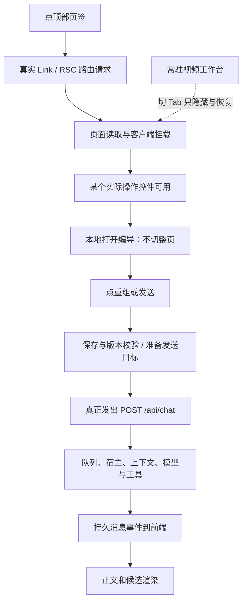

# T-1299 前端与桌面交互性能诊断

用户本轮最痛的是 **AI 对话**和**项目顶部切换 Tab**。目前最有把握的结论是：对话的长等待主要发生在 POST 之后，历史 trace 中前端在发请求前另有约一秒的重组准备与重复读；Tab 已保住原生视频实例，当前小项目的首次目标访问与暖切换仍有明显差别。应分别处理这些段落，不能用“前端缓存一下”概括全部问题。

本报告只诊断和提出未实施建议。当前源码 `cd4974febaf6536d6dfda46e89249896461f2cfe`；技能与项目均为 3.29.0，阶段为现有 BUILD 的分析任务。未改产品、测试、旧证据、模型设置或任务状态，未调用新模型、渲染、发布或当前 App。Root 保留方向裁决，执行按用户指定的 Sol 高思考；未启用加速选项，工具没有 service tier 读回，不能声称已技术验证极速开关。

## 看的是哪一段

本次数字统一指“点击至自动化检测到指定控件状态”的观察上界。具体选择器为 `getByRole(textbox, 第 1 段正文)` 的 visible＋editable；`getByRole(button, 复制公众号文章／导出分页 ZIP／保存工程)` 的 enabled；本地打开编导后 `getByRole(textbox, 我能帮你做什么)` 的 editable。按钮没有另外显式校验 visible、稳定、遮挡或实际点击完成业务，因此不称目标可交互；它也不是 TTI、FCP/LCP/INP。Playwright click/goto 结束只当相应动作记录。未测 CPU、RSS、安装版、真实大项目或长会话。

Root审查后核对锁定 Playwright 1.60.0 的真实消费者：`coreBundle.js:18298` 的 Frame.expect 先 one-shot，再调用 `retryWithProgressAndBackoff`；`:17979` 的退避为20/50/100/100/500ms，随后重复500ms。检测值含轮询量化、动作预检查、进程通信和断言开销，不能把某个856–903ms样本直接归为应用耗时。`getByRole`未传includeHidden，`:53474`默认省略该选项，注入role engine会排除`isElementHiddenForAria`，所以当前hidden/aria-hidden宿主通常不会匹配视频按钮；这减轻特定误匹配风险，仍不等于完整可操作验证。nativeAfter是在readyAt之后取样，但未单独记取样时刻，不能编出两者误差上界；只说取样时同host已hidden=false。后续若定位真实就绪，应在浏览器端用mutation/RAF记录可见＋disabled变化的同一时钟，并另做一次实际操作验证，不为修饰本轮数字扩大重跑。

## 实际证据与量化结果

### 新的无模型真实顶部 Link 补测

Root 批准后使用 `frontend/measure-tabs.cjs` 和 T1299 专用隔离 driver。新 owned 库/媒体/缓存、账号组、项目及脚本/文章/图文/视频空作品，单 Chrome、单 dev:true Next；浏览器硬拦 `/api/chat` 和外部来源。16 次顶部 Link 切换分两圈，并做一次 1280 本地开编导。运行 `frontend/runs/prepared-ef6d610a87d8684b`，脚本退出 0、宿主清理 0；4208 个绑定源码/产物 hash 未变，`modelSubmitted=false`、`userAppTouched=false`、越界清单为空。

首轮诊断曾误查默认未展示的富文本编辑器，并漏显式配置 Playwright expect，5 秒默认提前失败；这是诊断脚本错误，不是产品故障。首轮原日志、失败图与 cleanup=0/hash 不变保留在 `prepared-e7eae35d0fcfb017` 及 `measure-tabs-initial-selector-failure.log`。根据实际默认分镜视图改查“第 1 段正文”，并显式设置 expect 120 秒后才得到本次完整结果；未缩短产品执行预算、未改产品符合测试。

|真实路径与状态|点击至检测到指定控件状态|该次 RSC 请求完整时间|观察|
|---|---:|---:|---|
|本 run 首次进文章|1899ms|1240ms|含首次代码/页面挂载，不叫生产冷启动|
|本 run 首次进图文|1847ms|1301ms|新小稿面，检测到首个导出按钮 enabled|
|本 run 首次进视频|2347ms|1362ms|原生 shadow host 首次建立|
|视频→文章，第一次回切|857ms|64ms|视频 host 保持 id=1、隐藏|
|文章→视频，第一次返回|341ms|172ms|恢复同一 host，无新增工程/素材浏览器读|
|视频→图文，第一次回切|903ms|232ms|同 host 隐藏|
|图文→视频，第一次返回|261ms|140ms|恢复同一 host|
|第二圈三次返回视频|228、240、234ms|118、91、102ms|每次只发路由 GET，工程/素材重读为0|
|第二圈文章两次|872、361ms|181、75ms|相同小作品也有波动，样本不足以报生产 P95|
|第二圈图文两次|337、339ms|108、138ms|保留全部样本|
|两次回脚本|257、444ms|171、221ms|首段正文可编辑|
|1280“打开编导”|56.03ms|无项目路由 GET|3 个会话/feed 请求并发启动，打开不等其完成|

第一圈、第二圈各三次返回视频，共六次；见 `frontend/summary.json`、`frontend/tab-probe-summary.json` 的完整 17 行，避免把路径数量当抽样轮数。16/16 顶部切换都产生项目 RSC GET；`prefetch={false}` 的真实实现没有预取证据。不能据此认定“应全局开启预取”：这是 T1071 为避免未点击重页面工作而明确选择的基线。

当前原生是 shadow DOM 模块，不是 iframe，记录中 `iframes=0`。从首访视频起，全部后续步骤 host 始终 id=1、connected=true、shadowChildren=4；切到文章/图文/脚本仅 hidden=true。首次工程 GET 2 次，其中 1 次被 StrictMode 清理取消，之后六次返回工程 GET 与素材 GET 都为 0。此小项目中没有复现旧“切页重挂视频、再读同一素材”。未编辑媒体或测 Undo/Redo，不能把本次空工程补测冒充原 T1071 丰富工程验收。

顶层 LongTask 记录共 10 次，总 duration=805ms，最长133ms；它覆盖本页整个测量过程，包含初载和 dev 行为，没有按调用栈/步骤归因。它既不是 CPU 百分比，也不是 INP，不能据此认定 React、WASM 或某个组件是罪魁。

### 既有真实模型旅程与开发路由日志

T1298 e5d/78ec 成功运行因为 `trace=retain-on-failure` 没留下 trace；分析使用它们的 `next.log`、四轮 task/message JSON。两轮服务端日志分别264/257条请求，包含测试读回与轮询，不可统称产品自己发出的请求。8轮 execution `createdAt→updatedAt` 为37.461–75.169秒，含队列、宿主、模型、工具与结算；`POST /api/chat` 完整响应约37.8–76秒，不是首次响应头或首 token 时间。

历史 4969 run 在图文重组刷新后的抽屉可见性测试假设上失败，前三轮模型、采纳及读回完成；其保留 trace 可区分 `_apiRequest=true` 的测试 API 与真实浏览器。三个真实发送样本：

|操作|Playwright click 动作结束|点击开始→真正 POST /api/chat|
|---|---:|---:|
|公众号重组|353ms|917.74ms|
|公众号直接对话校正|71ms|131.09ms|
|图文重组|222ms|1074.19ms|

数据在 `frontend/send-preparation-timeline.json`，只用作历史 dev 实测，不伪装当前安装版分位值。`duration=-1` 的取消/未完成请求没有作为负耗时计算。

T1294 两轮设置/实聊的 server 日志分别275/278条请求；各有22次 `ingestion.douyin.status→AccountRequiredError`，因为测试组没有抖音账号，另各有一次故意制造的模型设置 CAS Conflict。它们是预期环境/测试分支，不是当前生产故障。T1296 dev 首次文章2.5秒中 next.js 1.844秒；图文1.799秒中 next.js 1.486秒；视频1.663秒中 next.js 1.393秒。相同 run 后续服务响应分别约133–190、168–245、142–152ms。这些首次值受开发编译影响很大，不能混入 App 性能结论。统计脚本及原路径在 `frontend/analyze_existing.py`、`existing-measurements.json`。

## 建议逐条落地，均未实施

以下时延数字是待校准的体验目标，不是本轮实测结论或新设hard-fail质量门。性能目标不能反过来阻止合法保存、生成、渲染、导出或大输出；先保正确性与安全降级，再比较同条件体验。

### 先显示真实工具阶段，公开正文按 phase 单独验证

**症状与依据：**用户点发送后等待几十秒。A 实测前置准备为0.13–1.07秒，明显解释不了37–75秒完整等待。B 对同一78ec隔离库的只读副本核验进一步发现：本次四个 external_tool 样本对应的持久 `execution_stream_events` 都在终态入库；Codex text delta 进入 progress，但 dispatcher 没装 supervisor 的 `onText`，HTTP 订阅的是持久事件。详见 `runtime/owned-snapshot-summary.json` 和 `runtime/derived-timeline.json`。这是“前端为何迟迟收不到可见正文”的高置信度跨层接线结论，B负责精确实现建议；没有中途首 token 观测，不能补报 TTFT。

**最小方向与风险：**以 B 终稿 `RUNTIME_PERFORMANCE.md` 为准：本次四个 `external_tool` 样本走终态批量路径，ordinary 工具流已有实时投影，不能描述为所有对话都缺流。最窄落点先投影已结算、身份可核的真实工具阶段，复用原持久流/去重机制，适配 external identity/proof，不伪改row kind；不直接将当前只含字符串的onText接到UI。若继续公开正文，必须携带thread/turn/item与明确允许公开的phase，未知phase和reasoning不展示。保留恢复、取消、候选完整schema/digest核验及用户采纳才落库。主要风险是重复展示、跨turn串流、取消后迟到回写及恢复重放。

**验证与成功标准（待校准体验目标）：**同一小稿/长稿的正常与恢复路径，对齐点击、POST、worker、已结算工具/允许公开phase事件、持久append、浏览器收到内容的时刻。可先评估“结算后1秒内看到真实工具阶段”的目标；若实现正文phase，另行测首段公开正文。全文/候选最终仍与精确回读一致；另报告总完成耗时，不能拿更早显示冒充模型提速。

### 合并重组按钮的同一次准备，保留最后的版本与归属校验

**症状与依据，置信度高：**重组比直接发送多等一段。当前 article/graphic `reorganize()`：先 get 当前稿检查脚本→`prepareForTurn()` 的 latest+exact→`openChat(autoSend)`→`sendPreparedRef` 又经 `prepareEditorTurn()` 调同一 latest+exact。干净稿逻辑上5个顺序读；直接对话校正为2个。4969 trace 实际看到两组 latest/exact 和0.918/1.074秒 POST 前等待；期间还有挂载读取，不能把整个差额全归这两次查询。

**具体路径：**`article-workbench.tsx:400`、`:287`；`graphic-post-workbench.tsx:118` 及其 reorganize；`draft-chat-request.tsx:298`；`ai-copilot-content.tsx:1787`。

**最小改动与风险：**让一次显式重组只有一份准备结果，跨异步边界核 editor/scope/generation/digest 未变后供同次发送使用；变了就重新准备，后端真实版本/CAS/权限核验照常做。不能删掉保存、精确版本校验，不能把旧目标缓存成执行真值。可能回归的是准备期间改字、切作品/组、并发保存、原保存未知结果恢复和双击发送。

**A/B 与待校准体验目标：**同一构建/小稿/长稿、干净/dirty各20次，记录点击→POST和每次顺序读数，先确认干净重组至少去掉一组重复 latest+exact，直接对话不倒退；建议暖小稿 POST 前 P95≤300ms（需实际可达性评估），全部并发/未知回执负族继续过门。若剩余主要在模型准入/挂载，继续按证据分段，不能靠砍校验追数字。

### 切页后，旧候选卡不要每次重做同一份历史来源准备

**症状与依据，置信度高于CPU推断：**用户切平台后，助手重挂会伴随旧消息卡的读取。4969 图文重组发送前，除了图文读取，实际有2次完成的 `ai.workCandidates.source` 与2次 `articles.versions.get`，对应会话中的两张旧公众号候选卡。`useAssistedWorkReview` 在挂载 effect 默认准备所有启用的文章/联合候选，与预览是否展开无关；当前源 `chat-work-editor-card.tsx:43–61` 可贯通该路径。不能据这些请求推断主线程卡了多久。

**最小改动与风险：**考虑按可见性延迟历史卡准备，或按 scope＋原conversation/sourceMessage/toolCall＋candidateDigest＋immutable exact version 做有界的同请求合并；实际采纳仍重核当前 owner/CAS/source receipt。不能缓存当前稿、删除历史、把新一轮来源冒充旧来源。风险是候选来源串组、错误启用采纳、原待确认请求选择丢失及缓存无界。

**A/B 与待校准体验目标：**同一真实历史分别含0/10/50张旧候选，切文章↔图文记录 source/exact 请求数、卡片准备时长、可见按钮及正确回执。建议已验证且未变化的不可变历史读只保留一份在途，离屏不再线性放大；采纳当前候选、旧候选冲突与原请求恢复仍准确。缓存是否引入要先过服务/所有权边界审核，不在本分析直接落地。

### Tab 的下一步是分开服务读取与客户端挂载，不是推翻当前常驻宿主

**症状与依据：**本次小工程首次目标状态检测约1.85–2.35秒；有的暖文章/图文回切约0.86–0.90秒，RSC为64/232ms。差值包含页面挂载、其他请求和断言轮询/通信，尚无独立调用栈，不能称已证客户端余量或CPU瓶颈。16次Link均重新要RSC，当前顶部`project-stage-stepper.tsx:159`明确关闭prefetch。`ProjectIdLayout.resolveRealProject`与文章页分别 getProject/listOutputs；图文/制作页也有多次真实读取，属于静态可核的重叠，尚无当前逐SQL/调用栈归因，不能直接算成数据库慢查询。

**已有修复关系：**T1071不是“纯未实施”。其已审四路径修复与旧RED→GREEN、工程GET12→0、句柄/Undo/Redo/MP4证据保留。当前显式 active 的 VideoStageChatDock、ProjectVideoSessionHost、visible传递仍在；本次实际同 host、返回视频工程/素材重读为0，未见这条复发。LED047本地打开编导后56ms检测到输入可编辑且无整页请求也成立。旧3710ms/RSC3304ms只作历史背景，不是本轮复现。

**最小改动与风险：**先补 RSC loader 子段、客户端 mount commit/首个控件状态检测、后台请求的同一时间轴。证实重叠后只在同一请求/同scope内合并身份和导航读取；保留当前稿新鲜读取与owner守卫。不要统一把全部页签改为prefetch=true：制作页现有 get-or-create 路径及大型原生资源加载需先核，未点击的页面不能提前制造写入/重工作。任何缓存/预取必须分清页面身份与可变作品数据。主要风险是切组串值、过期稿、视频未保存状态被重挂、预取副作用。

**A/B 与待校准体验目标：**使用同一打包候选和同一中性工程，初访/暖访各分开，至少20次真实顶栏点击；先保“同shadow host、原未保存输入/Undo/Redo、无额外工程/媒体读”，再比RSC和控件状态检测。建议暖小项目控件状态检测P95≤500ms、首次路由单列；未达不能靠隐藏或删掉稿面内容。后续安装版验证需要归属清楚的隔离安装候选和代表工程条件，不能用当前dev小样替代。

### 长会话渲染、大JSON和轮询：已有护栏有效，容量热点仍需profile后再改

**当前可证事实：**e5d/78ec四轮后都是8条消息、26个parts，紧凑JSON约92.9–93.9KB，尚不是大历史。`messages.map`再`parts.map`、候选schema解析/`editorCanonical(originalCandidate)`、`AssistedWorkSelection`中收起事实详情仍执行`JSON.stringify`，都存在随历史/事实量增长的静态工作量；`live-chat-session.ts`闲置回收会序列化闲置消息估算字节。但本轮没有profiling把133ms长任务归因到它们，不能称已证瓶颈。

`ChatToolTrace`已React.memo且展开后才生成JSON摘要，LED047这条已落实；消息`useChat` throttle=50ms。近期任务feed有pending屏障和epoch/卸载保护，只在有活动任务时interval；execution task卡循环是await顺序读且终态停。新小项目每次助手挂载观察到2次`ai.tasks.list`，dev StrictMode清理/重挂可解释，不能外推生产双轮询；也没有观察到持续在途叠加。LED061的闲置会话16个/4MiB上限、保护在途/等待状态仍在，现有回归通过不等于安装版内存已测。

**最小方向与风险：**先给0/10/50历史候选、短/长文本与关闭/展开详情做React commit/longtask/heap留存诊断；确认热点后再将稳定消息拆memo、按需挂载历史、将不可变候选canonical按真实身份memo、事实详情按展开渲染。轮询只对证实重复消费者做单在途合并，不取消合法后台任务或降低观察完整性。风险是滚动锚点/选区丢失、候选采纳按钮状态与来源不同步、过期响应回写、完成历史被错误清理。

**待校准体验目标：**历史增长时键入与本地打开面板单独测，暖目标操作P95≤100ms可作为交互目标而非当前事实；同一消费者慢请求时peak inflight=1、卸载后无状态回写、完成后interval停止，并保持历史可回读和所有合法大输出。只有可重复profile显示收益才实施；不为静态看着复杂重写整个聊天或视频编辑器。

## 交接与剩余缺证

执行证据都在本任务 `frontend/`，统计不读取现用 App/真实用户库；旧日志里的测试签名URL查询参数在派生统计中已脱敏。当前无在途浏览器/Next，源hash无变，浏览器槽已释放。尚缺安装版真实顶栏/输入延迟、用户大项目媒体与长会话容量、React/JS调用栈、CPU/RSS及中途首正文事件。这些是下一次经Root选择的最小验证对象，不是已成立故障或批准重构。
