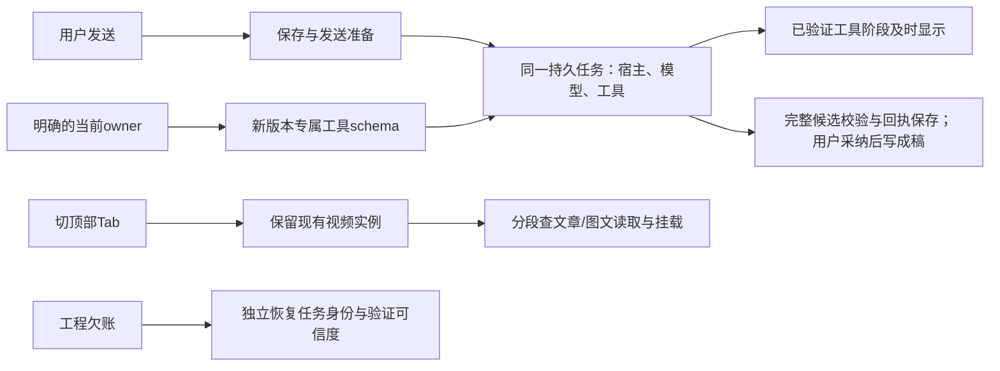

# T1299：先改善聊天等待，再按证据缩短耗时

用户最痛的是AI对话慢、顶部Tab切换慢。本轮已经找到两个具体入口：**Codex改稿过程中，已经结算的外部工具没有及时进入持久消息流；简单改稿仍携带很大的跨工作面工具参数目录。** 前者先改善反馈，后者可能减少模型输入；两者都不能在实施前承诺总耗时下降。切Tab的小项目补测证明视频实例复用仍有效，下一步应分段查文章/图文返回时的数据与挂载，不重做视频保活，也不盲目预取。

这是只读分析交付，**所有实现建议均未执行**。基线为`cd4974feb`；Root负责方向与逐条裁决，执行继续使用用户指定的GPT-6.1 Sol高思考代理。工具没有service tier读回，不能声称技术验证极速开关。未改生产/测试代码、旧任务状态或审核，未安装、部署、发布，也未调用新模型或操作现用App/用户库。

## 证据说明了什么

| 对象 | 已确认事实 | 不能据此推出什么 |
| --- | --- | --- |
| AI完整等待 | T1298八轮任务创建至更新为37.461–75.169秒，包含排队、宿主、模型、工具及结算 | 不是纯模型推理、首token或数据库耗时 |
| 反馈断点 | 78ec四轮持久事件都在终态写入；公众号首个真实工具约20.657秒预留、20.957秒结算，最终持久事件在53.360秒。该链是host的`external_tool`分支；已有ordinary工具实时投影及终态去重，不应重建另一套流 | 不是所有引擎、工具或HTTP都完全无进度；没有中途首正文观测，不能补报TTFT |
| 工具目录 | 四轮冻结52工具共336,290字节；`work.editor.propose`定义195,339字节，约58%，含文章/图文/视频联合schema | 冻结字节不等于每次最终wire/token或费用；缩小后实际提速待同条件实测 |
| token角标 | e5d首轮265,336输入、1,192输出、216,832缓存；这是该UI回合ephemeral thread累计，包含内部多次往返，UI再累加会话历史 | 不是最后一次内部请求用了265K，也不能把所有输入当新计费token |
| 发送准备 | 历史dev trace三样本点击开始至POST约918/131/1,074ms；当前重组静态链有两组重复latest/exact准备 | 不能解释全部37–75秒，也不能把整个前置差额都归给重复读取 |
| 顶部Tab | 新隔离小项目16次真实Link切换，另1次本地开编导；首次文章/图文/视频检测值约1.85–2.35秒，暖切换有波动。视频后续保持同一host、事后`hidden=false`恢复，工程/素材重读为0 | 数字仅为“点击至自动化检测到指定控件状态”的观察值，含expect轮询；enabled不等于可见、稳定、无遮挡或实际可操作，不是精确可交互时间/TTI；不能把与RSC差额直接归为CPU/客户端瓶颈 |

前端实测是dev模式、小作品与空视频工程，首次值受首次加载/编译影响；没有安装版、大素材项目、长会话CPU/heap、SQL分摊或生产分位数。诊断脚本首轮夹具错误、原失败与清理结果均保留，最终成功未覆盖它们。证据详见[前端报告](FRONTEND_PERFORMANCE.md)、[运行时报告](RUNTIME_PERFORMANCE.md)及各自小型JSON。

## 建议落地顺序与边界

以下是Root本轮逐条裁决后的方向，仍是**未实施建议**。实现时需另按准确范围形成SPEC/独审；本分析不新建实施任务，也不替旧任务结案。

| 顺序与用户收益 | 最小改动及证据 | 必须保留的边界 | 验证与依赖 |
| --- | --- | --- | --- |
| 先让聊天显示已经发生的工作 | 在外部工具真实结算处，通过现有持久事件体系适配受信external identity/proof；终态与已保存投影精确对账。先显示“已读取当前稿”等可证明阶段 | 不伪改call kind、不另建执行通道；重复/乱序、fence、取消迟到、重连、事务回滚均守原边界；候选完整校验后才可预览，采纳仍由backend service落库 | 同一事件记录结算、持久append、浏览器收到三时刻；可先设结算后1秒内见阶段的待验证目标。首次反馈与总完成耗时分别报。公开正文另需thread/turn/item/phase协议独审，未知phase/reasoning不公开，不能直连raw `onText` |
| 同时减少明确工作面的工具输入 | 按用户已选`editorTarget.owner`构造新版本`work.editor`专属schema及描述，先减最大联合定义；复用各owner完整能力 | 不关键词猜意图、不禁止合法跨能力；保能力发现、真实归属/ID/版本/digest、冻结旧任务与历史resolver，不重哈希旧任务 | 先核schema覆盖与字节数；再同模型、同稿、同操作、缓存冷热口径一致成组比较输入/缓存、首反馈、完成p50/p95。核脚本原稿及其他平台不变。仅体积下降时只报体积收益；依赖冻结工具版本/服务契约独审 |
| 接着消除同一次发送的重复准备 | 一次重组共享同turn准备结果，合并重复latest/exact；现有链路及历史trace均可指向 | dirty、version、group/scope、generation变化即失效；保存、执行时重验、CAS/owner检查仍在；未知结果继续原任务，不自动新发 | 干净/dirty稿、准备中改字、切组/切作品、并发保存、双击与未知恢复，核脚本原稿及其他平台不变；确认去掉一组重复读，再比较点击至POST。300ms等只能作为待评估目标，不能靠删校验追数字 |
| Tab先定位剩余段，再选小改动 | 保已有效视频常驻；观察文章/图文返回的重复data/history mount、RSC loader和route至可见控件段。旧候选卡挂载有重复source/exact读，可单列测0/10/50卡 | 不缓存可变当前稿真值、不删除历史、不制造预取写入；当前稿/权限新鲜度、切组隔离、未保存状态、Undo/Redo、原生实例仍保 | 先在生产模式、代表性隔离项目补同条件基准，明确visible/enabled/实际操作及检测误差；确认具体重复后再选请求合并、按需历史准备或有界缓存。未经测量不承诺收益、不统一开启prefetch |
| 工程治理独立推进 | T1111/T1125终态module、20审核链、15身份候选、重复门/前置环境逐项处理；T1297键盘缺陷单列原输入链 | 不抄receipt造绿、不删历史、不放宽绝对路径或权限、不批量关255任务；T1297不冒称聊天/tab慢因 | 先核终态定义的可审计归档/兼容迁移及全module读取，保路径逃逸/符号链接负例；旧审核逐链复核；门分段留原输出；按各原任务真实范围验收 |

阶段计时应随上述实际改动接入原诊断能力，记录task/call/attempt关联的安全时间及字节数，不保存raw prompt/凭据/私有推理。表中体验目标都需同条件对照后校准，**不是新增性能硬门，不得阻断原本合法的任务**。预检复用、长活host、并发扩容、数据库/轮询重构、渲染内核优化目前缺乏归因证据，不列为默认实现。沿用LED047本地打开/按需渲染、LED053期限与原任务身份、LED061有界单在途/取消和恢复边界，不通过缩预算、删历史或自动重发制造“快”。

## 欠账不能混成产品性能结论

[逐项欠账报告](DEBT_ANALYSIS.md)覆盖原29身份，每项列证据、用户影响、证伪方法、最小范围及必要验证：20审核绑定，8个lesson，1个backlog-health。原完整reconcile为33ERROR/0WARN，新增4项在T1298已真实闭合；29是保留的历史身份，并非本轮重新跑出的29项全量失败。本轮实际静态核仍有20审核错误、前端receipt错误0；health实际exit2，LED052因缺显式隔离PG配置在业务测试前exit1，其余7个lesson没有本轮复跑。因此既不能说全绿，也不能把29都称当前产品bug。

登记前255开放任务为188进行中、67待办，重复ID0。15项最后事件为complete但看板仍开放，其中存在历史编号/身份冲突，不能批量关闭；T1071导航已有四路径修复与历史证据，本轮同视频host补测支持保活仍有效，当前开放不代表从未实施。对其余记录未逐个运行时重验，不能编造“已完成/真实未完”的精确比例。

T1111/T1125均已终态，旧module绝对write路径仍在全局验证，阻断本任务progress generate及后续context-compile；这是真实工程入口问题，未证明影响App运行时。建议先审终态模块可追溯归档/兼容迁移，保原定义与审计，不放宽路径或手写progress。根因已有T1292承接；本轮只记证据，没有扩修或重开旧业务任务。

## 本轮验收口径与收尾

本轮交付是三份专项报告、这份综合结论及可追溯小证据；Root检查后才用taskctl完成T1299。review/frontend列保持`—`，不造UI回执。context-plan显式analysis入口通过；B未指定唯一步骤的一次调用exit2见运行时专项。progress generate及context-compile的真实exit2保留，Task Packet没有成功，不伪造派生状态。

本轮未改产品或测试源码，因此不执行构建/TDD/全suite来替分析凑PASS。没有扩跑全reconcile，依据是已登记的只读分析SPEC与Root范围决策，**并非用户单独下达了全量对账禁令**；不替代原重大产品任务应跑的全门。原33/29及当前静态20均保留，未作accepted-risk或全绿声明。

最小收尾为：核三份报告/29覆盖/255库存与实际写集，`git diff --check`；刷新本任务静态receipt核；执行一次`pmem sync`并保真实结果（不为既有progress错误伪造完成）；Root审后通过`taskctl complete T-1299`写真实分析完成事件；精确暂存本轮SPEC、报告、小证据及必要metadata后提交。无推送、安装、部署或发布；提交后仅必要静态audit与工作区检查，避免反复生成HEAD绑定。

收尾实录：Root已审三份专项与综合方向，要求的候选归属、脚本/其他平台不变及context-plan口径已补。机械coverage为29/29、登记前255唯一任务、禁止写集0；静态审核20、前端0、本任务新增0，diff检查通过。`taskctl complete`实际exit0，在2026-10-15 14:17:44.724Z将T1299置✅；它只代表分析交付完成。完成前pmem实际exit0显示256开放，完成后再同步实际exit0回255，PROJECT派生列表与当前状态一致，边界剩余仍5。原progress/context-compile失败和所有未验证范围保持原状。
