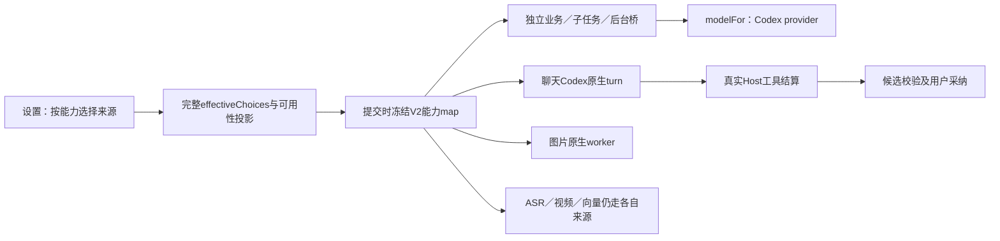

# T1300 Codex运行时能力盘点（只读，未作本轮功能验收）

盘点源码：`4eb101161`。本文件是B提供给SPEC独审的消费者索引，正式验收状态以`FUNCTION_MATRIX.md`为准。本轮未启动App、Next、浏览器、数据库或模型，未改生产源码。沿用GPT-6.1 Sol high；没有极速开关读回，不声称已技术验证其状态。

## 目前能下的结论

当前源码已经接上Codex的聊天、结构化生成、图像理解和图像生成/编辑中央路径。没有发现“选Codex仍统一要求供应商文本API”的当前证据；也没有因此证明各功能都可用。T1298四轮只覆盖文章/图文改稿，T1294只覆盖普通实聊；独立业务任务、工具子节点、后台桥、图片消费者必须分别验。

T1293历史安装记录指向`30cd8f68e6d7c539b3bd01d4e90d5f695526f86b`，早于T1294/T1298修复。**A当前只读双摘要已匹配T1294交付`8bbbe79d`**，见`INSTALLED_SOURCE_IDENTITY.json`；含T1294当时修复、未含后续`b6ef3314f`。所以不能说“仍是T1293旧包”；版本差异仍不能直接证明本次普通对话失败根因。

## 配置到实际消费者

1. 公共`settings.modelRouting.put/get`使用revision CAS，保存新选Codex项前检查真实状态；检查在偏好写事务外。`settings.service.ts:routingResource`正常组合根总返回完整六族`effectiveChoices`；无Codex缓存时能力是`unverified/CODEX_STATUS_UNAVAILABLE`，不是缺失choices。
2. `persistence-client.ts:prepareChatRouting`先读偏好和同次配置快照，再由实际聊天capability与text/vision mode调用`freezeSelectedModelRoutes`。显式聊天Codex只覆盖本轮主路由，不能把所有子能力强制改Codex。子能力按用户保存的族来源及父任务冻结map执行。
3. `contract/src/internal/model-routing.ts`注册56个mode+capability路由：text12、structured32、vision7、image2、video1、asr1、embedding1。相同能力不同mode不是同一个消费者。Codex锁定runtime `0.159.3`，冻结真实defaultModelId、原route digest与selectionRevision。
4. 独立结构化：`createStructuredBusinessExecutionService.prepare`冻结Skill/facets并绑定原ai_task → `model-worker-dispatcher`按实际mode读取原route → `resolveWorkerCredential` → `generateStructuredInWorker` → `modelFor(spec)` → `createCodexProviderModel`。CodexSpec不含供应商token。业务schema与完整候选校验保留；本轮不放宽解析。
5. 图像：`assertImageCapability/resolveImageSpec/resolveFrozenAssetSpec`选择image或vision自己的route；`runAssetInWorker`的Codex输入分支调用`generateCodexImage`，API分支保持原供应商。实际参考图必须经原owned file端口读取。
6. Codex可用性是安装、锁定版本、认证、真实模型能力及受控MCP/沙箱预检的合取；设置绿灯不代表所有功能已实测。`image.edit`在未确认前可以是unverified；不能伪签ready或改成别的模型。

## 各入口及当前消费者矩阵

下表“历史证据”只说明曾发生，**所有行本轮公共链仍待执行**。同一适配器族可用一个中性项目/稿件复用输入，但不同实际消费者不能用同一次聊天替代。

| 入口／任务或工具 | 实际能力键与mode | 当前消费者 | Codex之外的必要依赖／历史证据与缺口 |
| --- | --- | --- | --- |
| 普通助手、脚本/文章/图文/视频工作面对话 | text:copilot.assist；带图片则vision:copilot.assist | prepare-chat-reply→chat-assembly→external-chat-worker-run→runCodexNativeTurn | 合法group、conversation、Skill；作品target另核owner/version/digest。T1294普通实聊、T1298文章图文4轮旧证据；不能代签脚本/视频 |
| 选题、校准、定位、复盘、蒸馏聊天面 | text/vision:topic.generate、calibration.diagnose、positioning.generate、review.insights、knowledge.distill | chat-assembly SKILL_PRIMARY_CAPABILITY，仍走上述聊天原生turn | 各自上下文及权限；本轮分别核真实公开入口，不能当structured任务已验 |
| work.editor.read/propose | 根聊天能力；工具自身无新模型 | external-task-tool.service→chat-work-editor-tool-host→work-editor-candidate | 已保存target、scope与当前版本重读；只产候选，采纳由原backend owner。T1298仅文章图文真实链；production另验 |
| system.features/read/action.propose、context.*、history.read、skill.read等Host短读/候选 | 根聊天能力；不另选模型 | external工具宿主，逐次approve/lease/版本核验 | 原业务权限、真实ID；T1298实际子集，不代表所有system入口 |
| 聊天topic.enrich、topic.generate、positioning.generate、calibration.diagnose、review.analyze、knowledge.distill | structured:同名键；review.analyze节点的模型身份映射review.insights | external-chat-tools→ordinary tool→runChatGenerationInWorker→resolveChatGenerationCredential | 冻结Skill、原子节点输入和parent route；需代表性子节点实测，不得拿host候选替代 |
| 聊天script.hooks/script.draft | text:script.hooks/script.draft | external-chat-tools→runChatTextNodeInWorker；V2按子route选择modelFor | 原稿/结构和真实目标；legacy任务保持旧Codex协议；两入口均未由T1298覆盖 |
| 聊天web.read、material.gather、redfox.query | 根文本与相关工具实际模型/外部资源 | worker.web-read/research/redfox，各自受控资源端口 | 网络/RedFox凭据/受控浏览器或搜索依赖独立；Codex选择不提供第三方账号，缺依赖须准确报错 |
| 聊天cover.generate、material.generate、planning.thesis、review.script、research.autonomous、publish.package等提交工具 | host.task-submit，子任务按原route | executeAgenticTool→原任务服务/下列业务worker | 提交成功不等于子任务成功；候选/采纳/发布授权各守原边界，不能自动外发 |
| 独立脚本生成script.draft | structured:script.draft | application/generation/writing→script-business-adapter→script-worker-pipeline | 真实项目/脚本artifact、输入Skill及voiceover checkpoint；需实际生成/采纳刷新 |
| planning.thesis/contract/outline | structured:planning.thesis/contract/outline | writing适配器及planning-*适配器→通用结构化worker | 真实brief/contract/owner上下文；独立消费者待验 |
| script.review、publish.platform_adapt | structured:default、script.rewrite | writing→prepareScriptReviewContext/preparePlatformAdaptContext | 审核原事务提交，不绕成普通候选；平台适配守原授权 |
| review.analyze | structured:review.insights | writing→prepareReviewContext | 注意任务名与实际capability不同；需真实复盘主题输入 |
| topic.generate、scheduled.topic.daily、topic.enrich、topic.preference | structured:topic.generate/enrich/preference | discovery→topic/daily/topic-preference适配器→topic-worker-pipeline | daily有原run/供应/选择预算；代表定时路径需有界owned任务，不能重发旧unknown |
| calibration.diagnose/score、positioning.generate | structured:同名 | discovery→calibration-positioning-business-adapters | 真实校准输入/定位资料；不借普通聊天代验 |
| research.gather_material、material.match、script.source_similarity | structured:research.gather、material.match、default | discovery/media→research/target/script-similarity适配器 | 原材料读取/同稿来源核验；源码分支已接，不表示模型结果已过业务校验 |
| knowledge.classify/distill/relate、comment.qa-sift | structured:同名 | knowledge-generation-business-adapters→通用worker；distill可能分块多轮 | 原知识/评论归属，分块覆盖与父预算；T1238有真实知识分类旧证据，其余不能扩大 |
| 独立copilot.assist任务 | structured:copilot.assist | discovery→copilot-business-adapter | 与聊天chat.run不同消费者，需另验 |
| wechat.article-draft/text、graphic.post-text、publication.text | structured:copy.generate | writing/creative-post适配器 | 若UI已退役不恢复；对仍可达服务或宿主提交路径明确记录。T1296已删细碎调整按钮，不能为测试重新暴露 |
| cover.generate、graphic.card.generate | structured:copy.generate，随后image:image.generate/edit | cover-business-adapter、creative-post、cover-worker-run | image族单独选Codex/官方/自配；卡片/封面合法图需求、参考图和保存采纳是独立边界 |
| asset.classify、material.extract | vision:asset.classify、structured:script.draft | media→asset-processing-business-adapter→分类/提取worker | classify需真实图片；extract可能先ASR，音频来源单独配置。T1238有图像理解旧链，本轮未验 |
| video.decisions、production.rough-cut.propose | structured:video.scenes；粗剪structured:script.draft | video-decisions-business-adapter、modules/production/production-rough-cut-adapter及原视频worker | 原视频/逐字稿/试听门/候选采纳。场景流程内部video.cards/broll/subtitles/director按实际步骤冻结route；不可拿一次MP4导出代替模型能力 |
| reconstruct.project | structured:reconstruct.project | media→reconstruct-business-adapter | 必须真实imported来源/逐字稿；缺输入的拒绝不能误判Codex故障 |
| 内容雷达topic_preview / script_candidate | text:topic.generate（rewrite_only）；其余structured:topic.generate/script.draft | intelligence-generation-bridge→独立intelligence-generation-worker | 原claim/lease唯一，使用父冻结route/身份；策略/来源/ASR/网页依赖独立。T1238接线证据不替本轮雷达实际功能 |
| 后台benchmark、自作品归因、favorites处理 | structured:benchmark.teardown、topic.attribution、favorites.triage、knowledge.distill | scheduled-flywheel-execution→execution-flywheel-generation→独立worker | 原调度与平台授权、资源ID、ASR/知识输入；允许类型由sourceKind白名单约束，不绕过原调度归属 |
| exec.agentic.collect/material/research | text:agentic.collect/material/research | agentic-business-execution→runCodexAgenticInWorker | 自主工具与浏览器授权独立，network约束/continuous原deadline保留；另有provider入口，普通聊天不覆盖 |
| image.generate/image.edit | image:同名 | assetGenerationInput→runAssetInWorker→generateCodexImage | 实际PNG/引用图片、媒体入库候选与用户采纳；T1238真实图生成/编辑旧证据，本轮需真实消费者代表链 |
| transcribe.audio | asr:transcribe.audio；audio族official/self/local | resolveTranscribeRuntimeSpec→原ASR worker及owned lease | 不由Codex承接；云配置或冻结local Whisper及原安全回退，模型选择不替代ffmpeg/本地资源 |
| video.generate | video:video.generate；video族official/self | resolveVideoSpec→原multimodal video worker | 不由Codex承接；保持官方/自配视频服务与reference/job恢复。剪辑MP4导出是本地渲染另一功能 |
| knowledge.search.embed | embedding:knowledge.search.embed；embed族official/self | 当前组合根`embedTexts`直接抛KNOWLEDGE_EMBEDDING_DISABLED | T1294已停用显式向量能力；目录仅保历史兼容。本轮新付费向量链不适用，验证不成为聊天前置，不恢复UI或伪造可用 |
| TTS／新语音合成 | 当前56路由目录无TTS能力键 | 本轮范围未发现现役通用TTS供应商执行入口 | 不能宣称选Codex能TTS或虚构voice.generate；如实际入口宣称支持需先证其消费者/依赖，另补准确契约后评审 |
| chat.fallback | text:chat.fallback | resolveChatFallbackCredential→原可选stream备用 | Codex provider无doStream；当前特意投影unsupported并返回null，不是漏接主聊天；不为兜底偷偷切模型 |

## 故障候选与已排除项

| 项目 | 证据等级及当前结论 | 后续最小验证 |
| --- | --- | --- |
| 当前安装包是否含T1294/T1298修复 | A当前双hash精确匹配T1294交付，未含T1298后续修复；不能归为T1293旧包或直接断本次普通聊天根因 | 引用A当前身份文件；后续owned源测试与现用App未验分开 |
| 受控Codex预检/账号状态失败 | T1294历史真实account/read -32603，已精确同会话一次恢复；T1283原拒绝未复现，未知仍保留 | 新owned任务若失败保存task/call/error/protocol，不重发；不放宽预检 |
| 主Codex、子能力仍official/self且未配 | 这是V2按能力组合的合法可能，不能假定选一个引擎即全能力Codex | 读回choices、实际主/子route与call身份；仅在错路由的红证出现后窄修 |
| 后台/独立任务漏接 | 当前核中央structured、agentic、intelligence、flywheel均有Codex消费；尚缺本轮真实代表链 | 各消费者有界代表任务，不能只测copilot.assist |
| full snapshot中的official读取异常阻断Codex | 已排除所提直接异常路径：readChannelModelAuthority所有错误转local状态，快照逐能力resolver错误投影unavailable | 不据此修路由。额外配置读I/O成本仅静态可能，无计时不声称慢因 |
| legacy DTO缺effectiveChoices导致UI禁用 | A发现测试兼容组合；当前真实GET正常返回完整六族，缺缓存只改变cap状态 | A保受控负例；未证生产可达前不当本次用户根因 |
| host工具结果迟至终态可见 | T1299四样本实证＋当前external_tool分支源码确认 | 本轮已授权独立改动：复用既有流，工具结算后投影，终态去重对账 |
| work.editor.propose联合schema过大 | T1299冻结目录336290B，其中propose195339B；不是已测精确wire/token或慢因 | 本轮已授权owner专属新版本；测真实声明字节及同条件对照，不减少功能/预算 |

T1227“46项不可用”属于T1238之前的真实历史，不能当当前红测。本轮所有新结果必须有当前source/run、设置读回、task/call/owner、真实输出/失败与cleanup，不将静态接线写成PASS。

## 56个路由键逐项映射（穷尽静态库存）

本表补充上面的入口表，保证每个catalog键都有明确归属；目录键存在不等于现役入口存在。每键做冻结/解析断言；真实模型按不同执行族取有界代表样本，**不要求56次付费**。执行族：C=原生chat.run；S=独立model.structured/modelFor；N=聊天内部text/structured子节点；A=Codex agentic.run；I=独立intelligence桥；F=flywheel桥；V=视频多阶段；G=图片原生worker；O=保原非Codex消费者；X=保留/禁用/不支持，不伪造入口。对应源码函数和配置依赖见入口表。

| routeKey | 当前执行族／真实入口 | 本轮验证要求或不适用理由 |
| --- | --- | --- |
| text:topic.generate | C选题/画布；I雷达rewrite_only | C与I分别样本，不能互代 |
| text:calibration.diagnose | C校准聊天 | 每键冻结＋C族页面上下文 |
| text:positioning.generate | C定位聊天 | 每键冻结＋C族页面上下文 |
| text:review.insights | C复盘聊天 | 每键冻结＋C族页面上下文 |
| text:knowledge.distill | C蒸馏聊天 | 每键冻结＋C族页面上下文 |
| text:copilot.assist | C普通/项目工作面 | 普通及明确owner分别验 |
| text:script.hooks | N开场工具 | 独立子模型/parent route样本 |
| text:script.draft | N整稿工具 | 与S脚本管线区分 |
| text:agentic.collect | A采集自主任务 | A执行族＋原工具授权断言 |
| text:agentic.material | A素材自主任务 | 每键冻结，不以C代A |
| text:agentic.research | A研究自主任务 | A执行族＋受控浏览器授权 |
| text:chat.fallback | X原可选stream备用 | Codex明确unsupported/null，不是主聊天漏接 |
| structured:script.draft | S脚本/粗剪/material.extract；I脚本候选 | S与I分别；粗剪保试听/采纳 |
| structured:script.hooks | X目录保留；当前聊天hooks实用text键 | 冻结/解析断言，不虚构独立UI入口 |
| structured:planning.thesis | S论点策划 | 原brief/owner＋S族 |
| structured:planning.contract | S契约策划 | 原contract输入＋S族 |
| structured:planning.outline | S大纲策划 | 原brief/artifact＋S族 |
| structured:script.rewrite | S发布平台适配 | 原platform_adapt消费者 |
| structured:copy.generate | S文章/图文/卡片/封面/发布文案 | 仍可达各宿主输入断言；图子阶段另G |
| structured:review.insights | S复盘；N review.analyze模型身份 | 保任务/模板名与路由别名差异 |
| structured:review.analyze | N节点公开capability；身份resolver映射review.insights | 两键冻结及别名一致性；不称独立第2模型 |
| structured:topic.generate | S选题/每日选题；N；I策略雷达 | 共享S仍须daily准备与I桥断言 |
| structured:topic.enrich | S选题补全；N | N代表子节点＋S原任务绑定 |
| structured:topic.preference | S偏好学习 | S输入/候选归属 |
| structured:research.gather | S研究素材收集 | S材料上下文；外部依赖独立 |
| structured:copilot.assist | S独立copilot任务 | 不能用C聊天代验 |
| structured:calibration.diagnose | S校准诊断；N | 两种入口输入及冻结断言 |
| structured:calibration.score | S校准评分 | S业务schema |
| structured:positioning.generate | S定位；N | 两种入口输入及冻结断言 |
| structured:material.match | S素材匹配；V选料子阶段 | 不用硬编码规则替模型选择 |
| structured:reconstruct.project | S导入项目重构 | 缺真实imported输入记依赖，不改规则 |
| structured:default | S script.review/source_similarity等真实默认档 | 明确操作名与路由键，不补猜模型 |
| structured:knowledge.classify | S知识分类 | T1238旧实证；本轮S族代表及schema |
| structured:knowledge.distill | S/N分块蒸馏；F收藏蒸馏 | 父预算、分块及F桥分别断言 |
| structured:knowledge.relate | S知识关联 | 原atom权限＋S族 |
| structured:comment.qa-sift | S评论问答筛选 | 真实评论归属＋S族 |
| structured:video.scenes | V主场景步骤 | 真实视频阶段所需身份冻结 |
| structured:video.cards | V卡片阶段 | 仅原任务需要时调用，不能全目录强制生成 |
| structured:video.broll | V画面需求阶段 | 实际选料仍material.match |
| structured:video.subtitles | V字幕校正阶段 | 不是ASR供应商，保原逐字稿 |
| structured:video.director | V总编导阶段 | 与native工作面C工具候选区分 |
| structured:benchmark.teardown | F对标拆解 | 原调度claim/F代表，不创建重复采集 |
| structured:topic.attribution | F自作品归因 | sourceKind和原resource冻结 |
| structured:favorites.triage | F收藏分流 | 平台授权与ASR输入独立 |
| vision:topic.generate | C带图选题/画布 | vision族来源必须单独核 |
| vision:calibration.diagnose | C带图校准 | 每键冻结＋图像输入消费者 |
| vision:positioning.generate | C带图定位 | 每键冻结＋图像输入消费者 |
| vision:review.insights | C带图复盘 | 每键冻结＋图像输入消费者 |
| vision:knowledge.distill | C带图蒸馏 | 每键冻结＋图像输入消费者 |
| vision:copilot.assist | C带图普通/项目对话 | 代表真实图输入并核输出可读 |
| vision:asset.classify | S图片分类专门分支 | 真实图片，不以文本根对话代验 |
| image:image.generate | G素材/封面/卡片生成 | 真实图片文件+候选/采纳 |
| image:image.edit | G参考图编辑 | 原owned reference及真实输出；unverified不伪签 |
| video:video.generate | O官方/自配视频 | Codex不支持；保原配置，缺依赖单列 |
| asr:transcribe.audio | O官方/自配/本地Whisper | 原local回退与deadline，非Codex |
| embedding:knowledge.search.embed | X当前embedTexts禁用 | 历史目录兼容；不恢复为前置或发付费向量 |

目录外TTS没有当前能力键或已定位执行消费者；这只证明本轮盘点范围未找到，不宣称产品未来/所有插件绝无TTS。若用户可见入口存在，应先补精确消费者再定验收。
