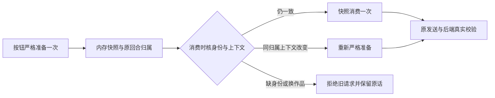

# T1300 前端实现独立复核

结论：**PASS，严格限于该提交的前端实现与已留存的受控测试证据。** 未发现开放的确定实现缺陷。这不是 production 浏览器、真实 Codex、视觉、40 个公开功能或 T1300 整体验收通过。

评审者：`/root/sol_spec_review`，独立于 A 实施者。实施期间仅只读检查与反馈，没有运行测试、模型、构建或浏览器。A 提交并明确释放后，才在 Root 授予的独占短窗口写本报告及机器回执；未修改产品或 metadata。

| 绑定对象 | 精确身份 |
| --- | --- |
| 受审提交 | `496d2d902b5afe7023dbdd709364a9e1f215b2c9` |
| 父提交／实现基线 | `787f46477666cac6c5ab543757a04c5bd258922a` |
| 主 SPEC SHA256 | `4a841aa69025c7b82c61ab6153dcb568b4520b506358450b578c80cbdc20d0aa` |
| delta SHA256 | `18dcbc684e407a34ce44be8a5a444cccfb66e0c870084d02e87fdd30e00e4840` |
| `FRONTEND_RESULT.md` SHA256 | `059c060c70319c215e05fe16027489733655566d32984d6b3e02a6f1a8fa010c` |
| `frontend/FROZEN_INPUTS.json` SHA256 | `5f0491abc2fccc68213c64c664e35623cc2f8f76c53fedfd2aa5a679346ef0b6` |
| `frontend/green-freeze.log` SHA256 | `5e73d18f4402e0bbbacbf19d6f57b2a9152a7facde734b8f2cf553795af4e85f` |

开始写报告前 HEAD 为受审提交且 `git status --short` 为空。独立核算 FROZEN_INPUTS 中 11 个源码／测试文件 SHA，全部一致：5 个产品文件、5 个对应测试改动，另一个原 `article-workbench-save-race.test.tsx` 仅运行、字节未改。提交其余内容为本轮测试日志、结果与 packet；未修改主 SPEC、矩阵、控制面、后端／worker／contract 或视频工作台。

## 实现判断

| 路径与关键位置 | 独立复核结果 |
| --- | --- |
| `draft-workbench/draft-chat-request.tsx:315-397` | ticket 是 Provider 内存对象身份，快照绑定注册 entry、完整机械指纹，原 turn 归属另保于 WeakMap。快照只消费一次；原请求重试仍必须核 nonce、scope、project、output、owner，不能通过丢 ticket 改成当前作品的普通准备。内容、版本、选区、写作偏好、dirty／generation 或注册变化使缓存失效并重新严格准备。 |
| 同文件 `343-359,380-394` | 等待前立即规范化上下文，等待后再核 entry／epoch／generation／dirty／上下文；避免同 generation 的共享对象迟改漏验。缺 preparation 或归属变化在任何 fresh prepare 前拒绝，因此旧文章按钮不能先保存另一个视频。重注册同归属可重新准备；无 ticket 的视频／普通聊天路径仍保留。 |
| 同文件 `289-302,320-336`；`copilot/ai-copilot-content.tsx:1069,1256,1800,1819,2144` | 注册／注销、Provider 卸载、请求替换、finally、取消、新会话及消费者卸载使快照失效。发送端每次保留原 ticket provenance；ticket 不进入显式 frozenContext、wire 或 storage。原 ownedWorkspace、session／epoch、pending guard 和已提交 UNKNOWN 原回执恢复路径没有被绕开。 |
| `article/article-workbench.tsx:287-305,402-413`；`projects/graphic-post-workbench.tsx:118-137,164-176` | 脚本门放在同一次 latest.scriptContext；删除按钮额外 latest，紧接自动发送复用仍有效的精确目标。普通无 ticket 准备不增加脚本要求。原 dirty 保存、UNKNOWN 原 body／key、精确版本读回及版本一致性检查保留。 |
| `copilot/chat-work-editor-card.tsx:43-120` | 只有 work.editor 文章历史来源参与按需读取／合并；key 包含 client、scope、来源位置、完整候选、output 与精确版本。失败删除，最后读者释放未完成项后不保留迟到缓存；活跃读不逐出，结算和 release 均收敛空闲历史到 32 项。work.creation 保持默认即时 fresh 读取。缓存不包含当前稿。 |
| 同文件 `122-135,293-319,359-364,503-524` | identity 变化即时使 ready 无效，原来源与精确版本未核对前不挂正文预览、不允许采纳；当前 dialog 内展示加载／错误，关闭后保留选择区。正式采纳仍使用原 assistantSource、expectedCurrentVersionId、原请求 key、后台服务和精确／当前版本读回。原 backend 来源、owner 与 CAS 没有因历史复用而减弱。 |

独立检查发现的跨组拒绝后重试丢 provenance、缺 preparation 先调用另一 owner prepare、work.creation 被共享缓存覆盖及 release 后容量不收敛，均已在受审提交关闭；没有以扩大服务／状态机或修改视频端口解决。来源错误在 modal 外的问题有明确 RED 后修正。原负例没有删除；来源不符测试仅增加按需预览与关闭 modal 的实际操作。

## 已核证据与准确限制

本评审读取 A 已发生的日志及对应源码断言，没有独立重跑。A 明确报告最终命令真实 exit0；TypeScript 日志为空，只能结合其执行回执判断，空文件自身不能证明通过。

| 验证 | 留存结果与边界 |
| --- | --- |
| 原六文件基线 | `baseline.log`：99 PASS。 |
| 最初 RED | `red.log`：12 FAIL／40 PASS。两工作台真实多读一次 latest、收起候选提前读取有行为红测；其余新 ticket 接口不存在的 TypeError 只是接口 RED，不能冒充全部并发／归属行为已在实现前失败。 |
| 独审 owner RED | `red-owner-before-prepare.log`：原端口实际 prepare=1、期望0；前一份错误类型探针失败另留。修后在最终 127 项中通过。 |
| modal 错误 RED | `red-preview-error-location.log`：限定当前 dialog 后真实失败；初探 toBeVisible 通过也保留，未冒充 RED。最终用 within(dialog) 核错误。 |
| 最终冻结回归 | `green-freeze.log`：6 文件／127 PASS，无未处理错误。覆盖真实 Provider→SDK 边界、首次挂载 StrictMode 自动发送一次、ticket 不进 wire/storage、跨组拒绝后重试仍零 POST、同归属失败恢复、换请求／卸载迟到、同 generation 选区／偏好、注册变化；历史并发、失败重试、身份隔离、40 项展开后收敛及 work.creation 原 fresh 默认。 |
| 原保存竞争 | 未改字节的 save-race 测试与原其他断言继续覆盖 UNKNOWN 原 body/key、CAS、精确读回、dirty、新输入及迟到采纳。它们是受控前端服务替身验证，不能称实际 production 保存已验。 |
| 类型／门卫 | A 报 frontend tsc exit0；boundary 日志无新增但仍保原5条，semantic 通过。`process-check.json` 记录无测试／tsc在途，原中断 PID99872不存在。 |

中间 attempt1 的错误／中断、attempt2 的 117 PASS／1 FAIL 和后续结果均保留，没有用最终绿覆盖。执行预算为 180 秒、retry=0；原超时 worker 的受管 TERM 不算通过。localstorage-file 警告与 jsdom 不实现导航仍可见，不能据此代签实际浏览器路由或操作。

这里证明局部重复请求消除与机械安全边界，不证明端到端耗时下降，也不证明普通 Codex 对话故障根因已定位。仍须在同一个新隔离 production／可安装候选上完成真实 Codex、浏览器加载与反馈时序、视觉及操作、三 owner 预览／采纳／刷新、脚本和另一平台、40 公开入口／56 键矩阵与完整 Gate。Tab／StageChatWrapper 未改，不把缺少实际测量的优化当作已交付收益。

candidate sidecar 的测试授权边界沿此前 `RUNTIME_IMPLEMENTATION_REVIEW.md` 所核原合同：专用 controller 真实签名、loopback／端口及启动 TTL 不变，私钥不传 sidecar／模型／诊断；每个功能单独真实断言。不证明真实激活、原生壳、Keychain／defaults 或壳 IPC，单 HOME 不构成这些隔离。本轮未启动候选或签 token。

本报告完成即释放独立报告写权，交 C 串行记录 metadata 与后续验收；不把局部 PASS 扩写为整任务完成。
