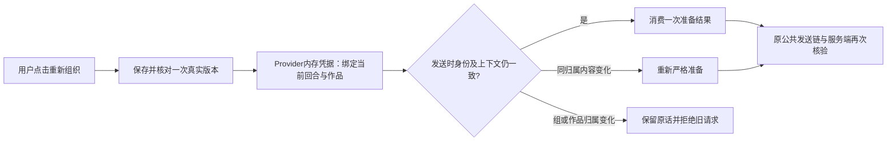

# T1300 前端实施结果

本轮只完成前端源码与聚焦回归，基线为 `787f46477666cac6c5ab543757a04c5bd258922a`，承接 B runtime `8e3f4724e`。没有运行浏览器、真实模型、构建或安装；普通对话故障根因、新 production 候选的各功能可用性、视觉与真实操作仍由后续同候选验收证明。不能把本报告写成 T1300 整体验收通过。

## 用户能得到的变化

公众号和图文点击“重新组织内容”，使用同次准备的精确稿件，不再在按钮前额外读取一次当前稿，也不在紧接着的自动发送中重复读取同一份已验证目标。干净稿的目标是一次有效 latest/exact；保存本身的原回执、精确版本与当前稿读回仍保留。当前脚本是否可用在该次 latest 中检查；普通自由对话不增加脚本门槛。

文章历史编辑候选在点击“预览改动”后才核对原来源和精确版本。收起时保留摘要；核对中或失败时，在当前预览弹窗显示状态；来源未核对前不挂载正文预览、不允许采纳。只有不可变 work.editor 来源参与同请求合并及有界历史复用；work.creation 保持原来的即时 fresh 读取。实际采纳继续由原后台归属、来源、当前版本/CAS和原请求回执校验。

## 机械边界

- 凭据仅 Provider 内存存在；request 只携带不含正文的 opaque symbol 对象，不写 transport、wire 或 storage。
- 绑定 turn/nonce、registry entry token、scope（组或旧账号）、project/output/owner、generation、精确版本和 documentDigest/正文机械指纹、selection 与 writingContext。等待前即冻结上下文指纹，避免同 generation 的偏好/选区改变被漏过。
- 快照只消费一次；同一原 request 重试仍每次核原 provenance。合法同归属明确准备失败可重新准备；跨组、项目、作品、owner或缺 preparation 的旧端口在任何另一个端口 prepare/保存前拒绝。无 ticket 的原视频/普通对话路径保留。
- 注册更换、注销、Provider 卸载、请求替换、发送 finally、取消/新会话/消费者卸载清理快照。过期异步结果不发布；取消和已提交 UNKNOWN 继续受原 ownedWorkspace/会话与原 receipt 恢复控制，不重新发模型任务。
- work.editor 历史读取以 client、scope、原 conversation/sourceMessage/toolCall、完整候选、output、精确版本为身份；同身份单在途，失败删除、末位订阅者卸载丢弃在途缓存；完成历史最多保留32项，活跃项结束及 release 归零时收敛。不能缓存当前稿或绕过采纳服务校验。
- 未修改 source/engine 准入、模型设置、StageChatWrapper、Tab prefetch、页面布局、后端/worker/contract或控制面。

## 当场验证与失败保留

所有 Vitest 正执行使用 `--retry=0 --maxWorkers=1 --testTimeout=180000 --hookTimeout=180000`。最终运行输入 SHA 在 [FROZEN_INPUTS.json](frontend/FROZEN_INPUTS.json)，原 Task Packet 字节未修改。

| 验证 | 真实结果与日志 |
| --- | --- |
| 原六测试文件基线 | 99 PASS；`frontend/baseline.log` |
| 准备去重、凭据接口、收起候选提前读取 RED | 12 FAIL / 40 PASS；`frontend/red.log`，其中两工作台分别实际多读一次 latest |
| 中间实现 attempt1 | 失败/中断，保 `frontend/green-attempt1.log`；误放的 requireScript 与漏导入 creationScopeKey 已修。该轮 worker PID99872 超过180秒后由受管命令仅 TERM 此测试进程，原 exec exit1，不能算完整回归 |
| 中间实现 attempt2 | 117 PASS / 1 FAIL；原 eager 错误测试未先关闭 modal 的查询需随按需行为调整，原断言未删；`frontend/green-attempt2.log` |
| 中间实现 attempt3 | 124 PASS；`frontend/green-attempt3.log` |
| 无 preparation owner 切换 RED | 首次探针核错错误类型失败（`frontend/red-owner-without-preparation.log`）；改为直接核禁止副作用后，真实 prepare=1、期望0（`frontend/red-owner-before-prepare.log`）。修为任何 fresh 前拒绝 |
| 预览错误位置 RED | 单纯 toBeVisible 初探通过但不足以证明在 modal 内（`frontend/preview-error-visibility-initial.log`）；限定当前 dialog 后真实 FAIL（`frontend/red-preview-error-location.log`），修为当前弹窗内显示核对/错误 |
| 最终冻结六文件整组 | 127 PASS / 6文件；`frontend/green-freeze.log`，retry=0，无未处理错误，真实退出0 |
| frontend TypeScript | `pnpm --dir frontend exec tsc --noEmit --incremental false`；`frontend/typecheck-freeze.log`，真实退出0；未运行会写 Next 生成物的 typegen/build |
| 物理边界 | `frontend/boundary-freeze.log`，无新增，原5条基线仍保留 |
| 语义边界 | `frontend/semantic-boundary-freeze.log`，通过 |

原始日志按原字节保留，因此 Git 对若干日志末尾空行给出 whitespace 提示；源码、测试、报告、JSON 与 Packet 的定向 `git diff --cached --check` 通过，不改写原始输出来消掉提示。

六文件为 article-workbench、graphic-post-workbench、draft-chat-request、chat-work-editor-card、ai-copilot-content 和 article-workbench-save-race 的原测试；最后一个仅运行，未改字节。覆盖原保存 UNKNOWN 同 body/key、CAS/精确读回、dirty/并发新输入；新增真实 Provider→发送端首次 StrictMode 自动发送、旧请求切组拒绝后重试零提交、同归属失败恢复、请求替换/卸载、同 generation 选区/偏好变化、注册更换及迟到结果；历史并发、失败重试、重挂、跨 scope/来源/version、40项展开后32项收敛，以及 work.creation 原 fresh 默认。

最终测试和 TypeScript 均已退出；`frontend/process-check.json` 的受管只读进程核查未见测试/tsc进程，原worker PID99872不存在。

日志中 localstorage-file 警告及 jsdom 不实现页面导航仍如实保留。没有据此签真实页面、原生壳或实际保存/导出通过，也没有据局部请求次数声称总耗时已经下降。

## 交接与剩余验证

Root 独立审核后，由 C 继续同一隔离 production/可安装候选的公开入口、真实模型、UI可见状态/操作、时间线、采纳/刷新/脚本和另一平台隔离，以及完整 build、LED047/053/058/061、timeout、orphan及全局 reconcile。这里不更新主矩阵、看板、完成事件或旧任务状态。
