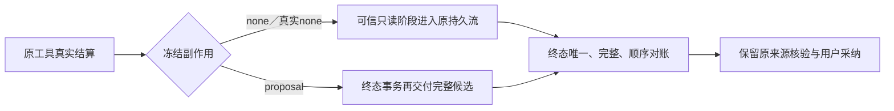

# T1300 运行时实现独立复核

结论：**PASS，严格限于本提交的 runtime 代码与已留存的受控测试证据。** 未发现开放的确定实现缺陷。它不代表真实 Codex 模型、浏览器阶段反馈、新 production 候选或 T1300 全功能验收通过。

评审者：`/root/sol_spec_review`，独立于 B 实施者。只读检查期间没有写文件、运行测试／模型／构建；B 提交并明确释放后，才在 Root 授予的短窗口写本报告和机器回执。没有改产品源码或控制面。

| 绑定对象 | 精确身份 |
| --- | --- |
| 受审提交 | `8e3f4724ed6a5625c37ef41c44bd3122f2927917` |
| 父提交／实现基线 | `d606c0c612197a5c5186d75175c0934c6d992536` |
| 已审主 SPEC SHA256 | `4a841aa69025c7b82c61ab6153dcb568b4520b506358450b578c80cbdc20d0aa` |
| 已审 delta SHA256 | `18dcbc684e407a34ce44be8a5a444cccfb66e0c870084d02e87fdd30e00e4840` |
| `RUNTIME_RESULT.md` SHA256 | `502870b74a9a659f68ef2f65d1df7fcb3d2062c6c930774f6bb1d8a6f95ba1fa` |
| `runtime/SOURCE_BINDING.json` SHA256 | `e0d6acac8bf2bc6c1541369cb0db71b01c421526abed0b9125e62d59402636ad` |
| `runtime/validation-results.json` SHA256 | `3f9f8445970e3d9332e1d506407a01539c3c03f51ec752cf22bac5f79a992c7f` |

开始写报告前，HEAD 正好是受审提交且 `git status --short` 为空。已独立核算 SOURCE_BINDING 的 24 个源码／测试文件 hash、validation-results 的 10 份日志 hash，全部一致。提交范围为已审 contract、backend runtime／原服务和对应测试／证据，没有 worker／IPC、前端工作面、生产配置或 metadata 改动。

## 代码复核结果

| 路径与关键位置 | 复核判断 |
| --- | --- |
| `contract/src/internal/chat-worker.ts:19`；`chat-turn-submission.service.ts:19,81-87,112` | 新 flag 为 optional，无旧输入默认值。新提交由 backend 赋值；已有 source 的 replay 在重新 assembly 前返回，未给旧冻结输入补 flag 或重算摘要。 |
| `external-task-tool.service.ts:24-26,87-121` | 原工具先结算，展示用独立受控事务；已 settled 原 ID 重入只补投影，不再 execute。unknown 保留未知且拒绝新调用；none 返回 proposal／unknown／committed 不能作为合法结果放行。展示异常只记稳定诊断，终态可按已结算事实恢复。 |
| `chat-tool-stream-chunks.ts:28-53`；`chat-tool-stream-projection.service.ts:118-132` | 新投影重核任务／账号组／会话映射、父 external call、冻结协议、native thread／turn、原 Host 工具权限族、proof 的完整身份／version／digest 和效果上界。仅 definition none 且真实 sideEffect none 提前投影；不接受 worker 自报任意 chunk。原 lease 守 attempt／fence，settlement 不产生新执行权。 |
| `chat-tool-stream-chunks.ts:56-69` | 在原 task 行锁事务内按整个 task 的 toolCallId／approvalId 收集输出，核真实 call 归属、完整 JSON、callIndex、唯一输入／输出及输入先于所有输出。先前独审发现的“别 call 重复输出漏看”和“反序仍 completeBefore”均已修复；已有输出却缺输入不能后补成反序成功。全缺且事实一致才可安全补流，finish 后不新追加。 |
| `external-chat-turn.service.ts:207-211,232-241,250` | 新版终态按同一可信构造核对；none 已投影不重复追加，缺早期流可恢复并记 recovered_at_finish。所有 proposal 在终态原事务首次 append，明确 deferred_proposal；没有提前挂可预览／可采纳卡的新增路径。旧无 flag 分支保留。 |
| `work-editor.ts:82-90`；`chat-work-editor-protocol.ts:6-22`；`chat-tools.ts:4089-4097` | 三 owner 保各自完整 typed patch／snapshot，production 仍含 markdown。新前缀由明确 editorTarget.owner 选择；旧 director v1／v2／markdown 分支及完整定义 fixture 保留。未知、混版、重复工具和 owner 不符拒绝，不用正文关键词决定 owner。 |
| `chat-assembly.ts:80,279`；`chat-turn-preparation.ts:15,24,34` | 内层工具原型和外层第二次冻结使用同一 owner 选项，目标仍经真实读取及相等校验。 |
| `chat-work-editor-tool-host.ts:24,43,50-51`；`work-candidate-source.service.ts:43-60` | Host、外层 adapter.current 与文章来源 service 共用冻结协议选择，并按冻结定义严格重建。第三处来源消费者没有遗漏；原 proof／history／digest／归属／正式采纳检查保留，文章来源 source API 没有扩大接受图文／native。 |

## 已核测试证据及限制

以下是读取 B 已发生的日志、源码断言和退出记录所得，本评审者未独立重跑；类型日志为空时，只能由对应 validation-results 的 exitCode=0 记录证明该次退出，空文件本身不是通过证据。

| 受控验证 | 已留结果与覆盖范围 |
| --- | --- |
| contract | 3 文件／21 项通过；新 flag／owner schema 及原合同。 |
| backend | 8 文件／95 项通过，含当前 56 路由键逐项冻结断言；这是受控目录／解析验证，不是 56 个真实功能已执行。 |
| external 生命周期 | `green-external-lifecycle.log` 1 文件／17 项通过。源码第 99-140 行覆盖别 call 输出、反序、缺输入、篡改 proof、none→proposal 和 native 协议／线程；第 143-195 行补真实 append 事务 rollback、原 ID／finish 恢复 execute 一次、同 ID 并发、旧 fence、取消／换 fence 迟到、诊断 sink 抛错及安全字段。追加 6 项与前面 95 项有重叠，不重复把 17 全计作新增。 |
| prepare／assembly／director | 3 文件／122 项通过；三 owner 内外定义一致、已冻结目标／写作资料、原方法等回归。 |
| 公共 worker 协议链 | 8 项通过：Pi／Codex × director-v1／v2／markdown-v1／owner-v1。核真实 submit／claim／Host／ledger／文章来源／采纳／幂等／精确读回和 CAS。Pi 使用 localhost 供应商协议替身，Codex 为原宿主协议测试；均不是真实上游模型。图文／native 在契约、Host approval 与 prepare 被覆盖，不能拿文章链代签其实际预览和采纳。 |
| 类型与门卫 | B 记录 backend／contract 类型 exit0；boundary 仍原 5 条、无新增，semantic 和 timeout exit0；日志 hash 与记录相符。没有由此声称完整 build、orphan、frontend 或全局 reconcile 已通过。 |

红测与失败口径准确：contract／external 的行为 RED 保留；owner 首次 ENOENT 只是夹具路径失败，不算 owner 行为红测。旧定义捕获的 sandbox／CJS 失败和旧测试前缀失配也保留，没有补拍历史 PASS。生命周期是追加回归，不伪称这些用例在实现前已红。

声明字节测量有三类旧完整定义相等证据，新两工具总字节分别为 article 25340、graphic 17638、production 157896；这只是实际声明 UTF8 大小，不是完整 wire／token／模型耗时，不证明普通对话故障根因或端到端提速。

尚需后续统一候选验收：真实 Codex 的普通与带图聊天、三 owner 的真实候选／预览／采纳／刷新、none 阶段浏览器接收早于 finish、各公开用户功能／独立执行族、真实媒体产物及同条件性能观察。40 功能／56 键矩阵、隔离 production 可安装候选、完整 Gate 与全局差异收尾仍未完成，不能以本报告完成 T1300。

## 后续 candidate sidecar 的测试授权模式

本节仅说明 Root 已接受的验证环境选择，**没有在本轮启动 candidate 或签发 token**。可由专用本地构建／验证 controller 沿现有 build_smoke helper 签真实测试 token，在隔离产物 sidecar 中做已授权功能断言；不修改安全合同或添加 bypass。

原文依据为 `docs/superpowers/specs/2026-08-02-desktop-verdict-basic-hardening.md:47` 的“smoke 驱动进程”使用真实私钥签“有效期不超过 5 分钟的 licensed 测试 token”，第 64、66-70、117、142 行进一步限定：私钥只在 controller／专用签名进程及获准构建进程，实际 Sidecar、模型、普通诊断子进程不得继承，日志／证据不得泄漏。`verdict-key-material.mjs:139-189` 保 canonical 密钥配对、真实 Ed25519、端口绑定与最多 5 分钟；`runtime-smoke.mjs:11-34` 保 loopback／production／owned DB、media、workspace 及 child env 剥离。

准确限制如下：

- `instrumentation.ts:29-32` 启动时调用验签；`verdict-token-gate.ts:64-81,127` 检查当时有效期／端口并设置 licensed。`build_smoke` 没有独立业务 scope 消费者，5 分钟是新进程启动接纳期限，不是每请求或整套功能测试执行上限；不能因此缩持久任务期限、续签重发原任务或改 TTL。
- `proxy.ts:88-102` 的握手默认拒绝、后续 session／owner／backend 及 Codex／第三方真实授权仍保留。测试 token 不证明真实激活、Growth 额度、付费上游能力或用户现用配置已验。
- 每项功能必须真实断言；runtime-smoke 本身接受若干 401／400／404 来证明“不崩”，这些结果不能算功能成功。证据须标为“production candidate sidecar 测试授权模式”，绑定 binary／sidecar／包 hash、启动端点、driver 和 run。
- 只测 candidate sidecar 与浏览器，不证明原生 Tauri 启动、安装／激活、Keychain／defaults、壳 IPC 或真机原生 UI。单独 HOME 无法隔离 Keychain／defaults，正式现用 App、用户数据库和原作品／设置保持本轮不动。

本报告完成即释放独立报告写权，由 C 串行接手 metadata 与后续 frontend 派发，不把本局部 PASS 扩写为整任务完成。
