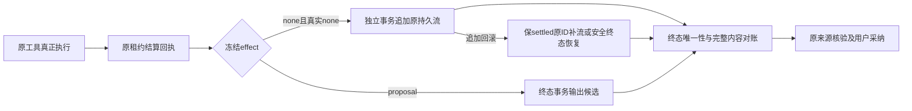

# T1300 B运行时实现结果

基线`d606c0c612197a5c5186d75175c0934c6d992536`，按C正式runtime lease与Task Packet串行修改；未写控制面、前端workbench、worker/IPC、模型路由准入或生产配置。B此次只完成局部实现和受控验证，**T1300整体尚未完成**：新production候选、真实Codex模型及各公开功能的逐项旅程由后续统一候选阶段执行。本轮未启动用户App、未打开用户数据库、未读取复制密钥、未重发原unknown任务。

## 实现及安全边界

- 新任务由backend冻结`externalToolProjectionVersion:1`，旧输入没有默认值，不重算历史摘要。只有原Host的`definition.effect=none`且回执`sideEffect=none`提前输出；全部proposal，包括work.editor/work.creation/system/canvas，完整output仍在终态事务发送。
- 复用ordinary的工具结果协议和持久事件表，提取共享chunk构造；external增加受信proof/definition/version/inputDigest/父协议与native线程回合校验。整个task内按toolCallId/approvalId检查唯一归属、完整JSON、输入先于全部输出；冲突/篡改拒绝，不能补成成功。早期none丢流可以安全finish恢复，诊断为`recovered_at_finish`，不能冒称实时反馈通过；proposal明确`deferred_proposal`。
- 工具执行与展示为两笔受控事务：第二笔回滚不丢第一笔settled回执。原ID重入只补展示，不重新执行。诊断只含稳定身份、阶段、时戳/字节数；sink异常不影响任务。无首token、preflight或CPU精确观测，仍记缺测。
- 三owner按用户明确的editorTarget选择新专属schema及前缀；保该owner完整typed patch/snapshot及production markdown能力。内层assembly、外层turn-preparation、Host/adapter和文章来源resolver共用同一明确协议选择；旧director-v1/v2/markdown-v1完整schema/描述/指纹保持，新旧混版、未知协议、跨owner拒绝。文章来源专用source API没有扩给图文/native。

## 当场红测及限度

生产修改前：`runtime/red-contract.log`实际exit1，2项期望失败（新版本字段被拒绝、owner schema缺失），其余16项通过；`runtime/red-external-tool.log`实际exit1，1项期望失败（新冻结字段/早期事件缺失），另2项通过。源码尚无新行为时已经保存三族完整旧定义，见`legacy-definitions.json.gz`。

`red-owner-definitions.log`虽发生在owner实现前，失败原因是测试fixture相对路径多一级的ENOENT，**不算owner行为红测**。路径修正后完整快照相等及新owner断言通过。后补的生命周期/篡改/来源兼容用例标为追加回归，没有补拍前置RED。

捕获快照首次tsx CLI受sandbox pipe监听EPERM；第二次直接loader因`.ts`在无type模块目录按CJS解析，顶层await失败；改为`.mts`后使用Node loader实际exit0。两次真实失败日志保留，不换业务语义。公共worker测试的owned localhost监听按必要边界获提升；只用协议替身和新内存库，无真实模型。

## 验证结果

| 结果 | 实际证据 |
| --- | --- |
| contract三文件21项，exit0 | `runtime/green-contract-attempt1.log` |
| backend八文件95项，exit0；含全部56路由键逐项冻结/解析断言 | `runtime/green-backend-final.log` |
| 新external生命周期17项，exit0（其中6项在上述95项后追加；其余重叠，不重复计数） | `runtime/green-external-lifecycle.log` |
| turn-preparation/assembly/director三文件122项，exit0 | `runtime/green-preparation-attempt2.log` |
| Pi/Codex × director-v1/v2/markdown-v1/owner-v1 共8条隔离公共worker协议链，exit0 | `runtime/green-public-worker-attempt1.log`；真实submit/claim/Host/ledger/source/adopt/CAS/读回，无付费模型 |
| backend与contract类型检查 | `runtime/typecheck-backend-final.log`、`typecheck-contract.log`均exit0；生命周期追加测试类型复核见`typecheck-backend-lifecycle.log`及`validation-results.json` |
| boundary、semantic、timeout策略，均exit0 | `runtime/boundary.log`保原5基线且无新增；`semantic-boundary.log`；`timeout-policy.log` |

新external专属负例位于`backend/src/modules/ai/external-task-tool.service.test.ts`：别call重复output、反序sequence、缺输入已有输出、proof版本被改、none伪proposal、native错绑定/错协议、真实append事务回滚→同ID/finish恢复、并发同ID、旧fence、取消/换fence后迟到、诊断sink抛错。只读真实结算后可以收到流，候选在终态前没有output；回滚/并发/恢复均断言execute一次。取消/换fence是新隔离夹具的受控状态边界，不冒完整原生App取消验收。

公共worker的8链具体在`backend/src/integration/chat-work-editor-worker.test.ts`：文章长候选、旧三协议和新owner的Host/adapter/文章来源三处定义一致；原source读回、用户采纳、重复采纳幂等、刷新读回/后续手改/CAS拒绝，不通过重发模型恢复。Pi分支是真实localhost供应商协议替身及worker；Codex分支是原宿主协议测试，**都不冒真实上游模型或整个App验收**。图文/native的新owner在契约、Host外层approval及prepare装配通过，真实三工作面及图文/native预览/采纳仍由后续统一production候选旅程完成，不能拿文章链代签。

## 实际声明字节

`runtime/owner-definition-measurements.json`为实际新工具声明UTF8测量；旧三族`equalBeforeChange=true`，同时保完整定义序列化SHA。以下是read+propose两项总字节，不是全部工具目录、最终wire、token或模型耗时。

| 声明 | 两工具总字节 | propose schema字节 |
| --- | ---: | ---: |
| 旧markdown-v1 | 197521 | 192692 |
| wechat_article新owner | 25340 | 23377 |
| graphic_post新owner | 17638 | 15626 |
| production新owner | 157896 | 155033 |

这证明输入声明变窄，不能据此声称对话恢复或上游耗时下降。反馈提前、输入缩小、总耗时改善需要在同一production候选真实模型旅程分别记录。旧安装包、当前源码、新候选继续分环境；当前普通聊天故障根因尚不能由安装版本差异直接判定。

B未push、安装或发布。受测文件SHA、具体命令/退出和资源清理记录见`runtime/validation-results.json`及`runtime/SOURCE_BINDING.json`；Task Packet不手改、不作为代码自引用提交。Root/C独立复核后再推进后续步骤和整体收尾。
