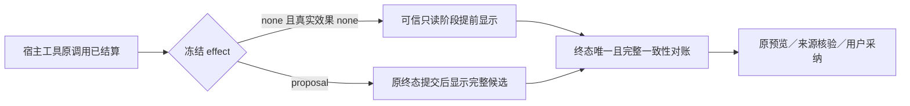

# T1300 独立 SPEC／契约评审

正式结论：**PASS（SPEC／契约方案评审；不是实现或功能验收）。**

已审最终 SPEC SHA256：`220aa12786f59be04d81391eadb496c671674d1bdfa6ace98cb0f6a9b3f94b7a`。C 锁定后，本评审者重新读取主 SPEC、完整功能矩阵及全部六份关联输入，独立计算七个文件 SHA256，均与 `SPEC_INPUT_LOCK.json` 相符。没有未解决的 blocker／major finding；可由 C 通过 reviewctl 登记本独立结果，再满足任务／packet／lease 前置后实施。

评审者：`/root/sol_spec_review`。本评审者不撰写 SPEC、不实施产品或控制面改动，仅阅读当前源码与文档，并独立反馈。没有运行产品测试、模型或构建；本报告不证明当前功能已通过。

初读环境为源码 `4eb101161fa25f1a446fd84a67817cd904497d65`；技能与项目流程版本均为 `3.29.0`。已读取 AGENTS、BACKLOG、任务 SPEC、PROJECT、PROJECT_CONTEXT、产品流程技能、阶段路由与物理架构。本轮评审是在维护期 BUILD 内审必要 CONTRACT 变化，不能在输入仍留候选字段时授权生产编辑。

初读输入 SHA256：

| 文件 | SHA256 |
| --- | --- |
| `docs/features/t1300-codex-functionality-and-performance.md` | `860c74f7f4cef3e09521dbbd0ec33d30b344b407d769bc037a5fec251f34c97b` |
| `docs/verification/t1300/FUNCTION_MATRIX.md` | `3817381f739267addf196f4374dd27f4e33ff1b30000cde1efb64a0923029e73` |
| `docs/verification/t1300/workflow-preflight.json` | `a7d09b97d25350ce0d5ce065fe9820a8777cc1a16967e7922263263b5d7d5766` |

以下保留锁审前的草稿反馈原义，最终逐项处理结果见后表。这些不是正式首轮未关闭 finding，也不是要求尚未实施的 SPEC 已有 TDD 红绿证据。

| 编号 | 当前消费者证据与风险 | 最小闭合方式 |
| --- | --- | --- |
| S-01 | `external-chat-turn.service.ts:235-248` 仅 ordinary 分支核唯一早期输入／输出；external 分支终态无条件追加。`external-task-tool.service.ts:94-113` 目前结算后直接返回，不提前投影。若只加 append，终态会重复卡片；若只去重而不对账，早期流与正式结果可能不一致。 | 冻结新投影版本及字段位置；新版本从宿主已结算调用、冻结 definition、原输入 proof 共同重建输入和输出。锁定 task／call／turn／toolCall／toolName／toolVersion／inputDigest 的一致性、callIndex／全局 sequence、幂等和终态唯一一致性。覆盖缺 proof、错版本、重复／乱序／篡改、unknown、不完整回执、原子回滚、取消迟到及 fence。可安全恢复的阶段流缺失不得单独让原可完成聊天硬失败，但不能计为 finish 前反馈 PASS。 |
| S-02 | `chat-work-editor-tool-host.ts:23,42,49-50` 及 `chat-host-tool-adapter.ts:31-55` 都按当前定义重建并核 fingerprint。`chat-tool-definitions.ts:97-100` 把描述、schema、effect 绑定版本。仅新 revision 而覆写公共 schema／描述，会使旧冻结任务无法恢复。 | 明确新 owner 版本、提交装配与两层 resolver 的同一版本选择；保留原 work-director v1／v2 和 markdown v1 的 schema／描述／hash。混合、未知版本必须明确拒绝；历史不得重哈希。旧版本固定快照和 resolver 回归覆盖全部 owner，新增 owner schema 跨 owner 拒绝及合法跨能力路径。 |
| S-03 | 当前矩阵 TOPIC／TOOLS／MEDIA 是集合行，尚不能核清用户要求的模块功能覆盖。`contract/src/internal/model-routing.ts:35-56` 当前目录有 56 个 route key；`chat-tool-definitions.ts:29-48,96` 显示 structured、hooks、task-submit、web／research／redfox 等不同执行族，普通聊天不能代表这些族。 | 用当前能力键及实际消费者做穷尽覆盖索引，每键记录公共入口或内部复用、来源、适用／阻断／未验及理由，关联矩阵行和证据。共享执行族可映射同一真实模型样本，不要求每键都调用收费模型。TTS 不在此路由目录中，单独确认其实际消费者和配置。 |
| S-04 | `article-workbench.tsx:285-294` 的 target 含 writingContext 与 selection；`draft-chat-request.tsx:276-315` 有编辑器 entry 身份与 generation 守卫。仅按 generation／digest 缓存，可能复用同稿但新选区、新偏好或重新注册 editor 的旧 target。保存也有独立 pending／unknown 恢复。 | 锁定复用仅限同一次请求／turn，绑定 editor 注册身份、scope／group／project／output／owner、generation、version／digest，以及 selection／writingContext；失效时重走原 prepare。保留保存的原回执、精确读回、CAS 和服务端当前真值，不把 UI 缓存提升为执行权限。明确被消费一次、失败和卸载的清理规则。 |
| S-05 | SOURCE 初稿只要求身份核验，尚未限定如何将已安装产物、当前源码和后续隔离候选的功能结果关联。源码包含 T1298 修复不证明用户当前安装版已包含，也不证明版本差异就是故障根因。 | 分别记录源码 HEAD／dirty、安装文件标识／hash／来源清单和可信度、隔离候选构建输入／manifest／hash／启动端点，真实公共 run 明确绑定实际候选。无法确定修复是否包含时标 UNKNOWN，不猜根因，不替换正式安装位置或读取用户库。 |
| S-06 | `work-candidate-source.service.ts:42-58` 独立固定调用通用 `buildChatTools` 并重建版本／参数，再要求与冻结定义完全相等。新 owner schema 即使在 worker host resolver 正确恢复，文章来源与采纳仍会在这里被版本不符拒绝。B 初稿的精确生产写集未包含此消费者。 | 来源 service 也使用同一冻结协议解析与严格重建，不用当前默认反推历史协议；来源读取／正式 adoption 集成覆盖 director v1／v2、markdown v1、新 owner，保 digest／scope／history／input proof 和正式写权限。精确补入 SPEC 写集与对应原测试，不放宽原版本相等检查。 |
| S-07 | `ai-copilot-content.tsx:2874-2883` 收到成功 output 即挂 proposal 卡。`chat-work-editor-card.tsx:43-61` 挂载即查来源，依赖不含 finish；`:76` 非文章来源默认 review ready；`:367,374-380` 的预览／采纳缺 turn 完成条件。早发完整 proposal 会让 graphic／native／system／canvas 等在 turn 仍执行时允许写，早期 source 请求失败也可能到终态后不重查。 | 冻结早期可读阶段与可操作候选的区别：none 短读按原事实展示；proposal 完整结果可进入持久流，但 UI 必须在原 task／turn 完成及所需真实来源／候选回执核对后才放行可操作卡。明确 finish／恢复后重核，不假报候选损坏、不跳 source 校验。覆盖文章、图文、native、work.creation 与 system／canvas，finish 前采纳零写，取消／unknown 不启用，完成／重连后可预览与采纳。 |

流程迁移方向初读无异议，但正式结论仍需锁定精确迁移输入：`progress.mjs:104-147` 读取并校验所有 `.modules`，`context-compile.mjs:269-282` 只从现役 `.modules` 寻 task binding。保原完整配置字节、两 module JSON、事件原行及 hash 后，仅显式移出 T1111／T1125，能够解除已定位的前置阻断而无需修改通用路径守卫。`events.ndjson:1272,1300` 与 `BACKLOG-archive.md:1072,1062` 能对应真实完成；迁移时仍须重新检查末事件、任务非活动、无 dependency／claim／lease，并验证其余模块不变、归档不能 claim／compile。当前报告没有执行迁移或路径负例，不能把此判断当迁移验收。

候选来源时序的精确事实：不能笼统说“只有终态才有来源”。`chat-turn-submission.service.ts:133` 在提交时已经把 chatTaskId 写入用户源消息；`work-candidate-source.service.ts:118-120` 读取这条用户消息，`:87` 允许父 external call 为 started／settled；前端 `ai-copilot-content.tsx:1188-1189,1239-1244` 能由响应头关联该原用户消息。终态 assistant 消息在 commit 创建，但并非所有来源服务的唯一读取点。S-07 要求的是保护原任务仍执行时的交互／正式写入时机，并确保实际来源读回完整，不能编造“缺 assistant 必然没有 source”的根因。

最终锁定输入与逐项结果如下。

| 文件 | 本评审者独立核算 SHA256 |
| --- | --- |
| `docs/features/t1300-codex-functionality-and-performance.md` | `220aa12786f59be04d81391eadb496c671674d1bdfa6ace98cb0f6a9b3f94b7a` |
| `docs/verification/t1300/FUNCTION_MATRIX.md` | `c4d57cf7fbb4025d91c03d84f69f24795b5b4e421d93a4e7df6a5453984ec577` |
| `docs/verification/t1300/FRONTEND_ANALYSIS.md` | `12adef40e2964400d23664c7f121a55993cb45fda5c9f15b6466c13da65ab5c0` |
| `docs/verification/t1300/INSTALLED_SOURCE_IDENTITY.json` | `953916203a24985ff3336e28dca175c72518688aa6dbcc435955449dac280130` |
| `docs/verification/t1300/RUNTIME_DESIGN.md` | `944732eceac9fe35637a8545fb836182d29662b43c017f1dee066a8a7a9182b3` |
| `docs/verification/t1300/CODEX_RUNTIME_MATRIX.md` | `6ed3b408bbc5257459c5ad17f32ab6efbf6ac0f4395e18572cae4d0d39c81c64` |
| `docs/verification/t1300/workflow-preflight.json` | `a7d09b97d25350ce0d5ce065fe9820a8777cc1a16967e7922263263b5d7d5766` |

| 草稿反馈 | 最终锁定方案／审核判断 |
| --- | --- |
| S-01 工具流可信事实及终态 | 已锁 `externalToolProjectionVersion:1`，服务端赋值，旧任务不补默认；原 settled 回执后独立 lease 事务投影，仅 none／none。明确完整 proof／identity／冻结版本／digest、JSON 深相等、唯一输入输出和终态对账；none→proposal 拒绝。缺早期流只从原 settled 事实恢复，标 recovered_at_finish，不重 execute；篡改不覆盖，取消／旧 fence 无新执行权。方案通过；原子性、并发、失败与真实浏览器时序仍待实施后验证。 |
| S-02 冻结工具版本 | 已锁三个 owner 前缀、原完整能力族、旧 director v1／v2／markdown schema／description／顺序／hash。Host resolve、外层 adapter.current 和来源 service 都按同一冻结协议重建；混版／未知／错 owner 拒绝。方案通过，不能用当前默认重写历史。 |
| S-03 功能覆盖 | 独立机械核矩阵 56 行／56 唯一 route key，40 行／40 唯一公开条目；复合条目的每个操作分别验。配置／冻结、协议族模型、用户实际功能三列独立，内部／退役继承要源码证据，外部阻断不能冒成功；TTS 未定位，embedding 停用不复活。方案能够约束逐模块验收，不等于这 40 条已通过。 |
| S-04 准备复用 | 已锁单次 turn／entry token／owner／范围／目标／generation／version／digest／selection／writingContext，一次消费，变更及失败／取消／卸载清理；保留保存原回执、精确读回、CAS 与服务端当前真值。方案通过。 |
| S-05 真实候选与安装来源 | 当前双 hash 与 T1294 交付记录一致、后续修复未包含的版本差异与“普通聊天根因未复现”分别表述；新隔离 production／可安装候选为交付条件，build 输入、binary／sidecar／包、实际端点及公共 run 同候选绑定，dev 不能代签。方案通过；现用 App 与用户库保持本轮只读边界。 |
| S-06 第三来源 resolver | 已把 `work-candidate-source.service.ts` 加入精确写集，共用冻结协议解析并保原 work.creation 分支；文章 source/adoption 与三 owner 各自原有 preview/adoption 回归分别要求。没有扩大文章来源接口接受图文／native。方案通过。 |
| S-07 候选提前操作风险 | Root 最终选择更窄方案：仅 none 只读提前，所有 proposal 的完整 output 保持原终态发送，包括 work.editor／creation／system／canvas，标 deferred_proposal；不扩 UI 完成门。该方案关闭本次新增“提前挂可操作卡”风险，草稿中的新增 UI gate 建议不再要求实施。 |
| 终态 module 数据归档 | 仅显式 T1111／T1125，保完整原配置字节／定义／完成事件原行及 SHA；执行时再核终态、依赖／lease／活动，保其余 module、原历史及全部路径负例，不修改 vendor/path guard。方案通过；不能将静态预检当归档／generate／compile 已验。 |

本轮通过的内容是：当前能力与安装来源的真实边界、完整功能验收方法、已授权性能窄修、旧冻结协议兼容、来源采纳消费者、准备复用边界及必要数据级流程迁移。现有架构的单任务权、backend service 正式写入和模型仅产候选均保留。性能收益须分别报告，详细范围已经明确 queue／ready／preflight／TTFT 仍缺测，不能借诊断称完整精密链路计时。

实现、真实 Codex／媒体、隔离候选公共 UI、TDD／相关 Gate、迁移负例及完整 reconcile 均尚未由本评审者执行。它们是已锁 SPEC 的后续完成条件，必须保存真实失败及未验，不用本 PASS 代签。仅 C 使用受支持 reviewctl 登记本独立结果；本评审者没有改 BACKLOG、事件、manifest 或审核状态。
