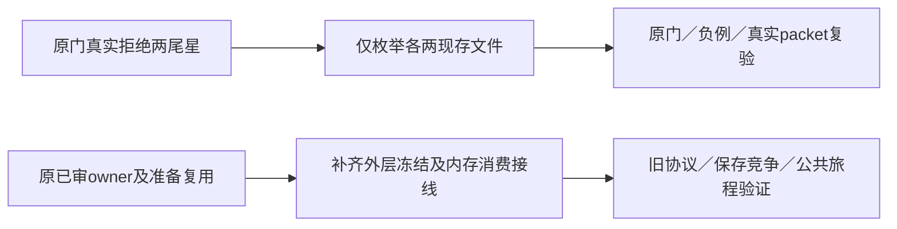

# T1300 第二轮独立增量评审

结论：**PASS，仅通过已锁定的补充方案；不代签实施、测试或前置恢复。**

评审者仍为 `/root/sol_spec_review`，独立于 SPEC／DEC 作者和 A／B／C 实施者。本轮只读源码、配置、原失败日志与锁定输入，仅写本补充报告及 recheck 输入；没有运行流程或产品测试、模型、构建，也没有编辑 SPEC、控制面或产品源码。

本轮沿同一主 SPEC 路径和 review lineage 复审。旧首轮 findings 为空；本轮没有新的开放 blocker／major，不重置 initial，不重复评议已审方向。

| 输入 | 独立核对 SHA256 |
| --- | --- |
| 本轮主 SPEC `docs/features/t1300-codex-functionality-and-performance.md` | `4a841aa69025c7b82c61ab6153dcb568b4520b506358450b578c80cbdc20d0aa` |
| 补充 `docs/features/t1300-workflow-and-owner-wiring-delta.md` | `18dcbc684e407a34ce44be8a5a444cccfb66e0c870084d02e87fdd30e00e4840` |
| 原主 SPEC 完整字节 `docs/verification/t1300/workflow/spec-before-delta.md` | `220aa12786f59be04d81391eadb496c671674d1bdfa6ace98cb0f6a9b3f94b7a` |
| `DEC-130002` 章节当前完整文本 | `2296586a6103242308a5ef8528ad9110fbb6f05148827d340d00426227672924` |

已独立计算 `SPEC_INPUT_LOCK_ROUND2.json` 的全部九个输入 hash，均相符；新主 SPEC 以旧主 SPEC 的全部原字节为精确前缀，仅追加显式 delta 绑定。原六份关联输入（含功能矩阵）hash 不变，首轮锁与独评没有覆盖。DEC 章节 hash 只标记本轮实际读到的授权文字，不把整个可变 DECISION_LOG 当不可变宪法。

| 增量 | 当前消费者证据及判断 | 后续验收约束 |
| --- | --- | --- |
| 两条尾星配置收窄 | `progress.mjs:52-57` 仍只允许精确文件或 terminal `/**`。当前 T1294／T1295 各一条尾星会被原门拒绝；分别替换为 delta 明列的 `.md` 和 `.T-1294.review.md`／`.T-1295.review.md` 两文件。四个目标均为现存普通文件、非 symlink，均属于原前缀集合。属于权限收窄，无需改 guard 或再归档任务。 | 只改两 write_set 值及本任务自身精确 module 登记；保两旧任务其他字段、其余旧 module、旧 SPEC／回执／状态、原归档和完整配置快照。前后结构差异与 hash 要真实保存；原路径负例仍拒绝，归档仍不能 claim／compile。 |
| owner 选项外层贯穿 | `chat-turn-preparation.ts:15,24,34` 把 frozenOptions 传入内层 assembly，并在外层再次准备冻结 definitions。主任务仅在 assembly 加 owner 选项不足以保证外层版本一致；补该文件属于已审新 owner schema 的必要装配。现有 `chat-assembly.test.ts`、`assistant-director-methods.test.ts` 确实消费该入口；允许新增 preparation test 已明确标注当前不存在。 | 新三 owner 在内层、外层、Host／adapter／source 三 resolver 的声明和版本一致；旧 director v1／v2／markdown 原 hash 不变。跨 owner、混版、未知协议继续拒绝，真实 RED→GREEN 不能只测声明生成器；不扩 worker／IPC、数据库或合同。 |
| 前端 opaque ticket 消费与 requireScript | `ai-copilot-content.tsx:1787-1822` 是 prepare／发送／finally 的实际消费者，`:1848` 接收显式 autoSend request；workbench 重组目前先取 source 再 prepare。仅在该消费者传递 Provider 内存 ticket 并清理，才能落实原已审同 turn 去重；在本次 latest 中核脚本条件可以消掉按钮额外读取。 | ticket 不进 transport、wire、sessionStorage 或持久回执；绑定原已审完整身份和上下文，一次消费、失效走原 prepare，finally／取消／卸载／迟到安全。普通聊天不新增脚本门；重组缺脚本仍原错误且零提交；不改 engine／source 准入、正文协议、work.creation 卡默认行为或 backend 当前真值／CAS。delta 列出的六个原前端测试均存在。 |

已只读查看原 `workflow-green-progress.log`，其真实内容是 T1294 write_set 拒绝；文件名不构成成功证据。原 `workflow-safety-tests.log` 确有 57 例、50 PASS／7 FAIL，以及 `skill_dir` 指向仓库 orchestrator 而缺 `rules/global-rules.md` 的失败。补充允许用原字节脚本／测试和真实安装规则布局做一次完整环境化复验，是限定的环境核验；不得覆盖原失败、删断言或改 vendor。实际本项目 generate／claim／packet 及负例仍须由 C 真正执行，不能用临时布局成功代签项目入口成功。

这批增量没有引入新产品方向、公共事件、能力目录或权限。首轮 56 键／40 公开条目、none 早期只读而 proposal 终态、旧冻结兼容、原稿与平台隔离，以及新隔离 production／可安装候选验收仍全部有效。由 C 使用本轮独立 recheck 输入沿原 lineage 登记后推进；本 PASS 不是两 glob 已修、测试全绿或 Codex 功能已恢复的声明。
