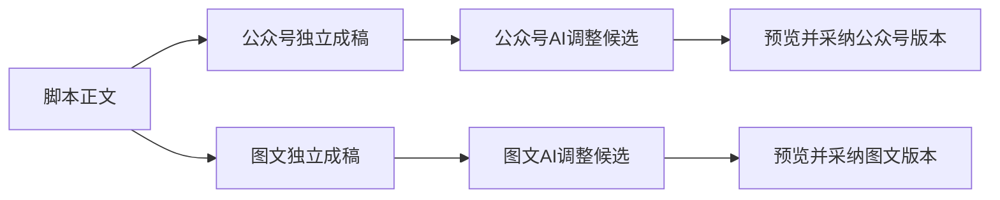

# T1300 当前可交付候选与验收事实

修复代码已进入新的本地不可变包，Tab与手工本地编辑已实际验证；**完整真实模型与全部功能验收仍未完成，父任务不完成**。真实模型外发授权尚待真人回答，T1321保持blocked，实际POST0/model0。没有把旧失败或UNKNOWN重发后洗成通过。

## 用户实际创作路径

脚本是正文源。公众号与图文分别形成自己的成稿；需要AI调整时从对应工作面发起，先看到候选与来源，采纳后保存该平台版本。平台稿不反向覆盖主脚本，也不互相覆盖。

这项T1296/T1298核心重构已经实施并经当时正式旅程验证：脚本唯一正文入口、两平台独立调整、删除细碎精调入口、扩大剪辑AI助手，曾完成四轮真实模型候选/采纳/刷新及脚本与另一平台不变校验（[原正式结果](/Users/zyongzhu/Workbase/Thirdspace-creator/docs/verification/t1298/FORMAL_RESULT.md)）。本次新包也实际查看了扩宽后的剪辑区并跑过手工切换/编辑；这些历史完成事实与当前尚欠的全功能复验分开，不抹掉核心重构，也不把旧包真实模型结果冒新包已执行。

本次累计代码修复包括：连续下划线预览保真与历史选择竞态；纯账号组每日选题、审核/校准/legacy work准备的冻结身份；纯组任务详情/events读取与论点采纳；真实agentic executor准入；混合Host/ordinary工具投影及同thread检查点完整性；封面/图卡文案阶段Codex身份与图片后续绑定；纯组视频预览请求；已生成候选的采纳不再重新要求当前生成模型可用。各项的实际RED、局部GREEN、独立审查与原缺限见对应T1307–T1325任务原件，本文不将局部受控结果替代新包真实供应商结果。

## 可审查包

| 项目 | 实际绑定 |
|---|---|
| 构建源码 | `7790be04ca16b65a8161c06c5943ba607e8ecd4d`；后续只追加验证控制/文档，不为控制HEAD重建 |
| 稳定DMG | [CreatorOS-1.2.0.dmg](/Users/zyongzhu/Downloads/CreatorOS-1.2.0.dmg) |
| 保留的不可变DMG | [独立副本](/private/tmp/t1300-artifact-v6mrof2a/CreatorOS-1.2.0.dmg) |
| App | [CreatorOS.app](/private/tmp/t1300-artifact-v6mrof2a/CreatorOS.app) |
| DMG | 850,688,983 bytes，SHA256 `5d31e8d9d40f2d41a3982f6d2bbfc0012a80a6901fcdd6609f7a82f863723d10`；Downloads与不可变副本实核相等 |
| App主binary | 19,226,976 bytes，SHA256 `59bcb3ee6f09c02dfd8966ce5a4598bfb0cb594e5444bc7456b7d53d3163d463`；不是sidecar的creatoros-server |
| sidecar.tar.gz | SHA256 `275ef09211af5c06dabea13eeebca6ee75b0627896fb4d24be4ce80c307e394e` |
| 启动清单 | candidate-binding.json中13项真实启动文件逐项bytes/SHA；包括全部实际runtime workers |

固定四桌面测试4文件/45PASS。实际`CREATOROS_LOCAL_SKIP_INSTALL=1 pnpm -C frontend desktop:package-local`自然exit0/426.776758917秒，hdiutil verify及codesign verify均0。release attestation的creator准确为7790；manifest原有validation=not-run、claimEnabled=false、无DeveloperID/公证状态不改，不冒正式发布验收。未安装、未启动原生壳，正式App只读哈希保持原值。

新候选是该包展开的production sidecar，独立owned根`/private/tmp/t1300-candidate-v5ohn8`，端口64455/controller91207。ready实际startupVerified=true、首页200、无握手403；使用已审build_smoke测试授权而非真实激活。私密session为0600，只保路径不入提交。两个旧候选与原DB/历史继续保留，controller94030和32328均未关闭或重启。

绑定与原退出见[候选证据目录](/Users/zyongzhu/Workbase/Thirdspace-creator/docs/verification/t1300/acceptance/final-repair/candidate)。App/DMG/sidecar原件保留供审查，不作为测试清理对象删除。

## 当前性能与本地操作

这里是手工中性小项目的单样本，非冷系统/冷网络、非长会话或大媒体项目。Tab主指标为同document真实click到页面内容存在、指定控件可见并命中可操作；普通内容仅核viewport相交，**不是严格整页TTI**。没有同条件旧包基线，不报告提速百分比或p95。

| 工作面 | 独立context首次访问目标 ms | 同page已访问切换 ms |
|---|---:|---:|
| 脚本 | 217.7 | 89.6 |
| 文章 | 321.7 | 193.9 |
| 图文 | 331.1 | 174.4 |
| 制作视频 | 622.6 | 68.2 |
| 复盘 | 189.9 | 115.3 |

前三个首访来自曾中断轮中的独立有效样本，后两项单独补验；不是一次全五项整case通过。旧制作视频587.6ms只核原容器/任意header控件，可能被“更多”满足，原数保留但不作loaded-ready。暖访自然case通过，同视频host节点connected/引用相等；不据此声称光标、播放、dirty等全部状态保留。文章/图文的真实预览展开与原生滚动已操作，无精调正文编辑。

脚本实际键入再Undo，原存储currentVersionId=artifactversion-6215d1e4-48、全2版本未变，autosaveEnabled=true保原。原生视频后来通过UI创建黑底默认文字5秒场景（mediaRefs=[]）；本地play时间码推进、正确Mac Meta Undo/Redo、保存与恢复读回revision1→2→3、elements1→2→1，原元素完全相等；整个document含revision/时间不宣称字节相同。这不是实拍媒体解码、ASR、复杂多轨或AI生成性能。

新owned最终实际AI任务0、execution任务0、会话0，设置原revision0/默认未配置，没有为了性能切换Codex。旧根仍存在原长任务，没有取消/删历史制造空闲；未穷尽当时全系统负载。成功context关闭会断言模型/外源拦截数为0，不用拦截隐藏自动请求。早轮仅留末context网络原记录的缺限保留；最后原生补验逐context安全记录独立保存。

详细原失败/中断、光标与快捷键夹具修正、旧依赖快照不完整及事后77c70 blob核对的限度，见[本地验证报告](/Users/zyongzhu/Workbase/Thirdspace-creator/docs/verification/t1316/runs/local-performance-7790/REPORT.md)与该目录OUTPUT_INDEX。当前真实普通聊天首字、SSE/DOM差异、模型完成性能均未验。

本包实际剪辑工作台与扩宽后的AI区（空工程/未配置模型的真实状态，不是生成结果）：

## 功能覆盖与剩余工作

[FINAL_COVERAGE.json](/Users/zyongzhu/Workbase/Thirdspace-creator/docs/verification/t1300/acceptance/final-repair/FINAL_COVERAGE.json)逐项保留40项旧包真实操作及原task/action引用、56项新包实际公开配置投影；不改锁审母矩阵、不把历史PASS冒新包已执行。历史119项配置/路由受控断言与当前真实默认未配置分开，settings不替代任务冻结路由证明。

- 旧包实际普通多轮、每日选题389新增5候选、独立业务审核/校准、文章/图文联合候选采纳、文章重组、知识、素材研究/匹配/提取、生图/参考编辑、ASR/原生删词导出等原件保留；其中跨新改动路径须按真实consumer/装配差异决定复用，不单凭巨大persistence文件SHA或同能力名判断。
- 新包普通/含工具聊天、五ordinary内容链及五vision上下文、纯组详情/events、thesis采纳、真实RSS/agentic消费仍需受影响路径复验；U24/U36缺真实平台来源等准确BLOCKED，不造评论/收藏数据。
- 封面/图卡须新包真实生成与下载；设置改成不可用后同原候选采纳且0新模型，不能先恢复设置绕过。T1324须真实HTTP GET/Range/Next自动HEAD空body、cookie播放器进度与原候选采纳/下载；local direct GET不代Next HEAD。
- T1321唯一真实诊断未启动。自动审批在CreateProcess前拒绝，原0POST/0model，等待真人对新中性测试上下文发送既有登录Codex的授权。原U14两个无候选任务、旧封面2613/图卡5713首因UNKNOWN保留，不能因局部修复推回定因，也不重发旧UNKNOWN。

统一原timeout Gate已自然0/83.003592833秒。原输入清单控制面两文件因合法登记变化、五包原缓存足迹与规则排除test的限度均有原记录；不称供应商/完整功能Gate通过。

历史风险授权只覆盖T1301完整素材业务组合的实现前RED记录缺失，真人原答为“接受这项历史缺证，继续验收”，见[HUMAN_ACCEPTED_RISK](/Users/zyongzhu/Workbase/Thirdspace-creator/docs/verification/t1301/acceptance/control/HUMAN_ACCEPTED_RISK.json)和[对应DEC](/Users/zyongzhu/Workbase/Thirdspace-creator/docs/verification/t1301/acceptance/control/DEC-HISTORICAL-TDD-RISK.md)。它不是补拍PASS，也不覆盖其他缺证。T1307/T1308联合验收没有扩大这项授权；[T1307独评](/Users/zyongzhu/Workbase/Thirdspace-creator/docs/verification/t1307/runtime/IMPLEMENTATION_REVIEW.md)中的RET-001（首次7例整文件未当场独立留存SHA）和RET-002（第二次修后失败DOM/JSON被覆盖）仍保缺失且未获风险接受；核心真实RED与生产前完整快照已证的事实也保留，不拿后续新绿补过去。

## 全局对账

`pmem sync`原命令exit0/1.625759667秒；`reconcile`原命令自然exit1/1573.093242833秒，**32 ERROR/0 WARN，全局未通过**。完整原输出及比较见[closeout](/Users/zyongzhu/Workbase/Thirdspace-creator/docs/verification/t1300/acceptance/final-repair/closeout/GLOBAL_RECONCILE_COMPARISON.json)：20个review receipt、8个lesson、backlog-health及3个frontend receipt。原29身份均仍在，不证明子命令根因相同；额外3身份是T1294/T1296/T1298原receipt之后watched_paths已变化，按[既有T1292](/Users/zyongzhu/Workbase/Thirdspace-creator/docs/features/t1292-post-integration-global-reconcile-findings.md)精确追加调查，未重绑旧收据或认定新增产品运行故障。LED047/053/055/056/059/060/061/062/063本次实际通过，也不抹过去失败。

本次收尾源自7790包相同产品字节，运行期间控制/文档提交变动如实记录，不称整次reconcile绑定一份全仓clean HEAD。原 `git diff --cached --check` exit2仅针对保留的原构建/PW日志中的CR、行尾空格与EOF空行；原字节不修剪，不能称全仓diff-check全绿。T1292实际追加登记后，必要派生 `pmem sync` 再次自然exit0/1.475709041秒，原第一次0与reconcile失败原件均保留；没有因纯文档追加重跑完整reconcile。T1300及三个验证任务仍未完成，T1321保持blocked；没有批量complete、修改guard或安装发布。
