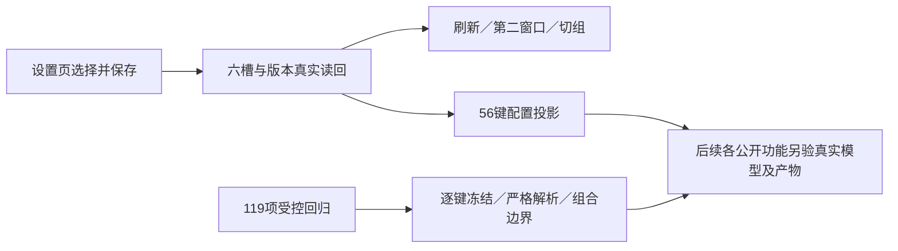

# T1300 父配置与路由验收

本窗口公共 CFG 通过，五份受控回归共 119 项通过。56 个真实配置投影键与锁定矩阵及所选来源逐项一致。真实模型调用和 U25–37 等具体功能不属于此窗口，不能由这里的“可用”元数据代签。

被测 production 包来源为 `dc46cfa700ec9c9cbada47fb76237d0b50d10a67`，公共端点 `http://127.0.0.1:65353`；binding SHA256 为 `d82fcbe6bbccae7f99197a0ce20deb3bd2520c459dded17e6f322f13dcf859e5`。执行控制 HEAD 为 `69fd17fb460d66f7cd379c61a7873c2e05b66e27`，五份实际执行测试与包来源的对应测试逐字相同。未启动原生壳、重建包或操作正式 App；当前服务及 controller 94030 保持原运行。

| 检查 | 实际结果与证据 |
| --- | --- |
| 初始配置 | revision 1；text/vision/image 为 codex，video/audio/embed 为 official，见 `CFG-initial.json` |
| 公共 UI 合法组合 | 文本选 official，图片联合 vision/image 选 self；点击保存并 GET，revision 1→2；六槽完整保存，见 `CFG-combination-put/get.json` |
| CAS | 用原 revision 1 提交，真实 HTTP 409、`MODEL_ROUTING_CONFLICT`、latestRevision 2；当前值未变，见 `CFG-stale-CAS-rejection.json` |
| 刷新及跨窗 | 页面刷新、第二窗口“重新读取当前设置”均显示已存组合；未把它扩大为自动跨窗即时同步，见对应截图/JSON |
| 不支持来源 | 公共 PUT video=codex 得真实 HTTP 400、`MODEL_ROUTE_UNSUPPORTED`；配置未变，见 `AVAIL-unsupported-video-rejection.json` |
| 恢复并切组 | 公共 UI 将 text/vision/image 选回 Codex，revision 2→3；切换真实空组读回相同用户设置，再回原组并刷新，见 `CFG-final-codex-*`、`CFG-other-group.*`、`CFG-final-reload-original-group.*` |
| 业务隔离 | 原 article/graphic 完整 DTO、script metadata、全部 3 个 versions及两个原 ai/execution task DTO 全部相等；前后 SHA256 均 `fc629e3bf087e6a78d301a791397ad7fc489ba016db2f61f032ea7816d72f442`，见 `BUSINESS-*` |
| 受控组 | contract 14 项、backend 105 项，单 worker/retry 0；见 `CONTROLLED_RESULTS.json`、两份原日志及 `CONTROLLED_SOURCE_BINDING.json` |

最终真实 GET 有 56 个唯一 mode/capability 键：51 项 ready；`image:image.edit` 为 unverified；`text:chat.fallback` 为 unavailable / `MODEL_ROUTE_UNSUPPORTED`；官方 video、ASR、embedding 三项为 not_configured / `MODEL_NOT_CONFIGURED`。这是实际状态，未把编辑未核实记为可用、未切换缺失用途来源。embedding 仍为停用兼容槽，未触发向量执行；未新增 TTS 入口。`ROUTE_RESULTS.json` 为 56 条逐键结果，并明确每条“实际功能执行：本窗口未执行”。

未登录、锁定版本不符、无模型 ID、能力不足、原身份变化、主子来源组合及旧冻结兼容由受控原测试验证；未退出当前真实认证，也未制造另一个真实 Codex 账户错误。因此这里不声称真实登出/错误账户场景已验。公共设置截图已实际查看，图片行明确显示“理解：可用；生成：可用；编辑：未核实”，video/ASR 明确显示未配置。

首次公共运行因隔离库仅有一个真实组，在任何配置修改前 exit 1；这是验收前置缺失，原 revision 1/六槽未变，记录保留在 `attempt01-single-group-precondition/`。Root 随后明确授权通过原 `accountGroups.create` 建空验收组 `grp-bcda7005-750`，未绑定平台账号或复制数据；请求幂等 key 和原回执见 `owned-empty-group-*`。第二次运行实际 exit 0（17.560 秒），不重跑已通过的 119 项受控组；没有自动重发未知模型或业务任务。

本窗口 0 真实模型、0 脚本/成稿保存。最终六槽为 codex/codex/codex/official/official/official，revision 3，回原组 `grp-bcda7005-6`。浏览器 context 正常关闭；owned 服务、空组和原业务资源留给后续验收。语法与 diff 检查通过；timeout 门按 HANDOFF 授权引用同冻结源码的原真实 exit 0，详见 `CHECKS.json`，不声称本窗口重跑过该门。完整父功能、原生壳、现用安装版和全局对账仍待其各自证据。
