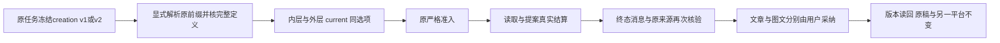

# T1300 联合创作冻结协议修复结果

已修复受控复现的联合创作准入失败：合法写作上下文使原任务冻结为director-v2，外层Host适配器却遗漏定义选项，按director-v1重建，原严格准入因此拒绝。修复把同一冻结协议选择贯穿内层、外层/current与来源读取；没有放宽准入，也没有删除合法空写作选择。本步本地回归完成，**新production候选上的真实联合创作仍待验**。

基线`8635d80f7ac0e2f3aa0024f6d4858e125dc22852`；受测三生产/五测试及两原兼容测试完整SHA见[runtime/SOURCE_BINDING.json](runtime/SOURCE_BINDING.json)，命令、退出及原件见[runtime/validation-results.json](runtime/validation-results.json)。本报告不自引用提交SHA；最终提交由交接消息绑定。未改控制面/原矩阵/worker源码/contract/通用adapter/dispatcher/validateTask或现用App。

## 原失败与修复范围

原production候选`fc53f3fbd`的A11任务`ai-task-63f990d9-a489-4fd8-9870-d123e080d244` / `execution-task-7032dd5c-cf2c-4c0f-89fd-d68fd76e3aef`在872ms后失败，错误`CHAT_WORKER_INPUT_UNAVAILABLE`。原提交有合法`writingContext:{schemaVersion:1,brandProfileVersionId:null,sourceAssets:[]}`。原件仍在`../acceptance/candidate/runs/owned-a6446b6b7b797f0c/public-a/`；旧任务未重发、未恢复或改写。只读公共模型摘要当场200且calls=[]，但当时未保存独立HTTP JSON，不能补造原件。受限inspect未取得冻结payload全文，因此此处依据原公共输入、源码及本次受控RED闭合，不声称读过原完整payload。普通U01成功不覆盖此联合入口；T1298旧四轮是work.editor重组/校正。

实际修改只涉及：

- `chat-work-creation-protocol.ts`：只识别原creation v1/v2完整前缀与64位hash格式，拒绝混版、重复、未知，支持单propose子集；从冻结身份选`workWritingContext`，再核真实选择、解析结果、project与摘要。不重新签名或改哈希算法。
- `chat-work-creation-tool-host.ts`：同一选项用于内层完整定义比对、外层adapter及其current重建。
- `work-candidate-source.service.ts`：creation与editor分族选择/重建，保持完整description/schema/hash/effect/execution比对，creation不覆盖旧editor选项。原call/proof/来源/target、采纳事务重读与CAS全部保留。

合法v1无写作上下文及合法v2有真实已解析上下文继续成立。v1却带不一致上下文原Host已经不接受，本步没有声称“所有旧v1任意上下文”兼容。v2的空选择也是合法对象，不据此降回v1。非空资料选择通过原`createWorkWritingContext`构造器与严格owner/project/asset/file资料端口夹具验证，外层/current返回完整已解析资料；这是受控来源端口，尚非candidate实际上传文件证据。

## 当场红绿与验证

| 项目 | 实际结果 | 证据与边界 |
| --- | --- | --- |
| 前置RED | exit1，2项按预期失败 | `red-admission.log`：冻结v2、外层v1同hash；原validateTask拒绝。生产仍为基线，仅新增测试。链为submit service、真实PGlite/lease、生产`createChatTaskToolHost`组合、原validateTask，assemble为确定性替身；不是HTTP、顶层dispatcher或真实模型。 |
| 修后最初准入 | exit0，2项通过 | `green-admission-first.log`，随后扩完整链。 |
| 最终五文件 | exit0，44项通过 | `green-public-service.log`，最终新增admission用AI公共service创建会话/消息。包含v1/v2读/提案、终态消息、source.read/readSource、两owner原运输采纳/读回/幂等/CAS、原脚本与另一平台不变。早期43/44中间日志保留，不作最终hash绑定。 |
| 原editor Host | exit0，7项通过 | `editor-host-compat.log`，旧v1/v2及当前族不被creation选项覆盖。 |
| 原editor来源与采纳 | exit0，4项通过、4项排除 | `editor-source-adopt-compat-codex.log`，受控外部协议director-v1/v2/markdown-v1/owner-v1；真实submit/claim/短Host/source/adopt，非真实Codex。Pi分支不运行，不启动其localhost替身服务。 |
| 类型 | 最终exit0 | `typecheck-public-service.log`。首轮新增测试有3项签名错误，`typecheck-attempt1.log`保留，已修。 |
| 物理边界 | 最终exit0，原5条基线、0新增 | `boundary-final.log`。第一次新增测试直接import跨模块repository造成1新增，已改用AI公共service，未改门或豁免；原`boundary.log`保留。 |
| 语义、超时 | 均exit0 | `semantic.log`、`timeout.log`；180s test/hook、retry0，原产品预算不变。 |

最终聚焦通过55个不同用例（44+7+4）；不把超时门内部用例重复计入。旧editor首次过滤`-t 'codex/'`实际8项全skip，exit0不能算通过：保`editor-source-adopt-compat.log`与实际标题库存`editor-test-inventory.json`，改为`-t codex`后才得到4项真实通过。所有原失败与中间记录均保留。

修复前完整v1/v2定义已捕获为`creation-definitions-before.json`，最终测试逐字JSON相等，含原description/schema/effect及版本hash；两版read均707字节、propose均35293字节。这只是冻结声明大小，不能当token或提速收益。capture首次tsx CLI因sandbox本地IPC EPERM失败，保`definitions-before.log`；改同进程`node --import tsx`完成只读声明捕获exit0，无外网/模型。

负例覆盖未知/混合/重复前缀、错hash、描述/参数/effect/execution、缺选择/解析结果、错project/摘要/选择、跨组/错误原参数/unknown结果与来源、v2缺proof拒绝；原legacyJoint v1无proof窄兼容仍通过。proposal仍沿原终态出现；本步没有更改早期投影策略。

## 构建产物、清理与待验

原editor兼容测试beforeAll构建本地`ai-worker/dist/execution-worker.cjs`，是必要受控回归的普通产物，不是重建candidate。测试内部构建stdout被原execFileSync捕获而不转储；另以相同输入执行正常worker构建，保存`editor-worker-build-final.log`，实际exit0，输出路径/完整SHA在SOURCE_BINDING。未改worker源/构建脚本，旧candidate位于独立/tmp sidecar，未引用此本地dist。没有启动Pi服务、新浏览器、真实模型或旧candidate。

全部测试/类型/门/构建命令已终结，PGlite各afterEach及原editor finally均await关闭；无在途服务或模型。原controller早已stop，旧记录143且未证flush完成，本步不重写为shutdown0或打开旧库。

接下来必须由C从新冻结源码构建新的production候选与owned根，再经真实公开一键联合创作、两份候选预览、分别采纳、刷新、原稿与另一平台隔离验收；不能用本报告代签真实Codex/原生壳/用户环境或40功能矩阵。新上传自动`asset.classify`须保原task全过程，旧owned素材`asset-616dc18d-181`待核状态也不得自动重发。AI对话usage须分会话累计、缓存输入、本turn与工具声明字节；当前没有同模型同稿速度对照，不宣称提速百分比。
