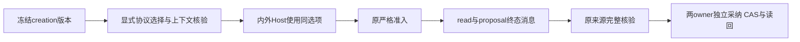

# T1300 creation 修复独立实现复核

结论：**PASS，仅限本提交实现与既有受控测试证据。** 未发现开放的确定实现缺陷。本结论不能关闭真实 candidate 联合创作缺陷，也不通过 HTTP、顶层 dispatcher、真实 Codex、原生壳或 T1300 整体验收。

评审者：`/root/sol_spec_review`，独立于 C 方案作者及 B 实施者。实施期间只读检查；B 提交并明确释放后，按 Root 授权仅写本报告及对应 JSON。没有改产品、锁或控制面，也没有运行测试、模型、构建、浏览器或 candidate。

| 绑定对象 | 精确身份 |
| --- | --- |
| 受审提交 | `3b166290b75e74638901d18673f9fb9b6dd9be66` |
| 父提交／实现基线 | `8635d80f7ac0e2f3aa0024f6d4858e125dc22852` |
| 已审主 SPEC SHA256 | `bf9837ac87b8c3315d5f904e8bf6b6d510bb862eee9f6b7a479f4562049add59` |
| round3 delta SHA256 | `e6de6763fa1571e10a696839ac512faa4232399b35618011a2eed01fce8031e1` |
| round3 锁 SHA256 | `21982cad9a67c9395bcdaf8d9f1010f4d2ec03fc9506e9790ba85f36daa76032` |
| `CREATION_REPAIR_RESULT.md` SHA256 | `9510b5fb1e63d1f6e2bac24b0ca9df7e29876cc21b3b129981ede1ba4fd5eb69` |
| `runtime/SOURCE_BINDING.json` SHA256 | `70e98b64d900283aa44f8e2f19a85574ed99586583aded89f3a8d2033ab80180` |
| `runtime/validation-results.json` SHA256 | `fbb1ad6311a454bfbff01ec1278f1c9d2147e2c3f4d00abc55390feb796ea171` |

报告写入前 HEAD 为受审提交且工作区干净。独立核算 10 个受测文件 SHA、worker 本地产物 SHA，全部匹配；SOURCE_BINDING 的两个 RED 基线生产文件 SHA 也与父提交原字节匹配。提交仅三指定生产文件、五指定测试及专属证据；原两 editor 兼容测试字节未改。contract、worker 源码、共享 adapter、dispatcher、validateTask、采纳业务服务、前端与 metadata 均未修改。

## 代码与公共链判断

| 位置 | 独立判断 |
| --- | --- |
| `chat-work-creation-protocol.ts:8-23` | 仅解析 creation 工具的完整 director-v1/v2 前缀及64位 hash 格式；无族返回空，单 propose 合法，重复／混版／未知拒绝。原前缀决定 workWritingContext，然后核 target／resolved 是否一致、project、selection 与真实解析体摘要；不改旧 hash 算法或重签。合法空选择仍为 v2，非空资料不因新增规则被拒。 |
| `chat-work-creation-tool-host.ts:28,41-47` | 同一 definitionOptions 用于内层完整定义重建与外层 adapter；adapter.current 沿原机制每次 resolve 并用同选项再 prepare。完整冻结定义 canonical 相等仍在，原身份／目标及取消门保留。修复的是漏传选项，没有删工具或放宽准入。 |
| `work-candidate-source.service.ts:44-53,65-72` | editor／creation 各自解析并只重建实际存在的 propose，不以一个族的 workWritingContext 覆盖另一个。原完整 schema／description／version／effect／execution 严比仍在；原消息、task/call、proof、输入与候选 digest、target、group/account/user 及采纳重读门保留。legacyJoint 仍仅 v1 外部调用缺 proof 的原窄例外，v2 不套用。 |
| `chat-work-creation-admission.integration.test.ts:69-100` | 原 submit service、真实 DB 与持久 lease、生产 createChatTaskToolHost 组合和原 validateTask 均实际调用。最终会话／消息使用 AI 公共 service；assemble 是确定性替身，故它是公共服务组合准入回归，不是实际 HTTP、完整生产 assembly／顶层 dispatcher 或模型调用。 |
| 同测试 `103-142` | v1/v2 均继续执行 read/propose、原 ID 幂等、settle／commit 终态消息、source.read/readSource，随后经文章／图文原 transport 独立采纳、精确版本读回、重复采纳、stale CAS、跨组拒绝、原脚本与另一平台不变。没有正式稿自动写入或新模型任务。这里的候选读取是服务层预览材料，不冒充真实 UI 预览。 |
| Host 测试与两原 editor 测试 | v1/v2 完整定义与修复前快照逐字 JSON 相等，外层及 current version 一致；单 propose、混版／重复／未知、错 hash／description／parameters／effect／execution、缺选择／resolved、错 project／digest／selection 拒绝。非空资料用原 createWorkWritingContext 构造器及 owner/project/asset/file 断言验证；实际上传文件仍待 candidate。editor 原历史 Host／source／adopt 受控兼容保持。 |

helper 的上下文检查没有扩大成创作判断；原 Host reader/source 的受信上下文验证仍先执行。无本工具时的旧聊天兼容和原 editor 族不被 creation helper 干预。未发现需要继续扩大写集的具体缺陷。

## 证据复核与限制

本评审读取 B 已发生的日志、命令退出记录及对应断言，没有重跑。14 项 validation 日志均存在并计算 SHA，关键原件 hash 见对应 JSON。类型日志为空，exit0 由 validation-results 记录支持，空文件本身不是通过证据。

- **真实 RED**：`red-admission.log` exit1，两项分别因冻结 v2／外层 v1 同 hash 不相等、原 validateTask Conflict 失败。父提交生产文件字节绑定正确；不是 helper-only 或静态推测。最初 RED 的会话／消息夹具使用旧 repository，最终改公共 AI service 后整组重跑，原 RED 不改写。
- **最终聚焦 GREEN**：`green-public-service.log` 5 文件44项，`editor-host-compat.log` 7项，`editor-source-adopt-compat-codex.log` 4项，共55个不同用例通过；后者另4项 Pi 排除。受控外部协议没有运行真实 Codex，Pi localhost 替身也未启动。
- **旧兼容与拒绝**：修前 v1/v2 完整定义快照、单工具子集、外层/current 和原 editor 来源回归覆盖冻结重建；v1 无 proof 仍可按原窄兼容恢复，v2 删除 proof 明确拒绝。unknown、跨组和篡改原参数负例保留，原 CAS 与来源门未弱化。
- **门与构建**：backend 类型、semantic、timeout 记录 exit0；boundary 最终无新增但仍原5条。editor 原测试必要本地 worker 构建与独立构建日志均保留；其本地 dist SHA `3851b4fb132035f1b03528d68b0fa1c5ab86bda8134d8b98795252295c5a6454` 匹配，只是测试产物，不是新 production candidate。
- **失败不抹平**：最初类型三处签名错误、跨模块 repository 新增边界失败、旧 editor 过滤8项全 skip、snapshot capture CLI 的 IPC EPERM 及各中间运行原件均保留。全 skip 的 exit0没有计入55项。测试预算180秒、retry0，产品预算未改。

原 production A11 失败、calls=[] 未存独立 HTTP 原件及未取得完整 frozen payload 的限制仍如实保留。原任务未重发；旧 shutdown143／flush 未证没有被改写。受控声明字节、局部修复及55项通过不能证明实际速度收益、素材识别 UNKNOWN 恢复或整个功能矩阵已完成。

下一步必须从新冻结源码重建、核验新 production／可安装候选及全新 owned DB/media，再真实公共一键联合创作、两份候选预览、分别采纳、刷新和脚本／平台隔离。旧 fc53 的成功不能继承为新包 PASS，受控 assemble 也不能代签真实模型。原生壳、真实激活、Keychain／defaults、IPC、其他40公开功能／56键矩阵及完整 Gate 继续按原要求单列。

本报告完成即释放独立报告写权，由 C 串行登记本步骤并推进候选验收，不以此局部 PASS 完成 T1300。
