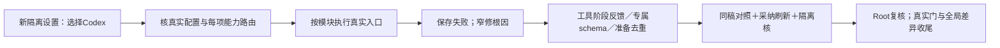

# T1300：先恢复Codex功能，再落实有证据的性能优化

## 用户本轮授权与目标

用户在T1299分析完成后明确授权实施建议，并要求分模块测试众多功能，尤其选择Codex执行引擎后的模型可用性；随后明确症状为“无法正常对话或执行功能”。因此本任务以**配置能真实生效、对话与各能力入口可完成**为核心，不能只做单轮聊天或体积优化就宣布完成。Root继续只判断方向、复核结果，具体执行交原GPT-6.1 Sol高思考代理；不主动开启加速，工具无service tier读回，不假称已技术验证开关。

本任务从`4eb101161`开始。沿用T1296/T1298已确认方向：脚本为唯一原稿，公众号/图文各自重组和独立调整，AI只产候选，用户采纳后backend service写成稿；平台修改不反向覆盖脚本或另一平台。不是将255旧任务一次性关账，不恢复旧联合生成或已删除精调入口。

先只读核当前分支、已安装App/交付包的版本/构建标识与产物来源，分别标注环境。源码已修不证明已安装包已更新；不得据版本差异直接断言用户故障根因，更不能为了验证自行替换安装包或读取用户库。

`INSTALLED_SOURCE_IDENTITY.json`的实际双hash核验显示：当前安装binary与sidecar精确匹配T1294交付`8bbbe79d`及attestation，未含后续`b6ef3314f`动态函数暴露/采纳回执/首次autoSend修复。这是功能执行失败的重要版本差异候选，**不是普通对话根因的证明**；不因旧包行为重写当前已经修复的功能。任何无法由可信attestation/source/hash确认的修复包含关系均写UNKNOWN。

允许本轮在全新owned账号组、项目、数据库、媒体根及受控Codex中实测功能和必要真实模型；现用App、用户库、原作品/设置不动，未知旧任务不重发。**交付必须包括含T1298和本轮改动的新隔离production/可安装本地候选及其公共全链验收**，不能只交dev源码样本。构建输入HEAD/dirty、manifest/attestation、binary/sidecar/包hash、实际启动端点和公共run要绑定同一候选；当前源码、现用安装版、新候选分三环境记录，准备具体可审查的本地包交Root处理后续交付。正式安装位置当前不动；不把此边界扩大为永久否定后续本地交付。当前先完成SPEC及独审，通过前只读盘点/新任务文档和metadata，不修改生产、不大构建、不启动真模型。不推送、部署或发布。确认见`orchestrator/DECISION_LOG.md`的DEC-130001。

## 完成时的行为

1. 在公共设置中选择Codex后，实际设置读回、冻结模型来源/引擎/能力路由与执行账本一致；能力不支持或未配置时给真实原因，不能静默改用别的模型或显示永久可用。普通对话、工作面改稿及实际能力入口按矩阵验证，不以设置页有绿灯代签。
2. 对真实复现的当前缺陷，先保存失败ID、日志和数据状态，再在根因所需最小范围修复，保持原任务/费用/归属/期限。新增根因超出当前消费者/服务范围时补准确SPEC及独审；不猜换模型、扩大权限或加timeout。
3. 对Codex host的`external_tool`链，仅对effect=none的真实已结算只读工具及时显示已验证阶段。所有proposal（work.editor/work.creation/system/canvas）完整output仍在终态提交后发送，保原预览/采纳时点。复用现有持久事件/订阅和ordinary终态对账机制，增加受信external proof/identity适配；不另造任务权、第二流或伪改call kind。只有完整候选schema/digest/版本校验及回执保存后才可预览和采纳。
4. 对用户明确打开的editor owner，构造新版本专属`work.editor`声明/schema，减掉该工具不相关的联合owner参数；仍保各owner完整能力、显式能力发现/跨能力合法路径、旧冻结定义与历史resolver。不得用关键词推断能力，不重哈希旧任务，不放宽strict parser。schema去重语法须核锁定Codex消费者支持，不能只据JSON Schema合法性推断可用。
5. 同一turn的重组准备只读一次有效latest/exact。共享结果绑定turn、editor注册entry token、owner、scope/group/account/project/output、generation、version/digest及writingContext/selection机械指纹，不能只看稿件generation。凭据仅被同次发送消费一次，不跨turn；dirty、选区/写作偏好、目标、注册token或归属变化即失效重走原prepare，失败/取消/卸载清理凭据与在途结果，迟到结果不回写。保存及服务端执行时真实重读/CAS/owner校验不减；未知保存结果沿原回执恢复，不发重复任务。
6. 顶部Tab保留已经有效的视频实例常驻；先在生产模式和代表性隔离项目分段观察文章/图文数据、历史卡挂载、route至可见控件及一次真实操作。只对已证重复做请求内合并、不可变历史有界去重或按需准备；不统一开启prefetch，不预取get-or-create，不缓存当前稿当执行真值。若测量不支持某候选收益，保留原实现并如实说明。
7. 分段计时随改动进入原诊断能力：点击/POST、task/call/attempt、queue/ready/preflight/provider/工具结算/持久append/浏览器接收与finish。只存安全身份、duration/字节数，不存raw prompt/凭据/私有推理。反馈提前、输入缩小、总耗时下降分开验，不设阻断合法生成/保存/导出的性能硬门。

本轮不接公开正文增量，未知phase/reasoning不公开，不能直接将现有裸字符串`onText`接UI。工具阶段独立交付；正文协议若以后做，另须thread/turn/item及明确可公开phase契约和独审，不能借本任务暗加第二套正文机制。

## 必要流程前置：终态module可审计归档（候选，待独审）

T1299已证T1111/T1125最后taskctl均complete，当前非255开放任务，旧绝对write路径仍在全modules入口验证，导致合法新任务无法generate/context-compile。若本轮派发确被同一阻断命中，仅将此兼容治理纳入必要前置，不能绕门生成packet或重新修旧业务。

本轮只读核两项均无其他module依赖，当前progress无vertical/lease；既有progress/context-plan/context-compile/governance/parallel等消费者读取配置的`.modules`。因此优先采用**项目数据级归档，不改通用流程校验器**：专用归档逐项保原模块完整JSON、迁移前config完整原始字节/SHA、原任务身份、真实最后完成事件原行/锚及来源，随后仅从现役`.modules`移出这两个定义。原配置快照存于本轮证据，归档没有执行消费入口。迁移显式指定这两个ID，不按“路径不安全”自动忽略记录。

迁移前后独立核验：最后事件确为完成、看板非活动、无在途/claimed执行、无现役依赖、原定义和其余模块逐项不变；未知/重开/冲突必须拒绝。原授权/审核/事件文件保持原字节，不把归档叫删除历史。现有`progress`不读取归档，归档ID不能claim/compile为执行packet；重新启用须恢复满足当前安全规则的新定义与适用审核。保现役绝对路径、`..`、非末尾glob、控制面越权及符号链接逃逸负例；绝不放宽校验。若实际消费者显示数据级迁移不足，先补确切接线范围独审，不默认建设归档框架或改共享技能/vendor。

此改动只解除工作流前置，不承诺App加速；不放宽路径校验，不删T1111/T1125历史、不手写progress、Task Packet或完成状态。其RED→GREEN及完整原负例通过后，才使用受支持progress/context-compile派发实现步骤。

## 模块职责与并行边界

| 模块 | 负责人及候选写集 | 输入/输出与串行点 |
| --- | --- | --- |
| 前端准备、Tab与公共交互 | A：`frontend/src/features/article/article-workbench.tsx`、`projects/graphic-post-workbench.tsx`、`draft-workbench/draft-chat-request.tsx`、`copilot/chat-work-editor-card.tsx`及相应原测试/本轮e2e；`copilot/ai-copilot-content.tsx`、`use-assistant-engine.ts`、`assistant-engine.ts`仅在根因证实后修其来源/准入路径 | 只消费已冻结contract；不写backend/worker/contract/控制面；不动StageChatWrapper、顶部prefetch及布局；事件/schema contract变化前不改适配 |
| Codex配置路由、事件与工具版本 | B：`contract/src/resources/work-editor.ts`、`contract/src/internal/chat-worker.ts`；`backend/src/modules/ai-runtime/{chat-tools,chat-tool-definitions,chat-work-editor-tool-host,chat-assembly}.ts`、`ai/{chat-turn-submission.service,external-task-tool.service,external-chat-turn.service,work-candidate-source.service}.ts`、`execution/chat-tool-stream-projection.service.ts`及原测试/`backend/src/integration/chat-work-editor-worker.test.ts`；允许同模块新增纯解析`chat-work-editor-protocol.ts`、事务chunk helper `chat-tool-stream-chunks.ts` | 先锁定contract/version/兼容负例，再供A读取；不写前端workbench/控制面。复用既有tool-input/output事件，不新建UI事件种类；本轮不扩worker诊断协议/不改worker，用现有task/call/settle/append/finish安全时戳及字节计数，preflight/TTFT保缺测 |
| 流程前置、独立验收与收尾 | C：本SPEC/新验收矩阵、`orchestrator/process/modules.config.json`的精确终态数据迁移及专用归档、本轮独立诊断/完整性脚本、公共e2e与Gate证据；默认不改vendor流程源码 | C唯一写BACKLOG/events/manifest/DEC/module/progress/审核；不互改A/B源码。Gate/构建/唯一浏览器与owned数据库串行占用 |

这些是评审前边界，不是已授予任意目录编辑权。共享checkout不能仅凭文件不同就并行写；按技能验证真实worktree/执行lease，未满足则串行。Root不执行实现/测试。A/B只读盘点可并行，SPEC/合同独审及流程前置未闭合前不派发生产编辑。C不自审自己的SPEC；通过受支持reviewctl保存独立结果后才taskctl start，不将待审手改为PASS。

### 锁定的工具流及版本合同

新任务的`contract/src/internal/chat-worker.ts`冻结输入允许`externalToolProjectionVersion:1`，仅由`chat-turn-submission.service`服务端赋值；缺省保持旧终态行为，不给已冻结任务补默认/重算摘要。复用`tool-input-available`/`tool-output-available`与原denied/error族，仍写同一`execution_stream_events`。只有definition.effect=none且outcome.sideEffect=none，在真正execute并经原lease事务保存settled回执后，才以独立lease事务投影；已settled原ID重入只补投影，绝不重新execute。投影异常留安全诊断与原任务恢复，不新发模型/工具。definition.effect=none但outcome.sideEffect=proposal必须拒绝，不凭outcome放宽只读policy。proposal output不提前，终态策略按原候选合同处理，不标为恢复降级。

受信重建核execution/attempt/fence、ai_task/conversation/group映射、external_agent父call、settled状态、冻结definition、原参数和`externalToolInputProofSchema`。必须`identity.toolVersion===definition.version===proof.toolVersion`，proof的call/turn/toolCall/toolName逐项等于真实call，重算inputDigest匹配；早期仅支持已有Host none族，缺proof、错parent、未知或committed效果、参数/结果冲突拒绝。原input归父call、output归工具call，callIndex/全局sequence沿原事务顺序，每toolCall仅唯一input/output，相同事实幂等、不同事实冲突，完整JSON与可信重建深相等。

新版本终态严格核唯一性/完整内容，none早期已有完整投影时不再次批量追加；旧版本沿原终态路径。安全可恢复的none阶段缺失，可在finish提交事务内按已settled事实补投影并对账，标`projectionTiming=recovered_at_finish`与call身份；业务可完成，但不能计finish前反馈PASS。已有及时投影标`before_finish`；proposal终态明确标`deferred_proposal`，不是recovered。finish后不新补阶段，篡改不能被覆盖。缺失阶段不能成为反杀合法聊天的性能硬门；取消/失租仍无新执行权。重复/乱序、缺proof/错版本、rollback、双worker竞争/旧fence、取消迟到、重连和不完整回执均需负例。

owner新版本前缀为`chat-tools-work-editor-owner-v1-wechat_article:`、`...-graphic_post:`、`...-production:`加原64位hash，hash继续绑定实际description/schema/effect。仅由明确且已验证editorTarget.owner选owner声明；无target保通用发现。保完整article/graphic/native typed-patch及production markdown_timeline等合法参数，不改变candidate/adopt合同。

精确兼容`chat-tools-work-director-v1:`、`chat-tools-work-director-v2:`、`chat-tools-work-editor-markdown-v1:`：保原schema/description/顺序/hash，v1不含writingContext、v2含writingContext，markdown沿完整现有参数。专用host.resolve、外层host adapter及`work-candidate-source.service.readSource`三处共用同一冻结定义协议解析选项，重建均须与冻结definition相等；单工具子集可单项重建，成对read/propose必须同协议族。混版、未知前缀、owner/target不符拒绝，不按当前target重写旧definition。固定旧快照回归必须覆盖各owner、外层adapter.current、候选来源/采纳路径，不仅声明生成器。不引入未验证`$ref/$defs`技巧。

阶段诊断只输出`executionTaskId/callId/attempt`、`phase`（tool_settled/tool_projection_appended/turn_finished）、ISO observedAt、可缺的同进程单调非负elapsedMs/inputSchemaBytes、上述三值projectionTiming、ok或稳定失败码result。单行JSON无正文/URL/秘密，sink失败不影响业务；不改worker/IPC。queue/ready/preflight/provider首token缺测继续记缺测，不伪装全链精密计时。

当前阶段路由：技能/项目均3.29.0，维护期BUILD中补本任务必要CONTRACT审核，沿用现有设计，不全量改版。`context-plan`实际exit0为4-build；codegraph本轮单次sync实际exit0且Already up to date；研究门audit实际exit0，不阻T1300。`workflow-preflight.json`保存当前两终态module的定义SHA、原事件锚、终态行及无依赖/lease证据；迁移尚未执行。Task Packet/lease须在精确W/R/DAG、有效审核及必要入口前置闭合后真实生成。

## 验收与失败处理

`docs/verification/t1300/FUNCTION_MATRIX.md`作为本轮矩阵真相：56个当前route键逐键配置/冻结/解析断言、每独立协议族真实模型、每独立公开功能实际旅程分三列。无需56次重复费用，但同族一次样本不得给不同用户功能整体签PASS；内部别名/子步骤继承须指出同一真实consumer和动作证据。当前40条公开功能条目含若干复合操作时，每操作各给结果；仅内部/退役入口须有可达性源码证据，不恢复旧UI。发布只到物料/预览，不向外发。TTS未定位现役消费者不得虚构入口，embedding按已停用兼容项验证，不恢复为聊天前置。

每行记录配置、公共入口、真实模型或受控负例、task/call/owner、最终产物及采纳/刷新/隔离、失败和清理。初始执行结果均待验；不可把旧T1298四轮PASS移作本轮当前PASS。普通聊天和不同工作面分别证明；需要外部账号/服务而未具备时标准确阻断/未验，真实拒绝不冒成功。新隔离production App候选的真实公共UI全链及可安装本地包是完成条件，dev/模拟/静态不能替代；必须明确真实被测启动来自哪份候选binary/sidecar/端点，不能将单独dev Next的结果写成安装候选验收。未发生的原生壳行为仍单列未验，不冒整App全功能通过；正式现用App不动。

改动前对实际缺陷记录可重复红测；contract/worker/backend/frontend聚焦测试覆盖版本兼容、跨owner拒绝、旧冻结任务、重复/乱序流、取消迟到、重连/回滚、dirty/CAS、当前稿/脚本/其他平台不变。真实公共链在新owned根中覆盖选Codex后的功能路由；媒体需检查真实产物，不能只看成功状态。模型失败保存原ID，不自动重发，取消按原任务归属；LED053最短执行/观察预算与完整外层清理余量、LED047本地打开/按需渲染、LED061单在途/恢复继续成立。

本轮有生产改动，完成受影响TDD/contract/类型/构建、frontend/oil视觉实际操作、boundary/orphan、timeout与LED047/053/058/061等相关门，再pmem sync、完整reconcile和全局差异归因。完整构建/对账不得与浏览器真实旅程交叉改bundle/hash。保原33/29、当前20审核和新失败的真实归属；本轮范围内失败不能叫旧债，本轮无新增需以实际对比证明。范围外根因已有T1292则引用，不为造绿改旧状态。Root复核全部矩阵与门后才taskctl complete；不推送/安装/发布。

## 本次独审锁定输入

以下工件的完整SHA绑定本次SPEC含义与验收范围；尚未执行不是PASS。运行时协议及各真实消费者的详细输入/输出/错误/兼容例子以同SHA的RUNTIME_DESIGN为准，能力目录静态归属以CODEX_RUNTIME_MATRIX为准，执行结果以FUNCTION_MATRIX为准。实际结果可追加到独立结果工件，不暗改本次被审要求。若实现发现改变合同/范围的新事实，按准确变更复审，不覆盖旧锁定证据。

| 输入文件 | SHA256 |
| --- | --- |
| `docs/verification/t1300/FUNCTION_MATRIX.md` | `c4d57cf7fbb4025d91c03d84f69f24795b5b4e421d93a4e7df6a5453984ec577` |
| `docs/verification/t1300/FRONTEND_ANALYSIS.md` | `12adef40e2964400d23664c7f121a55993cb45fda5c9f15b6466c13da65ab5c0` |
| `docs/verification/t1300/INSTALLED_SOURCE_IDENTITY.json` | `953916203a24985ff3336e28dca175c72518688aa6dbcc435955449dac280130` |
| `docs/verification/t1300/RUNTIME_DESIGN.md` | `944732eceac9fe35637a8545fb836182d29662b43c017f1dee066a8a7a9182b3` |
| `docs/verification/t1300/CODEX_RUNTIME_MATRIX.md` | `6ed3b408bbc5257459c5ad17f32ab6efbf6ac0f4395e18572cae4d0d39c81c64` |
| `docs/verification/t1300/workflow-preflight.json` | `a7d09b97d25350ce0d5ce065fe9820a8777cc1a16967e7922263263b5d7d5766` |
