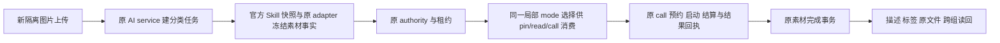

# T1301 图片分类冻结路由修复：实现结果

已修复受控复现的分类身份消费错误：合法 `model.structured` 图片分类原本冻结在 `vision:asset.classify`，身份服务却寻找不存在的 `structured:asset.classify`。现在三个消费者按同一冻结事实选原 vision 键，原归属、身份、租约和回执门保留。最终本地受影响回归 **89 项通过、零跳过**；新 production 候选的真实上传自动分类仍待验，不能据本报告完成 T1301 或代签 T1300 U27。

基线 `24a65c06f293da32037b1dfc2c342de00eec334b`。全部受测源码、原兼容测试、SPEC/锁/真实 Task Packet 的 SHA 见 [runtime/SOURCE_BINDING.json](runtime/SOURCE_BINDING.json)，逐命令真实退出和原件见 [runtime/validation-results.json](runtime/validation-results.json)。提交 SHA 由最终交接绑定，避免报告自引用。29 项审核输入中，仅本步允许的1生产/2现存测试发生变化，另新增1份允许的集成测试，其余26项字节相等。

唯一生产改动是 `backend/src/modules/execution/execution-model-identity.service.ts` 的局部 `frozenRootModelMode`，接到 `pin`、`read` 和 `frozenNonChatModelBindingForCall` 普通根 structured 分支。只在 v2 下，kind 为 `model.structured`、skillId/capability 都为 `asset.classify`，且原 `assetProcessingInputSchema` 核过的冻结 taskType 同为 `asset.classify` 时选 vision；错字段、缺正确键、身份漂移拒绝，不回退 text、structured 或当前配置。

缺 route / schemaVersion1 在新 facet 校验之前保原 null 兼容路径。合法旧 `model.generate(asset.classify)` 仍为 vision；`material.extract` 的实际 `script.draft` 仍为 structured；六种 chat vision 及先行 I/F/agentic/ASR/video/cover/image 分支不改。纯 mode 选择不授予 DB 权限，不把 facet 自报当素材所有权。scope、file/checksum、业务映射、原 request 摘要、fence、取消与原 deadline 继续由原真实消费者负责。

## 当场红绿与时间顺序

| 证据 | 实际结果与边界 |
| --- | --- |
| `red-three-consumers-final.log` | **真实前置 RED**：生产仍为基线，7项失败。API/Codex pin及已有合法 identity 的 read 均 `MODEL_ROUTE_NOT_FROZEN`；真实 ledger 原 call 的 binding 两来源为 null；Codex 原 call 服务拒绝“原call未冻结Codex执行权”。12项因 `-t T1301` 过滤，不计通过。 |
| `red-three-consumers.test.ts.snapshot`、`red-source.sha256` | 保当时测试原字节及生产/测试 hash。已有 identity 只在独立 read/call unit fixture 中写隔离 DB；不从公开入队请求指定、不用于完整业务链。 |
| `baseline-asset-chain-counterexample.log`、`baseline-counterexample.json` | **实现后的基线反例回归**：暂用冻结基线唯一生产文件原字节，API/Codex完整服务组合均在正常 pin 失败，同为 `MODEL_ROUTE_NOT_FROZEN`；2失败/4过滤。finally 已精确恢复修复字节并记 SHA。**完整业务组合没有前置 RED**，此后置反例不能补拍成前置 TDD；该缺失留独评裁决。 |
| `green-focused-final.log` | 精确恢复后按 packet 三文件完整合组，exit0、80通过、0跳过。 |
| `compat-original-consumers.log` | 原 Codex call、只读 recovery、素材 workspace 三文件，exit0、9通过、0跳过。与80项不重合。 |
| `typecheck-final.log` | backend `tsc --noEmit` exit0，无诊断。空日志由真实退出码确认，不凭空文件认定通过。 |
| `boundary.log`、`semantic.log`、`timeout.log` | 均exit0；物理边界原5条基线、0新增。超时门内部用例不重复计入89项。产品预算未改，定向test/hook180秒、retry0。 |

更早四份 `red-three-consumers*.log`、两份 `green-asset-chain*.log`、`green-focused-first.log` 全部原样保留：分别遇到不支持来源的路由夹具、缺冻结输出契约、宿主运行字段防伪拒绝、误读 enqueue DTO 导致 modelInput 丢失、Buffer/Uint8Array断言、错误 storage key、误把 AssetRow 当带标签 DTO、标签读缺 entity access，以及 legacy 测试未按原 parse 顺序算 request digest。这些不能计成产品根因 RED。最终用原素材 service 注入真实 entity access 读标签，用原 parse 计算旧输入摘要，未改生产门/豁免。`green-three-consumers.log` 的19项与 `green-new-families.log` 的14项是中间子集，不再叠加总数；后者29项过滤也不算通过。

## 完整链究竟验证了什么

新增 `backend/src/integration/asset-classify-model-identity.integration.test.ts` 用真实1×1 PNG字节和全新 owned组，经原 `AssetsService.createUpload/completeUpload`、`AiService.createTask`、官方有效 Skill 快照、asset adapter、structured business preparation、authority、真实 PGlite lease、正常 `pin/read`、原 generation ports 的 reserve/start/settle/save，以及素材 `complete` 事务。Codex族另经原 `bindCodexCall` 绑定原 thread/turn；每来源只有一个原 call。最终验证描述进入原文件 metadata、标签经原 taxonomy service 读回、currentFileId与真实字节不变、业务与执行成功、完成回执幂等、attempt1/原deadline不变及跨组不可读。

**替身边界**：对象存储是只含本次真实 PNG 的测试 Map，凭据和模型返回是受控输入；不是 HTTP、顶层 dispatcher、真实凭据 resolver、真实 SDK/模型或生产文件系统验收。完整链未预置 modelIdentity，未复用或复制旧 UNKNOWN。现存混路由集成文件保原特殊族，新增 legacy generate/material 两族与六种 chat vision 的消费断言；身份文件另跑六种 chat 的实际 pin/read。

负例由对应真实消费者守住：v2缺/坏 facet、skill/capability/taskType不一致、缺vision键、身份变化、错误scope/operationKey/原task；ledger相同 operationKey 的 request digest 冲突；原 fence、取消、原thread不可替换；素材真实业务group、currentFileId、实际checksum变化；结果正文与原模型回执不一致不能完成。`skipModel` 原短路可完成且 generation port拒绝发模型，payload没有新增身份。

错误边界未改：分类 facet 缺失/坏JSON经原 schema 产生 Zod 拒绝；kind或其他输入错误也沿原输入校验。明确的分类字段矛盾由局部 `ConflictError` 拒绝，缺route由原 `readFrozenModelRoute` 拒绝；nonchat binding保原 catch→null，Codex call原服务对null拒绝。宿主原 dispatcher 会将 port异常包装 `HOST_PORT_REJECTED`；worker对不明 receipt 保原 UNKNOWN策略。**不能把所有负例统称对外 `MODEL_ROUTE_NOT_FROZEN`**，也未扩大错误码/权限/重试/timeout范围。

## 原现场、资源与后续

原 `ai-task-c3ad8262-227` / `exec_b994f018-19d0-4a60-afae-168278505844` 保持 UNKNOWN，未重发、恢复或改写。原 HTTP409模型摘要仍是映射无效，不能写成 calls=[] / 零模型 / 零费用。本次证明的是源码受控同根失败与修复，不反造旧 frozen payload、上游结果或旧任务内部异常。没有真实模型耗时/用量对照，不宣称提速。

源码/测试/报告/JSON的staged whitespace检查exit0；全量检查exit2仅因13份原始测试日志末尾空行，原件保留，详`staged-whitespace-all.log`，不据此改业务或裁剪证据。

本轮未启动浏览器、服务、candidate或真实模型，无 worker build、大构建、安装、当前App、用户库、密钥读取或设置修改。所有命令已结束，隔离 PGlite `afterAll` 均 await close 成功；媒体仅测试内 Map，无新增磁盘媒体根或后台任务。源码 freeze及门结束后，仅整理本报告/证据并精确本地提交，不push；控制面交还C。

后续由C集中新冻结production候选，用全新owned DB/media，经真实公共图片上传捕获**独立自动** `asset.classify` 创建响应、原task/execution/attempt/file、原credential/call/receipt/终态、描述/标签/原文件与跨组读回。A同一次真实自动分类可同时服务T1301与T1300 U27，不额外重复付费；vision聊天不能代签，material.extract仍独立。未知不自动重发。原生壳、真实激活及用户环境仍未验，不能以测试controller授权代签。
