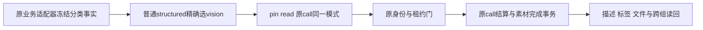

# T1301 独立实现复核

结论：**PASS，仅限冻结代码与现有受控行为验证；无开放的确定产品缺陷。** 完整素材组合的前置 RED 缺失，不能签其前置 TDD 已满足；后置反例不会补成历史，也未自动转为 accepted-risk。真实新候选／模型分类、T1301 整体验收与 T1300 U27 均未通过。

评审者：`/root/sol_spec_review`，独立于方案作者和实施者。B 实施期间只读检查，提交并明确释放后才按 Root 独占窗口写本报告及 JSON。没有运行测试、模型、构建或浏览器，没有修改源码、SPEC／锁或 metadata。

| 绑定对象 | 精确身份 |
| --- | --- |
| 受审提交 | `dc85a88a31b67e1bf0749e645d45bd90e184909a` |
| 父提交／实现基线 | `24a65c06f293da32037b1dfc2c342de00eec334b` |
| 已审 SPEC SHA256 | `23bb8676108e6f0fbf0e603951d3e8885ab4aaab43de1836c83ffaf3e19a1fb1` |
| 原锁 SHA256 | `28320fea8280b314e7fb8fe33af4a78217adc2140bd37f21f0d8178bf156a69f` |
| `IMPLEMENTATION_RESULT.md` SHA256 | `fbce067895fc84cfa4806ef1bd0a3e1e2ef002192fbeb4335343a21f9412f3b6` |
| `runtime/SOURCE_BINDING.json` SHA256 | `b12ac31eb25be7e862e550b94d652cf71307ea47526bcdb523caed2e8604b7d9` |
| `runtime/validation-results.json` SHA256 | `a352fefaad9e046d091966a9d43be10e0685e593eaf9467ae41474a379cc1197` |
| `runtime/EVIDENCE_SHA256.json` SHA256 | `fd21292dc1090eb7afd4ea66d1247fa84b2ec5702170d6d3e9e8c8433ef27f16` |

报告前 HEAD 为受审提交，工作区干净。独立核 SOURCE_BINDING 的10项全部匹配（7个受测源／测试及SPEC、锁、packet），EVIDENCE_SHA256 的30项也全部匹配。原29锁仅授权的一生产／两原测试变化，其他26项保持；新增集成测试在已审写集。提交无 worker、dispatcher、contract、权限／超时、前端或 metadata 改动。

## 实现与安全复核

| 位置 | 复核判断 |
| --- | --- |
| `execution-model-identity.service.ts:91-102` | 局部纯 selector 先保 chat 模式与原非structured判断；无 route／schemaVersion1 在解析 facet 前回原 structured 路径，再由原 readFrozenModelRoute 返回null。v2 普通structured出现任一分类标志时，必须 schema 与 kind／skillId／capability／taskType完整一致才选vision；否则拒绝。其余structured不改，不从正文／文件名作语义判断。 |
| 同文件 `181,215,242` | 三个真实消费者使用同一选择，缺vision键由原冻结读取拒绝，pin/read继续核首次无秘密identity和原route身份，不能借text身份或当前设置。nonchat binding继续 catch→null，由原调用者拒绝；没有新错误包装或对外DTO。 |
| 同文件 `105-180` | 先行 intelligence、flywheel、agentic、ASR后处理、videoDecisions、cover/image及video.visual-review分支原样在普通structured之前；legacy model.generate(asset.classify)仍选vision，material.extract实际script.draft仍structured。原task/call/scope/operationKey/parent/identity门未删。 |
| 原素材／call消费者及新增集成 | selector不授予资产读取／写入权限。原readProcessingAsset实际核业务映射、组、当前file和checksum；原generation ledger、Codex binding、结果回执、素材complete事务继续守预算、fence、取消、thread、摘要和幂等。skipModel无模型短路保留。 |
| 间接恢复消费者 | Codex call/read-recovery、model-call-recovery源码未改，既有归属／回执／source/fence规则保留。旧UNKNOWN没有被打开、恢复或重发；本轮没有新恢复入口或续期。不能把mode修复当成任意任务的新调用权。 |

错误口径准确：坏facet／缺facet可由原schema产生Zod拒绝，分类字段矛盾由局部ConflictError拒绝，缺键由原readFrozenModelRoute拒绝，binding保null。并非所有负例都对外暴露相同MODEL_ROUTE_NOT_FROZEN；dispatcher／worker原HOST_PORT_REJECTED与UNKNOWN策略没有变。

## 时间顺序与证据裁决

本评审读取B已发生的命令退出、日志、快照和断言，没有独立重跑。20项命令记录保留；类型空日志须结合实际exit0记录，不能凭空文件认定通过。

| 证据 | 实际证明及限制 |
| --- | --- |
| `red-three-consumers-final.log` | 真正前置7项行为RED：API/Codex pin与已有合法identity的read均缺structured路由；原真实ledger call两来源binding=null；Codex call拒绝原冻结权。12项由过滤排除，不计通过。基线生产SHA与原提交相同，当时测试原字节及SHA均留存。 |
| 更早四份RED日志 | 不支持Codex的目录来源、缺输出契约、入队identity防伪、错误读取enqueue DTO等夹具失败全部保留，不能计作相同根因RED。 |
| 完整素材组合 | 修后新增，通过真实公开service与原adapter／lease／call／receipt／complete组合验证；**没有前置组合RED，原SPEC的这一时间顺序要求未满足。** 本局部实现PASS不签完整TDD Gate，也不替Root/C将缺证接受为风险。 |
| `baseline-counterexample.json` 与原日志 | 实现后恢复唯一生产文件的原基线字节，完整API/Codex组合在正常pin均实际MODEL_ROUTE_NOT_FROZEN，2失败／4过滤；是后置反例。18:57:32Z结束并finally恢复修复字节true，SHA与当前生产相同；18:57:50开始最终绿。证明组合能捕获该缺陷，不追认前置历史。 |
| `green-focused-final.log` | 最终三文件80项通过、0skip；包括完整业务链、原identity与混路由库存，恢复后受测四文件SHA全部绑定。 |
| `compat-original-consumers.log` | 原Codex call、只读recovery、素材workspace三文件9项通过、0skip，与80项不重合，共89unique。六chat vision实际pin/read及既有模型族在定向库存保留。 |
| 类型／门／空白检查 | backend类型、boundary、semantic、timeout exit0；boundary仍原5条，非全库无违规。源码／测试／报告／JSON空白检查exit0；全量staged检查exit2仅13份原日志尾部空行，原件保留，不写全绿。 |

完整业务链确实由原AssetsService上传／完成、AI service创建新任务、官方Skill快照、asset adapter、structured preparation、authority、PGlite lease、正常pin/read、generation reserve/start/settle/save和素材complete构成；完整链没有预置modelIdentity。Codex族实际调用原bindCodexCall并拒绝换thread；API/Codex各仅一个原call。描述进入原file metadata，标签经taxonomy service与真实entity access读回，currentFileId、PNG字节、attempt1与原deadline不变，跨组／错file／checksum、坏回执、fence、预算及skipModel负例均在原消费者验证。

测试对象存储是本次PNG的Map，上游凭据／模型结果为受控输入；没有HTTP、顶层dispatcher、真实credential resolver、SDK／模型或生产文件系统验收。中间Buffer/Uint8Array、storage key、标签DTO／权限端口及旧parse摘要夹具失败均保留，最终没有通过改生产门或过滤负例取绿。中间19项／14项子集与超时门内部用例不重复计入89项。

## 尚待完成

原现场只能确认同exec宿主port拒绝与unknown，HTTP409不是calls0；当前受控复现不能反造旧payload全文、内部异常、模型结果或费用。旧task/attempt/file仍保原ID且不重发，旧shutdown143／flush未证不变，没有实测速度或用量对照。

须由C集中冻结新production／可安装候选和全新owned DB/media，通过真实公共上传捕获独立自动asset.classify创建、原task/execution/attempt/file、实际模型回执、描述／标签／文件及跨组读回；同一实际样本可服务T1301与T1300 U27，不重复付费重发。vision聊天及旧包成功不能代分类／新包；material.extract、其余矩阵、原生壳／真实激活与完整Gate仍独立待验。

本报告完成即释放独立报告写权给C。局部PASS不完成T1301、不自动签组合前置TDD或真实candidate验收。
