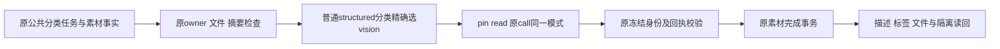

# T1301 独立初轮 SPEC／契约评审

结论：**PASS，仅通过未实施的方案。** 无开放的 must-fix／blocker／major。新增受控 RED、实现、实际模型分类、新 production 候选及整任务验收均尚未通过，不能由本报告代签。

评审者：`/root/sol_spec_review`，独立于 C 方案作者及后续实施者。按任务真相、项目流程与已读 `product-to-code-orchestrator` 3.29.0 路由为 BUILD 维护期的既有运行时契约修复。先只读核源码／证据；C 原 codegraph session62350 真实退出0、明确释放后，才在 Root 授权短窗口写本报告与 initial JSON。没有修改 SPEC、锁、产品或 metadata，没有运行测试、模型、构建或浏览器，也没有自行登记审核。

| 绑定对象 | 精确身份 |
| --- | --- |
| 源码检查基线 | `8f42586985fed53842a6e95eeadf3165fc2a0331` |
| SPEC | `docs/features/t1301-asset-classify-frozen-model-route.md` |
| SPEC SHA256 | `23bb8676108e6f0fbf0e603951d3e8885ab4aaab43de1836c83ffaf3e19a1fb1` |
| 输入锁 | `docs/verification/t1301/INPUT_LOCK.json` |
| 输入锁 SHA256 | `28320fea8280b314e7fb8fe33af4a78217adc2140bd37f21f0d8178bf156a69f` |

独立逐项核算锁内 **29 个输入 SHA，全部匹配**，写报告前再次核验仍一致。新集成测试当前确实不存在，属于明确允许新增文件；产品目录没有未提交差异。已审范围包括完整 SPEC、架构／module、冻结路由目录／worker 输入合同、三个身份消费者及 dispatcher、业务适配器／structured 准备服务／worker 真实消费顺序、原测试与原 candidate 公共证据。另只读核 `readFrozenModelRoute`、素材处理及生成端口、Codex 调用／只读恢复和模型恢复消费者，不将纯 selector 当数据库权限。

## 原失败及根因口径

原公共上传后 `ai.tasks.create` HTTP200，任务 `ai-task-c3ad8262-227`／attempt `bddc1e27-3457-4b79-80bf-f86e40dcf0fa` 绑定素材 `asset-c3ad8262-221`／文件 `afile-c3ad8262-225`，后续原 GET 对应 `exec_b994f018-19d0-4a60-afae-168278505844`。execution 从18:20:23.112Z到18:20:25.390Z进入 blocked／unknown_result，`ASSET_PROCESSING_RECEIPT_UNKNOWN`；绑定初始快照 executionTaskId=null 是创建时观测，后续 transition/final 才提供精确执行映射，不能改写早期原件。

同 exec sidecar 原件摘录确认 `resolveModelCredential HOST_PORT_REJECTED`。模型摘要实际 HTTP409／“模型摘要来源映射无效”，steps/results为空，均不能证明 calls0、零费用或上游模型未调用。独立 vision 聊天成功不证明自动分类成功。未取得原 payload 全文及内层 exception，`MODEL_ROUTE_NOT_FROZEN` 是源码强定位，必须继续由受控 RED 证明，不能追认历史红测。

源码关系明确：`asset-processing-business-adapter.ts` 产生分类的普通 `model.structured` 输入及原素材 facet；dispatcher `model-worker-dispatcher.ts:423` 对该能力选 vision。`execution-model-identity.service.ts:202,229` 的 pin/read 却先把 structured 选成 structured，`:168` 普通原 call binding 同样如此。catalog 只有 `vision:asset.classify`，v2读缺键应拒绝。此差异支持当前窄修与实验设计，尚不代表已读原错误内部原因或已证明所有同码失败的唯一根因。

## 范围、合同与安全判断

| 复核重点 | 方案判断 |
| --- | --- |
| 精确变更 | 仅身份服务一生产文件，局部纯 selector 统一 pin/read 与原 call 普通根 structured 分支。原 kind／skillId／capability 与 `__assetProcessing.taskType` 一致才使用 vision；不是全局 structured→vision，不按文件名或正文做语义判断。 |
| 原内部 API | pin/ref/capability/credential、read/ref、frozenNonChatModelBindingForCall/task/call 的入参、输出及错误边界不变；保存无秘密身份、身份一致性、原call键、parent、摘要与租约由既有服务守卫。无新 DTO、worker 消息或对外错误格式。 |
| 旧记录兼容 | 无 route、legacy、schemaVersion1 的 pin/read 保持原 readFrozenModelRoute 返回null的兼容，在此前不新增 facet 硬门。v2缺正确键、伪装／错shape／身份变化拒绝，不能回退 structured、主text或当前偏好，也不修改旧route／摘要。 |
| 真实权限与素材 | selector 不是授权。原 AI业务映射、user/group、readProcessingAsset、素材当前file/checksum、call/inputDigest及完成事务仍实际核验；skipModel 原无模型短路保持。坏输入可拒，合法空／非空输入不能被新增门整单反杀。 |
| 其他族不变 | videoDecisions、video.visual-review、cover/image子调用、intelligence、flywheel、agentic、ASR及六种chat vision不被统一选择器吞并；material.extract 的实际script.draft与其他普通structured仍按原mode。先行特殊分支保原顺序及归属。 |
| 原恢复权不扩大 | binding 也被 model-call-recovery、codex-read-recovery 及 Codex call service消费，修正mode仍须保其原call事实、source/identity、fence、deadline和授权；方案明确不新增恢复路径、不改UNKNOWN策略、不续期或自动重发旧unknown。必要原测试与负例覆盖该边界。 |
| 物理与写入边界 | 不改 worker、dispatcher、contract／目录、前端、设置或权限超时；AI不直接写库，结果经原backend素材处理service事务与投影。精确一生产／三测试及证据写集与module一致，无预扩生产目录。 |

module 新增 T1301 implementation→acceptance，T1300 acceptance 依赖 T1301 acceptance；T1300 主SPEC／矩阵／round3审核未变。这是独立根因新任务，initial 合理；不借此重置 creation review 或虚构 process-cycle 授权。原 taskctl 待审拒绝、progress首次拓扑漂移及随后生成／释放事实保留，不把前置失败签成通过。

## 验证计划充分性及剩余要求

方案要求分别实际 RED 击中 v2 分类 pin、已有无秘密 identity 的 read、原真实 call 的 nonchat binding，以及 Codex／素材回执组合；text／vision故意不同，并证明 API 和 Codex 两类冻结 vision。公共 AI service→asset adapter/bind→真实PGlite/lease→credential/pin/read→原call/结果/complete→描述/tags/文件及跨组读回，足以补当前消费者遗漏，不是 helper-only。

三指定测试为原 identity 单测、原 mixed-execution 集成及允许新增的 asset-classify-model-identity 集成；必要原 Codex call/read-recovery、素材workspace回归只读运行。正负例明确包括错kind/skill/cap/taskType、缺facet/v2键、错group/fence/file/checksum/摘要/identity、旧route兼容及其他路由族。预算不缩短、test/hook180秒／retry0，保所有失败与skip；backend类型、boundary／semantic／timeout后仍需原完整流程收尾。未实施方案不要求此刻已经有红绿结果，实施评审时必须核真实命令、受测SHA和替身界限。

关闭T1301还必须新冻结production／可安装候选及全新owned DB/media，绑定源码／产物／端点，实际上传触发独立自动分类，记录原task/attempt/file与真实模型产物、描述／tags／文件及跨组读回。受控组合不冒HTTP或真模型，vision聊天不代分类，旧包成功不继承给新包。已授权build_smoke controller仍保真实签名、loopback／端口／TTL、私钥不传业务子进程及正常握手／归属。

原两候选及UNKNOWN只读保全；round2 shutdown实际143且未证flush完成，不写shutdown0或完整drain。新根不依旧库恢复。原生壳／真实激活、Keychain/defaults、现用App及用户库保持不动，不安装／发布；T1300其余矩阵仍待逐项验收。

无须为该最小方案新增用户确认。C应按本SPEC精确SHA登记独立initial回执，再启动真实lease/packet；不得将方案PASS写成新红绿、真实模型或任务完成。本报告及JSON完成后释放写权给C。
