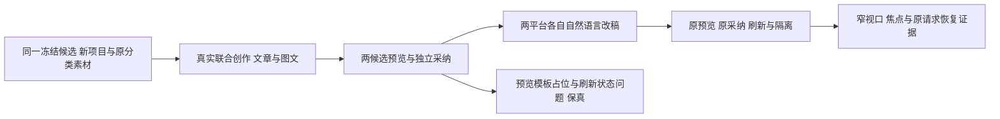

# T1302 真实候选前端验收

本轮完成真实联合创作、两平台各一条自然语言改稿及采纳旅程，并捕获了待修的呈现/恢复问题。不能签 T1302 整体通过，也未完成任务或处置历史 RED 缺证。

## 来源和范围

- 构建源码 `2168294fef3f62bc8e0b4ca3254652b935daeb0d`，控制面 HEAD `817616d5caab85e408153859df73d967487a536a`；产品五目录相对构建 source 零 diff，原 binding 位于 `docs/verification/t1301/acceptance/candidate/candidate-binding.json`。
- acceptance Packet SHA256 `c46d3f76196ae8749a9b61535376c11e1e3d896db96d54315d7a9fa062ab006f`；只写本任务 public/runs 与本报告。端点仍 `http://127.0.0.1:64881`，controller 未重启。
- 合法复用组 `grp-e2aea52e-6`；新项目 `project-e2aea52e-83`、脚本 `artifact-e2aea52e-96`、文章 `output-e2aea52e-130`、图文 `output-e2aea52e-143`。模型设置只读 revision 1，text/vision/image=codex，其余原 official；本窗口未再次 PUT、上传或分类。
- 原始证据根 `docs/verification/t1302/acceptance/runs/final-2168294-a-ui/a/`，runner 在本任务 `acceptance/public/a/`。每次 reporter 独立保存，无 retry，失败原日志与截图保留。

## 实际任务与结果

| 独立真实操作 | 原 aiTask / execution | 实际结果 |
| --- | --- | --- |
| 公共一键联合创作 | `ai-task-399cb821-13c0-4f28-a633-0107bd853b6f` / `execution-task-828eed61-64ec-483a-b1c0-600cbc683d40` | succeeded；两真实候选，`A1302JOINT` 1 PASS / 1.4m。 |
| 文章自然语言简化末段 | `ai-task-d8fbdf53-c487-47d7-b088-8063f9088b7c` / `execution-task-d19717a6-5bdc-4dda-9225-28db66b243e0` | succeeded；当前 article 编辑候选，生成 case 1 PASS / 52.2s。 |
| 图文自然语言简化末卡 | `ai-task-a469855e-81e7-4d44-a25f-51430b84d7ef` / `execution-task-5d7b01a7-0b89-4ada-aaa7-7510ea66a6a4` | succeeded；当前 graphic 编辑候选，生成 case 1 PASS / 39.6s，预览采纳刷新 1 PASS / 6.8s。 |

三个原消息均有独立 sourceMessageId、原模型任务与 `actualEngine: codex`。公开 chat summary 均 HTTP 200 且真实 `calls: []`；不据此推断零模型、零成本或已读底层 provider/model 路由。原 assistant metadata、tool parts、候选来源和采用 body 的 callId 均保存；这些不能替代 T1301 分类原 call 的直接可见性。

联合确认按钮合法追加 `artifactversion-e2aea52e-116`，早于模型任务创建，正文与按钮前逐字一致。两次平台采纳均以该确认后列表为隔离基线，脚本不再新增版本/改文，每次另一平台的文档和版本均保持不变。文章选择 title-only 与 replace facts（真实事实为 0 项），图文保默认选择；未伪造非空事实。本轮不代签父矩阵尚未操作的两个重组入口或其它功能。

## 真实 UI 与恢复覆盖

1. 当前注册文章/图文工作台 placeholder 正确、通用 chips 隐藏，输入 aria-label、附件、发送与清空保留。脚本页与全局助手保原通用 placeholder/chips。未实际操作视频或跨组 host 切换，不将原受控测试签成该生产负例。
2. 选择区只在既有预览 modal 内出现；文章真实 tags 缺省时没有虚构标签选择，空摘要显示“（空）”，事实 0 如实显示。脚本引用显示真实类型/数量和名称未提供，无 raw JSON/id。关闭重开保选择；联合 modal 重开 source/exact 计数 4→4。文章 editor 的 lazy 读按该候选 toolCallId 核，未开预览为 0；关闭重开不新增该来源读取。混在同一历史的联合卡仍按原 fresh 读取，未把其必要读取算成 editor 回退。
3. 文章 editor 来源 GET 做明确标记的真实响应延迟/丢弃：modal 有 loading，再有 error；关闭重开重新请求原来源成功。未伪造来源 JSON或模型输出，未重发模型。
4. 图文 creation 采纳服务器 HTTP 200 后丢弃一次客户端响应；原 storage、body/key/source 保留。刷新后原 pending 提示/恢复名可见，预览内选择 disabled，原按钮重发同一 body/key，公共版本未重复新增；`A1302RECOVER` 1 PASS / 14.4s，零新模型。
5. 文章 editor 同样真实采纳 200（版本 `artifactversion-e2aea52e-394`）后丢响应，首次显示原恢复名；但刷新前未再次预览时，外卡没有 pending/恢复提示，只见 disabled 的“采纳到当前作品”。120s 原断言真实 FAIL，不能由后续恢复销账。
6. 获 Root 明确授权后，在独立新 browser context 仅恢复该失败用例保存的原同 scope/output/source/body/key storage 字节，明确不称自然同浏览器会话。通过原预览后出现 pending disabled 选择及恢复名，原按钮真实恢复成功；请求与原字节一致，版本 394/版本列表未增加，脚本与图文均不变。`A1302STORAGE` 1 PASS / 5.1s，不替代第 5 项 FAIL。

## 缺口、失败与排版限制

- **真实模板差异**：联合文章候选 ready 后的原生 HTML 有六个可见 `{{栏目名}}/{{日期}}/{{副标题}}/{{关键词}}/{{账号名称}}/{{标签}}`；同稿采用后原生 HTML 无占位、改为石墨版式。两边均等到原 export enabled/onPreviewReady；`nativeLayout` 实际为空，字段选择未写 layout。没有替换 native handler，没有为该问题再发模型。详见 `joint-recovery-article-preview-adopted-visual-comparison.json` 与两原 HTML/图。
- **刷新状态**：同一 browser 中已成功采用的历史联合卡刷新后仍显示“原采用请求待核对/恢复原采纳请求”；稿件和回执确实成功。保真实截图，不能只以作品刷新成功签 UI 状态正确。文章 editor 则有上述首次 lazy 挂载缺少恢复提示的独立失败。
- **dirty 阻挡**：首次从自动承接脚本、尚未保存的文章工作台采纳联合卡，被原 dirty 保护拒绝，等待状态 120s 后 FAIL。原页可见“查看脚本原稿”及头部脚本链接、提示“开始对话或导出时保存”，未见独立“保存/核对”按钮。未清输入/弱化保护；经真实脚本页打开同一原会话恢复采纳前核实版本未变。该受阻入口可发现性仍交 Root 判断。
- **runner 假设失败**：首文章 editor case 将 viewport 改为 640 时，原宽侧栏被响应式卸载，modal 随之消失；随后 runner 直接读 rect 抛 null。保该 exit 1，不把假设错误直接归产品故障。独立 case 通过真实“打开编导”/历史重开后，两 owner 的窄页预览可达。
- **缩放方法严格区分**：640×900 加 CSS zoom 2 的真实采样中 modal top=-418，标题/关闭被裁切；该图及 metrics 保留，不据此冒充浏览器菜单/原生 200% 的结论。随后遵照仓库既有方法，以 1366×900 基准的一半 **683×450 CSS viewport、无 CSS zoom** 补证：两 modal top=16/bottom=434、height=418，标题/关闭实际可达、内容内部可滚动，Tab 留 modal、Escape 返回触发按钮，1 PASS / 5.6s。仅证明等效可用空间，不称浏览器菜单/native 200% 已验。

全窗口 11 个实际 case 结果：8 PASS、3 FAIL（dirty 阻挡、窄页 runner 假设、editor lazy 刷新恢复提示）。没有覆盖、删除或过滤失败凑绿。

## 描述补证、门与释放

原素材 `asset-e2aea52e-49` / `afile-e2aea52e-53` 经公共 materialLinks 合法关联新项目。本来必要的 `work.creation.read` 原 tool output 返回对应 images.description，与分类结果描述逐字相同；asset.description 原为空，实际文字未触及 4000 截断。此为 **ProjectScriptSource 合并/可能截断后的真实消费投影**，不冒 raw mediaMetadata 或原分类 call 已读取；没有新发描述模型，也未打开/复制活动 DB。

本窗口未改产品，不重复整套 timeout/Gate；按 C 明确指令复用同冻结 source 的 T1301 `timeout-policy/verify` exit 0、174 PASS 和静态 2839 文件记录。最终产品 diff 空、gitstatus 空。浏览器与全部测试自然退出，三原模型任务均 succeeded、无在途；controller/owned 数据保留，未安装、重包、提交、taskctl complete 或写 metadata。代表图与自检见 `VISUAL_REVIEW.md`；正式独立复核与后续修复由 Root/C 串行安排。
