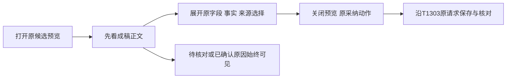

# T1302 预览呈现增量实施结果

候选预览现在先显示成稿；原字段、事实与来源选择默认折叠，展开后仍可照原方式选择。文章联合候选的空版式与现有工作台使用同一简洁默认主题，明确指定的旧版式仍优先。待核对和已确认的锁定原因在弹窗内、折叠区外可见。

基线 `bdc6a63e37b51e1b4d9f46bab3734cc0c24320b5`，同 lineage round3 `PASS[REV:f5756f377f49]`；正式 lease/Task Packet 由 C 交接，原件为 `runtime/refinement/TASK_PACKET.md`，SHA256 `8f742d664b77d927e2da28d8cf7f9d641ded12426e191d81500ccdb58b4d1a32`。执行者 `/root/sol_ui_refinement`，按委派 GPT-6.1 Sol high；未主动开启加速，工具没有开关读回，不声称核验当前开关状态。

## 修改及不变量

- 生产只改两个原卡文件：creation 的真实 `NoteRelayEditor` 补 `simplified`；共享 `AssistedWorkSelection` 在 enabled 且 ready 后复用既有 `LazyDisclosure`。只挂卸选择内容，不包卡层 hook、NoteRelay 或状态。
- loading、error、pending 和 confirmed 原含义保留；必要原提示位于折叠外。外卡被 Dialog 设为 `aria-hidden` 时，弹窗内仍可读锁定原因。没有第二套采纳按钮或新增读取、保存动作。
- `Object.hasOwn` 字段全集、合法空值、缺省 tags、原默认选择、事实 keep/replace 与审阅态、refs、metadataSource、document/body/key 保留。折叠关开与弹窗关开均不重置选择。
- 原 `useAssistedWorkReview`、投影、来源、保存及其后的卡逻辑逐字未改。组合测试只增加四处真实 summary 展开动作及同文件 helper，全部原业务断言不变；机械比对见 `runtime/refinement/invariants.json`。

## 当场红绿与原件

生产修改前实际取得三项目标 RED：editor ready 区默认展开、creation ready 区默认展开、creation 空版式经真实 NoteRelay 与原 native bundle 预览及 HTML 导出出现六个模板占位。命令、两生产与测试 SHA、原测试快照分别在 `red-binding.json`、`baseline/`；`red.log` exit1，3 个目标失败、26 个按名称过滤跳过。空版式原预览和导出 HTML 在 `red-artifacts/`。

首轮 creation 因 jsdom 环境直接 import esbuild 的跨 realm `TextEncoder` 不变量导致收集失败，单独保留 `fixture-esbuild-realm/`，没有计为 creation 行为 RED。测试桥改在有 180 秒预算的 Node 子进程运行原 esbuild 格式转换，随后取得上述真实三项 RED；此时生产字节仍是基线。

修后先跑 5 文件 67 项通过；随后补两卡各 pending/confirmed 的真实保存或未知响应、整树卸载重挂和弹窗状态检查，最终为 71 项。首轮最终 71 及 LED/AI 243 已通过，但 Python 外层 2400 秒不覆盖全部用例的理论串行上限；原件保留 `initial-outer-budget/`，同源码、同用例以 86400 秒外层上限各最终复验一次，不扩大用例。直接 Vitest 均 `--retry=0 --maxWorkers=1 --testTimeout=180000 --hookTimeout=180000`。

## 最终受控验证

| 验证 | 真实结果 | 证据（均在 runtime/refinement） |
| --- | --- | --- |
| 两卡、原组合、NoteRelay、原 native bundle | 5 文件、71 通过、0 失败、0 跳过，exit0；外层实际 18.24 秒 | `focused-final.log/.exit` |
| LED-047 原 8 文件及只读 AI 内容 | 9 文件、243 通过、0 失败、0 跳过，exit0；外层实际 45.97 秒 | `led047.log/.exit` |
| 完整 frontend 类型 | exit0，外层实际 145.34 秒 | `types.log/.exit` |
| boundary | exit0；原 5 条，新增 0 | `boundary.log/.exit` |
| semantic | exit0 | `semantic.log/.exit` |
| timeout verifier | exit0，静态 2839 文件及原内部回归均执行；外层实际 113.68 秒 | `timeout.log/.exit` |

最终命令在 `commands.json`，结果在 `validation-results.json`，受测字节锁在 `verification-source-binding.json` 与 `final-source-binding.json`。测试中的 jsdom navigation 提示与 Node localStorage 警告保留，不冒真实页面导航或浏览器旅程证据。

`native-html-comparison.json` 绑定实际 HTML：同一空版式文章的预览和导出占位均 **6→0**，真实正文“同源文章正文”保留。显式 `moyu-green` 的完整 nativeLayout 入参逐项相等，真实预览、导出仍包含显式栏目、作者与正文；没有全局禁止旧合法主题变量。修后 HTML 及 creation 两种锁定状态的弹窗 DOM 在 `final-artifacts/`，最终 19 项原组合 DOM 在 `final-combo-dom/`。

暂存时，全部原始 `-z` 路径与证据/源码 SHA 已匹配；首次对全部暂存工件运行 `git diff --cached --check` exit2，原因仅为原 native HTML 的空白行和原日志尾空行。原件保持真实字节，不清洗来过门；随后五个源码及报告的精确空白检查 exit0。范围守卫仍覆盖全部暂存路径。

## 证明边界与交接

普通两卡测试的 RPC/scope/native 预览边界仍有替身；新增 HTML 组使用真实卡、真实 NoteRelay、原 `public/reference-editors/noterelay/native/native.js` 的 mount/load/export。只在测试宿主句柄接上独立 JSDOM 的原运行时；esbuild 仅格式转换，跨 realm Blob 转换保持原 HTML 文本，没有手造或清洗 HTML。原 native bundle 回归另只读执行。组合保真实 Provider、scope/epoch/signal、owner、两卡和 NoteRelay，仍使用原 dispatch/native 外部边界替身；不把这些拼成生产 E2E，也未验证真实 PNG 像素。

本窗口未启动 App、浏览器、模型或服务，未打包、安装、重开旧 owned 根、重发旧 UNKNOWN、读取用户库或 Keychain。各命令均已退出，新增原生测试实例已 dispose 并关闭 JSDOM。未修改控制面、SPEC、旧审核或 T1303 历史证据；pmem/reconcile/任务状态由 C 串行处理。

新不可变生产包的自然刷新、预览到选择到原采纳和指定版本读回、实际 HTML、窄窗与真实菜单 200%、键盘焦点及独立实际图评审仍待后续验收。T1302/T1303 acceptance、T1301 历史组合前置缺证与用户裁决、T1300 完整能力矩阵均未因本受控实施验证完成。正式 App 和全局既有欠账保持原事实。
