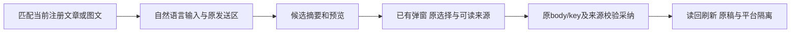

# T1302 独立初轮 SPEC／UI 合同评审

结论：**PASS，仅通过本次锁定方案。** 无开放的 must-fix／blocker／major。产品尚未改，新 RED／GREEN、实际新候选视觉与功能均未通过；查看旧基线不等于新界面验收。

评审者：`/root/sol_spec_review`，独立于 C 方案作者及 A 实施者。按 BACKLOG 顶部与 SPEC 审查，沿已读 product-to-code-orchestrator 3.29.0、项目 oil-ui-pro 0.10.0 及账号组规范。C 明确释放后，仅写本报告及 initial JSON；没有修改输入、产品、测试或 metadata，没有运行测试、模型、构建或浏览器。仅使用本地看图工具查看两张已存在的基线截图。

| 绑定对象 | 精确身份 |
| --- | --- |
| 源码检查基线 | `42ae5e89e4635fa67ecf8cd1aa017a5f5e39df35` |
| SPEC | `docs/features/t1302-embedded-assistant-simplification.md` |
| SPEC SHA256 | `f2b7b6b6a1b1f3290df51eca50d17f16ee68d722bcd3436b922d5798646058f9` |
| `INPUT_LOCK.json` SHA256 | `8c59529a9625c37ee43e182c13ac7cb272bd9f79f8dae9108cb5b4f94e3ec045` |
| `VISUAL_BASELINE.json` SHA256 | `c472f0fba90f9eae9f68b2182c24aaf3b186897e1e1cf219660b39540c628d5a` |

已独立逐项核 **51 个输入 SHA，全部匹配**。三个拟改 UI 生产文件与基线候选 `8f42586985fed53842a6e95eeadf3165fc2a0331` 的 Git 原字节全部相等。原 pre-formal-lock SPEC／锁完整保留；对照差异仅加入 Root 明确授权的同宿主 placeholder 与相应断言，是首次正式 initial 的输入收敛，没有已发生的旧 initial／recheck 被替换。

## 基线与方向

已实际查看锁定的 U11／U12-refreshed-editor-ready 两图：文章、图文页侧栏均有“分析机会／生成脚本／寻找素材”等通用 chips，输入提示仍针对全局项目探索；可见文章候选的字段选择与 raw project_script 引用 JSON 占据窄侧栏。图文页显示的仍有历史文章卡，不能把截图当两种候选卡全部状态已看完。原分类 UNKNOWN 提示另属 T1301，不在本任务借简化隐藏或签恢复通过。

T1296 已明确原稿在脚本、单一重组主动作与自然语言调整，本次继续既有方向做减法合理。保原工作台、品牌、Dialog／Button／tokens，无新风格探索或新页面。已有截图仅证明当前问题与基线，后续必须在同条件新 production 中检查实际布局及操作，不编视觉分数。

## 精确交互与合同判断

| 复核重点 | 方案判断 |
| --- | --- |
| 当前宿主判据 | 必须 embed存在且selection.kind=project；当前注册 preparation.owner 为文章／图文、project与embed.selection.id相等、scope与当前workspace相等；当前 readEditorState().outputId非空且与preparation.outputId相等。使用原editorTick更新，不读URL、旧request、历史candidate或存储；没有虚构embed.outputId。首挂／注销／切组／任一不匹配保原通用行为。 |
| chips 与 placeholder | 同一严格判据只隐藏vm.chips内层，并按owner换自然语言改稿提示；aria-label不变。外层suggested-action-chips还包含发送／停止／清空／快捷键提示，方案明确不能整块移除。项目／对象context、附件、错误／授权状态及原输入／发送／自动发送能力保留。全局、脚本、视频为显式负例。 |
| modal与hook | 只移AssistedWorkSelection展示至两卡现有DialogContent，hook留原card/member层；关开不重置fields/facts/pending，关闭不是取消。editor lazy／有界历史cache和creation fresh默认不变；无新source请求、技术详情按钮或额外模型。来源加载／错误在modal内，原采纳错误在卡上可见。 |
| 空值与默认 | 保Object.hasOwn原checkbox集合，title／summary合法空串、article tags缺省／空数组、fact.text空串、空refs如实显示。展示不排序／去重／改对象，不增加默认勾选，不删合法空事实。默认／部分fields、facts keep/replace及原body/key/digest逐字保持。 |
| facts实际结果 | 对照review.base与实际review.document，不以raw proposed冒采用后；keep保原facts，replace沿原id/text/refs全同继承confirmed规则，新改项needs_confirmation。显示真实事实正文与“已确认／待确认”，没有替用户确认或在前端重做语义判断。 |
| refs与metadata | 覆盖project、asset、project_script、output_version、moments_version、work_basis_version及graphic的intelligence；metadata另区分project／publication_revision。只有锚点ID无名／原文时显示准确类型、数量和未提供名称，不冒已读原文／已验证事实、不借当前项目名贴历史来源。混合采纳删整组metadataSource仍沿原算法，缺组仅无声明。 |
| pending／恢复 | 原save前冻结storage/body/key保留；外卡留简明待确认状态及原恢复入口可发现性，选择仅在modal内且pending字段／facts禁改。刷新／关开／UNKNOWN不清storage或重绑key；原source、幂等、CAS及双卡隔离不改。缩短呈现不等于减少必要核验。 |

现有真实消费者支持上述最小方案：Provider已用editorTick使context更新；原hook在展示层外保存选择；来源合同真实含所列变体但通常无名称；实际facts投影已由原前后端一致算法承担。无需修改Provider、DraftChatRail、backend、contract或保存／网络合同来实现本任务。

## 写集、验证及流程边界

生产只允许 ai-copilot-content、chat-work-editor-card、chat-work-creation-card 三个现存文件，展示helper可放原文件；测试只三个同名现存测试。interactions及必要draft-chat-request只读复跑。module与SPEC一致：新增T1302 implementation→acceptance，并给T1300 acceptance加依赖；T1301 module语义／锁与T1300主SPEC／矩阵／round3不变。

方案要求UI行为先实际RED再GREEN，文字／样式不人为破坏代码造红。精确宿主正反例、三类动作／附件／context保留、同判据placeholder与aria-label、默认／部分fields+keep/replace完整body/key、所有refs／metadata与空值、实际facts状态、pending／UNKNOWN同key恢复、关开／刷新、source失败／跨组与双卡独立均可在指定消费者测试中落实；frontend类型、boundary／semantic／timeout与LED047涵盖原按需读取、单在途及卸载边界。尚未执行的这些要求不能写PASS。

真实视觉与功能必须在集中冻结的同一不可变新production／可安装候选、全新owned DB/media中取得：文章和图文分别预览→选择→采纳→完整读回／刷新、脚本原稿与另一平台不变；窄窗／200%长内容、loading/error/pending及恢复、Tab/Enter/Esc和焦点返回实际操作并看图。沿现有界面规范一轮独立视觉复核，不拿受控测试代替、不强加新风格。共同证据可引用子任务和父矩阵，不能同族一次样本代签未执行功能，也不必为metadata变化反复重包或重复付费。

沿既有专用production-sidecar测试授权，保真实签名controller、loopback／端口／TTL及私钥不传业务子进程；不冒真实激活／native壳。正式App、用户库、Keychain/defaults不动，不推送／安装／部署。原UNKNOWN／失败／shutdown143及flush未证继续保留。T1301完整组合前置RED缺失不在此改名销账，也未自动accepted-risk。

本次无须额外用户确认；由C按本SPEC精确SHA登记首次initial，随后真实lease／packet再实施。完成本报告和JSON后释放写权；本方案PASS不通过T1302实现、视觉／功能或T1300整体验收。
