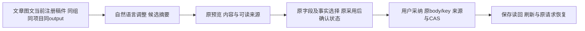

# T1302：补齐文章图文AI侧栏精简与可读来源呈现

用户已授权恢复Codex功能并落实已确定优化；T1296原授权要求文章/图文以脚本承接、单一重组与AI对话调整为主，删除细碎入口。Root依据A及独评只读核查确认侧栏精简遗漏，批准独立窄UI任务。沿原版丰富工作台和既有oil-ui-pro方向，不新选风格，不新增数据归属、保存或传输合同；本文先独立初审，产品尚未改。Root判断/复核，具体实施与测试交既有GPT-6.1 Sol高思考代理，不主动开启加速；无开关读回不声称已核验。

T1301只修模型身份服务，其主SPEC/锁/已审module语义保持；本任务不混其生产写集。T1300主SPEC、原矩阵与round3不改。父T1300 acceptance另加本任务acceptance依赖，最终同一不可变新candidate验证子任务后继续完整父矩阵，不每次metadata转换重包或重复付费。

## 用户看到的结果与真实基线

文章和图文内的助手聚焦当前稿件：自然语言对话保持，通用快捷chips收起。候选卡优先摘要、预览与采纳；原字段/事实选择放入现有预览。来源用真实可读类型/数量表达；已有事实正文及确认状态直接展示，避免raw JSON/id淹没内容。全局助手、脚本、视频及不匹配宿主保持原快捷能力；不以隐藏chips删除自然语言能力。

原基线是8f42586985fed53842a6e95eeadf3165fc2a0331第二轮production候选的A211V零模型刷新截图，具体路径见本任务VISUAL_BASELINE.json并绑定round2 candidate-binding及A-ROUND2-WINDOW-RESULT/SHA清单。C已实际查看两图：两页面可见通用chips；可见候选卡展示原始引用JSON，图文页截图仍含历史文章卡，不冒称这两图穷尽两种卡所有状态。当前B只改backend身份服务，3个UI文件与该基线字节未变，需机械核SHA。旧分类UNKNOWN banner不在本任务修复范围，其T1301原失败保留。新视觉与交互结果仍待取得，不把截图保存等同通过。

## 嵌入判据及不可改动的动作

只在`embed`存在、`embed.selection.kind === "project"`、当前真实`readEditorState().preparation`的owner为`wechat_article`或`graphic_post`、`preparation.projectId === embed.selection.id`、`preparation.scopeKey === creationScopeKey(当前scope)`，且当前`readEditorState().outputId`非空并严格等于`preparation.outputId`时隐藏通用chips。只消费现有字段，不新增`embed.outputId`、Provider props或状态合同。沿Provider原`editorTick`导致的context更新读取当前状态，不用URL、历史candidate、旧request.target/selection、存储或猜测宿主。

首挂无preparation、注销、切组、owner/project/output/scope不匹配及其它selection kind保原通用chips；全局/脚本/视频为显式负例。只条件隐藏`vm.chips`所在内层，不能隐藏3603的整个`data-slot=suggested-action-chips`外层（含发送/停止/清空/hint）。保项目与对象context chip、附件、输入、原发送/停止/清空、错误/待授权反馈；不改transport正文、引擎准入、模型、prepared ticket、自动发送及会话归属。

## 候选选择与来源显示合同

仅搬`AssistedWorkSelection`渲染到两种卡现有`DialogContent`。`useAssistedWorkReview`和选择hook仍留原card/member层；关闭不是取消，重开保选择。editor原lazy/有界历史读取、creation原fresh不变，无新增source网络请求或技术详情按钮。保持原预览ready及采纳门，不强制新增模型；source loading/error在modal内可见，原采纳错误仍卡上可见。

- 原`Object.hasOwn`决定checkbox集合；title/summary合法空串、article tags缺省或空数组、fact.text空串、sourceRefs空数组均如实呈现，不filter删除合法空事实、不把缺省tags造为新字段或新默认勾选。
- 文本显示真实title/summary；tags按原数组标签呈现。不得改对象、解析默认、排序/去重或序列化路径来配合展示；原字段默认及部分选择、fact keep/replace、原body/request key/摘要逐字保持。
- 事实展示取`review.base`与实际`review.document`的正文、refs及reviewState。keep仍是原facts；replace仅原id/text/refs全同才沿原算法继承confirmed，否则needs_confirmation。不得用raw proposed确认状态冒采用后事实，不把新事实标已确认。显示“已确认/待确认”，不替人确认。
- 来源refs覆盖project、asset、project_script、output_version、moments_version、work_basis_version；graphic另intelligence。多数合同只有ID/版本锚，不含标题或原文：只能显示准确类型、引用数量及“未提供可读名称”，不借当前项目名贴历史来源、不编名字/原文，不把refs声称已读取或已验证的事实。
- metadataSource区分project与publication_revision；混合字段采纳按原算法删除整组metadataSource，缺组只是无整组声明，不称来源已验证。保逐字段及图文原sourceRefs语义，不重写当前来源或冒改业务验证门。
- pending在原save前写sessionStorage，刷新恢复同source/body/key。外卡保一行真实pending状态和原恢复操作的可发现性，选择区仅modal内；pending字段/facts继续disabled，不清storage、不重绑key、不因modal卸载重置hook。默认/部分fields+keep/replace、关开/刷新/UNKNOWN重试保原请求与CAS、source来源和跨组拒绝，两个卡互不干扰。

## 精确实施范围

A唯一产品实现writer，生产只允许现存：

- `frontend/src/features/copilot/ai-copilot-content.tsx`
- `frontend/src/features/copilot/chat-work-editor-card.tsx`（共享selection/纯展示helper可在原文件实现）
- `frontend/src/features/copilot/chat-work-creation-card.tsx`

测试仅对应三个现存同名`.test.tsx`。只读运行`frontend/src/features/copilot/ai-copilot-interactions.test.tsx`验证原自然输入/autoSend/scope；必要原draft-chat-request测试可只读复跑。不修改Provider/StageChatWrapper/DraftChatRail/selector/backend/contract/worker/路由、设置或期限；不改T1301代码和锁。A另写自身`docs/verification/t1302/runtime/**`、IMPLEMENTATION_RESULT.md；C串行控制面、独评短窗口和新candidate验收另授明确资源，不与A并写。

纯UI呈现沿项目oil-ui-pro 0.10.0、账号组UI_RULES、现有Dialog/Button/tokens，不新建设计系统。生产无新字段或权限，来源仍原service核验，AI只候选、用户采纳写成稿；脚本原稿及另一平台不变。

## 验证、阶段及交付

维护期BUILD既有UI局部重构，先SPEC独审和现有合同核验，适用UI Gate/实现验证/公共旅程；无新架构/数据归属或外部API。UI交互先实际RED捕获遗漏再改至GREEN，纯文字/样式不为造红破坏正常代码。适用聚焦三文件+只读interactions、frontend类型、boundary/semantic/timeout及LED-047（同页预览/历史读取与卸载范围）；正执行至少120s、test/hook180s/retry0、外层覆盖串行及清理。不排除失败/缩预算或加硬门反杀合法任务。

重点断言：hide仅精确当前注册宿主，首挂/注销/切组/不匹配/全局/脚本/video负例，发送/停止/清空/context/附件不丢；default/部分选择及keep/replace原body/key逐字相同；合法空值、所有refs/两metadata族、原与采用后事实及确认状态；pending/UNKNOWN同key恢复、关开/刷新、来源失败与两卡独立、原source/CAS/平台隔离。受控测试与真实production分开记。

新candidate独占构建/浏览器/模型串行，沿T1300已审DEC130003专用production-sidecar测试授权模式，全新owned DB/media及明确candidate source/hash/run；正式App/Keychain/用户库不动。新候选真实文章/图文候选预览→选择→采纳→读回/刷新，同时检查脚本原稿及另一平台；窄窗/200%长内容、loading/error/pending/恢复、键盘Tab/Enter/Esc与焦点返回实际操作并看图。按既有界面规范一轮独立视觉复核，不编分数/风格确认；测试凭据不冒真实激活/native壳验收。只为验证独立功能必要模型调用，同一真实证据可引用子任务与父矩阵，不用同协议样本代签所有功能。

C收尾先子任务适用Gate与真实公共结果，再准确review/taskctl及父模块依赖；不以metadata done替代产品验证、不手改✅、不推送/安装/部署。T1301额外完整组合前置记录缺失单列，不在此改名销账、也不自动accepted-risk。T1300未完成矩阵仍pending，原两候选失败/UNKNOWN/退出143与缺flush完成事实保留。
