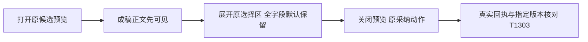

# T1302 增量：预览先显示成稿，选择区默认折叠（待独立recheck）

用户原授权为恢复Codex功能并精简文章/图文工作台。Root结合真实production验收和独立oil评审，批准本窄增量；不重置T1300 round3，不改T1301已审生产范围。原主SPEC及initial锁/审核完整保留，主SPEC同路径仅追加本增量绑定，走原lineage recheck。当前只方案，产品未改。

## 真实问题与裁决

本轮2168294候选，A在两个原平台真实生成、预览、部分选择、采纳、读回后报告11case8PASS3FAIL，3原模型均succeeded。失败、故障注入、runner假设和实际产品问题分列于FRONTEND_VALIDATION.md；不以模型成功代整体UI通过。creation文章预览有6个模板占位，同稿采用后0个且nativeLayout为空；已定位creation卡漏传原NoteRelayEditor的simplified，导致空layout默认主题与工作台不同。独立9图评审指出683×450有效CSS视口文章首屏被选择区遮住正文。评审全文在acceptance/runs/control-post-ui/INDEPENDENT_VISUAL_ORIGINAL.md，不能只截取有利结论。

Root裁决：对齐已有效的工作台简洁预览；全部原选择保留但默认折叠。不是全局修renderer缺变量，也不根据无变化/空值删除勾选项。原关闭预览后采纳的已验证流程保持，不加第二套采纳按钮；弹窗直接采纳建议为非阻断改进，当前避免扩张动作/焦点与恢复状态机。顶部截断次要建议保留，不列本次改动。

## 最小呈现合同

1. creation卡现有NoteRelayEditor补simplified，与editor卡及采用后工作台一致。空nativeLayout按现有graphite-minimal默认渲染，预览与导出均走原真实组件；不写nativeLayout，不填假栏目/账号，不清洗HTML，不改显式旧主题、renderer、native bundle或布局降级规则。
2. 两卡共享AssistedWorkSelection只有enabled且ready的真实选择区默认折叠，用已有Disclosure/原生可访问折叠语义及项目tokens。无enabled review不造空折叠。首次打开先见文章标题/正文或图文内容；用户能展开原字段、事实及来源。
3. 原Object.hasOwn字段全集、合法空字符串/缺省tags/空数组、默认选择、keep/replace事实确认算法、refs、metadataSource、原document/body/key及序列化全保。不能按相同/空值删除checkbox或自动改默认；折叠只改变呈现。
4. useAssistedWorkReview及选择hook仍在原card/member层，折叠与关闭不重置选择、不取消pending。loading/error和必要pending原因始终可见，原恢复操作可发现。状态恢复修复属于独立T1303，不能靠折叠隐藏失败或local标记冒保存成功。T1302最终acceptance等待T1303 acceptance，但T1303实施不依赖T1302 acceptance，防循环。
5. 保现有close→adopt保存路径、焦点返回、输入发送、来源校验和CAS。全局助手/脚本/视频/另一平台及原稿无语义改变；本次不新增模型请求/API/数据库字段。

## 精确写集与串行职责

A唯一实现writer，生产仅现存frontend/src/features/copilot/chat-work-editor-card.tsx与chat-work-creation-card.tsx，测试仅对应两个现存.test.tsx。运行原noterelay-editor.test.tsx/native-bundle.test.ts、ai-copilot-content.test.tsx和interactions只读，不改renderer/native主题。新受控证据仅docs/verification/t1302/runtime/refinement/**与REFINEMENT_RESULT.md。C串行控制、R独立报告；当前仅方向草案；先B按T1303独立initial/packet做完整RED及恢复冻结，再按其新card字节锁本delta送recheck、交A实施。两个卡共享严格串行，不能锁当前旧SHA冒未来closure。原implementation历史/packet与实际写权保留，新增ui-refinement步骤不重跑原实现来改旧证据。

## 必要验证与限制

产品编辑前，实际行为RED分别证实creation空布局与原采用后默认不同、已ready两卡选择区默认展开遮蔽内容；夹具错误不算目标RED。修复后两卡默认折叠、可展开全集/空值/原defaults、开关及modal关开保状态、pending原因/loading/error可见；原body/key部分选择逐字等同。simplified必须经真实NoteRelayEditor现有导出/渲染路径验证，不只mock一个prop；原native bundle只读回归，无需为one-prop扩生产write_set。

聚焦两卡、frontend类型、boundary/semantic/timeout和LED-047受影响路径；执行test/hook180s、retry0，外层留完整余量。新production候选包含T1301及本增量/T1303，独占资源、全新owned根，真实公众号/图文预览→选择→原采纳→读回刷新、原脚本和另一平台不变；同文预览/导出HTML占位前后对照。1366及窄窗、683×450布局与真实浏览器菜单200%分开记录，键盘Tab/Enter/Esc、焦点、滚动实际操作并看图。CSS zoom裁切不能冒原生200%通过。独立oil视觉复核，不打虚构分。

历史失败全部保留；本增量未实现/未验。T1302接受依赖T1303恢复，T1300父矩阵仍pending。T1301组合前置RED缺证及未答复accepted-risk不由本增量销账。
