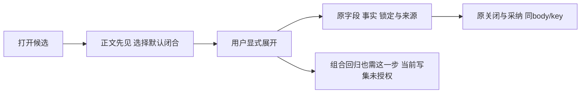

# T1302 原 lineage round2 增量评审

评审者：`/root/sol_review_t1303`，按委派使用 GPT-6.1 Sol high；未核验极速开关，未声称跨模型族独立性。本次是原 `REV:a0b5e6f83c1e` 的 recheck，上一轮 findings 为空，不重开 initial。结论为存在 **1 项 open major（REV-001）**，需要先澄清验证写集；正式结论由控制面 `reviewctl` 根据四字段 JSON 计算，本报告不登记审核或转换任务状态。

| 冻结对象 | 精确绑定 |
| --- | --- |
| 本轮 commit | `6f11f81c529c252adfc7b6e3edcc8124b0004d4c` |
| 主 SPEC SHA256 | `fa159adba3255e1515b369ff23578cf229cb07484cfcddb04b4b6f2435ac4e81` |
| delta SHA256 | `74d9348d2c7c475838428c169a70adcb916b91ef03155be1c19954f0b97bd65a` |
| INPUT_LOCK_ROUND2 SHA256 | `02a3102a8b31e3ba9a28dd200d0f1596beb69dfab501acac413d8e828b367045` |
| 原 initial SPEC SHA256 | `f2b7b6b6a1b1f3290df51eca50d17f16ee68d722bcd3436b922d5798646058f9` |
| constitution | `orchestrator/SYSTEM_ARCHITECTURE.md`，SHA256 `eb1826d4c09054df622d9718c38ca372bd19833e72bd1a752757631a5747c1df` |

实际只读核验：55 个输入逐项 SHA 相等；`SPEC_BEFORE_DELTA.md` 的原 initial 字节是主 SPEC 完整前缀。`git diff 130b97f… HEAD -- frontend backend contract worker` 为空，两个 card 确为 T1303 新冻结实现。读取 `reviewctl context T-1302` 得到上一轮完整 packet、PASS/空 findings 与新主 SPEC 第66行的合法 changed-lines 锚点；本轮只审该新增引用及其 delta，没有重审未改的 initial 设计。

## REV-001：默认折叠与既有组合回归的只读写集冲突

需求与验收已经确认：选择区默认闭合，按 open 挂卸控件；原部分选择、pending/confirmed 锁定、同 body/key 恢复、事实和平台隔离仍须验证。delta 第29行却只允许修改两 card 对应测试，并将 `work-candidate-adoption.ui.integration.test.tsx` 指定为只读运行。

实际消费者为该锁定测试第114、117、121行：四种坏确认/缺证参数例在打开 modal 后直接查全部 checkbox；editor UNKNOWN 部分字段例和联合 article partial-fields/fact-replace 例直接点击标题、摘要或事实控件。它们都没有展开步骤。已有 `noterelay/lazy-disclosure.tsx:3` 的 `open && children()` 会让闭合控件根本不在 DOM。因此合法实现新合同后，这些必要回归会在选择控件查找处失败；现有写集又禁止修正这条真实操作路径。这是本次增量引入的验证合同冲突，不是补提首轮偏好。

最小结果约束：授权该既有组合测试增加真实展开动作，保留原 body/key、facts、锁定、零自动写及隔离断言；同步 SPEC、精确写集和锁后沿原 lineage 复核。不能增加 test-only 自动展开、修改默认闭合、删除保护断言，或改写 T1303 原 RED/120/19 历史结果。这里不增加产品功能或生产写集。

本轮没有运行测试；上述是锁定代码与呈现合同的确定性冲突，不能冒称已经取得新 RED。

## 其余增量判断

- creation 卡缺 simplified 与 editor/工作台现状吻合。真实 NoteRelayEditor 的 layout 分支先取显式 `nativeLayout.editor==='noterelay'`，仅空默认且公众号 simplified 时选 graphite-minimal；补 prop 不需改 renderer 或写 layout。现有 NoteRelay/component 与 native bundle 有主题/导出消费者，新受控与生产证据仍必须沿真实路径取得，不能只断言 mock prop。
- 只包 enabled/ready 选择内容、hook 保持 card/member 层、NoteRelay 独立挂载、按关闭后原采纳的路径继续，能保选择与原请求生命周期。loading/error、pending/confirmed 锁定原因留 modal 内折叠外，解决外卡 aria-hidden 的可见性问题；不需要第二套采纳按钮或来源读取。
- 不变的字段全集、合法空值、defaults、keep/replace、refs/metadata、原 document/body/key 和 T1303 locked/confirmed 语义已有明确约束，未发现其它增量缺口。真实大窗口/窄窗/200%、键盘焦点、导出内容及独立视觉验收仍待实施后实测。

通俗说，正文先露出来，原选择仍在用户展开的位置；原来的恢复测试也必须先做这个展开动作，再证明它没有改错请求。

沿用已加载 oil-ui-pro 0.10.0/UI_RULES 和已存独立9图评审原文；没有声称本轮重新看过9图或通过新视觉。T1303 局部实现通过与 acceptance pending、T1301历史前置缺证/未答复风险、T1300 round3和父矩阵全部保留。本轮只写本报告与同名 JSON，未改 SPEC/产品/测试/控制面，未运行测试/模型/服务。交付后释放全部写权。
