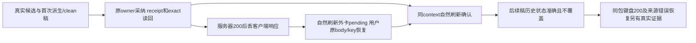

# T1303 已审采纳与恢复范围最终独立复核

**PASS：T1303 SPEC已审采纳、原请求恢复/确认及必要前端范围的证据现已具备。** 这是对SPEC的范围判断，不是把所有Codex功能或所有历史选择路径判全绿。任务完成前的pmem/reconcile/taskctl及范围外失败登记仍交C/Root执行，本报告不把任务直接标complete。

评审者 `/root/sol_review_t1303`，按委派 GPT-6.1 Sol / high，独立于实施和实际操作执行者；未读回或声称核验Fast/tier。本次仅汇总已复核原件、逐项对照SPEC，不运行测试、模型、浏览器、服务、构建或控制命令。

## 同一新包与证据链

SPEC SHA为`ab8325625fee34dec7ea964b5273988027121072f8d9afca9d9abf6c771dccfd`。新source **`cfbaf1ee021ef6904440ffd78afe3f82c4381ed6`**，candidate binding位于`docs/verification/t1304/acceptance/candidate/candidate-binding.json`，SHA **`af548574f185d2ae22ea05de24fdc27bf2971283c75882eef76c9b99b1ddb7cb`**；绑定含DMG/binary/sidecar/source及测试driver身份。使用新fresh owned根`/private/tmp/t1300-candidate-IDnfdQ` / `http://127.0.0.1:65112`，run=`final-t1304-t1305`，未重开旧根、迁移业务storage、安装正式App或使用原生壳/真实激活。

三个分工窗口使用同一冻结source和B真实新组/候选，经合法串行交接；control commit不同只表示证据/控制登记推进，不冒不同产品版本。当前再次逐项核三份最终索引，全匹配，数量不相加冒不重复总量：

| 证据 | 索引内文件数 | 索引 SHA256 |
| --- | --- | --- |
| T1303 新B业务闭环 | 214 | `f485b8bb07cfec1964a59b3188697c29c30aa048f97987a67940b7cdd2a23b4a` |
| T1304 A键盘/真200% | 275 | `13ce0e7f9c9fc79a4b211588579fbf82931167c240eae4cc3834a382d9ac88f7` |
| T1305 A来源失败/原位重读 | 145 | `c6dc5374ed1be1de526cfeadb8e81ff7733b2bfaae253679e2cbfa89898a4e4b` |

B本轮报告是 **`docs/verification/t1303/acceptance/runs/final-t1304-t1305/b/FRONTEND_VALIDATION.md`**，SHA`6c8761d4748c6ea60c5b71e1068b06199d41225eb3318f4ef44bd3efe4f80bd6`；顶层同名旧recovery2报告不冒本轮证据。T1304有限实际独评SHA`24fb7471bae6dd0654e8754902dbcb8ed6719c51f08731538485d7f46999643d`；T1305本轮来源/UI独评SHA`e56d7e3ed8c7aa373dd12a61a4214834c26f7987592352dac358e122cd505323`。

## 对照原SPEC，不缩减已确认范围

| SPEC要求 | 已成立的证据及限度 |
| --- | --- |
| §用户结果、§首次自动承接：未人工编辑的派生dirty可由原动作采纳，不能预保存绕guard | B joint1真实UI按钮生成候选，两工作台saved base83/95初始空，原owner dirty/专属composer/native ready均核；本owner无预save。文章title-only/空fact replace、图文默认选择分别采纳，exact/current读回后自然reload确认。图文前全局1笔是已完成文章保存，不误报图文本owner有预save。 |
| §原请求与确认：真实receipt/exact后本地确认，刷新准确，历史后续稿不覆盖 | B正常保存文章148/图文206，独立新cleanJoint文章302及图文358，editor文章534；同page/context自然刷新。旧joint1两卡和cleanJoint文章历史显示“已有后续版本”，外卡/折叠外modal/disabled选择可见，完整当前稿不变，历史阶段0新保存/模型。 |
| §lazy与§82：丢客户端响应后自然reload未preview可发现，用户原body/key恢复 | cleanJoint图文358、editor文章534均为服务器真实200提交后仅丢客户端回包。自然reload未preview外卡显示pending/原恢复入口；明确点击恢复，两次完整input逐字深等（body/key/base/source），保持同版本和全文，再reload确认。无业务storage注入、重发模型或自动POST探测。 |
| §74受控GREEN：真实编辑/改回、await身份/代次/注册变化、CAS/base、历史脚本、坏确认、旧UNKNOWN与字段/facts保护 | 原T1303独立实施复核及完整前置RED/回归保留；额外三预审问题闭合、outputId指纹反例保留。用户编辑/迟到注册等负例是受控真实owner/Provider组合证据，不冒本轮浏览器手工改正文；当前工作台无该正文输入，不造UI扩范围。 |
| §41/43及§82：lazy有界缓存、loading/error/pending、原选择与恢复原因可见 | 原受控cache/卸载/UNKNOWN/body-key断言保留；B原context pending/confirmed/later原图及DOM已核，状态在折叠外。T1305三族真实source暂持/abort→中文说明→用户明确关开→原source真200及默认恢复；首次失败前无手选字段，不冒跨故障已有选择实测，ready后手选普通关开保持另列。 |
| §82：两平台/脚本隔离、窄窗、真实菜单200%、Tab/Enter/Esc/focus与独立oil | B各保存/恢复/历史前后另一平台完整DTO、script artifact metadata+按真实total分页全部3版本相等；T1304新包三族×宽1600/窄1024/真200九格成立，真实settings ARIA200选中+目标CDP zoom2/CSS1，之后100/zoom1恢复。对应独立有限实图复核成立；T1305三族loading/error/recover九代表图亦已实看。 |
| §80/84：新不可变包、适用Gate、保旧失败、不代父或用户风险裁决 | 同一新包包含后续已冻结修复，原签名握手/owned归属模式沿用。原实施类型/LED047/边界/语义/timeout及B新source timeout原件保留，新docs runner预算另核。旧失败与下述历史选择观察均不销账；控制面收尾尚待执行。 |

T1303 Provider及两owner三生产文件从原实施commit`130b97f71b8170ad6674e4eb3c25dc3a9eae9bd6`到新包source逐字未变，已机械核对。两卡后续仅有已独立审过的T1302展示与T1305来源恢复变化；原实施报告JSON SHA`c226d343857ccb3536626c8a8fcc74a339f7c1d9910b93dbe2ca48f3001914ef`保持。原120聚焦、最终typed fixture UI19、backend3、LED174与各门按真实字节范围引用，不把最后类型收窄追称旧120同字节；T1305亦明确91完整回归在最后同步probe单行前，最终8定向通过，未冒最终SHA全91/tsc重跑。

## 业务公共链的实际结论

B **1 case自然exit0 / 240.042s**，三独立原execution任务均succeeded，匹配原assistant/sourceMessage/actualEngine=codex。joint1为UI一键，editor为原文章composer手动自然语言；cleanJoint诚实标记为**公共API生成＋原owner UI采纳**：真实composition revision/member/current exact base及已确认scriptRef，新requestId，wire省略scriptConfirmation，后端user source补public-request。未伪造SSE headers、来源或旧冻结target，不把再次一键新输出误认独立clean旧稿。

浏览器7个保存请求形成5个新版本、5个原key；两组恢复完整input深等且无重复版本。每次保存/刷新隔离和两个历史阶段完整before/after均相等。B自然pending/confirmed/later属于其原同一context；A后续新context仅做UI/source操作，不搬B状态伪造自然确认。

confirmed的证明限度仍是：本客户端实际收到成功回执并exact机械核对，再本地绑定/读回；versions.get没有服务端request签名或provenance，不由此增加写授权。旧only-body未知、坏确认及source/CAS仍保原拒绝与显式原key恢复，受控证据不被实际 happy path替代。

## 未定历史选择观察的范围裁决

T1305首轮是**1FAIL/2PASS**，article定向后1PASS。原文章失败发生在历史pick后联合region120s未出现，实际仍editor；source0、无候选采纳/恢复请求。原请求序列有editor及joint1 messages读取，但没有response完成时序，不能定根因；源码messages引用guard只是线索。等待初始editor真实200/region后再pick使source路径可达，**不修复该竞争，也不是快速历史切换通过证据**。

此观察必须保留为根因未定、未修复、未accepted-risk，待C/Root独立登记核查，不预造任务号。其消费者是未在T1303/4/5修复的通用会话加载/历史选择；它没有进入原候选source、派生准入、保存receipt或恢复状态链。新包B已经从真实历史入口完成所需候选及保存状态检查，A也完成三族source与键盘操作，原请求/数据边界没有被该观察推翻。因此，**它不阻断本报告明示的T1303已审采纳/恢复验收范围**；但阻止将这些局部结果宣称“所有历史切换可靠”或“Codex全功能已完成”。这是按SPEC对象/失败阶段划边界，不是自接受该风险或删去失败用例。

## 仍须保留的边界与收尾

- 原包真实dirty拒绝、误pending/lazy缺失、旧窄屏双层关闭、来源英文提示、原runner错误/中断与controller143/未证flush等历史事实均保留；新包证据不反写历史。
- T1301完整组合前RED缺证及用户未真实答复事项仍pending，本报告不accepted-risk；T1300四十功能/五十六键矩阵、原生壳、真实激活/现用App未由此签收。
- T1302专属chips/来源完整族与同文导出仍按其自身验收处理；当前只引用与T1303状态可见/采纳流程有关的展示证据，不代整个T1302 acceptance。
- C需登记历史选择观察并按真实规则执行适用pmem/reconcile/taskctl与证据整合，范围外全局失败准确分列。这里的PASS不是控制面已收尾、task complete、安装、push或发布授权。

只生成本报告/JSON及本窗口先前T1305两报告，其余原件/产品/控制只读。四报告交付后RELEASE全部报告写权与资源，不提交、不运行测试。
