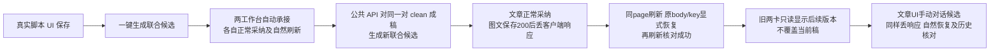

# T1303 真实生产候选业务链验收

本轮 fresh 根的三轮真实 Codex 与两工作台采纳恢复链通过：Playwright **1 PASS / exit 0 / 3.8m**，retry 0。**这不是 T1303 整体前端验收完成**：共享 UI、键盘、窄窗、真实浏览器缩放及独立 oil-ui-pro 评审仍由后续独立窗口补验。本报告不完成任务、不代签 T1300 四十功能矩阵、不证明原生壳激活或现用 App。



## 候选、资源与真实入口

- 不可变包源码 `8ced635520132688c6ef91449ad530d36d9ff1af`；handoff 控制面 `cd2afc59d6777f427c69a8b68abf1d6590f25803`。复用原包，未重包、未改产品或 driver。
- 原包 binding 为 `/Users/zyongzhu/Workbase/Thirdspace-creator/docs/verification/t1303/acceptance/candidate/candidate-binding.json`，SHA256 `cbcb2aecbb0acf910e08a59069be0fb133470ad77c4608d02b739c0c581de527`；本轮仅记录引用和哈希，没有重复复制签名身份字段。
- fresh owned root `/private/tmp/t1300-candidate-gPThzJ`，端点 `http://127.0.0.1:53008`。私有握手不进入报告或日志；controller `76238` 由 C 保活，B 未重启、关闭或打开活动数据库。
- 真实 packet `/Users/zyongzhu/Workbase/Thirdspace-creator/docs/verification/t1303/acceptance/public/b/recovery2/TASK_PACKET.md`，SHA256 `dd3fddc09a81e81a4f6d8df7af3a673c4da6ddf981645a28bbd2d55927b47144`。
- 新组 `grp-1ffecb88-6`，项目 `project-1ffecb88-22`，脚本 `artifact-1ffecb88-35`；同一对真实输出：文章 `output-1ffecb88-76`、图文 `output-1ffecb88-88`。新 root、新组、新脚本，不复制旧数据库、业务 storage 或旧 task。
- 设置页真实选择文本来源 Codex 并保存读回，其他能力原配置保留。本轮纯文，不上传图片或新增分类任务。
- 脚本通过真实 contenteditable 与保存按钮写入；之后按一键确认后真实脚本版本列表作为每次采纳/历史查看的隔离基线，不再假设每次确认必新增一个版本。比较真实 sections.body，合法标题投影不误算正文改变。
- 每次采纳前核真实 `[data-page]`、对应 output URL、dirty/clean 状态、文章/图文专用 composer placeholder、原生预览 ready、原 server base 及零预采纳保存；没有在脚本页 fallback 代签 owner。主工作台导出未提前点击，避免通过 prepareDelivery 先保存空承接稿。

## 三个模型原任务

三轮各有独立 conversation，始终同一 page/context；所有自然 pending/confirmed/后续版本状态均在该 context 真实产生。未导入、导出、注入或手改业务 sessionStorage。只设置测试组选择 cookie/localStorage 与 onboarding 偏好。

| 模型动作 | aiTask | executionTask | 真实结果 |
| --- | --- | --- | --- |
| 原 UI 一键联合创作 | `ai-task-239ced2c-d5ea-4e1f-b797-993e61a86007` | `execution-task-89a3251d-41f0-4df0-9c90-e2110210afef` | succeeded；source `ai-msg-1ffecb88-100`；conv `ai-conv-1ffecb88-99` |
| 同一对 clean 稿件公共 API 联合创作 | `ai-task-1ffecb88-236` | `execution-task-1ffecb88-237` | succeeded；source `ai-msg-1ffecb88-235`；conv `ai-conv-1ffecb88-233` |
| 文章原 UI 自然语言末句编辑 | `ai-task-48522040-6981-42a9-8590-00a5d141a5af` | `execution-task-269deb12-c960-4cb0-b2ef-67e773597243` | succeeded；source `ai-msg-1ffecb88-462`；conv `ai-conv-1ffecb88-461` |

原 assistant metadata 三轮均 `actualEngine: codex`，原 message/tool/candidate/target 与来源身份已保存。第二轮经现有 `ai.conversations.messages.create`，真实同 composition.currentRevision/memberCurrent 与两稿 current/exact base、已确认 scriptRef 构造全新 clientRequestId；wire **省略 scriptConfirmation**，后端真实 user 请求补 `public-request`。根据返回 message.modelMetadata.chatTaskId 读取 AI task 再获得 executionTaskId，未伪造 SSE headers。它是“公共 API 生成 + 原 UI 采纳”，**不是**再次点击一键按钮会复用旧输出。

## 五次实际保存与两次恢复

| 保存路径 | 实际结果与边界 |
| --- | --- |
| joint1 文章自动承接 dirty → 正常采纳 | PASS；真实预览后选择 title-only，事实替换选择真实空事实，不伪造非空事实；当前 owner 接受候选、读 exact/current、自然 reload 后外卡与默认折叠 modal 均确认仍当前。 |
| joint1 图文自动承接 dirty → 正常采纳 | PASS；图文真实工作台、默认选择，正常收到 200、自然 reload 确认仍当前。 |
| cleanJoint 文章 clean → 正常采纳 | PASS；新候选 frozen base 等于真实当前稿，正常保存及自然 reload 确认。 |
| cleanJoint 图文 clean → 200 后丢客户端响应 → 显式恢复 | PASS；server 真保存为 `artifactversion-1ffecb88-331` 后仅 route.abort 丢客户端响应，不伪造返回或来源。自然 reload 未开 preview 已有外卡 pending/恢复入口；原预览选择锁定。点击原恢复按钮再次发送完整相同 input（含 body/key/base/source），再 reload 确认；公共 current/exact 保持版本331，无重复新增。**不冒称首次客户端正常收到 200。** |
| editor 文章 clean → 200 后丢客户端响应 → 显式恢复 | PASS；原 UI 自然语言生成 work.editor 候选，真实保存 `artifactversion-1ffecb88-492` 后丢响应。自然 reload 未开 preview 已有 pending 和“恢复 / 采纳原请求”；preview 选择锁定，显式同完整 input 恢复，再 reload 确认仍当前。未用额外模型或额外保存帮助恢复。 |

全程浏览器共有 **7 个 owner versions.create 请求，形成 5 次实际新版本**：两组故障各为原保存及同一请求恢复两次。两组原 request 深相等，原 key/body/source/base 均保留；没有生成新 key 或重新执行模型。故障注入仅丢弃已产生的服务器响应，明确是受控客户端故障，不称自然网络事故。每次采纳/恢复前后，另一平台资源及脚本版本列表完整相等；不会把“当前稿保存成功”代替恢复状态核验。

原 joint1 两历史卡在后续稿采纳后，均只读显示“这份内容已保存，当前成稿已有后续版本。”；editor 采纳后 cleanJoint 文章历史也如此。外卡、默认折叠预览、展开后的 disabled 选择均核对，当前稿不变，新增保存请求和模型提交均为 0。这里的“零写”指业务保存/模型提交；只读 dispatch 本身仍使用 HTTP POST。

## 画面与原件索引

证据根：`/Users/zyongzhu/Workbase/Thirdspace-creator/docs/verification/t1303/acceptance/runs/recovery2-8ced635/b/`。截图均有同名 `.html` DOM 和 `-counts.json`；counts 含阶段、请求序列、URL、viewport。B 已实际查看下列代表画面，pending/confirmed/后续状态在折叠区之外，modal 选择默认折叠，未见本轮画面的水平裁切；此自检不替代独立 oil 评审。

- `joint1-{article,image}-normal-{owner-before,confirmed-natural-reload,confirmed-modal-collapsed}.png`
- `cleanJoint-article-normal-confirmed-natural-reload.png`
- `cleanJoint-image-loss-{pending-natural-reload-before-preview,pending-modal-collapsed,confirmed-natural-reload-before-preview,confirmed-modal-collapsed}.png`
- `editor-article-loss-{pending-natural-reload-before-preview,pending-modal-collapsed,confirmed-natural-reload-before-preview,confirmed-modal-collapsed}.png`
- `joint1-history-newer-{article,image}-{outside,modal-collapsed}.png`；`cleanJoint-article-history-newer-article-{outside,modal-collapsed}.png`

关键机器原件：`BUSINESS_RESULT.json`、`VALIDATION_SUMMARY.json`、`turns-index.json`、三组 `*-task.json`/`*-messages.json`、`cleanJoint-public-request.json`/`*-source-response.json`/`*-submission.json`、两组 `*-loss-{actual-response-loss,requests,result}.json`、各正常采纳 `*-result.json`、`network.json`、Playwright `result.json`/`execution.log`/`execution.exit`。runner 源与绑定在本轮 public/recovery2 和 `runner-{initial,binding}`；详细哈希见 `EVIDENCE_SHA256.json`。

## 命令、失败历史与剩余范围

实际命令（私有 session 只传路径，不显示内容）：

```bash
T1300_SESSION=/private/tmp/t1300-candidate-gPThzJ/session.json T1300_ACCEPTANCE_TASK=T-1303 T1300_MODULE=b T1300_RUN_NAME=recovery2-8ced635 pnpm --dir frontend exec playwright test recovery2/recovery.spec.cjs --config ../docs/verification/t1303/acceptance/candidate/driver/playwright.config.cjs
node tools/timeout-policy/verify.mjs
```

- Playwright session60552 实际 exit0，1 passed(3.8m)，retry0。外层8小时覆盖三轮完整串行、每模型30分钟有限观察及请求/截图/清理余量；请求900000ms，未延长任何原任务持久期限，未知不重发。timeout-policy 原 session56377 实际 exit0，原日志/exit 保留。
- 旧 `/final-8ced635-recovery/b/` 仅R：01将合法标题投影误判正文、02错误假设按钮每次新脚本版本且复用旧输出，均是 fixture FAIL；旧两模型实际 succeeded。03 首次只读请求 ECONNREFUSED/exit1/零新增业务。旧 controller/PID/port 消失且无退出/flush记录，原因 UNKNOWN。C 经 Root 授权用同不可变包新 fresh 根，本轮不打开旧 root、不复制旧DB、不重发旧任务；这些旧失败不能被本轮 PASS 覆盖。
- 本轮摘要辅助命令曾先读取尚未完成的 timeout-policy.exit 而报 FileNotFoundError；摘要已写，原 gate 后收真实0，单列 `evidence-helper-note.json`，不算业务失败或 gate PASS。sandbox ps 被拒未据此杀进程/重跑。
- 本轮仅新增本验收 runner/证据，未改产品或既有测试源、无安装现用App、无大构建、无SQL/数据库打开、无凭据读取或模型SDK替身。模型与来源真实；HTTP响应丢失是明确的客户端边界注入。
- 未测平台直接正文编辑：当前工作台没有此输入UI，不造 DOM/native 回调或用聊天冒本地编辑。真实人工编辑/注册变化/保存迟到负例来自已记录受控组合，不冒成本轮浏览器行为。
- 仅完成上述 T1303 三轮核心业务验收。未新增图文 standalone editor/reorg 模型，不代签父模块；共享UI/完整键盘/窄窗/浏览器真实缩放及独立 oil 评审仍待后续 T1303 acceptance。

本轮原模型全终态，浏览器自然关闭；B 已完成证据保密/哈希检查并释放 writer。controller、owned root 保留给 C/A 后续独占窗口，不由 B 关闭。未提交、未 taskctl complete、未写控制面。最终释放说明另见同证据根 `RELEASE.json`。
