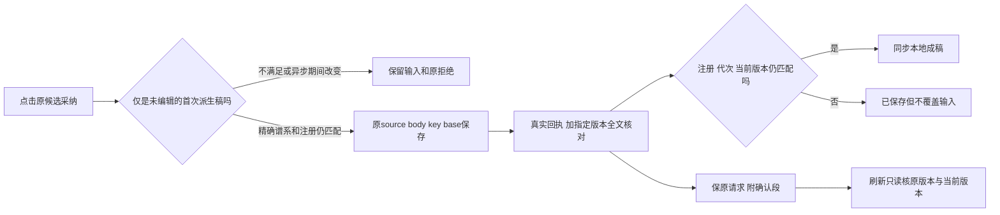

# T1303 实施结果

本次修复让未被人工改动的首次脚本承接稿，可以沿原候选、原请求采纳；保存后刷新按指定版本读回准确显示当前或历史保存状态。真正编辑过的稿、迟到输入、注册变化、UNKNOWN 和后端来源/CAS保护继续保留。没有增加保存按钮、自动模型请求或后端写权限。

基线 `04ec81b9b38254dc009761136c9aa35fc952daae`，独审 `REV:e65c711f4f47`，真实 implementation lease 与原 Task Packet 见 `runtime/TASK_PACKET.md`。仅修改 SPEC 的五个生产文件及六个允许测试文件；第七个 save-race 原测试及 NoteRelay、后端采纳测试只读回归。未触及 T1302 simplified/折叠、backend/contract/worker、路由、控制面或当前 App。GPT-6.1 Sol/high；未主动启用加速，工具没有开关读回。

## 实际修改

- `draft-chat-request.tsx`：增加可选只读 `admitCandidate` 与内存证明；Provider 在异步前后核原注册、scope/output、代次及完整状态。编辑/真实注销后不可恢复首次派生资格；首挂 StrictMode 同步 effect 重放可正常使用。内部 `adoptCandidate` 增可选 `isCurrent` 回调，旧两参 port 兼容。
- 两 owner：实际首次继承时记录原 saved base/全文指纹、脚本引用与文本摘要、派生稿指纹和实际 generation；不以 generation>0 推断派生。只读核原候选 member/target 与原版本，不调用自动保存，不更换 base。任何真实 onLayoutChange/setDraft 改动、手动保存/重读使证明失效，改回相同字节也不恢复。保存完成后、真正 setState/setDraft 前再检查 Provider 注册；迟到输入及旧 owner 仍 mounted 的注册替换均不覆盖本地稿。graphic 初始证明采用真正惰性初始化。
- 两卡共用 review：保存完整旧请求，再于收到真实成功回执且 exact version/全文核对相等后附加版本化确认段，绑定完整 identity、原 request/document digest 与 receipt.versionId。刷新只读核原 exact 与 current，分别显示“这份内容已保存，仍是当前成稿。”或“这份内容已保存，当前成稿已有后续版本。”；旧请求/确认损坏/读失败仍待核对。`locked` 独立于 `pending`，已确认仍锁原字段、事实、body/key。
- lazy editor 外卡：先核本地记录存在性。无记录/旧 only-body 保 source 按需；仅完整 confirmed 记录可做必要 base/exact/current 只读核，不预取 source，不自动 POST。用户打开 preview 后仍核真正原 source。历史读缓存原 32 项上限和卸载保护保留。

确认段只控制呈现。`versions.get` 返回 versionId/document，没有服务端 request provenance 或签名；不能把本地确认当任意请求的服务器证明，也不能用它授权写入或自动同步。候选历史脚本仍合法时，最新脚本推进不会被新增门直接判为旧候选失效。

## 红绿顺序及原件

1. **生产编辑前五条完整组合 RED**：`runtime/red-five.log`、`.exit`（1）、`red-binding.json`、`baseline/production-binding.json` 与原五生产字节、`baseline/red-ui.test.tsx`、`red-dom/`。两 owner 空稿真实继承 dirty 后，真实 Provider 拒绝，POST=0；另外两 owner 各自用非空 clean 稿先成功保存、整树卸载重挂后仍 pending；第五条 editor 成功响应丢失后新整树未 preview 找不到外卡恢复。五项相互独立，确认组未依赖修后派生组。
2. 首轮最小修后 `green-five.log` 为 5/5；独立预审又发现 editor 未 preview 的确认、current/历史区分、保存中注册替换三个边界。先实际运行 **增量 RED**：`red-increment.log`、`.exit`（1，3 fail/5 按 -t 过滤 skip）、`red-increment-binding.json`、`increment-baseline/`、`red-increment-dom/`。它们不是原始五条前置 RED。修后 `green-eight.log` 为 8/8，两个 owner 的保存中注册保护后来均纳入最终组。
3. 扩展负例实际发现 Provider 状态指纹未包含 outputId，见 `focused-expanded.log` 的对应失败；已补 outputId 与冻结的原 key/generation。没有把其它夹具失败代签此行为红。
4. 最终合组、类型和门见下表及 `runtime/validation-results.json`；原120项受测源/测试锁为 `runtime/verification-source-binding.json`；最终字节锁为 `runtime/final-source-binding.json`。原 RED 原件不随最终 UI 大白话措辞修改。

夹具/中间失败全部保留，不计目标 RED：`fixture-message-null.log`（contract message 不能为 null）、`fixture-source-toolname.log`（source DTO 缺 toolName）、`red-four-plus-lazy-fixture.log`（lazy modal 的 aria-hidden 查询）、`increment-registration-label-fixture.log`（等待按钮名称不符）。`focused-initial.log` 两项失败为旧 editor fixture 的 source.toolCallId 与 location 不一致，已只修 fixture；`focused-expanded.log` 另两项为换行查询和异步 review 就绪等待，已修测试等待。`types-initial.log` 的 ArticleState.projectId 与测试 projectTitle 两项类型错误真实保留，未称首次全绿。`expanded-ui-first.log` 四项为 modal 打开后以可访问 role 查外卡的测试查询错误，已用 hidden heading 定位外卡，未改变产品行为。

## 最终验证

| 范围 | 实际结果 | 证据 |
|---|---|---|
| 七个聚焦测试及只读 NoteRelay | 8文件、120通过、0失败、0跳过 | `focused-final.log/.exit` |
| 最终新增组合测试字节 | 19通过、0失败、0跳过，另保真实DOM | `ui-final-byte.log/.exit`、`ui-final-dom/` |
| 原 LED-047 消费者 | 8文件、174通过、0失败、0跳过 | `led047.log/.exit` |
| 原 backend 采纳集成 | 3通过、0失败、0跳过；v1/v2 原 source→assisted transport→两 owner/receipt；拒绝前端 document/错 digest、事实选择和 CAS | `backend-original.log/.exit` |
| 前端完整类型 | 原packet命令明确exit0，最终源/测试字节 | `types-confirmed.log/.exit` |
| boundary | exit0，0新增；仍有5条原基线 | `boundary.log/.exit` |
| semantic | exit0 | `semantic.log/.exit` |
| timeout policy verifier | exit0；原规范及内部回归真实执行 | `timeout.log/.exit` |

所有本轮直接 vitest 命令 `--retry=0 --maxWorkers=1 --testTimeout=180000 --hookTimeout=180000`；未缩产品请求预算。timeout verifier 自身的原内部命令/预算未改，其用例不另冒充本任务新业务覆盖。

最终新增完整树组合为 19 项：原5条、增量3类（注册保护覆盖双 owner）、双 owner StrictMode 与 latest-script 推进、双 owner base 推进拒绝、legacy/错确认身份/错摘要/exact 读失败、editor UNKNOWN 部分字段同 body/key 显式恢复、联合 article 部分字段与 fact replace、脚本/另一平台隔离。真实 owner 回调编辑改回、只读准入等待输入、原保存迟到输入/unmount 及 Provider 等待中 scope/output/generation/注册/proof 变化分别由聚焦文件覆盖。原 defaults、keep/replace、缓存和卸载用例同时回归。

最终120项之后完整类型检查实际发现一个新增fixture字面量类型被拓宽，见 `types-final.log` exit2；仅将 kept.reviewState 加 `as const`，生产及其它测试字节不变。保原120项测试字节于 `focused-final-input/ui.test.tsx`；最终19项组合与完整tsc在新字节重跑通过，不把旧120全部算作新测试字节执行。`types-final-fixed.log` 使用 `/usr/bin/time -l` 包装，83.78秒后资源统计的 `sysctl kern.clockrate` 被sandbox拒绝，wrapper exit1，未独立捕获子tsc exit，因此不用它签类型PASS；后续原命令 `types-confirmed` 明确exit0。只读进程取样发生于结束后，记录为空，不冒充CPU/heap观测。没有继续扩采样。

## 证明边界及资源

完整树使用真实 Provider、workspace scope/epoch/signal、两 owner、两卡/shared review、NoteRelayEditor；dispatch 和 NativeEditorSurface 外部执行句柄为受控替身，另有 `next/navigation` 环境壳 stub。RPC DTO 经真实 contract response schema 解析。没有真实 HTTP 服务、模型、production candidate、真实路由或原生渲染；UI fixture 不执行后台来源授权/CAS，后者由上述独立原 backend 真实 service/隔离测试数据库集成证明，两者不混称同一条 production 链。

当前真实工作台没有平台正文手工编辑控件；owner 变化测试从已有 NoteRelay onLayoutChange 外部回调测试边界进入真实 setDraft/generation，不称用户浏览器实际手改正文，不为测试新增 UI。受控 native 回调并非真机导出证据。最终自然刷新、窄窗/200%/键盘、真实视觉/操作和不可变生产包验收仍待后续窗口，本步骤不签该部分 PASS；T1300 全能力矩阵、T1301历史缺证、原生激活均未因此完成。

没有启动 App、Next、浏览器、模型或旧 candidate；没有打开活动/用户数据库、重发旧 UNKNOWN、读取密钥、安装包、打包或 push。后端回归使用原测试自建的隔离数据库并走原 afterEach close。所有本轮测试/类型/门命令均已退出；未留在途服务、模型、浏览器或命令。git写权在精确本地提交后由完成交接明确释放；控制面由 C 串行推进，本 agent 不 taskctl 改状态。
