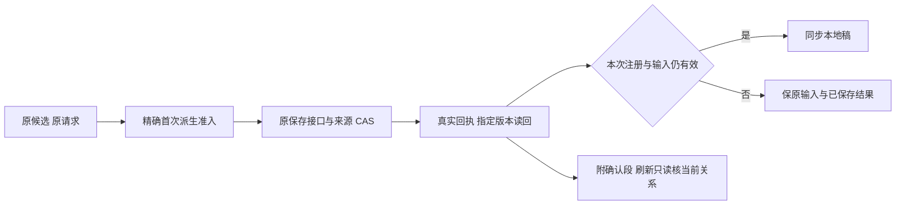

# T1303 独立实现评审

结论：**PASS，仅覆盖冻结实现与受控回归**，未发现开放阻断项。真实模型、不可变生产包、自然浏览器刷新、原生渲染、视觉/键盘/200% 及整体任务验收仍未通过本报告。评审者 `/root/sol_review_t1303`，按委派使用 GPT-6.1 Sol high；未声称核验极速开关或跨模型族独立性。本轮只读核证并写这份报告与同名 JSON，未运行测试、模型、服务、构建或控制面命令。

| 冻结对象 | SHA / 精确身份 |
| --- | --- |
| 实施 commit | `130b97f71b8170ad6674e4eb3c25dc3a9eae9bd6` |
| 基线 commit | `04ec81b9b38254dc009761136c9aa35fc952daae` |
| SPEC SHA256 | `ab8325625fee34dec7ea964b5273988027121072f8d9afca9d9abf6c771dccfd` |
| initial INPUT_LOCK SHA256 | `e213bac7e55ad856064625fd0a8e4c4659010bcdfd7cfaee0b23aafbc26f41fb` |
| IMPLEMENTATION_RESULT SHA256 | `84dfe5ecd868b28353e985c85b1516e877a000f910ad3fa4f755f25355ff1186` |
| final-source-binding SHA256 | `6e980fc03b9cebc6c3f4b08a82511df066600f82275195934ac1dd05dc6f7427` |
| validation-results SHA256 | `e0ee77c98f6643795a1caef30c59ac0d5026bc225930936573a23f7c3426ed2c` |

14 个最终绑定文件的工作树 SHA 逐项匹配，并逐项与实施 commit 内字节比对相等；开始时 git status 为空。提交路径用 `git diff-tree --no-commit-id --name-only -r -z <commit>` 读取：120 条路径，11 个 frontend 文件，全部处于五生产、六允许测试和本任务实施证据写集；第七个 save-race 测试、NoteRelay 和 backend 采纳测试未改。未修改 SPEC、T1302 展示增量或后端合同。

初次 staged guard 因中文路径 quoting 误判、外层 shell 继续执行 commit 的历史由交接如实保留。本评审没有把该 guard 改写成 PASS；改用已提交树的 `-z` 原始路径独立逐项核对，结果为零越界。仓内没有额外 postcommit guard 原件，本报告记录本轮实际读取与计数，不猜测另一个 guard 已通过。

## 实现核对与预审问题闭合

| 位置 | 核对结果 |
| --- | --- |
| `draft-chat-request.tsx` 的 `derivedEditorDraft` / `matchesDerivedCandidate` / `adoptEditorCandidate` | 只读能力可选，缺证明继续 dirty 拒绝。proof 绑定 scope/project/output/owner、原 saved base/全文、脚本引用/文本摘要、派生稿与 generation；只做机械谱系判断。Provider 在准入 await 前后核 entry、完整 stateFingerprint（已补独立 outputId）、proof 当前性；编辑或真实注销/替换后退役，不借 StrictMode 的首挂同步重放误拒正常派生。 |
| 两 owner 的 `setDraft` / `save` / `admitCandidate` / `adoptCandidate` | 用户回调改动会立即清派生/准入证明，改回相同字节不复活；手动保存/重读失效。只读核 latest 当前根和原 exact base，不自动保存、不换 source/body/key/base。latest 脚本推进本身没有被加成旧候选门。真正同步前核原 draft/generation/currentMatches；无迟到输入才覆盖。 |
| 原预审问题：保存等待中注册变化 | Provider 把本次 `isCurrent` 传入 port；两 owner 在 `saveWorkEditorCandidate` 返回后、任何 `setState/setDraft` 前调用，失效直接保 saved-not-synced。已不再先同步再靠 Provider 改返回状态。完整树负例覆盖两 owner 仍 mounted 时真实注册替换，检查原 native load 内容未被候选替换。 |
| 原预审问题：editor 成功后刷新未 preview 误 pending | 未 requested 时只有完整 confirmed 记录才做必要 base 投影、identity/request/document 摘要、指定 exact 与 current 只读核；无记录和旧 only-body 不预取 source、不自动 POST。完整树成功后整树重挂未 preview 已确认，source 读取计数不增加。 |
| 原预审问题：确认历史版与当前稿未区分 | `verifyConfirmation` 增既有 current 读回，依据 versionId/全文判定当前关系。两卡复用“这份内容已保存，仍是当前成稿。”或“这份内容已保存，当前成稿已有后续版本。”；后续 v3 负例保当前稿/零新写。 |
| 原请求和确认边界 | 确认只在实际成功 receipt 与 exact 版本全文机械相等后附加，原 operation/output/body/document/key 不删。原字段和事实以独立 locked 锁住；恢复必须原 request 完全相等，坏身份/摘要/投影、legacy、exact 读失败均保原请求与 UNKNOWN/pending。版本 GET 没有 request provenance/签名，本地 confirmed 只支持上述本客户端呈现，不授权写入或同步。 |

通俗说：程序原样承接且人没动过的稿可以采用候选；人改过或保存等待中换了编辑器就保留本地输入。卡片确认的是那次原保存，后来的稿不会被历史确认覆盖。

## 实际证据

| 验证 | 已核日志与结论 |
| --- | --- |
| 产品编辑前完整 RED | 原五生产、测试快照与 `red-binding.json` SHA 匹配；`red-five` exit1、5 个目标失败。两派生组真实 Provider dirty 拒绝/写0；两独立 clean 组先写1再完整重挂误 pending；editor 响应丢失后未 preview 缺外卡恢复。五份 DOM 与归因一致，夹具错误另列，不计目标 RED。 |
| 独立预审增量 RED | `increment-baseline` 五生产和测试与 binding 匹配；`red-increment` exit1、3 个目标失败/5 个过滤 skip。editor 确认、后续版本、注册替换同步三个真实失败均早于对应修复。`green-eight` 后续 8/8；该原件措辞未因最终文案改动而改写。 |
| 指纹负例 | `focused-expanded` 实际 output 变化负例失败；已补 stateFingerprint.outputId。另两夹具失败保持原记录，不混作该行为红。 |
| 聚焦回归 | `focused-final` 8 文件、120/120、0 skip、exit0，绑定 `verification-source-binding.json`。 |
| 最终测试字节 | 旧 UI 测试原件 SHA `d496f386d9a84bae6f4329a4518da2f12b99dc6790779d20d55a15e4fbf803b0`；与最终字节精确 diff 只有 kept.reviewState 增 `as const`。最终 `ui-final-byte` 19/19、0 skip、exit0。未把旧120冒称全部在最终测试字节重跑。 |
| 完整 frontend 类型 | `types-final` 真实 TS2322/exit2 保留；`types-final-fixed` time wrapper exit1/子 tsc 未独立捕获，不作通过。最终原 tsc 命令 `types-confirmed` 空诊断日志及明确 exit0，覆盖最终字节。 |
| LED-047 | `led047` 8 文件、174/174、0 skip、exit0；jsdom navigation 提示保留，不冒真实浏览器路由。 |
| 原 backend 采纳 | `backend-original` 3/3、0 skip、exit0；原真实 service/隔离数据库 source→assisted transport→两 owner/receipt、事实、错误 digest 与 CAS 回归。源码未改，不与 UI RPC 替身拼成生产 E2E。 |
| boundary / semantic / timeout | 三个 `.exit` 均0。boundary 原5/新增0；semantic 无新增违反；timeout 静态2839文件、120000ms 下限及 verifier 内部实际回归通过，动态/真实平台证明限度照原日志保留。 |

最终19项完整树和聚焦负例覆盖派生/确认、UNKNOWN 同 body/key 恢复、部分 fields/事实 replace、原事实审阅态、两平台和脚本隔离、注册变化、StrictMode、latest 历史脚本、原 base 推进、损坏确认、缓存/卸载及实际 owner 回调编辑改回。完整树保真实 Provider/workspace scope/epoch/signal/owners/cards/shared review/NoteRelay；dispatch、NativeEditorSurface 与 next/navigation 环境壳有替身。当前页面没有真实平台正文编辑控件，回调负例不冒用户浏览器实际手改正文证据。

正式生产包、自然 reload、真实模型、原生预览、视口/焦点/键盘/200% 和独立实际图评审仍需后续验收。T1302 新 card 锁增量另审；T1300 round3/全能力矩阵、T1301 历史前置缺证及其用户裁决均不因本实现 PASS 销账。未运行 reconcile 或完成任务；控制面由 C 串行推进。交付本报告后释放全部写权。
