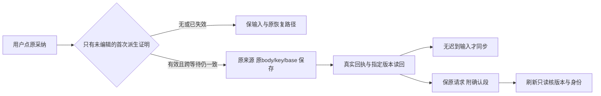

# T1303 独立首轮 SPEC 评审

评审者：`/root/sol_review_t1303`；按本轮委派使用 GPT-6.1 Sol high。本报告不声称核验了极速开关，也不声称跨模型族独立性。评审仅覆盖 T1303 锁定方案；产品、测试、SPEC、任务状态和控制面均未修改，未调用模型、服务、构建或测试。可导入 packet 为同目录 `SPEC_REVIEW.json`，严格使用 `spec-review-round/v2` 四字段；正式结论交 `reviewctl` 计算与记录。

评审判断：未发现开放 blocker/major 或需修订项，`findings=[]`。方案可进入后续审核登记和前置 RED 门；本判断不是实现或验收通过。

## 冻结输入

| 对象 | 精确绑定 |
| --- | --- |
| 评审冻结 commit | `9de1f217f9e536cecde7649ddc23d9be1ce3f454` |
| SPEC | `docs/features/t1303-derived-draft-and-adoption-recovery.md` |
| SPEC SHA256 | `ab8325625fee34dec7ea964b5273988027121072f8d9afca9d9abf6c771dccfd` |
| INPUT_LOCK SHA256 | `e213bac7e55ad856064625fd0a8e4c4659010bcdfd7cfaee0b23aafbc26f41fb` |
| 沿用 constitution | `orchestrator/SYSTEM_ARCHITECTURE.md` |
| constitution SHA256 | `eb1826d4c09054df622d9718c38ca372bd19833e72bd1a752757631a5747c1df` |
| 技能/项目流程版本 | `3.29.0` / `3.29.0`，无版本升级需求 |
| UI 约束 | 项目 `oil-ui-pro 0.10.0` 与账号组 `UI_RULES.md`，沿既有方向 |

只读 Python SHA256 检查结果：52 个 `inputs` 在工作树均匹配，并使用 `git show <冻结commit>:<path>` 再核 52 个提交内字节，零漂移；新增 `frontend/src/features/copilot/work-candidate-adoption.ui.integration.test.tsx` 确实不存在。历史 `EVIDENCE_SHA256.json` 的 217 个文件均存在且逐项匹配。锁中 `sourceHead=817616d5…` 是历史来源标识，本次审核绑定以上冻结 commit，未把两者混作相同来源。Hash 检查证明输入未换，不证明业务已通过。

按 BACKLOG → SPEC → 项目记忆 → 技能/阶段路由及审核规则 → 架构/UI 约束读取。当前维护期 `4-build`，本次为新的 `initial`；内部 owner/Provider 合同扩展需要本轮审查，既有 UI 方向无需重新选风格。沿用已有 CodeGraph 取证并以直接消费者核对，未重建索引或声称索引已同步。

## 真实消费者与判断依据

| 已核源码位置 | 事实与方案判断 |
| --- | --- |
| `frontend/src/features/draft-workbench/draft-chat-request.tsx:95`、`:289`、`:429` | 当前 port 四方法、注册 token/entry 与泛 dirty 拒绝真实存在；可选只读准入及 await 前后核验能局部扩展，缺能力仍拒绝。proof 不序列化、不增加后端权限；注册对象及当前对象身份必须一并核，不能只核 outputId。 |
| `frontend/src/features/article/article-workbench.tsx:199`、`:219`、`:287` | 首次 `inheritArticleScript` 会使 draft 不等于 saved current；owner 采纳同步原条件只容 clean。SPEC 的原 saved 文档/版本、scriptRef/text、派生 draft 与 generation 精确证明，以及用户编辑/手动保存/换 scope/output/重注册失效约束，足以约束局部实现并保护迟到输入。 |
| `frontend/src/features/projects/graphic-post-workbench.tsx:31`、`:42`、`:59`、`:118` | 图文同样首次派生 dirty，session 按 scope/output 识别；原 sync 依赖 draft 等于 initial.current。方案覆盖另一 owner，未用文章局部绿替代图文或掩盖真实 dirty。 |
| `frontend/src/features/projects/script-first-content.ts:8`、`:14` | 既有派生为逐字承接和元信息填入，不是 AI 创作判断；可以机械记录真实派生谱系，不需相似度、关键词或新语义规则。 |
| `frontend/src/features/copilot/chat-work-editor-card.tsx:84`、`:113`、`:122`、`:128`、`:243` | shared review 只存原 operation/output/body/document，保存成功没有确认段；已经真实 receipt→exact→current 读回。confirmed 可在此附加并保原请求，不能凭 GET 当 request 签名。旧格式仍 UNKNOWN、原 body/key 恢复、坏确认降级保记录的约束明确。 |
| `frontend/src/features/copilot/chat-work-editor-card.tsx:339`、`:342`、`:485`、`:549` | editor 初始 requested=false，使 storage 读取随 source lazy 一起跳过；本地完整绑定的存在性检查能提供外卡待核对标签，source 网络仍按需。存在性不能冒充 confirmed，也不能跨组读取或从旧 selection 猜宿主。 |
| `frontend/src/features/copilot/chat-work-creation-card.tsx:99`、`:120`、`:178`、`:195` | creation 共用 review，选择状态在 modal 外；可沿原动作展示恢复/确认状态，保 pending 禁改选择、关闭重开持续状态和原保存绑定，无需第二套按钮。 |
| `backend/src/application/generation/work-candidate-adoption.ts:12`、`:18`、`:21`、`:27` | 后端重读可信来源并锁真实作品，原 receipt 检索先于 CAS 新建。前端 proof 不能绕此链，不换 key/base/source；不得增加 latest-script 条件阻断合法历史候选。 |
| `contract/src/operations/articles.ts:27`、`contract/src/operations/graphic-posts.ts:33`；两 resources 的 `articleWriteResult` / `graphicPostWriteResult` | 版本 GET 只返回 versionId/document；SPEC 已明确本地确认的证明上限，不承诺服务端任意 requestId provenance。 |

通俗说，程序自动填入的那份原样草稿可以被用户选中的候选替换；人改过的稿必须留下。卡片只在收到回执并读回指定版本后说“原保存已核对”，后续新稿另算。

## 验证设计与限制

五个生产文件和七个测试文件的精确写集与 `MODULE_CHANGE_SCOPE.json` 一致，无 backend/contract/worker、transport 或新生产 helper。新组合测试要求真实 Provider、两 owner、两卡/shared review、NoteRelay，仅 RPC/NativeEditorSurface 外部边界替身；现有部分单测确有 owner/scope/editor mock，所以 SPEC 明确要求新增公共组合测试是必要且可行的补强，不能复用旧薄夹具冒完整链。

两 owner 各自首次自动派生→原采纳两条 RED，以及各自非空 clean 稿成功保存→完整卸载→新树只读确认两条 RED，互不依赖修后行为；另有 editor lazy 未开 preview 重挂外卡发现性 RED。要求冻结五生产 SHA、测试快照、真实 DOM/命令/exit，并在任何产品修改前实际运行，足以避免把 helper 红或夹具错误写成目标红。当前这些 RED **尚未执行**。

GREEN 覆盖用户编辑及改回、await 期间输入/切组/output/注册变化、CAS/原 base、合法历史 source 与最新脚本差异、无 proof 默认拒绝、默认/部分 fields 和 facts 投影、同 body/key、未知响应仅用户恢复、畸形/错身份/摘要/exact 失败、legacy UNKNOWN、历史已确认后出现后续稿、lazy/有界缓存/卸载、两平台与脚本隔离。真实 backend 采纳 integration 仍另只读回归，RPC 替身不冒生产后端。预算、retry0、LED-047、类型/架构/语义/timeout 与新不可变包公共旅程的要求明确。

新包中的真实首次承接/预览/原采纳/读回/刷新、丢客户端响应后的自然 reload 与原 key 恢复、真实 200%/键盘/焦点/状态及 oil 实际视觉评审，均留待实施后执行。未查看新实现画面，不签视觉通过；不把旧注入 storage 的成功算自然恢复。

T1302 展示增量需以本任务实现冻结后的新 card 字节另锁同 lineage recheck；本报告没有审该增量。T1300 round3、未验全功能矩阵、T1301 历史前置组合 RED 缺证及用户尚未答复的风险裁决均保持原状。原真实失败、runner 假设失败、旧 controller 143/缺 flush 的限度不因本轮方案评审消失。

本轮只写本报告和 JSON。未执行 `reviewctl record`、`taskctl`、`pmem sync` 或 `reconcile`；审核登记由控制面持有者串行导入。报告交付后释放写窗口。
