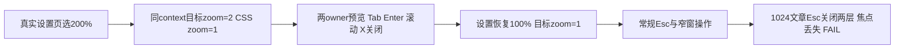

# T1303 共享 UI 实际操作验收（A）

**整体未通过。** 本轮一个 Playwright case 自然结束：exit1，154.876 秒；8 个内部检查点为 7 PASS、1 FAIL，不能写成 7 个测试通过。未中断的 1024×700 文章候选预览中，Esc 同时关闭弹窗与外层编导，原触发器消失，焦点落到“打开编导”；完整 120000ms 焦点断言失败。真实浏览器 200%、其余已列操作和零业务写入分别成立。独立 oil 评审待 R，本文是 A 的执行与看图记录。

## 绑定与执行边界

- source：`8ced635520132688c6ef91449ad530d36d9ff1af`；控制面 HEAD：`f9deafa1c64db909c3bf85eed53f2824139dad1e`；53008 由 C 持有，未启动、关停或重启服务。
- 正式 packet：`acceptance/public/a/recovery2/TASK_PACKET.md`，SHA256 `46cbbec2b8ce1c65aee67585c2c1219a968e2e0bc443326e1e8b518d959f7b72`。W 仅该 A public 目录、`acceptance/runs/recovery2-8ced635/a/**` 与本文。
- 使用本机已安装 Playwright 1.60、完整 Chromium 1223 / Chrome for Testing 148.0.7778.96。新临时独立 persistent profile，同一个 context/appPage 连续做设置与目标页验证；原 candidateGuard、握手 header 与外网 guard 沿用，未改 driver。没有读取用户 Chrome profile、B 业务 sessionStorage、用户库或 Keychain。
- 新 context 只绑定 B 明确交接的隔离组身份，从真实历史列表选原 conversation/card；不声称它自然恢复 B 的 pending/confirmed/later。三个真实 turn 的保存/自然刷新结果只引用 [B 报告](FRONTEND_VALIDATION.md) 及其 `b/` 原件，本轮零新模型、零成稿保存。
- 两份作品和脚本版本的前后完整 DTO 深相等，网络记录没有 `/api/chat`、`ai.conversations.messages.create`、`articles.versions.create`、`graphicPosts.versions.create`。见 `a/business-before.json`、`business-after.json`、`network-operations.json` 和派生的 `VALIDATION_SUMMARY.json`。

## 最终实际结果

证据根均为 `acceptance/runs/recovery2-8ced635/a/`；每个截图配同名 HTML、ARIA、meta，checkpoint 结果见 `checks.json`。

| 检查点 | 结果与证明范围 | 主要原件 |
| --- | --- | --- |
| 文章真实 200% | PASS：Enter 打开、默认折叠、键盘展开/选择、14 次 Tab 留在 dialog、真实滚动、X 关闭焦点返回、重开保选择 | `article-real-200-*` |
| 图文真实 200% | PASS：同上；X 关闭，未冒称该点验证 Esc | `graphic-real-200-*` |
| 文章 1366×900 | PASS：Tab/Enter/Space、滚动、Esc 关闭且焦点回原触发器，重开保选择 | `article-normal-*` |
| 图文 1366×900 | PASS：同上；按真实当前位置选择滚动方向 | `graphic-normal-*` |
| 图文 1024×700 | PASS：预览/展开/Tab/滚动/X 关闭与焦点；未重复窄窗 Esc | `graphic-narrow-*` |
| editor 1024×700 | PASS：真实历史编辑候选预览/展开/Tab/滚动/X 关闭与焦点 | `editor-narrow-*` |
| editor 来源加载/错误/恢复 | PASS 仅表示状态可见及能恢复：暂持真实只读 source 请求显示 loading，abort 连接显示 alert；关闭重开后走真实 source 读回恢复。未伪造业务响应 | `editor-source-loading/error/recovered.*`、`source-failure-result.json` |
| 文章 1024×700 Esc | **FAIL**：Esc 后 dialog 和外层编导一起消失，focus=“打开编导”，candidateRegions=0；原预览按钮不存在，120000ms focused 断言自然失败 | `article-narrow-Escape-close-immediate.json`、`*-after-close.png/.html/.aria.txt`、`checks.json` |

真实缩放的完整链：`settings-selects.json` 实际读到 `select#zoomLevel`、原值 1 和可见 200% 选项值 2；A 看真实 DOM/原图后写本轮继续标记，再用原生 `selectOption({label:'200%'})`。`settings-200-percent.aria.txt` 明确“网页缩放 / 200% [selected]”；`zoom-200-target.json` 读回 `cssVisualViewport.zoom=2`、CSS root/body zoom=1、DPR=2、683×450。没有 CSS zoom、PageScaleFactor 或半 viewport 替代。设置页 200% 截图拍到放大后的顶部，**截图本身未滚到 200% 控件数字**；控件读回来自同刻真实 ARIA，不能说数字在该图内可见。`settings-restored.aria.txt` 与 `zoom-restored-target.json` 证明恢复 100% / zoom=1。

## 发现与验收限制

1. **窄窗 Esc / 焦点为实际阻断。** 最终一次运行没有 SIGINT，也没有 resize 已打开的 modal；先设 1024×700，再打开助手与候选预览。关后原图直接可见“打开编导”，原触发器所在编导区域已消失。只证明该实际文章路径；没有把未运行的其它窄窗 Esc 逐一签失败，也未改产品或弱化断言。根因修复应由 Root 另走合法范围，本文不据静态推断代替修后验收。
2. **错误解释仍有缺口。** 实际来源连接失败只显示英文 `Failed to fetch`；关闭重开可以恢复，但错误区没有说明当前稿是否受影响和恢复办法。上表的 loading/error PASS 不代表该文案满足 UI_RULES 的可理解与恢复发现性要求。
3. B 的自然 pending、confirmed、later 均来自原 `b/cleanJoint-image-loss-*`、`b/editor-article-loss-*`、`b/joint1-history-newer-*`、`b/cleanJoint-article-history-newer-*`。A 未注入或迁移业务 storage，也未重复保存捕获这些状态。T1302 独有 chips/placeholder/引用完整族与同文 HTML 导出未在本窗口重新 claim 或签收。
4. 保留既有丰富工作台、tokens 与 Dialog/NoteRelay；未新选风格、未删文案或做视觉精修。A 实际看过本轮设置发现/200%、两 owner 的 200% 折叠及滚动、两 owner 常规预览、图文/editor 窄窗预览、来源 loading/error/recovered、窄窗 Esc 关闭后原图。其余自动生成截图不以“保存成功”冒称逐张看过；独立 oil 判断由 R 另件记录，不打虚构分。

## 原失败、runner 修正与清理

- `attempt01-launch-sandbox/`：沙箱内完整 Chromium SIGABRT、清理 kill EPERM，未到业务页面，不当产品或 200% 失败。Root 准许必要沙箱升级。
- `attempt02-settings-browser-close/`：普通 context 实际打开目标页、zoom=1；进入设置页时 browser 关闭，原因 UNKNOWN，后续 Target closed 不当产品失败。不能因为后来 persistent 成功就倒推旧关闭根因已证。
- `normal01-runner-scroll/`：原向下滚已在底部，保完整 120 秒失败；A 后主动终止该 run，exit130 / 149.40 秒。其 article-narrow focus 观察受终止影响，后两仅 Target closed，不作确定产品结论；最终未中断窄窗结果另列。
- `fixture01-persistent-module/`：`require('playwright')` 在 frontend 未暴露，未启动 browser；改用已存在 `@playwright/test` 的 chromium 导出，不当行为 RED。
- `attempt03-settings-locator/`：persistent 设置页真实可达；原 option regex 未匹配带空白的原生文本，完整 120000ms 定位失败。保原件及随后 exit130 / 145.10 秒；两 owner 常规点已 PASS，其窄窗后续受终止影响。Root 准许依据已观测 `#zoomLevel` 纠正定位续跑。
- 最终根目录 run 自然 exit1 / 154.876 秒；原 guard 未报 denied。日志保 browser exitCode0、临时目录 cleanup 完成。无在途浏览器/测试/模型，C 的 controller 未动。

原 runner 的 `save('RESULT')` 与 reporter `result.json` 在本机大小写不敏感目录同路径，最后保留的是 Playwright reporter；不补造那份中间 JSON。退出后的 `VALIDATION_SUMMARY.json` 明确标派生，直接机械核原 `checks/before/after/network/execution`；保受测 runner 原字节，未为消除该痕迹再跑。

## Gate 与交接

当前冻结生产字节的 timeout Gate 复用 B 已发生的 `b/timeout-policy.log`、`b/timeout-policy.exit=0`，由 Root/C 指定，不声称该 Gate 跑过 A 新 runner。A 新 config/fixture 的实际消费者预算：单 case1800000ms、beforeEach180000ms、launch180000ms、action/expect120000ms、navigation300000ms、设置继续观察600000ms、retry0、workers1；外层7200秒覆盖本次单 case、初始化与独立 teardown/清理余量，最终实际154.876秒。其余原 Gate 不重跑。

原件绑定在 `source-and-reference-binding.json`；精确握手扫描 `sensitive-scan.json` 为 0 次，未输出私有 session/header。证据 SHA 清单另存 `EVIDENCE_SHA256.json`。A 不转换 task/progress、不写控制面、不安装/push/发布。T1303 总验收保持未通过；T1302/T1301/T1300 依赖与原缺证不因本轮局部通过消失。
