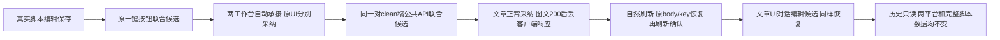

# T1303 新生产候选业务闭环验收

本轮三次真实 Codex 与两工作台采纳恢复链通过：Playwright **1 PASS，exit 0，240.042 秒，retry 0，workers 1**；timeout-policy **exit 0**。7 个 owner 保存请求形成 5 个新版本，两次恢复均复用原完整 input，未新增版本。此报告仅证明本轮业务闭环；T1304 键盘、T1305 来源失败、T1302 HTML 和独立 oil 评审由 A 后续窗口验证，不签 T1303 整体前端完成或父 T1300 全功能通过。



## 绑定与实际环境

- production candidate sidecar 测试授权模式，沿 DEC-130003 真实 build_smoke 签名/握手；不证明真实激活或原生壳。
- 源码 `cfbaf1ee021ef6904440ffd78afe3f82c4381ed6`；控制 HEAD `091ffc44dc54f60929d6e53231c3c45abdc573f3`，执行前产品/tests 相对源码零 diff。
- 新 binding：`docs/verification/t1304/acceptance/candidate/candidate-binding.json`；SHA256 `af548574f185d2ae22ea05de24fdc27bf2971283c75882eef76c9b99b1ddb7cb`。源码、DMG/binary/sidecar hash 和 driver 见该绑定；B未重新构建、安装、操作现用 App、Keychain 或用户库。
- 新 owned root `/private/tmp/t1300-candidate-IDnfdQ`，端点 `http://127.0.0.1:65112`；全新 DB/media，仅通过现有公共 API/UI 创建业务数据。私有 session 仅以路径供代码使用，不打印内容/headers。controller 由 C 继续持有，B未重启、stop或打开数据库。
- 正式 packet：`docs/verification/t1303/acceptance/public/b/final-t1304-t1305/TASK_PACKET.md`，SHA256 `867c72542d3ab3c7030e89d3cd08be38bda937f467503648b849b5007e790692`。
- runner：同目录 `recovery.spec.cjs`，SHA256 `a66edc0f1188849b3f3f5f04870b2344b9a3bd436d384d465f02328a55da4174`。复用已核旧三模型 runner，只在新 W 调整绑定、首 HTTP 安全错误包装、完整隔离读取；旧报告、旧 run、旧源码和旧 UNKNOWN 均未改或重放。
- 新组 `grp-d99d5a06-6`，项目 `project-d99d5a06-22`，脚本 `artifact-d99d5a06-35`；文章 `output-d99d5a06-76`、图文 `output-d99d5a06-88`。详细 URL 和来源精确定位见 `HANDOFF.json`。

## 三个真实模型原任务

全程同一 page/context；未导入、导出、注入或手改业务 sessionStorage，仅设置 fresh 组选择与 onboarding 偏好。设置页真实选择文本来源 Codex、保存并公共读回。脚本用真实 contenteditable 和保存按钮写入；确认后比较 `sections.body`，不把合法标题投影误当正文变化。未预保存文章或图文来绕过首次派生 dirty。

| 动作 | 原 aiTask | 原 executionTask | 结果 |
| --- | --- | --- | --- |
| 原UI一键联合创作 | `ai-task-19fa77e3-eaba-4402-9644-82200208a40a` | `execution-task-443b8f95-7163-45f7-8226-38830d80ebed` | succeeded |
| 同两稿公共API联合创作 | `ai-task-d99d5a06-253` | `execution-task-d99d5a06-254` | succeeded |
| 文章UI手动对话编辑 | `ai-task-d3697a84-d932-4dee-9787-9d4f59b77ebd` | `execution-task-46c76f80-d9bf-4de1-a149-f06c629b41b8` | succeeded |

三个 assistant 原 metadata 均 `actualEngine: codex`。第二轮使用原公共 `ai.conversations.messages.create`，冻结同一 composition 的真实 revision、member/current exact base、已确认 scriptRef 和新 requestId；wire 不传 scriptConfirmation，由后端真实 user source 补 `public-request`。返回 message.modelMetadata.chatTaskId 后经 `ai.tasks.get` 取得 executionTaskId，未伪造 SSE headers。原“一键生成”每次新 intent 会创建新输出，因此第二轮用公共 API 锁同一对 clean 稿。

## 保存、恢复与隔离

| 路径 | 实际结果 |
| --- | --- |
| joint1 文章首次派生 dirty | 原 owner/UI预览后采纳；可选字段仅选择标题，事实 replace 对应真实空事实。正常成功、exact/current 真读回、自然 reload 确认仍当前。 |
| joint1 图文首次派生 dirty | 原 owner/UI 默认选择采纳；正常成功、exact/current 真读回、自然 reload 确认仍当前。 |
| cleanJoint 文章 clean | 新候选 frozen base 等于真实当前稿；正常采纳及自然 reload 确认。 |
| cleanJoint 图文 clean | 真服务器200保存 `artifactversion-d99d5a06-358` 后仅 route.abort 丢客户端回包；自然 reload 未开 preview 已有 pending/原恢复入口；选择锁定；显式完全相同 body/key/source/base 恢复，同版本/全文不变，再 reload 确认。 |
| editor 文章 clean | 真实文章 composer 手动自然语言生成编辑候选；真服务器200保存 `artifactversion-d99d5a06-534` 后仅丢客户端回包；自然 reload 外卡 pending/原恢复入口；显式相同完整 input 恢复原版本，再 reload 确认。 |

两次注入均为受控客户端响应丢失，不冒称自然网络事故或首次客户端正常收到200。恢复不换 key、不发新模型；7 请求对应5个原 clientRequestId/新版本。原指定版本、current 与完整document实际读回。最终文章/图文完整 DTO 含各自版本列表。

每次正常采纳、响应丢失恢复及自然刷新前后，另一平台完整 `articles.get`/`graphicPosts.get` DTO 与脚本 `artifacts.get` metadata、全部 versions 深相等。版本读取按真实 `meta.total` 翻页并检查前进/重复，不把前100当全量；本轮实际脚本3版本。每次历史只读检查同时冻结两平台完整 DTO 和脚本 metadata/全versions，结束全部深相等，不只检查当前 owner。

joint1 两历史成员在后续稿后均显示“这份内容已保存，当前成稿已有后续版本。”；editor 保存后 cleanJoint 文章历史同样显示。外卡、默认折叠 modal 与展开 disabled 选择真实检查，历史阶段0额外 owner保存/模型。只读 dispatch 仍使用 HTTP POST，不把 HTTP 方法当业务写。

## 原件、画面与范围

本目录 `BUSINESS_RESULT.json`、`VALIDATION_SUMMARY.json`、`turns-index.json`、原 task/messages/candidate/submission、五组 result 与 isolation-before/after、两组 actual-response-loss/requests、完整 network、Playwright result/execution.log/exit 为实际原件。`HANDOFF.json` 明确两 owner URL、scriptId、每轮 conversation/sourceMessage/toolCall/aiTask/executionTask、精确 `ai.workCandidates.source` input。creation 来源为 eager，后续 A 必须在导航/挂载前先拦截该真实来源，不能先 mount 命中缓存后冒注入成功。

B 已实际查看 setup脚本、joint1文章刷新确认、joint1图文默认折叠确认、cleanJoint图文自然pending/confirmed、editor文章自然pending/确认modal、joint1两平台历史后续版本图。截图均配同名 DOM 与 counts（URL/viewport/阶段/请求序列）。实际包含1366×900业务及1280×900历史检查；不据此代签窄窗键盘/真实200%缩放或独立oil评审。普通画面自检未替代后续任务走查。

实际命令：

```bash
T1300_SESSION=/private/tmp/t1300-candidate-IDnfdQ/session.json T1300_ACCEPTANCE_TASK=T-1303 T1300_MODULE=b T1300_RUN_NAME=final-t1304-t1305 pnpm --dir frontend exec playwright test final-t1304-t1305/recovery.spec.cjs --config ../docs/verification/t1304/acceptance/candidate/driver/playwright.config.cjs
node tools/timeout-policy/verify.mjs
```

单测试保8小时预算，独立外层9小时覆盖原串行及清理；每次公共请求900000ms、每模型有限观察1800000ms。原任务ID/持久期限保留，无UNKNOWN自动重发。工具没有tier读回，不声称已核验Fast开关。

首次真实启动在 test body 前被 macOS Chromium bootstrap_check_in `Permission denied (1100)` 拒绝，exit1，0公共请求/模型/owned业务。完整原件移入 `attempt-01-sandbox-launch/`，`attempt-preservation.json`保原→新路径。Root随后批准正常 require_escalated 申请，同runner/候选/owned根/范围执行成功；没有自动审批拒绝或绕开业务校验。该环境失败永保，不写成产品FAIL或旧PASS。只读进度摘要曾因task字符串类型假设报AttributeError，随后修正，无业务影响，见`evidence-helper-note.json`。

首HTTP wrapper直接捕获底层传输异常，只抛安全operation ID/status/稳定错误码，不把原Playwright请求错误/headers/private session写进日志；未靠事后脱敏掩盖首次HTTP泄漏。最终私密扫描及全部证据SHA见索引。未改产品/测试源/control、未commit/complete，父T1300矩阵及T1301历史RED风险仍保留。浏览器自然关闭，模型全终态；交接释放见`RELEASE.json`。
