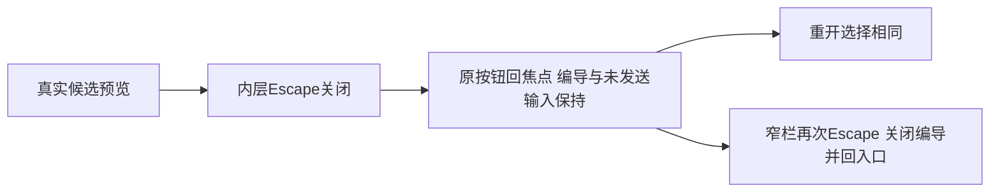

# T1304 新包实际 UI 独立复核

**PASS，仅 T1304 已审键盘与对应界面范围。** 当前三族候选在宽窗、窄窗及真实200%下，内层关闭不再带走编导，原触发按钮回焦点，选择与实际未发送输入保持；外层原键盘行为成立。未发现本范围开放问题。不代签 T1305、T1303 全任务、父矩阵、正式 App/原生壳或真实激活。

评审者 `/root/sol_review_t1303`，按委派 GPT-6.1 Sol / high，独立于实施与本轮操作执行者。沿同一评审会话，含此前源码复核；不冒称新建无历史的视觉上下文。本次有限 oil 判断依据当前新包实图、原操作和项目既有 UI_RULES/oil-ui-pro0.10.0，不因源码理由豁免画面，也不重开风格、打分或扩成整页改版。未运行测试、模型、服务、浏览器、构建或控制命令。

## 冻结与原件

| 对象 | 精确绑定 |
| --- | --- |
| source | `cfbaf1ee021ef6904440ffd78afe3f82c4381ed6` |
| control HEAD | `a0a28f59c73bb7b9a9a24358f49b0a54a863080a` |
| run / endpoint | `final-t1304-t1305` / `http://127.0.0.1:65112` |
| candidate-binding SHA256 | `af548574f185d2ae22ea05de24fdc27bf2971283c75882eef76c9b99b1ddb7cb` |
| B HANDOFF SHA256 | `273f942b79f1f94f82249f94f93edd1501df41d85563677e1baf43bedf9a4283` |
| A UI_ACCEPTANCE SHA256 | `21a3598047522c6e2dc525db4c274c221cfd405e778709f605955f787a13459f` |
| A EVIDENCE_SHA256 索引 SHA256 | `13ce0e7f9c9fc79a4b211588579fbf82931167c240eae4cc3834a382d9ac88f7` |
| keyboard.spec.cjs SHA256 | `a1e758652da0f5d4ea6382c349087a5eb7ccbc939e7931b98d819c1412f75035` |

证据位于 `docs/verification/t1304/acceptance/runs/final-t1304-t1305/a/`；索引 **275 件**逐项 SHA256 匹配，其中 **58 张 PNG**。报告、runner、绑定引用、九组 result/checks、原 DOM/ARIA 和执行结果一致。数量不额外包含索引自身，也不把58张保存成功说成全部已逐张看过。

实际为 **1 个 case、9 个检查点**，retry0/workers1、自然 exit0。外层实耗50.523s，Playwright reporter自身49.770s；不是9个独立测试。全程仅测试授权 production sidecar，未启动原生壳或操作 C controller。

## 实际键盘矩阵

| 候选族 | 宽1600×1000 | 窄1024×700 | 真200%：1366×900 / CSS683×450 |
| --- | --- | --- | --- |
| creation article | PASS | PASS | PASS |
| creation graphic | PASS | PASS | PASS |
| editor article | PASS | PASS | PASS |

每格先设视口/缩放再从实际 owner 和历史会话打开原候选，Enter来自真实预览 trigger。候选 Portal 位于 aside 物理 DOM 外；默认折叠不抢正文。实际 close 后 Tab 到 summary、Shift+Tab 回close，选择区正反 Tab 也留在内层；Enter 展开原 summary，Space切实际 enabled 标题框，wheel令真实容器 scrollTop 变化，九格均有 scrollChanged=true。

随后 Escape 只关闭内层；原 aside handle 仍连接、原 trigger获得焦点、真实 `#ai-copilot-prompt` 中该格唯一未发送文字保持。Enter重开后逐项checked数组相等，再关闭内层回原按钮。窄栏自身header的Shift+Tab落在原最后提交按钮，Tab回header；再次外层Escape关闭编导、回“打开编导”。宽栏原Escape不关闭编导。判断由原DOM/焦点/checked/scroll和请求记录共同支撑，截图没有单独代替键盘证明。

旧8ced候选的实际窄屏双层关闭/120s失败原件保持；当前结果只证明新source/run的修复范围，不覆盖旧失败，更不代签未跑的其它快捷键消费者。

## 有限 oil 实图判断

画面仍是 CreatorOS 既有内容工作台：品牌紫操作与焦点、白色 Dialog、低强调边界，文章正文与图文预览为主，采纳选择用已有summary折叠。符合保留既有方向和组件的约束。本次重点是用户关闭预览后仍知道自己在处理哪份候选、下一步可继续操作；没有新增版式或风格要求。

从58图中实际查看下列九张代表，三族/三种条件均有代表；此前预核查看的同字节图片沿用，不冒重新操作：

- `wide-{creation-article,creation-graphic,editor-article}-modal-default.png`：标题、关闭入口、折叠选择和正文层级清楚，原focus轮廓可见。
- `narrow-creation-article-after-inner-Escape.png`、`narrow-creation-graphic-after-inner-Escape.png`：原按钮焦点圈和未发送输入在同一编导面板中保持，任务上下文没有随预览消失。
- `narrow-editor-article-after-outer-Escape.png`：外层随后关闭，稿面仍在，“打开编导”入口聚焦。
- `real200-creation-article-after-inner-Escape.png`：真实放大后原trigger焦点及未发送输入仍可辨认；局部聊天内容由其真实滚动区承载。
- `real200-creation-graphic-scrolled.png`：放大正文/选择信息可读，长内容通过已实测的滚动访问；截取在视口边缘不等于内容丢失。
- `real200-editor-article-modal-default.png`：标题、关闭按钮、默认折叠与正文开头可见，关闭按钮focus明显。

结合九格滚动、选择、焦点原件，未见本次改动范围内的可用性、遮挡或阅读阻断。只覆盖列出的实际状态；未对全部58图、完整应用或来源错误态作视觉通过声明，不虚构分数。

## 真浏览器200%与隔离

实际完整 Chromium1223 / Chrome for Testing **148.0.7778.96**，Playwright1.60.0。新临时 persistent profile，同一context/appPage内连续完成设置与三族操作，未使用用户Chrome配置。早期消息的版本猜测不是证据，以本轮 browserVersion原件为准。

`settings-selects.json`发现真实 `select#zoomLevel` 初值1和可见200%选项，A看原DOM/图后实际选200%。`settings-200-percent.aria.txt:41`为 `option "200%" [selected]`；目标CDP `cssVisualViewport.zoom=2`，root/body CSS zoom仍1，inner683×450。**设置PNG拍到放大后的顶部，没有拍到下方数字控件；数值由原ARIA与独立目标CDP支持，不声称PNG直接显示200。** 没有CSS zoom、半视口或Emulation替代。finally原设置恢复100%，ARIA选中100%，目标zoom1/DPR1/1366×900。日志保浏览器自然退出0与临时目录清理完成。

业务before/after文件字节相同，SHA均为 **`39863d4966e65a3a90abc0ffaa591078c79fd7c01ea3eb9c214658fb1ba0317e`**，包含两平台完整DTO、脚本metadata及本批完整3版本。模型/成稿写为0，`forbidden-attempts=[]`且真实请求无相应操作；不是有尝试被挡后仍报零。21次source是原预览只读准备。A是新context，未复制B业务storage，不把此处可选候选称为B自然confirmed；B的自然保存恢复结论仍只由原B证据支撑。

## Gate、失败记录与交接

`timeout-reuse.json`所列B同source原timeout log/exit/execution三哈希均匹配，原exit0。使用 `git diff --name-only -z`复核B control至A control，除docs外只有modules.config.json/progress.json；门与实际消费者代码及依赖未变。复用限于该证明范围，不冒原门扫描了A新docs runner。

新runner实际预算另核：case7200000ms，beforeEach/launch180000ms，action/expect/screenshot120000ms，navigation300000ms，RPC900000ms，Settings观察600000ms，retry0/workers1，独立外层14400s，覆盖串行及清理。本轮无UI失败或重跑；两次验收后只读Python汇总语法笔误单列，未写产品或执行浏览器，不算产品失败，也不借后续查询补拍操作证据。

T1304本范围已有当前新包实际键盘/200%及对应有限图审证据；合法step done和最终任务收尾由C/Root依规则执行。本报告不改控制面，不代task complete；T1305来源暂持/abort/中文/重读、T1302导出和T1303整体仍待各自合法窗口，T1301历史risk与父矩阵不销账。

本次只写 `ACCEPTANCE_REVIEW.md` / `.json`，其它文件只读，不运行测试或提交。交付后明确 RELEASE 全部报告写权与资源。
