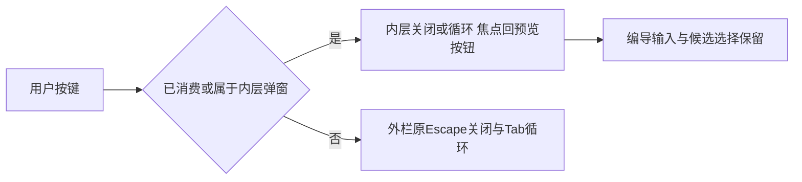

# T1304 实施结果

本次仅修复 `StageChatWrapper.mobileKeys` 的键盘归属。三个真实候选组合已在原生产字节上分别失败，修复后聚焦四文件 87 项通过；类型检查、LED-047 八文件 174 项、边界/语义扫描及超时规范门均通过。**这是受控实施验证，尚未完成新 production candidate 的真实浏览器验收或独立实施复核。**

## 实施边界

正式 packet：`runtime/TASK_PACKET.md`，SHA256 `ba7cf51bcc9d17ffcc5960c6d1199f8df6e80fafaa98fd213a6d6988e82bd582`；实施起点 HEAD `c869ba3bfef74906f368681b980910de4a24ac33`，方案初审 `PASS[REV:6bd542b80c14]`。

生产仅改 wrapper：先尊重 `defaultPrevented`，再确认当前活动且已挂载的面板、真实 DOM target、物理包含关系，以及最近的 `dialog` / `role=dialog` / `role=alertdialog` owner。Portal 与内联嵌套 owner 的所有键盘事件均交由原 owner；外栏自己的 Escape、Tab/Shift+Tab 继续原行为。关闭与初始聚焦的 RAF、两卡、共享 Dialog、全局热键、业务保存和恢复逻辑均无生产修改。

## 当场 RED 与失败历史

所有正式 RED 均先于生产修改；`runtime/red-v2-binding.json`、`red-v3-binding.json` 与各 `baseline*` 保存当时字节及命令。原 wrapper SHA256：`275c60bf56566e9a81260aa23dfd8ff37a1089bd7ef4aef4d6b49ebe5fa51dd3`。

|执行|真实结果|原始证据|
|---|---|---|
|首次混合探测 `red`|主动停止，exit130，317.222秒；非完整 suite 结论|`runtime/red.log`、`red.exit`、`red-result.json`、`red-dom/`|
|三族独立目标 `red-targets`|自然 exit1，3失败、41按名称过滤未执行；7.167秒|`runtime/red-targets.log` 与 `red-targets-dom/`|
|原 Portal Tab `red-tabs`|自然 exit0，3通过、41过滤；原行为合法|`runtime/red-tabs.log` 与 `red-tabs-dom/`|
|wrapper 首批边界 `red-wrapper`|自然 exit1，4失败、2通过、13过滤|`runtime/red-wrapper.log`|
|补齐 alertdialog/宽栏/切对象后的 `red-wrapper-final`|自然 exit1，6失败、4通过、13过滤|`runtime/red-wrapper-final.log`|

首次混合探测的两个辅助 Tab 操作未稳定进入内层，观察到约120秒等待后仍无目标弹窗；stdout未形成最终 Vitest 断言栈，不能把它定性为产品 Tab 缺陷或180秒 test deadline。第二次相同动作障碍后，按 packet 与 Root 指示仅对已确认归属的 Vitest 父进程发送 SIGINT，保原 exit130/partial/DOM。随后**只修测试时序**：等待外栏初始 header 实际获焦，再聚焦预览 trigger 并断言，才按 Enter；重新冻结 v2，并把 Escape/Tab 拆命令。未调整产品 RAF、事件或默认属性，未缩短预算。

正式三族分别为 creation article、creation graphic、editor article，每族独立新 Provider/owner/card/fixture，通过实际 Enter 打开原 Radix Portal 后按 Escape。三族均在“外栏应仍是原 aside”处得到 null，原 DOM/JSON 同时记录 outer/trigger disconnected、零写；这才计为目标 RED。wrapper 额外红例为已消费 Escape/Tab，以及物理内联 dialog/alertdialog 的 Escape/Tab；外层自有循环、宽栏和生命周期正例原本通过，如实保留。

## 修复后的验证

|门|实际结果|证据|
|---|---|---|
|聚焦 wrapper + 原完整 combo + 原两卡回归|4文件，87通过、0失败、0跳过，exit0，15.396秒|`runtime/focused.log`、`focused-dom/`|
|frontend TypeScript|`tsc --noEmit --incremental false` exit0|`runtime/types.log`|
|LED-047 原8文件|174通过、0失败，exit0|`runtime/led047.log`|
|架构边界|exit0，无新增；仍有基线5条（R2=4、R3=1）|`runtime/boundary.log`|
|语义职责边界|exit0|`runtime/semantic.log`|
|timeout verify|自然 exit0，57.380秒；静态扫描2839文件及原8组消费者门均通过|`runtime/timeout.log`|

87与174是各自命令的结果，不相加声称不重复总用例。timeout原门内 Node测试11、contract5、worker20、backend37、frontend68、mcp28、末组Node5均通过；其中 frontend knowledge 与 LED-047 有重叠。

真实组合使用现存 Provider/scope、ArticleWorkbench/GraphicPostWorkbench、两张真实卡、review、NoteRelay 与原共享 Radix Portal。仅在原 HTTP/RPC、native surface 等外部执行边界替身，并以窄 rail 插槽装配真实卡；不 mock wrapper/mobileKeys/Dialog/Portal/defaultPrevented，不加 stopPropagation。未发送输入是同一 rail 插槽内受控 React 输入，证明 wrapper 未卸载/重建它；不是声称整套 AICopilot 公共会话已在新包实测。wrapper 单测仅补 jsdom `offsetParent` 可见性，事件与 owner 判据均真实执行。

三族 GREEN 实际断言：Portal 在 aside 物理 DOM 外；内层 Escape 只关闭内层且回原 trigger；外栏、同一输入 DOM/值、候选标题选择保留；重开选择相同；第二次外层 Escape 才关闭编导并回入口；零保存请求、完整 owner fixture DTO 相等、空 sessionStorage。内层正反向 Tab 留在原 Dialog；外层自有 Tab/ShiftTab、defaultPrevented、内联 dialog/alertdialog、宽栏、卸载、离开阶段与切对象均覆盖。原宽度、折叠、路由、常驻视频及输入生命周期用例保持并在87项中通过。原生 `dialog` 由同一 owner selector 排除；未另造一个产品中不存在的原生弹窗验收场景。

## 字节冻结与预算

最终源码和测试副本见 `runtime/final/`，diff见 `runtime/implementation.diff`；精确绑定见 `runtime/final-source-binding.json`。

|文件|最终 SHA256|
|---|---|
|wrapper.tsx|`fc090e3116f944fef50d67b0e0c66c557c336399addb43fbf403a0265aae049b`|
|wrapper.test.tsx|`3422def2740c3c39189cd8fe94cd48a449f23d73a6ee67e492d8688dd687069d`|
|work-candidate-adoption.ui.integration.test.tsx|`67217aed1b64ba0a76d1e0cbba3682b0ce96be4ce2283644b7d1b7b448633c9b`|

`runtime/unchanged-inputs.json` 实核两卡/原两卡 tests/Dialog/rail/Provider/scope/transport 九份 SHA 与 INPUT_LOCK 一致。新增测试及 LED047 命令 test/hook=180000ms、retry0、maxWorkers1；新增有限异步观察120000ms；每个独立外层86400秒，覆盖串行与清理。原 timeout verifier 自带消费者测试120000ms保持原样。docs和test被原静态扫描排除，因此新增 runner 的预算由 `commands.json`、各 execution.json 与 `run-command.py`实际消费者单列核验，不冒称静态门扫描了新增测试。LED047执行前移除不属原八文件定义的第九个内容测试，只执行原定义八文件；其真实命令在 execution.json。

完整日志、原始 exit、耗时、DOM、前置字节、最终diff和本报告以 `runtime/EVIDENCE_SHA256.json` 冻结；不覆盖失败、不改旧任务证据。未构建/安装新包，未开服务/浏览器/模型，未调用真实业务保存，未重开旧根或复制旧业务 storage。受控原业务回归中 fixture 保存仍照原测试执行，不混同真实用户库写入。

实施证据已就绪，等待 R 独立复核；T1305未编辑，后续同一新不可变包的真实窄窗/两 owner/两卡键盘、真实200%与oil独评仍待合法 acceptance。本文不代签任务complete、公共UI通过或父矩阵完成。
