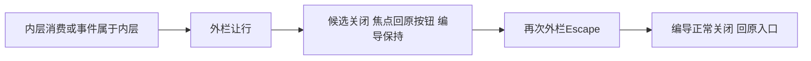

# T1304 独立实施复核

**PASS，仅冻结实现与受控回归。** 未发现开放实施问题；本报告不签新生产包、真实 UI/200%、视觉、整体任务或父矩阵验收。

评审者为 `/root/sol_review_t1303`，按委派 GPT-6.1 Sol / high，独立执行上下文；不声称跨模型族独立或核验 Fast/tier。沿已读产品流程 3.29.0、架构、oil-ui-pro 0.10.0 和项目 UI_RULES。本轮只写本报告与同名 JSON，未运行测试、模型、浏览器、服务、构建或控制命令，未改产品/测试/SPEC，未提交。

## 冻结核验

| 对象 | 精确绑定 |
| --- | --- |
| 实施基点 HEAD | `c869ba3bfef74906f368681b980910de4a24ac33` |
| 实现状态 | 冻结工作树，尚未提交；不能将基点当作含本次实现的 commit |
| 方案审核 | `REV:6bd542b80c14` |
| SPEC SHA256 | `b3005ed4c2d5b06391e8ace13cfa5742b838724764200b7c143dac37f205d958` |
| INPUT_LOCK SHA256 | `d896a6cc9d9339ef97b2bca8eb812200281e26e478aa6b56f88f726a24e548c3` |
| constitution SHA256 | `eb1826d4c09054df622d9718c38ca372bd19833e72bd1a752757631a5747c1df`，`orchestrator/SYSTEM_ARCHITECTURE.md` |
| IMPLEMENTATION_RESULT SHA256 | `1f3db57da2a5a415df638dd6cafd7ca5e840045e7d3f036af1043d587b8287f5` |
| final-source-binding SHA256 | `87d45452736e43e1b2ad11ff90dd408a890e299035e1a1bab71b2f94e41557db` |
| EVIDENCE_SHA256 索引 SHA256 | `6d548b57086ae49f7b67dbeec6fbc790f9781807cd9cd8c6ff147d6b9bcfc280` |
| implementation.diff SHA256 | `19dffd187402d2749cef96b8282c66f7333aaa57a1501b7ba46032dbb8edf95b` |

只读逐项核验：索引内 **151 件**全部匹配；3 份最终源码/测试的当前字节与 binding、`runtime/final/` 副本一致；9 份只读依赖与原 INPUT_LOCK 一致。实际 `git diff HEAD` 与冻结 diff 逐字相等，受审 tracked diff 仅 3 路径，均在实施写集内。索引计数不额外包含索引自身；hash 匹配不单独代替行为证明。

最终 wrapper SHA 为 `fc090e3116f944fef50d67b0e0c66c557c336399addb43fbf403a0265aae049b`；wrapper test 为 `3422def2740c3c39189cd8fe94cd48a449f23d73a6ee67e492d8688dd687069d`；原完整组合 test 为 `67217aed1b64ba0a76d1e0cbba3682b0ce96be4ce2283644b7d1b7b448633c9b`。

## 实现与覆盖判断

`stage-chat-wrapper.tsx:88–100` 的局部 guard 先尊重 narrow 与 `defaultPrevented`，再核当前 ref/currentTarget 和连接状态、真实 Element target、物理 DOM 包含关系及最近 `dialog` / `role=dialog` / `role=alertdialog` owner。之后保持原外栏 Escape 关闭与首尾 Tab/Shift+Tab 循环。Portal 在 DOM 外但沿 React 树冒泡的事件被排除，物理内联嵌套 owner 同样让行；不依赖名称、文案或业务分支。

两卡、共享 Dialog/Radix、Provider、scope/transport、保存及恢复状态机均为原字节。未散加 stopPropagation，未更改初始聚焦和关闭 RAF，未重建候选或改变 source/CAS、storage body/key、pending/confirmed。新 guard 留在容器所有者，职责与最小写集相符。

`work-candidate-adoption.ui.integration.test.tsx:93–160` 新增真实 StageChatWrapper + Provider + ArticleWorkbench/GraphicPostWorkbench + creation/editor 真卡 + 原 Radix 组合。rail 仅为装配插槽和受控未发送输入；外部 RPC/native 与 Next 环境替身如实保留。原 T1303 业务断言没有删改。三族实际用 userEvent Enter 打开，核 `outer.contains(inner)===false`，选择后 Escape 关闭内层，核原外层/trigger/输入 DOM 保留与焦点，重开选择不丢，再外层 Escape 才关闭；完整 owner fixture DTO 相等、零 save、sessionStorage 空。该受控输入证明 rail 没有被卸载重建，不冒充新包完整聊天输入链。

`stage-chat-wrapper.test.tsx:177–229` 的正负例核外层自身首尾循环、真实子控件 preventDefault、物理内联 dialog/alertdialog、卸载/离开阶段/切对象与宽栏行为。仅有 jsdom offsetParent 可见性 shim，没有伪造事件消费结果。两卡 Portal 正反向 Tab 由实际 Radix 管理；native `dialog` 被同一实际 selector 排除，但没有独立执行一个原生 `<dialog>` 用例，不扩报其覆盖。

通俗说，修复把一次按键留给当前操作的弹窗：关闭候选后原预览按钮仍在，编导及未发送输入保持；随后在编导中按 Escape 才关闭编导。

## 原始 RED 与 GREEN

前置 `red-v2-binding.json` 六份基线和 `red-v3-binding.json` 三份基线均与所存副本逐项匹配；原生产 SHA 始终为 `275c60bf56566e9a81260aa23dfd8ff37a1089bd7ef4aef4d6b49ebe5fa51dd3`。正式三族目标与最终组合测试同字节，wrapper 最终边界测试与 v3 同字节；先于产品修改发生的执行、命令、原日志/exit 和 DOM 相互一致。

| 原始命令 | 实际结果与归因 |
| --- | --- |
| `red-targets` | 自然 exit1，3 FAIL / 41 名称过滤未执行。creation article、creation graphic、editor article 均在期望外层仍存在时收到 null；即时 JSON 显示 outer/inner/trigger disconnected、writes=[]，为目标行为红。 |
| `red-tabs` | 自然 exit0，3 PASS / 41 过滤；原 Portal Tab 合法，未硬造失败。 |
| `red-wrapper-final` | 自然 exit1，6 FAIL / 4 PASS / 13 过滤；六红来自已消费 Escape/Tab 与两种内联 owner 的 Escape/Tab，原正例如实通过。 |
| 首次 `red` | exit130 / partial，317.222s，主动 SIGINT。初始 RAF 焦点时序造成辅助 Tab 未进入预览，未形成完整最终断言；不计目标 RED、Tab 产品缺陷或自然 suite 结论。后续仅等待实际 header 获焦再聚焦 trigger，重新冻结后执行。 |

修后原日志与 exit 核验如下；未把过滤数量当作缺失回归，也未把不同命令用例相加冒不重复总数。

| 验证 | 结果 |
| --- | --- |
| 聚焦 wrapper / 原 combo / 原两卡 | 4 文件，87 PASS / 0 FAIL / 0 skip，exit0 |
| LED-047 原八文件 | 174 PASS / 0 FAIL / 0 skip，exit0 |
| frontend 类型 | 原 `tsc --noEmit --incremental false`，exit0，log 空 |
| boundary | 实际 exit0，旧 5 条基线仍在（R2=4、R3=1），新增 0 |
| semantic | 实际 exit0 |
| timeout | 实际自然 exit0；静态门及原消费者回归通过 |

三族 GREEN 即时 JSON 均为 outer/trigger connected、inner disconnected，焦点为对应预览按钮；随后实际测试断言重开选择、同一输入、零写及第二次外层关闭。前置失败与通过后的不同状态保留，不用修后快照替代原红。

预算由真实 `commands.json`、各 execution 与 `run-command.py` 核：新增测试 test/hook180000ms、retry0、maxWorkers1，显式有限观察120000ms，独立外层86400s；timeout verifier 原消费者预算保留。docs/test 被原静态扫描排除，新增 runner 的预算另核，不冒旧扫描已涵盖新测试。LED-047 最终真实命令是原八文件，无需把未执行的额外文件算绿。

## 交接边界

这是未提交冻结工作树上的有限 implementation PASS；C 整合时需保持上述字节。后续须按合法 acceptance lease 在包含全部已冻结修复的新不可变包/fresh owned 根，实测窄屏三族 Escape、原 trigger 回焦点、外层再关闭与正反向 Tab，以及同包宽窗、真实浏览器200%设置/目标 zoom 双证和 oil 实图。受控 jsdom 不能代这些证据。

旧 T1303 的 1 case / 8 检查点 7 PASS、1 FAIL 与真实200%局部通过继续保留，不代签修后新包或全部 UI。T1305 尚待 T1304 实施冻结后首次正式锁审；T1297、T1301 历史缺证及父全功能矩阵不在本轮销账，不自动 accepted-risk，不代任务 complete。

本轮只生成两份独评报告，未运行任何产品测试或控制命令，不提交。交付后 RELEASE 全部报告写权与资源，交 C 串行整合。
