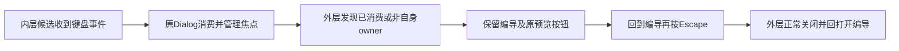

# T1304 独立首轮 SPEC 评审

评审者：`/root/sol_review_t1303`，本次独立评审执行上下文；按委派使用 GPT-6.1 Sol / high，审查模式记为 `homogeneous`，不声称跨模型族独立，也不声称已读回 Fast/tier 开关。应用 `product-to-code-orchestrator 3.29.0` 的 initial 协议及项目 `oil-ui-pro 0.10.0`；沿既有工作台方向，不重新选风格。

判断：未发现开放 blocker/major 或需修订项，`findings=[]`。仅判断锁定方案可进入审核登记与前置 RED；正式裁决及 REV 由 C 使用 `reviewctl` 计算。本轮未执行 `reviewctl record`，没有原生工具强制的额外回执路径，不预造 REV。

## 输入绑定

| 对象 | 精确绑定 |
| --- | --- |
| 冻结 HEAD | `85a4def1ed19e1abafee59fe3224b863f8acbb59`；开始审查时工作树 clean |
| SPEC | `docs/features/t1304-nested-dialog-keyboard-ownership.md` |
| SPEC SHA256 | `b3005ed4c2d5b06391e8ace13cfa5742b838724764200b7c143dac37f205d958` |
| INPUT_LOCK SHA256 | `d896a6cc9d9339ef97b2bca8eb812200281e26e478aa6b56f88f726a24e548c3` |
| constitution | `orchestrator/SYSTEM_ARCHITECTURE.md` |
| constitution SHA256 | `eb1826d4c09054df622d9718c38ca372bd19833e72bd1a752757631a5747c1df` |
| 技能 / 项目流程版本 | `3.29.0` / `3.29.0`，一致 |
| UI 规则 | 项目 `oil-ui-pro 0.10.0`、`docs/features/t1022-account-group-workspace/UI_RULES.md` |

只读机械核验：56 个仓内输入在当前工作树及 `git show <冻结HEAD>:<path>` 均逐项 SHA256 匹配；4 个锁定实际 Radix 输入均匹配。锁中 `sourceHead=f9deafa1c64db909c3bf85eed53f2824139dad1e` 是登记前来源，审查冻结是上述 HEAD；其间本任务 1 个生产文件及 2 个测试文件零 diff。A 的 `EVIDENCE_SHA256.json` 所列 408 文件逐项 SHA256 和字节数匹配，不把索引自身再计作第 409 个已列文件。

读取顺序为 BACKLOG → T1304 SPEC → PROJECT / PROJECT_CONTEXT → 技能、阶段路由、公共规则及 initial 协议 → 架构、UI 规则与实际消费者。当前为维护期 `4-build`；这是新的 T1304 initial，不续写 T1300/T1302/T1303 旧审核。读取现有路由和研究审计记录，直接核局部调用及实际依赖；未重跑索引，也不声称旧 CodeGraph 反映最新全图。

## 方案与真实消费者

| 位置 | 已核事实与判断 |
| --- | --- |
| `frontend/src/app/(creator)/projects/[projectId]/stage-chat-wrapper.tsx:83`、`:87`、`:88`、`:243` | 窄屏判定、关闭并安排回焦点、无条件处理 Escape 的 handler、aside 的 React 冒泡绑定均真实存在。当前未核已消费事件或 target 的 DOM/owner；修复点属于 UI 容器，单文件足够，不需改变候选业务。 |
| `frontend/src/components/ui/dialog.tsx:59`；实际 Radix `react-dialog/dist/index.mjs:84`、`:148`、`:212` | 当前共享 Content 使用 Portal；真实 Dialog 关闭通过 triggerRef 回焦点，FocusScope 管理循环与 trap。保留该实现而约束外层事件归属，可以避免关闭内层时卸载外层及其 trigger。 |
| 实际 Radix `react-use-escape-keydown/dist/index.mjs:12`、`react-dismissable-layer/dist/index.mjs:83` | Escape 注册于 document capture；最高层在未消费时 preventDefault 后 onDismiss。外层目前忽略这个标记，故 SPEC 的尊重 defaultPrevented 与真实 DOM/owner 双重约束有具体依据；不能仅凭 React 冒泡判归属。 |
| `frontend/src/features/copilot/chat-work-creation-card.tsx:182`、`:183`；`chat-work-editor-card.tsx:530`、`:617` | 两真卡使用同一共享 Dialog，未另行接管 Escape 或关闭回焦点；creation 两平台与 editor 是必要消费者族。无需在卡内添加 stopPropagation，也无需改 shared Dialog。 |
| `frontend/src/features/draft-workbench/draft-chat-rail.tsx:17`、`:43`；`frontend/src/features/copilot/ai-copilot-content.tsx:2895`、`:2896` | 原 rail 承载 AICopilotContent 并使用原 Provider；两类卡在该 React 子树实际装配。新测试可用窄 rail 替身装入真实卡，但不能替换 wrapper、Dialog/Portal 或事件消费事实。 |
| `frontend/src/app/(creator)/projects/[projectId]/stage-chat-wrapper.test.tsx:11`、`:112`、`:138` | 原 rail 是简易 div/button/input 替身；现有窄屏 Escape 用例只验证外层。SPEC 没有拿它冒充嵌套两卡组合，并要求保留外层原键盘行为。 |
| `frontend/src/features/copilot/work-candidate-adoption.ui.integration.test.tsx:7`、`:13`、`:62` | 已有真实 Provider、文章/图文 owner、两类卡、shared review 和 NoteRelay，RPC/native 为外部边界替身。可在同文件增加真实 StageChatWrapper 承载，不需新生产 helper 或替换采纳状态机。 |

通俗说，一次 Escape 应交给当前操作的弹窗：先关候选、回到原预览按钮，编导保留；再次在编导中按 Escape 才关闭编导。Tab 同样遵守当前弹窗的边界。

SPEC:15–17 已规定仅处理本面板所属事件、已消费事件让行、Portal/嵌套 Dialog 让行，并保外层 Escape/Tab 和有效焦点目标。具体局部判据交实施者选择，以反例验证；这属于合理实现细节，未留下两个互斥的用户结果。不得用业务名称、标签文案猜 owner。生产只有 wrapper，后端写权、候选 source/CAS、本地 storage 原 body/key、pending/confirmed 与两平台隔离均保持原消费者职责，无架构或契约扩展。

## 验证设计与证据限度

SPEC:30–34 的写集与模块配置一致：1 个现存生产文件、2 个现存测试文件。任何生产编辑前冻结生产 SHA、组合测试字节及命令；creation article、creation graphic、editor article 三条独立完整目标 RED，必须通过真实卡 Enter 打开、真实 Radix Escape 关闭，验证外层与 trigger 保留、焦点、选择、未发送输入及零 save。fixture/类型/模块错误单列；Tab 原本通过的行为无需硬造 RED。这些新增受控目标 RED 当前尚未发生，本轮不代签。

必要正负例包括 Portal 的 Escape/Tab/Shift+Tab、先关内再关外、外层首尾 Tab/自身 Escape、真实已消费及非 owner/嵌套事件、窄宽窗、关闭重开/卸载/切对象和有效焦点目标。既有宽度/折叠/路由/视频常驻与恢复选择回归仍保留。test/hook 180s、retry0、workers1、公共有限观察至少120s、外层含启动清理余量；适用类型、LED-047、boundary/semantic/timeout 明确，新字节不能冒旧 Gate 已扫描。

已核旧实际即时 JSON、checks、错误断言、业务前后 DTO 相等及真实 zoom=2 / CSS zoom=1；实际查看 `article-narrow-Escape-after-close.png`，图中确为外层消失后只剩“打开编导”。旧事实是 **1 个 case 自然 exit1，8 个检查点 7 PASS / 1 FAIL**，焦点断言完整120s自然失败；真实200%的局部通过不能推翻它，也不是本任务修后证据。Hash 证明证据未换，不单独证明交互成立。

SPEC:42–46 与当前 `modules.config.json` 的依赖一致：T1304 implementation 依赖 T1303 implementation，T1304 acceptance 依赖自身 implementation；T1303 下次 acceptance 等修复 implementation，不与 T1304 acceptance 互等。串行合法 lease/W、同 source/run 原证据准确引用足以复用公共验收，未形成循环。最终必须新不可变候选、fresh owned 数据、既有签名握手隔离；同包验证窄窗三族关闭/焦点及 Tab、宽窗与真实200%，业务前后无意外写。旧包的200%通过不能直接代签新组合。

本轮仅审 T1304。T1305 草案须等 T1304 实施冻结后首次锁审；来源失败中文说明不混入本写集。T1297 slider 的方向键问题、T1301 历史前置缺证及未获用户裁决、T1300 未验矩阵均不在本轮销账。原 controller143和未证 flush 限度保留，不称旧根优雅关闭。

本次只写 `SPEC_REVIEW.md` / `SPEC_REVIEW.json`，未修改产品、测试、SPEC、控制面或任务状态，未运行产品测试、模型、服务、构建、浏览器或索引；不签实现、实际视觉、新包或全功能验收。JSON 严格四字段无 verdict，由 C 串行导入。交付后释放全部报告写权。
