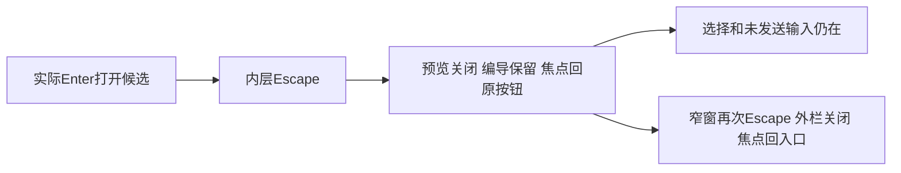

# T1304 新包真实 UI 验收

本轮有限验收通过：**1个 Playwright case 自然 exit0，50.523秒；9个检查点全部通过**。三族候选在宽窗、1024窄窗和真实浏览器200%下，内层 Escape 均只关闭预览，编导和原预览按钮仍在，焦点回原按钮，候选选择与实际未发送输入保留。窄窗随后外层 Escape 正常关闭编导并回入口；宽栏保持原不接管 Escape 行为。独立 oil 图审另由 R 完成，本文是 A 的执行结果。

## 绑定与范围

- source `cfbaf1ee021ef6904440ffd78afe3f82c4381ed6`；control HEAD `a0a28f59c73bb7b9a9a24358f49b0a54a863080a`；run `final-t1304-t1305`。
- 正式 packet：`acceptance/public/a/final-t1304-t1305/TASK_PACKET.md`，SHA `68b3db279aae3fb86a46ff68fe7f79f2d4a45e2461e374832f4069a437400fa1`。
- candidate binding SHA `af548574f185d2ae22ea05de24fdc27bf2971283c75882eef76c9b99b1ddb7cb`；B新 HANDOFF SHA `273f942b79f1f94f82249f94f93edd1501df41d85563677e1baf43bedf9a4283`。
- owned endpoint `http://127.0.0.1:65112`，组 `grp-d99d5a06-6`，项目 `project-d99d5a06-22`；creation 使用 joint1 会话 `ai-conv-d99d5a06-99`，editor 使用 `ai-conv-d99d5a06-502`，精确消息/tool IDs见 `binding-reference.json`、HANDOFF及各检查result。
- 复用 C 持有的新 owned sidecar，不安装 App、不操作其 controller，不接触用户库/Keychain。DEC-130003 build_smoke测试授权模式；未运行原生壳或真实激活。没有模型/成稿保存授权外扩。

## 实际矩阵

证据根：`docs/verification/t1304/acceptance/runs/final-t1304-t1305/a/`。下表每格对应同名前缀的 result.json、原 PNG、HTML 和 ARIA。

|族|wide 1600×1000|narrow 1024×700|real200 1366×900（CSS683×450）|
|---|---|---|---|
|creation article|PASS|PASS|PASS|
|creation graphic|PASS|PASS|PASS|
|editor article|PASS|PASS|PASS|

每格通过真实历史入口选择 B 的新候选；先设viewport/zoom，再开编导和预览，未在弹层打开时换视口。实际 `#ai-copilot-prompt` 填入唯一未发送文字，未按发送；聚焦原预览按钮后 Enter 打开真实 Dialog。默认选择折叠，原 NoteRelay/native预览就绪；真实 close按钮后的 Tab/Shift+Tab 留在内层并回close，选择区内正反Tab也留在该Dialog。Portal实际位于aside物理DOM之外。

展开原summary，Space切换实际enabled标题checkbox；原wheel使真实滚动容器scrollTop改变，9格均有scrollChanged=true。内层Escape后核原aside仍连接、按钮回焦、同一prompt值保留；Enter重开，选择checked数组相同。窄窗还核外栏header的Shift+Tab/Tab自身循环，再外层Escape只关闭外栏且聚焦“打开编导”；宽窗外栏Escape后不卸载。所有判断为实际DOM/键盘/wheel，没有CSS zoom、Emulation/PageScaleFactor、业务storage注入或mock renderer。

代表原图：

- `narrow-creation-article-after-inner-Escape.png`：原预览按钮焦点和未发送输入仍在。
- `narrow-creation-graphic-modal-default.png`、`narrow-editor-article-after-outer-Escape.png`：另外两族窄窗原状态。
- `real200-creation-graphic-modal-default.png`、`real200-editor-article-after-inner-Escape.png`：真实200%实际画面；长内容以实测滚动访问，不把整页截图当完整可见性。

## 真浏览器200%与清理

Playwright 1.60.0，完整 Chromium1223 / Chrome for Testing **148.0.7778.96**，独立临时 persistent profile。原 candidateGuard自动fixture、握手header与网络归属限制全保留；正常 require_escalated 执行原测试命令获准，当前运行无沙箱启动失败或改guard绕过。

同一活跃context的新tab实际打开 `chrome://settings/appearance`。A先读取本轮原图/ARIA/DOM，确认“网页缩放” `select#zoomLevel` 初始100%、可见200%选项后，才写内部执行记录并实际selectOption。`settings-200-percent.aria.txt`明确option200% selected；`zoom-200-target.json`同时读回目标 `Page.getLayoutMetrics.cssVisualViewport.zoom=2`、root/body CSS zoom=1、DPR2/CSS683×450。三族200%操作沿同context/appPage连续执行。设置页200%原图只拍到其放大后顶部，数字控件位于截图下方；数值证据来自真实ARIA读回及独立目标CDP，不声称该PNG直接显示200数字。

finally恢复原100%控件并实际读回，`zoom-restored-target.json`为zoom1/DPR1/1366×900，root/bodyCSS仍1。浏览器自然exit0；日志确认临时目录清理完成，临时profile已不存在。没有操作用户Chrome/profile或C的服务controller。

## 隔离、Gate与限制

`business-before.json`、`business-after.json`完整包含 articles.get、graphicPosts.get DTO、脚本 artifacts.get 元信息、分页allversions；本批脚本3版本/1页。二者**字节相同**，SHA均为 `39863d4966e65a3a90abc0ffaa591078c79fd7c01ea3eb9c214658fb1ba0317e`。脚本/另一平台均未变化。`network-counts.json`所有应用请求均为读取/list；21次source读取属于真实预览准备，不是模型。模型入口/成稿写入口额外有仅测试保护，`forbidden-attempts.json=[]`，没有被保护拦下的尝试；0模型、0成稿save。

这是新浏览器context，只设置新组身份/隐藏onboarding，没有复制B业务sessionStorage。B自然pending/confirmed/later只保其原context证据，本文不把本轮新context候选称自然confirmed。原8ced候选窄屏失败与所有旧证据保持；本报告只签当前source/run的键盘范围。T1305来源暂持/abort/中文/重读未在本窗口执行，T1302导出/简化也未执行；不得据此签全功能或父矩阵完成。

复用B同冻结source刚实际执行的 `node tools/timeout-policy/verify.mjs` exit0，原文件为 `t1303/acceptance/runs/final-t1304-t1305/b/timeout-policy.*`。`timeout-reuse.json`记录精确原件SHA与比较：B control HEAD至当前HEAD除docs和两份控制json外全部tracked输入相同；原static扫描排除docs且不扫描这两json，Gate/消费者代码与依赖未变。没有无理由重跑全套，也没有冒称原Gate扫描A新docs runner。新runner实际消费者预算单列：case7200000ms、beforeEach/launch180000ms、action/expect/screenshot120000ms、navigation300000ms、RPC900000ms、Settings观察600000ms、retry0/workers1、外层14400秒，覆盖串行与清理。

本轮没有UI失败或重跑。两次验收后仅用于人工汇总的只读Python短查询因多余右括号失败，未执行写入或浏览器操作；改用原result/rg/hash核对，不算测试失败或补拍。最终原测试log/exit/result、50余原图、HTML/ARIA、9格结果、runner和本报告由本目录 `EVIDENCE_SHA256.json`冻结。当前不改控制面或task状态；等待R独立有限图审，再由C切换合法T1305窗口。
