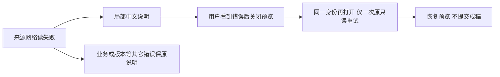

# T1305 实施结果

两卡已在候选来源读取失败时给出“候选来源暂时读取失败，请关闭预览后重新打开。”creation 仅在同身份错误确实打开显示、用户明确关闭后，下一次重开调用一次原只读 retry。editor 保持原预览 error→retry。五个独立目标 RED 均在产品前发生，修复后原三测试文件 91 项通过；后续一行同步探针调整另跑8项通过。**本报告是受控实施结果；新 production candidate 的实际浏览器验收及独立实施复核尚待完成。**

## 范围与真实链路

正式 packet `runtime/TASK_PACKET.md` SHA256 `6370971c5167139adffca312a848106c1d79cce172d5e64c69cadf07bc72ce52`，起点 HEAD `c94c98481db71ab73d9021b3d5fe7f2c15b659ae`，initial `PASS[REV:347298be9a66]`。生产仅两卡；测试仅原两卡 tests 与现存 combo。没有修改 wrapper、共享 Dialog、Provider、scope/transport、contract、控制面或 T1304 历史证据。

关键组合走真实 `useCreationClient → createCreationWorkspace.capture` 冻结 scope/epoch/signal 的 transport → contract `createClient` → `useAssistedWorkReview`。仅在原 `fetchCreatorApi` 外边界的 `h.rpc` 对 `ai.workCandidates.source` 拒绝 TypeError，其它 RPC 继续原 fixture；没有使用旁路 `createHttpTransport`。真实 Provider/owner/两卡/NoteRelay/原 Radix 路径保留，native surface 仍是原外部执行替身。

`runtime/red-chain.log` 在生产修改前自然 exit0，直接经过实际 client catch 得到与外 fetch 拒绝**同一 TypeError 实例**、constructor=TypeError、name=TypeError，随后真实卡 hook 呈现原消息。旧 T1303 浏览器只保存消息，没有构造器，本文不补签旧现场类型。

## 局部实现

仅在 `await client.readWorkCandidateSource` 的 try 内，将无 status/code 的 TypeError 类型失败包成文件内的 `CandidateSourceNetworkError`；不匹配英文消息。类型随共享 promise rejection 送达每个 subscriber，再由各自 active 生命周期设置本地失败状态。source await 后的 receipt 机械访问、候选全文比较、base/exact、确认段与 save 不在这个 catch 内；HTTP、AbortError、业务与损坏错误保原行为。

creation 的资格引用同一次失败对象，hook 对外返回的失败同时过滤完整 review identity（scope/source/candidate/output/base）。只有打开状态下关闭一个已呈现该错误的预览才授资格；重开立即消费引用，再走原 retry。首次打开、loading 先关闭后才迟到错误、成功开关、候选变化/卸载均不借用旧资格。在途关开不增加读。没有新按钮、轮询、模型、保存或读端点；没有改 fields/facts 算法、pending/confirmed、source/CAS、body/key 或 storage。

## 当场 RED 与原失败

两产品原 SHA：editor `94314f39df5bf23506aba6b7bb4d8bfed161b72b6cd0c6377392b458f070792a`；creation `0db1261b37e09f9bc6da706e2b0d396163455d351c8354407bc31b57d8e92842`。原字节在 `runtime/baseline/`；产品前测试和命令分别冻结于 `red-binding.json`、`red-final-binding.json` 与对应副本。

|执行|实际结果|作用|
|---|---|---|
|`red-targets`|自然exit1，5失败/25名称过滤，4.971秒|首次五目标成立|
|`red-final-targets`|自然exit1，5失败/38名称过滤，4.978秒|补负例后、产品仍原SHA，再跑最终前置字节|
|`red-chain`|自然exit0，1通过/42过滤，4.102秒|实际客户端异常保真|
|`focused`|自然exit1，88通过/2失败，137.016秒|首次修后回归，两处AbortError测试预期偏差|
|`focused-final`|自然exit0，3文件91通过，18.673秒|校准AbortError测试后的完整相关回归|
|`unit-final`|自然exit0，8通过/31过滤，4.054秒|最后一行同步探针读取调整的定向复跑|

五目标相互独立：editor article、creation article/graphic 的中文说明三例都实际打开 modal，看见原 opaque TypeError 消息但不满足中文；creation article/graphic 恢复两例不先断中文，实际看见 alert→关闭→重开，来源总读期待3实际2。总数包含**另一成员的一次 fresh 来源读**；目标成员本应从1到2，另一成员保持1。修后恰好新增目标的一读，params/query/body 与原来源相同，scope 由原 fixture 精确核验，零成稿写。各原 DOM/JSON/断言/log/exit均保留于对应 `*-dom/` 与日志。

修后 AbortError 两失败的实际 received 都是原“来源读取未完成”。jsdom DOMException 的 constructor=DOMException/name=AbortError/instanceof Error=false 已在 `focused-final.log` 与 `abort-fixture-shape.json` 原样记录；原宽 catch 正是非 Error fallback。仅校准此测试预期，并补 Error 实例 name=AbortError 的具体消息保护；没有改产品非source语义，也没有把修后对照称前置 RED。五目标及其 helper 块从正式 RED 到最终逐字节相同，SHA `028d0b1576f35f3b40dc44a949dd096dd3ae70a4abb1886d915eb88c5fb9d275`。整体测试文件 SHA 的变化和旧结果各自冻结，不回填旧证据。

最后把同步 render 已存在的探针 `await findByTestId` 换为 `getByTestId`，避免不必要异步查找默认预算；91项结果不冒称发生在这个单行调整后，另以最终8项通过验证，原31项未重跑而沿其相同测试逻辑证据复用。同期 tsc 在调整前完整通过，生产/其它测试相同；此行前后结果都是 HTMLElement，新增同步表达式亦经最终定向运行。

## GREEN 证据与适用范围

91项保留原完整业务、T1304键盘、fields/facts、body/key、UNKNOWN、confirmed/current历史、两owner隔离及缓存32项断言；新增覆盖 source/receipt机械TypeError/exact/status/Abort 类型边界、两个 subscriber 同次失败都获得机械标记与中文、失败entry清理、save TypeError维持UNKNOWN原body/key。

真实 workspace 组合分别验证两creation成员首次open不读、loading先关后迟到error首次重开不读、错误可见后明确关闭重读一次、消费资格后在途开关不叠、成功开关不读、换candidate/卸载不借旧资格；HTTP/Abort/exact保原且不授资格。实际scope切换原signal已abort，旧source reject不回写新身份。现存T1304两卡三族内层Escape/Tab及同一rail受控输入、选择保留也在本次原combo中通过；未把组装输入说成真实整套AICopilot公共会话。

在途快速关开用例在 loading 已显示后直接证明不叠读；useEffect清旧error前的极短窗口由同步 consumed 对象比较保障，**未声称这个极短窗口被 wait-loading 用例直接实测**。identity 包含所有机械字段；本次直接测candidate变更、scope切换与卸载，不宣称每个字段的全笛卡尔组合均实测。

|必要门|实际结果|原证据|
|---|---|---|
|frontend类型|`tsc --noEmit --incremental false` exit0，121.188秒|`runtime/types.log`|
|LED-047原8文件|174通过，exit0，31.321秒|`runtime/led047.log`|
|boundary|exit0，无新增；原基线5仍在（R2=4/R3=1）|`runtime/boundary.log`|
|semantic|exit0|`runtime/semantic.log`|
|timeout verify|自然exit0，67.118秒；扫描2839文件及原8组门均通过|`runtime/timeout.log`|

91、8、174及timeout消费者结果不相加冒称不重复总用例。新增test/hook180000ms、retry0、maxWorkers1；新增有限异步观察120000ms；每个外层86400秒覆盖完整串行与清理。原 timeout verifier 消费者120000ms未改。docs/test不在原静态扫描覆盖中，因此新增 runner 预算以 `commands.json`、实际 execution.json 与 `run-command.py`消费关系单列核验，不冒称旧/新静态门已扫描所有新test。

## 冻结与后续

最终五文件完整 SHA、diff SHA及不变目标块证据见 `runtime/final-source-binding.json`；副本 `runtime/final/`，完整差异 `runtime/implementation.diff`。42份其它 INPUT_LOCK 输入实际比对一致，见 `unchanged-inputs.json`，包含 wrapper/共享Dialog/Provider/scope/transport 与旧证据。

最终生产 editor SHA `1e8b88f0898b1c3b3ff5767eb27a79a9a7abed3519734c005063a98f242fb37c`；creation SHA `5853b0d63ebe9a6294c253feaca52a1e04159c412cc3a701e289537c34b19d2d`。最终测试 editor `c336055d5a330761b1ee806d8a96084939dfdee07a8b40ad879d9746f2a576ce`；creation `37bfeb2ea62424eef18389b4cab2c5fd960c2b1888ef2b329dfb323ddc7e8934`；combo `fc2b0a4f99b537c662bfefa3c64a0d31f3ed73baf7a040dbf278daca8b00ae25`。

完整原始日志/exit、RED前产品与测试、实际DOM、失败历史、最终差异和本报告由 `runtime/EVIDENCE_SHA256.json` 索引；没有覆写失败、运行服务/浏览器/模型/build或真实业务保存，没有碰用户库/Keychain或重开旧根。测试原有受控RPC/native替身保存行为照旧，不混同真实保存。后续独立实施复核、两修复一次新包及合法acceptance下真实来源中断/中文/恢复、键盘/200%和独立oil实图评审仍待完成；不代签任务complete、父矩阵或T1301历史风险。
