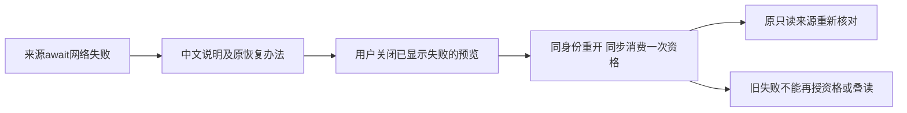

# T1305 独立实施复核

**PASS，仅冻结实现与受控回归。** 未发现开放实施问题；不签新包、实际浏览器 UI/200%、视觉、task complete 或父全功能。

评审者 `/root/sol_review_t1303`，按委派 GPT-6.1 Sol / high，独立执行上下文；不声称跨模型族独立或读回 Fast/tier。本轮沿已读流程3.29.0、架构、oil-ui-pro0.10.0与UI_RULES，只读核源码、冻结与原始证据；未运行测试、模型、服务、浏览器、构建、控制命令或提交。

## 冻结核验

| 对象 | 精确绑定 |
| --- | --- |
| 基点 HEAD | `c94c98481db71ab73d9021b3d5fe7f2c15b659ae` |
| 实现状态 | 未提交的冻结工作树；基点不能冒作含本实现的 commit |
| 方案审核 | `REV:347298be9a66` |
| SPEC SHA256 | `1d18c10558445dd44c30f08fda8e9bec9ed719683f9844f3fa02f902d7463d19` |
| INPUT_LOCK SHA256 | `6db1b01063048ddee3aebf73b7781ef927835902e9a1c54bf8d51ceeaaf6dda6` |
| IMPLEMENTATION_RESULT SHA256 | `2d35afb6634eac98299da21b20ee5095111574b1ef76a90b32f2ca3c797bf847` |
| final-source-binding SHA256 | `0237f2aaf54e2ef723eb5241d3f2e21501d8a201fa3c8d2244d2db915bc46d05` |
| EVIDENCE_SHA256 索引 SHA256 | `e4ee63205a97223ee3d99fd714f9e78515fab523026d06f4d4261ed90fcbdcd7` |
| implementation.diff SHA256 | `0dba6ecad7130c02e714dc089abc8a5667dc0b742856d85e6273fcd9d4415285` |

已机械核对索引中 **262 件** SHA 全匹配，5 个最终文件与 binding/`runtime/final/` 副本一致，原47锁中其余 **42 份只读输入**全部保持。实际 tracked diff 仅两卡和三现存测试，恰为合法写集；当前 `git diff HEAD` 与冻结 diff 逐字相等。T1304 wrapper、共享 Dialog、Provider、scope/transport、contract 及旧报告证据未改。索引数量不含索引自身，hash 不独立代替行为证明。

最终 editor 生产 SHA `1e8b88f0898b1c3b3ff5767eb27a79a9a7abed3519734c005063a98f242fb37c`，creation 生产 SHA `5853b0d63ebe9a6294c253feaca52a1e04159c412cc3a701e289537c34b19d2d`；三测试完整 SHA 记入同名 JSON。

## 局部实现判断

`chat-work-editor-card.tsx` 新增文件内 `CandidateSourceNetworkError`，仅在 `readWorkCandidateSource` 单一 await 的窄 catch 中分类：真实 TypeError、name 为 TypeError，且无 status/code。无需匹配任何英文错误消息。HTTP 结构化错误、Abort/作用域取消保原分支；后续 receipt 机械访问、候选全文核对、base/exact、确认段及 save 不在此 catch 内，不被泛化为来源网络失败。

类型随原共享 promise 的 rejection 传至所有 subscriber，各读者仅在 active 时设置 `{identity,cause}`；返回值同步按当前完整 identity 过滤。失败缓存仍按原规则删除，有界容量/清理未改。局部类型只在内存，不改变 wire、storage 或契约。shared hook 双读者负例和实际 workspace 异常保真是两种证据，报告没有把 mock client 的双读者用例冒作真实 workspace 组合。

`chat-work-creation-card.tsx` 用 `retryAfterClose` 与 `consumedFailure` 引用同一次失败对象。只有当前打开预览中的失败被用户关闭才授下一次重开资格；重开先同步清资格、标记对象已消费，再调用原 retry。因此即使 effect 尚未清除旧 error/sourceFailure，快速再次关闭也无法重授同一对象。下一次真正的新失败有新对象，不被旧消费永久封死。换 identity 时对外失败同步变 null，并清资格引用；卸载后新 refs 不继承。首次 open、loading 先关闭后才晚到失败、成功开关均不授资格，也不暗发请求。

当前在途反例先等 loading 出现再反复关开，直接证明该阶段没有叠请求；**清旧 error 前的极短窗口由源码的同步对象消费机制保障，本轮没有将它写成直接实测。** 完整 identity 的机械组成由源码核查，直接测试 candidate 变化、scope 切换与卸载，不冒全字段笛卡尔穷尽。

editor 原 preview 的 error→retry 未改。字段/事实投影、pending/confirmed/locked、原 body/key/source/base、receipt/exact/CAS 与保存路径均无生产 diff；save TypeError 的新测试仍保 UNKNOWN 原请求，不被重开翻译成来源恢复，既有完整业务断言未删。combo 唯一旧夹具调整将原固定组参数化为默认同值，实际 scope 深等于断言保留，以新增切组例使用真实新组；不是删除归属保护。

通俗说，网络错误告诉用户“来源没读到，关闭后重开”；真正看见失败并关闭的人，下一次打开才能原位重读一次。保存是否成功继续由原回执流程判断。

## 前置 RED 与测试字节

两原生产 SHA 为 editor `94314f39df5bf23506aba6b7bb4d8bfed161b72b6cd0c6377392b458f070792a`、creation `0db1261b37e09f9bc6da706e2b0d396163455d351c8354407bc31b57d8e92842`，冻结于原 baseline/red-final。命令、绑定、DOM、exit 和原断言与前置执行顺序一致，不拿当前产品替换修前证据。

| 执行 | 真实结果及证明范围 |
| --- | --- |
| `red-targets` | 自然 exit1；5 FAIL / 25 名称过滤。首次三个中文与两个 creation 原位恢复目标独立失败。 |
| `red-final-targets` | 产品仍原 SHA，自然 exit1；5 FAIL / 38 过滤。最终前置五目标中，中文看到原 opaque 消息；恢复实际走过 alert→关→开，第二读没有发生。 |
| `red-chain` | 产品前自然 exit0；1 PASS / 42 过滤。真实 useCreationClient→冻结 workspace transport→contract client catch 收到与 fetchCreatorApi 拒绝同一 TypeError 实例，hook 原链显示原消息；不追签旧浏览器 constructor。 |
| 首次 `focused` | 自然 exit1，88 PASS / 2 FAIL，外层实耗137.016s；保留原错误，不冒全绿。五目标在本次同前置测试逻辑已 GREEN。 |
| `focused-final` | 3 文件91 PASS / 0 FAIL，exit0；在最终同步探针单行调整前发生。 |
| `unit-final` | 最后单行调整后的原命令定向8 PASS / 31过滤，exit0；不是最终全91重跑。 |

creation 恢复两例没有先断中文，确实抵达“期待额外一读、实际没有”处失败。两成员初始各一读，因此总数原2、期望3；新一次只属于目标成员，另一成员不增加。修后请求完整内容与原来源一致，真实 frozen scope 精确核，完整 fixture DTO 相等、零 save、sessionStorage 空。

从 `runtime/red-final/` 与最终 combo 提取五目标及共享 helper 块，逐字一致，SHA **`028d0b1576f35f3b40dc44a949dd096dd3ae70a4abb1886d915eb88c5fb9d275`**。新增负例和之后夹具校准不改变该块，不能据整体文件新 SHA 倒填修前历史。

首次回归两 FAIL 来自新增 unit/实际 workspace 的 DOMException AbortError 期待具体 message。实际 shape 原件为 constructor=DOMException、name=AbortError、`instanceof Error=false`，原 catch 应走“来源读取未完成”。校准仅改这些新测试期待并记录 shape，同时增加 Error 实例 name=AbortError 的消息保护；产品没有为此更改取消/业务语义，原失败保留。

91项后最终仅 editor test 一行 `await findByTestId` 改同步 `getByTestId`，render 已同步建立探针；其后的120s waitFor与所有断言相同。机械 diff 已核确实只有该行，最终8项包含这个六族边界参数例、shared cache 与 save UNKNOWN。91项当时 editor test SHA 为 `feb534375070f7c9c9268dd31b566dad9ed40c81dc0c7c4ae6b89654560d1963`，最终为 `c336055d5a330761b1ee806d8a96084939dfdee07a8b40ad879d9746f2a576ce`。不声称最终整文件 SHA 又跑过91或类型检查；相同未变用例沿真实原结果复用。

## GREEN、门与交接限度

91项包含原 fields/facts、body-key、UNKNOWN、confirmed/current、平台/脚本隔离、缓存和 T1304 三族键盘组合。新增实际 workspace 例证明首次打开不读、迟到失败不授资格、明确关闭失败后仅一次同来源重读、消费后在途开关不叠、成功开关不读、换候选/卸载无旧资格；HTTP/Abort/exact 保原错误；切组原 signal abort，旧 reject 不写回新身份。真实 Provider/owner/cards/Radix 保留，fetchCreatorApi/native 是外部边界；rail 输入是受控装配输入，不冒公共 AICopilot 新包旅程。

| 适用门 | 原始结果 |
| --- | --- |
| frontend 类型 | 单行同步探针调整前完整 tsc exit0，121.188s；没有声称调整后重跑 |
| LED-047 | 原8文件174 PASS，exit0 |
| boundary | 实际 exit0，原5条基线保留，新增0 |
| semantic | 实际 exit0 |
| timeout | 自然 exit0；原静态与消费者门通过 |

各组结果不相加冒不重复总量。真实 commands/execution/run-command 消费预算为新增 test/hook180s、retry0、maxWorkers1、显式有限观察120s、外层86400s；最终同步探针不再制造无必要短异步观察。docs/test不在旧静态扫描覆盖内，runner预算另核，不冒扫描全涵盖。未扩大重复测试或运行任何新验证命令。

待 C 保持绑定字节整合后，仍须一次包含已冻结修复的新不可变生产候选/fresh owned 根，真实来源连接中断→中文原因/动作→原关闭重开读回，并核选择/输入/原请求及业务前后相等；同包 T1304 键盘/焦点、真实200%及独立 oil 实图不能由本受控结论替代。旧 T1303 失败、T1301 历史风险和父矩阵保留，不自动 accepted-risk，不代 task complete。

本轮仅写 `IMPLEMENTATION_REVIEW.md` / `.json`，不改产品、测试、SPEC、原证据或控制面，不提交。交付后明确 RELEASE 全部报告写权与资源，交 C 串行整合。
