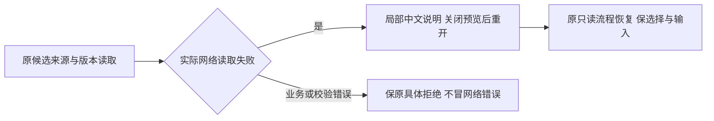

# T1305：补齐候选来源网络读取失败的中文恢复提示

用户已授权恢复Codex功能和完整候选操作验收。Root依据独立R对UI_RULES及oil-ui-pro交互状态要求的判断，批准独立最小来源读取错误展示任务。不是新增审美标准或全局错误改写；T1304键盘归属独立审核/实现。Root判断复核，GPT-6.1 Sol高思考执行，不主动启用加速，无开关读回不称已核验。

## 真实问题与适用要求

T1303 production候选源码`8ced635520132688c6ef91449ad530d36d9ff1af`，A真实历史editor候选只读来源请求暂持后abort连接，modal可见alert只有英文“Failed to fetch”；关闭重开使用真实source请求恢复，0模型/0成稿保存，前后DTO不变。原source-failure-result、editor-source-loading/error/recovered图/DOM、UI_ACCEPTANCE.md和408文件SHA清单保留。loading/error/恢复的实际可见PASS不代表说明满足可理解与恢复发现性；该缺口由Root/R认定属于本次预览验收必须修正。

依据项目UI_RULES及oil-ui-pro `references/interaction-and-state.md`“加载或提交失败：在相应范围解释原因和恢复动作”，亦为T1303已采用状态要求。原English error来自useAssistedWorkReview直接把reject Error.message存入review.error，AssistedWorkSelection原样显示；work.creation成员也共用此hook与展示，应在同一读取失败边界验证。不能通过删alert或关闭预览来躲失败。

## 最小方案与不变边界

生产唯一W：`frontend/src/features/copilot/chat-work-editor-card.tsx`，仅共享useAssistedWorkReview的**候选来源/原稿指定版本网络读取失败**解释。向用户给出准确局部说明及已真实可用的恢复动作，例如“候选来源暂时读取失败，请关闭预览后重新打开。”不新增按钮、自动重试或额外请求；关闭重开沿原lazy/fresh和有界缓存/卸载策略。

按实际读取操作阶段和异常结构判断，不匹配英文Failed/fetch关键词，不按文案/业务名猜语义。原fetch网络拒绝会原样抛TypeError；HTTP业务拒绝由既有HttpTransportError携status/code/details。仅在原await网络读取调用的窄边界标识可确认的网络失败；原来源身份/候选全文不符、版本不符、记录损坏、字段/摘要校验与有status/code的业务错误仍保原具体原因。其它未知异常没有足够类型依据时保原说明，不把所有Error/TypeError全局翻译。实现必须核实际客户端消费者；若无法在此文件内安全区分，先报告准确缺口而不扩大transport/契约写集。

原请求/候选/版本/source/全文校验、权限与CAS不变；pending/confirmed及locked原语义、body/key/storage不变；没有成功回执不声称已保存、稿件未变或后台任务结束。中文提示只解释来源读失败和关闭重开，不把它写成模型失败或引导重新发模型。关闭重开保字段/事实选择与未发送输入；不会因显示文案清storage、改key或重置选择。

## 精确测试、先RED后产品

测试W仅现存`frontend/src/features/copilot/chat-work-editor-card.test.tsx`及`frontend/src/features/copilot/chat-work-creation-card.test.tsx`。共享creation成员由原卡真实hook/selection验证，不为此改creation生产文件。只读参考原完整Provider/owner/card组合及原两卡恢复、网络transport、creation scope；不改Provider/owner、backend/worker/contract、全局transport/错误协议或共享Dialog。

产品编辑前，先冻结受测共享生产SHA和新测试原字节，分别运行真实editor与creation成员的原source读取网络reject→modal期望中文说明与关闭重开动作提示的独立RED。只能在外HTTP/RPC边界制造真实相同异常形状，不能mock useAssistedWorkReview/错误展示、直接给review.error塞目标文案或把夹具收集错误算目标红。保原exit/DOM/失败断言；之后同字节测试GREEN。来源读取失败与save响应丢失是不同阶段，后者不得被新翻译改变。

GREEN覆盖：editor lazy、creation fresh共享成员；source与指定base版本读失败的真实边界；先loading再error、关闭重开真实读回；已有选择/事实/输入保留，0成稿save/0模型/无额外自动重试；HTTP结构化业务错误及来源身份/文档不符仍具体显示，损坏本地请求原pending/锁定/恢复不洗；scope切换/卸载后无迟到回写；两卡相互隔离/有界缓存。原body/key/confirmed/默认选择及原facts算法断言不弱化。

证据W为`docs/verification/t1305/runtime/**`、`IMPLEMENTATION_RESULT.md`；测试test/hook180000ms、retry0、workers1，执行/有限观察最短120000ms、外层覆盖串行/启动清理。运行受影响两卡测试及必要原组合只读回归、frontend类型、boundary/semantic/timeout与LED-047适用路径。相同冻结字节的既有Gate按证明范围复用，不冒新runner已过门，不无理由全量suite或重复索引。

## 审核、DAG与真实候选验收

独立initial方案审核→真实claim/packet→目标RED先发生→单生产文件修改→受控GREEN/独立实施复核。T1305 implementation只依赖已done T1303 implementation，acceptance只依自己的implementation；T1303后续公共验收只需两修复implementation冻结即可用同一新不可变包/新owned run，分别在合法acceptance窗口引用原证据，不要求彼此acceptance先完成造成循环。T1304与本任务分别评审，不改变T1300round3/T1301原SPEC/审核/历史缺证。

两修复集中冻结后一次固定SKIP_INSTALL本地包，fresh DB/media，沿DEC-130003真实build_smoke签名/握手/归属；不碰正式App/用户库/Keychain，不重开旧根或重发旧UNKNOWN。新production公共候选实际暂持只读source请求显示loading→abort连接→可见中文原因与关闭重开提示→原关闭重开真实source读回；保选择/输入、原body/key及完整业务before/after，0额外模型/保存。editor与共用creation的适用族分列，不能以一个静态mock文案代全部。需要候选的最少模型与T1303/T1304原合法旅程共享，不能为证据重复付费。独立oil只评价实图和对应真实操作，原English失败永保。

真实适用Gate、pmem/reconcile、Root复核后再按taskctl完成；当前只是待审SPEC，不签任何修复/验收PASS。T1303当前业务局部PASS、真200%PASS、窄屏EscapeFAIL均保留；T1301历史组合前RED accepted-risk尚无用户真实回复，父矩阵不claim。现用原生壳/真实激活和父完整矩阵不由本任务签收。
