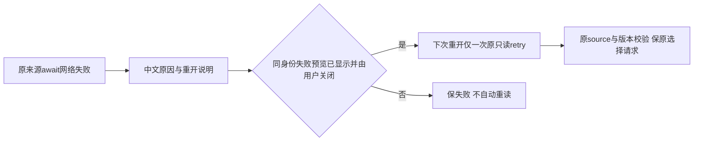

# T1305 独立首轮 SPEC 评审

评审者：`/root/sol_review_t1303`，独立执行上下文，按委派 GPT-6.1 Sol / high；模式 `homogeneous`，不声称跨模型族独立或读回 Fast/tier。沿已加载的产品流程 3.29.0、initial 审核协议、公共规则、物理架构、项目 oil-ui-pro 0.10.0 与 UI_RULES。

判断：未发现开放 blocker/major 或需修订项，`findings=[]`。这是方案判断，正式裁决及 REV 由 C 使用 `reviewctl` 实际登记；本轮没有预造回执或输出 JSON verdict，也不签实现/验收。

## 冻结与范围

| 对象 | 精确绑定 |
| --- | --- |
| 审查冻结 HEAD | `da310e4316e77888ad4a0bf72e49963ce72c3f80`；开始时工作树 clean |
| 已完成的 T1304 implementation | `8ab1b2bcd2158f351e2f27d9533a190dac3f2841`，有限实现 PASS，acceptance 待验 |
| SPEC | `docs/features/t1305-candidate-source-network-error-guidance.md` |
| SPEC SHA256 | `1d18c10558445dd44c30f08fda8e9bec9ed719683f9844f3fa02f902d7463d19` |
| INPUT_LOCK SHA256 | `6db1b01063048ddee3aebf73b7781ef927835902e9a1c54bf8d51ceeaaf6dda6` |
| constitution | `orchestrator/SYSTEM_ARCHITECTURE.md` |
| constitution SHA256 | `eb1826d4c09054df622d9718c38ca372bd19833e72bd1a752757631a5747c1df` |

本轮以只读 SHA256 核 47 个输入的工作树及冻结 commit 字节，全部匹配。锁中 sourceHead 是 T1304 实现 commit，至审查 HEAD 的 frontend diff 为空；真实新 wrapper、wrapper test 和 combo 已绑定本次锁，未拿旧草案字节或未来承诺代替。T1304 中间步骤原日志明确 `marked T-1304:implementation done`，不是整个任务完成。旧 T1303/A 和 T1304 索引哈希均在本锁内；本轮复用其已有核验，不重拍历史。

BACKLOG 顶部任务为 T1305；当前维护期 `4-build`，首次 `initial`。本轮仅审两卡来源网络失败的局部说明及既有预览关闭重开恢复，不扩全局错误系统、数据契约或 UI 方向。原英文错误图此前已经实际查看：错误位于预览中，只显示 `Failed to fetch`；“加载或提交失败解释原因和恢复动作”的适用依据仍为已沿用 oil 交互状态规则，并非新加审美标准。

## 真实消费者与三个澄清

| 源码与 SPEC 位置 | 事实及判断 |
| --- | --- |
| `chat-work-editor-card.tsx:142–148`；SPEC:13、15 | 真正来源请求在单一 `readWorkCandidateSource` await，之后还有 candidate 全文和 exact 版本校验。可在该 await 单独产生机械网络失败类型，后续 receipt 属性访问、校验、版本读与 save 错误继续原义；不能在整条 load/read.promise 的宽 catch 把 TypeError 一律翻译。 |
| `frontend/src/lib/creation-workspace-scope.ts:51–74`；`contract/src/client.ts:56–65` | 实际两卡经 useCreationClient 的冻结 scope/epoch/signal transport，调用 fetchCreatorApi 后核当前代次、解析 envelope，并由 contract client 校验。网络拒绝可直接传播；HTTP 拒绝为 HttpTransportError，作用域取消为 AbortError/CreationScopeChangedError。SPEC 已改正旁路 createHttpTransport 假设，要求前 RED 真实经过本链。旧浏览器未采 constructor，不追认旧现场类型。 |
| `chat-work-editor-card.tsx:45–82`、`:150–167`；SPEC:13、38 | editor 缓存共享第一 loader 的 promise；仅在首 loader 闭包 setState 会漏其他 subscriber。SPEC 明确窄 await 类型随共享 rejection/result 传递到所有读者，局部内存标记不进 wire/storage；双 subscriber 同次失败列入 GREEN。保失败缓存删除、有界缓存和 active 清理可在现文件实现。 |
| `chat-work-creation-card.tsx:99–100`、`:181`；SPEC:13、38 | creation fresh 时预览尚未打开就读取，而 onOpenChange 当前只 setExpanded，因此原错误后关开无第二读。新资格要求同 scope/source/candidate/output/base 的失败确在打开预览中展示，用户随后明确关闭，下一次重开仅消费一次。首次打开、关闭 loading 后晚到失败、从未可见、身份切换/卸载不授资格，在途开关不叠请求；已明确排除容易误实现的时序。 |
| `chat-work-editor-card.tsx:394–397`、`:459–462` | editor 原 lazy 身份与 preview error→retry 已存在。SPEC 保持该原行为，不借此次 creation 新资格修改 editor 既有业务错误恢复语义。 |
| `chat-work-editor-card.tsx:123–138`、`:155–185`；SPEC:15–17、38 | 现有本地原请求与确认只读核、保存 receipt→exact→current 是不同阶段。SPEC 保 pending/confirmed/locked、原 fields/facts、storage body/key/source/base，不将保存 UNKNOWN 当来源错误资格、不把重读当 POST 恢复；没有真实成功回执也不泛称已保存或稿件未变。 |

三个预看疑点现已成为明确可验证约束：重读资格来自用户关闭已显示失败的同身份预览；共享失败类型不依赖首 loader 的局部状态；前 RED 使用真实 workspace transport 而非旁路。没有遗留必须再补的产品机制或跨层接口。

通俗说，来源没读到时，卡片说明读什么失败以及怎样重开；用户真正看过该失败并关闭后，再打开才重新读取。读取失败不会自动重发模型或保存成稿。

## 测试可执行性与边界

SPEC:29–38 的生产写集只有两卡，测试写集为现存两卡 tests 与原 `work-candidate-adoption.ui.integration.test.tsx`，和模块配置一致。现存完整 combo 保真实 Provider、两 owner、两卡、Radix 与 workspace；fetchCreatorApi 是可制造底层 reject 的外部 HTTP 边界，能检查作用域/代次/取消与 contract client 异常保真。无需新增测试文件、mock workspace、修改 transport 或替换 hook 状态。

至少五个独立前置 RED 的定义足够具体：中文说明由 editor article、creation article、creation graphic 三族分别失败；creation 原位恢复由 article、graphic 两族独立运行，先依据原 alert 确认失败再关闭重开，不先断言新中文，能实际走到“原来源无第二读/仍 error”的目标失败。冻结原生产 SHA、测试字节/命令，保原 exit/DOM/断言；fixture/类型/模块错误不计目标红。这些本任务目标 RED **尚未发生**，本轮仅核设计可执行，不代签 TDD。

GREEN 明确覆盖三族的 source await 与后续机械访问/exact/save 错误边界、HTTP status/code、Abort 与作用域取消、共享双读者、资格的各时序反例、一次在途、卸载迟到响应及有界缓存。原默认/部分字段、facts、UNKNOWN 同 body/key、pending/confirmed、输入和平台/脚本隔离断言不得弱化。来源重读与用户原 key 保存恢复职责分开，无新权限或写路径，符合架构中的后端唯一落库和候选采纳边界。

test/hook180s、retry0、workers1、有限观察至少120s与外层含启动清理余量，以及受影响三测试、类型、LED-047、boundary/semantic/timeout 的要求明确；复用 Gate 仅限相同冻结字节和实际证明范围，不把旧门冒作扫描了新 runner。

## 公共验收与交接

实际模块依赖一致：T1305 implementation 等 T1303/T1304 implementation，acceptance 仅等自身 implementation；T1303 后续 acceptance 等两修复 implementation，不互等 acceptance。T1304 原锁、RED 与报告不改，T1305 继续写原 combo 必须保历史快照，不能回填 T1304。

SPEC:44–48 要求全部已冻结修复集中于一个新的不可变包、fresh owned 根；原签名/握手隔离与用户数据边界保持。新包实际来源 loading→连接失败→中文说明→用户原关闭重开→真实来源读回，editor/creation 适用族分列，保选择/输入/原请求及业务前后相等，不新增模型/保存或复制旧 storage。合法串行 lease 下准确引用同 source/run 原证据即可，不需形成隐性验收循环。T1304 键盘和真实200%仍需新包相应实际证据；旧局部成功不是新包证明。

本轮不签 T1305 实现/公共视觉、不抹 T1303 原键盘失败，不代签原生壳/激活/父完整矩阵，不替用户裁决 T1301 历史前置缺证。只写本报告与严格四字段 JSON；未运行产品测试、模型、浏览器、服务、索引、构建或控制命令，不提交。交付后 RELEASE 全部报告写权与资源，由 C 串行登记正式 REV。
