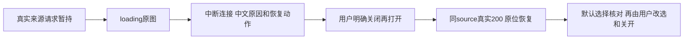

# T1305 真实来源失败与原位恢复验收

三族来源目标路径均已取得真实通过证据：loading→中断实际只读请求→准确中文提示→用户明确关闭并重开→同一来源真实 HTTP200 恢复，未增加模型或保存。**首轮整体仍为 exit1（1失败、2通过），文章定向复验为 exit0（1通过）**；初始历史选择疑点根因未定且没有修复，不将其消成纯夹具问题或自动accepted-risk。本文是 A 执行报告，独立 oil/验收复核待 R。

## 本轮绑定

source `cfbaf1ee021ef6904440ffd78afe3f82c4381ed6`，control HEAD `148a7da951a31ea3e3f94fcb8b42956f5daf6f2d`，run `final-t1304-t1305`。正式 packet SHA `8654cabbfe9a7a6eb9f39df83825116486b99ded169d3254f3a6b54c8c2512f0`；沿 T1304 candidate binding SHA `af548574f185d2ae22ea05de24fdc27bf2971283c75882eef76c9b99b1ddb7cb` 与 B新 HANDOFF SHA `273f942b79f1f94f82249f94f93edd1501df41d85563677e1baf43bedf9a4283`。

同一 C-owned service `http://127.0.0.1:65112`，新组 `grp-d99d5a06-6`、项目 `project-d99d5a06-22`；creation joint1 `ai-conv-d99d5a06-99`、editor `ai-conv-d99d5a06-502`。每族独立临时 persistent Chromium context，原 candidateGuard/握手header保留；full Chromium1223/Chrome for Testing148.0.7778.96，Playwright1.60.0。只设置该新组身份和隐藏onboarding，未复制 B业务sessionStorage、旧根或用户Chrome profile。DEC-130003 build_smoke专用授权模式，不签原生壳或真实激活。

证据根为 `docs/verification/t1305/acceptance/runs/final-t1304-t1305/a/`，以下默认均相对此根。

## 执行历史与三族结果

|原执行|真实结果|范围|
|---|---|---|
|根目录首次三case|自然exit1，136.335秒；1FAIL/2PASS|creation article未抵达联合候选；creation graphic、editor article完整来源路径通过|
|`attempt02-creation-article/`|自然exit0，7.550秒；1PASS|只定向文章一族，先等初始实际editor消息200和region后再选joint1；未重跑另两族|

首轮原 `result.json` / `playwright.log` / `creation-article-failure.*`全部保留。Playwright失败后重启worker，模块内checks数组重置，故根 `checks.json`只有后两PASS；它不是全三case结果，以原reporter result与log为准。原runner在 `attempt01-driver/`，修改理由及前后SHA在 `attempt02-adjustment.json`；没有覆写原失败或原通过。

|目标族|实际成功证据|初始暂持/abort|明确重开后的新增真实读|
|---|---|---|---|
|creation article|`attempt02-creation-article/creation-article-*`|同源匿名fresh两读|仅目标1读，HTTP200|
|creation graphic|根 `creation-graphic-*`|同源匿名fresh两读|仅目标1读，HTTP200|
|editor article|根 `editor-article-*`|lazy来源1读|1读，HTTP200|

所有拦截均在导航/挂载或预览前注册，按 operation+conversationId+sourceMessageId+toolCallId及owned origin精确匹配。只暂持浏览器发出的实际只读source请求，loading原图后 `route.abort('connectionfailed')`，不伪造业务返回或注入中文。初读group header精确等于新组、account header为空；原UI scope始终未切换。放开拦截后，真实200回执candidate与指定base版本经原RPC读回保存；恢复request的params/query与原source一致。

creation两成员wire完全相同，**没有按请求顺序指认成员**。两个匹配初读全部暂持/中断；目标实际打开modal看到中文错误，明确关闭再重开后总数从2到3。目标ready、另一成员仍disabled；随后首次打开另一成员，实际仍显示同一中文error且零新增读，再关闭而不重开。分别保存 `*-other-member-still-error.*` 和result.otherState；不能把2+1总数说成目标自身3读。

## 实际状态、输入和选择

三族 `*-source-loading.*`、`*-source-error.*`、`*-source-recovered-default.*`均保存原PNG/DOM/ARIA。错误alert严格等于“候选来源暂时读取失败，请关闭预览后重新打开。”，无新按钮。实际 `#ai-copilot-prompt` 在loading、error、关闭、恢复全过程值相同，`*-error-closed.png`可见未发送文字。没有按发送；应用网络记录无模型/保存尝试。

fresh来源首读失败前尚没有可编辑的采纳选择，result均明确 `preFailureManualSelection=false`。因此**不签“已手动选择跨网络故障保持”**。恢复后才展开选择：依据真实source回执指定base，另走原 `articles.versions.get` / `graphicPosts.versions.get`读回实际base；逐字段核协议默认。joint1文章title/summary为空，默认采用候选；图文title/summary空、tags空，默认均采用候选；editor指定base标题和摘要已有值，默认不采用候选。实际结果及base完整文档分别在 `*-result.json` / `*-actual-base.json`。

随后用户Space切换真实enabled标题checkbox，普通Escape关闭、Enter重开，checked数组保持，且没有额外source读；图在 `*-recovered-user-selection.*` / `*-selection-reopened.*`。这是**ready后的选择保持**，与跨故障已选状态明确分开。pending/frozen/body-key保持只沿本任务受控原回归和B同context恢复原证据准确引用；本轮未注storage、复制B状态或重发UNKNOWN凑场景。

## 首轮历史选择观察：根因未定

原文章case点击新joint1历史项后，精确locator `aside[data-slot="stage-chat-rail"]`内region“文章和图文联合候选”自然120000ms未找到。原图/ARIA末态是editor那轮，source匹配数为0，尚未进入loading/故障注入。因此它既不能当来源修复失败，也不能删成没有业务影响的纯测试错误。

原网络仅保存请求顺序：初始editor messages.list、随后joint1 messages.list；没有response完成时间，不能证明究竟谁先完成。只读源码线索：`ai-copilot-content.tsx:2008-2035` 的loadConversation在await前捕获messages引用，返回后若引用变化直接return true，未区分初始hydrate与用户明确pick；2055-2095默认hydrate与2139-2144用户pick共用它。观察与“默认先完成后，用户读被当过期而忽略”等竞争路径相容，**尚不能定根因或简单断言迟到默认覆盖**。

经Root批准，定向复验先监听初始editor真实200并等实际editor region可见，再点joint1；source拦截仍早于导航，三族来源目标因而可验。`creation-article-initial-conversation-ready.json`和`history-selection-start.json`有独立时刻；这不是历史切换竞争的修复或快速切换通过证据。原JSON线索在 `history-selection-observation.json`，交Root/C据证据后续登记准确欠项；A未扩生产范围或擅自建新任务。

## 隔离、预算和清理

四个实际case（含首次文章失败）各自读回完整两平台DTO、script artifacts.get元信息、分页全部script版本，before/after逐字节一致；均为3版本/1页。`isolation-result.json`保存逐case SHA和当前版本ID，0新模型、0成稿save、无被测试保护拦下的写尝试。source失败/重读不改变脚本或另一平台。没有进入T1302导出/简化操作，T1301历史风险和父矩阵仍不签收。

精确复用B同冻结source的 `node tools/timeout-policy/verify.mjs`原exit0；`timeout-reuse.json`保存原件SHA与B control HEAD对当前HEAD的比较：除docs和两控制json外全部tracked输入相同，原Gate/消费者及依赖未变。docs/two-control-json不属原扫描与消费者，不冒称旧门覆盖A新runner。新runner单case1800000ms，首轮3case串行；launch/beforeEach180000ms，action/expect/screenshot120000ms，navigation300000ms，RPC900000ms，retry0/workers1，外层14400秒覆盖完整串行及清理。定向仅1case，预算未缩短。

四个临时profile均自然关闭并清理，原debug日志和 `browser-cleanup.json`确认目录不存在；未操作C controller或重启/stop服务，未接触正式App、用户库或Keychain。正常require_escalated两次执行都获批准，无规避拒绝；私有session仅代码读取、未输出，secret检查无泄漏。

原图/DOM/ARIA、网络与真实回执、两轮原exit/result、runner原新字节、隔离与Gate证明及本报告由 `EVIDENCE_SHA256.json`一次冻结。当前只是三族source目标局部通过和一个未定历史切换观察；等待R独立复核及Root范围裁决，不代签全局全绿、任务complete或accepted-risk。
