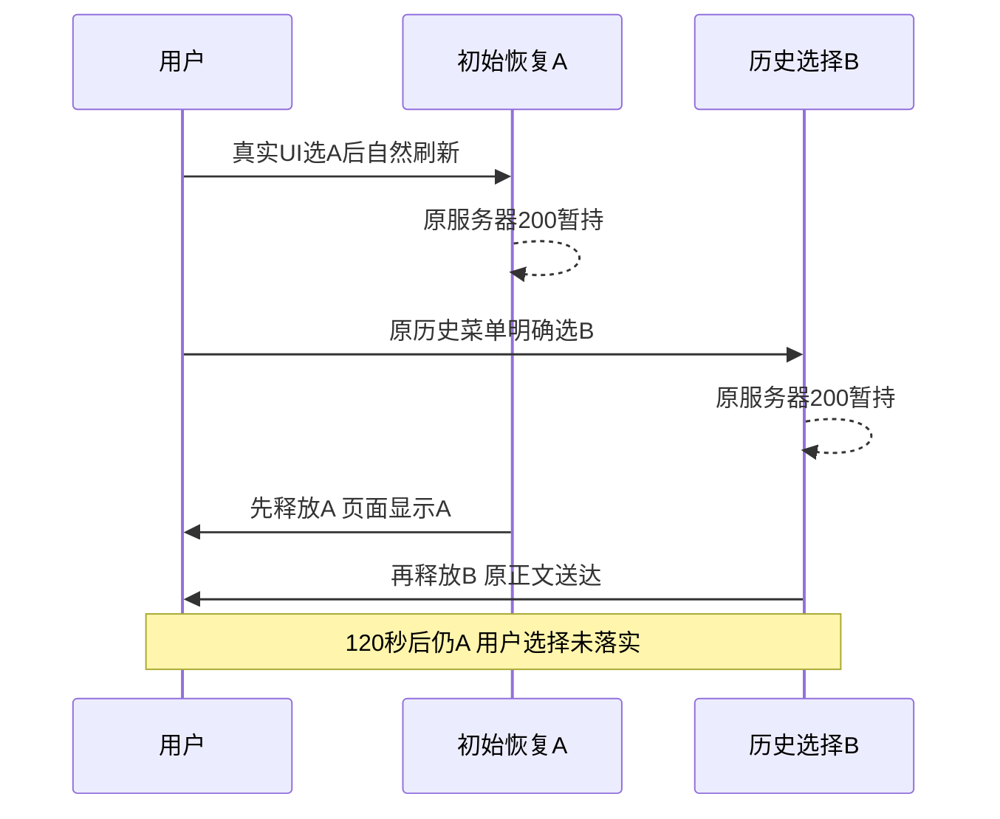

# T1306 首次恢复与历史选择真实时序诊断

**限定功能缺陷已复现，尚未修复。** 用户已在历史菜单明确选B，两份消息均为真实200且原正文不变；先释放初始A、再释放B时，120秒后仍显示A。反序释放与初始恢复完成后再选B均显示B。权威Playwright结果为 **1 FAIL / 2 PASS，exit1，146.266秒，retry0，workers1**；不能把“复现成功”写成产品PASS。

会话A为editor `ai-conv-d99d5a06-502`，B为joint1 `ai-conv-d99d5a06-99`；均复用已owned真实历史，没有新模型或成稿/脚本保存。文章URL沿原B HANDOFF。source `cfbaf1ee021ef6904440ffd78afe3f82c4381ed6`，control HEAD `e5d18d2c7d2fc8126319268a9633b2921f25d5a6`，原production candidate sidecar测试授权模式/65112/owned根不变，controller由C持有。非真实激活/原生壳验收。



三对照各用独立fresh context，同一组内先等默认editor实际200/region，再通过真实历史菜单选A，等真实200/可见A。只读核自然conv指针A；装好精确A/B messages.list拦截后自然reload。未复制、导入、搬运、注入或手改业务storage；仅原fresh组与onboarding偏好setup。

| 对照 | A实际释放UTC | B实际释放UTC | 最终可见/自然指针/菜单active | 产品期望B |
| --- | --- | --- | --- | --- |
| 01-a-then-b | 2026-10-16T02:28:22.612Z | 2026-10-16T02:28:22.866Z | A / editor | FAIL |
| 02-b-then-a | 2026-10-16T02:30:34.658Z | 2026-10-16T02:30:34.095Z | B / joint1 | PASS |
| 03-hydrate-then-b | 2026-10-16T02:30:40.579Z | 2026-10-16T02:30:41.619Z | B / joint1 | PASS |

第一组A/B原请求分别于02:28:22.125Z、02:28:22.421Z发起，原服务器完整200分别在22.203Z、22.524Z取得；**B已请求且真实200暂持后才释放A**。A在22.651Z被浏览器完整接收，页面实际显示editor；B在22.871Z完整接收，最终02:30:23.262Z仍为A（可见editor、精确原用户文本、菜单data-active与本组自然local指针四证一致）。后两对照最终B同样有对应联合候选、原用户文本、菜单与指针一致的证据。

各case的`timeline.json`保存每个请求的会话ID、原请求body SHA、发起、服务器响应/完整body、显式释放、浏览器响应/完整body、requestfinished时间。`read-NN-real-body.json`保原服务器正文。服务器body SHA、释放body SHA、浏览器body SHA和落盘原body SHA逐项完全相同，全部原200且含对应实际source user消息ID。每次response的meta requestId可不同，不要求跨请求正文SHA相同。所有响应/事件均从外部Playwright记录；无源码、React/window/fetch协议埋点，不记录headers/token/private session。

## 结论与边界

结果确认：在这份不变生产候选中，初始恢复A与显式历史B并发时，若A先落实，B的真实成功响应可能未落实到界面及指针；先B后A则B保持，已初始完成后选B正常。与`frontend/src/features/copilot/ai-copilot-content.tsx:2011-2031`按messages引用变化丢弃后回包、默认恢复`2074-2095`和显式选择`2139-2144`共用同loader的代码解释一致。没有读取内部执行分支，不把外部证据冒作该行分支埋点。

本次是新受控真实200响应顺序证据。原T1305首轮只记录请求发起顺序，没有完成顺序，其历史根因仍不追认。本任务不修改产品、不声称修复、不签全历史选择/所有UI可靠性，不扩大父矩阵；T1302正文渲染阻断与其它任务状态由Root另管。

三组前后`articles.get`和`graphicPosts.get`完整DTO（含版本列表）、`artifacts.get`脚本metadata、按真实meta.total取全versions均深相等。脚本实际3版本；0模型、0成稿save、0脚本save、attemptedWrites均空。浏览器拦截保护`/api/chat`与原模型/成稿/脚本保存入口；公共业务读取仍真实，未换base或重发原任务。

## 原件与执行

每组独立保存`case-result.json`、`timeline.json`、`natural-seed-A.json`、原body、`final-visible.json`、`visible-identity-witness.json`、before/after完整业务DTO与isolation-result、实际截图/DOM/ARIA。B已实际查看三组final截图。第一组期望断言自然FAIL后Playwright重启worker，另两组仍正常跑；没有用module级checks数组覆盖失败。权威总数来自`result.json`/`execution.log`/`execution.exit`。

```bash
T1300_SESSION=/private/tmp/t1300-candidate-IDnfdQ/session.json pnpm --dir frontend exec playwright test ../docs/verification/t1306/public/b/first-restore/history.spec.cjs --config=../docs/verification/t1306/public/b/first-restore/playwright.config.cjs --workers=1 --retries=0
```

同获准专用Chromium正常沙箱外启动，无自动审批拒绝。单case1800000ms，action/expect/screenshot120000ms，navigation300000ms，launch180000ms，RPC900000ms，外层14400秒；没有缩短真实请求或任务期限。没有新增模型任务。runner/config/packet/binding SHA见`EXECUTION.json`，全部原件索引见`EVIDENCE_SHA256.json`；私密检查只检实际token不输出其值。未跑额外测试/构建/服务，也未改控制面或完成任务。普通writer/browser/model窗口释放见`RELEASE.json`，原controller未操作。
