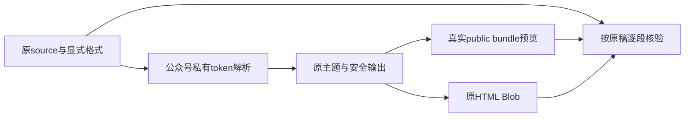

# T1307 公众号行内渲染实现结果

本轮受控实现与当前17项原生组合、标准生成核验、frontend类型、boundary、semantic及完整timeout门均已实际通过。两份T1302真实source的全文段落、章节顺序、标题与四行`______`分别对真实public bundle预览及原export Blob通过，未再新增字面strong/span。尚待独立实施复核及新不可变候选公共验收；不是T1302/T1300完成，也不是App安装或真实PNG像素验收。

基线HEAD `7dac8b0550d648d01e1f13348b5aa8787e8b5d38`，初审`PASS[REV:8496940d8913]`；交接packet SHA `aa442f3b0944137c825f1d37bd78e5f648c03b82a4dc37d329702aba3c08d5c9`。开工48项锁输入全部匹配，版本3.29.0匹配；本轮沿既有codegraph基线和源码直接核对，没有声称新符号索引已刷新。T1308实现与控制面均未编辑。

## 实际修改

公众号新增私有单实例markdown-it，沿现有配置，仅从本轮原输入产inline tokens。标准强调/链接/图片/代码/转义由已有依赖处理，`++`、`==`与精确无属性`<u>`以私有delimiter规则处理；变量成为终端原文本token，每次env独立。wechatRenderer按token使用原theme、leaf、safeUrl及escapeAttr输出，不再把生成的HTML送入后续格式正则。移除已失去消费者的wrapLeafText和unescapeHtml，原共享markdownParser、块转换、rednote、native宿主与公开合同没有修改。

补充格式回归发现：原自动关键词装饰会把`file_name_value`变成`++file++_name_value`，使原合法intraword下划线取得新的delimiter边界并跨行配对。连续两次失败后按packet停报；Root核源码与原失败后授权仅在原“已有格式不自动装饰”判断补`_`。纯正文原自动装饰和主题色仍有实际对照通过。

仅运行原`node frontend/scripts/build-noterelay.mjs`生成产物，无手工改bundle/归档/manifest/合同copy。实际变化是native.js、build-meta.json、source.zip与manifest的noterelay子树。manifest非noterelay子树及198项原许可库存逐项不变；CSS、两处LICENSE/notices及layout合同copy共6项原SHA不变。归档内renderer、新helper、共享parser、native入口与合同copy五项均与当前源逐字一致。证据：`runtime/GENERATED_FOOTPRINT.json`、`runtime/ARCHIVE_SOURCE_CHECK.json`。

## 真实红绿与失败保留

1. 生产编辑和任何生成之前，真实原bundle经原host/mount/load，两原source按实际`candidate.article`及`candidate.candidate.document`经projectArticle投影。两用例自然exit1，分别在DOM及原HTML Blob的全文/四行/无新增标签断言失败；章节、标题、主题及其余段落有效。`runtime/pre-red.log`、`pre-red-exit.json`、`red/creation-article-*`、`red/editor-article-*`保留原输出。
2. 格式安全族基线实际7 PASS、7 FAIL、2 skip；原5项均PASS。安全用例首次因已被sanitizer移除的href为null发生断言类型错误，不计产品RED；补null处理后单例真实PASS。其余嵌套、代码转义、变量终端、含符号地址、下划线/环境失败按原日志保留，不制造红色结果。`format-baseline.log`、`safety-baseline.log`。
3. 首次实现实际15 PASS、1 FAIL；第二次夹具校准后仍15 PASS、1 FAIL，均为补充下划线族。第一份夹具本身有可合法跨行配对的下划线组合，不能把该预期全部原样显示冒充CommonMark事实；改成intraword与显式转义后仍暴露上述前置自动装饰问题。`native-green.log`、`native-final.log`保留自然exit1。Root授权修正后16项通过，新加纯正文对照首次误按background查找graphite的border-bottom而失败；仅修测试选择与真实短语预期，无额外生产改动，原`native-final-correction.log`保留。
4. 最终17 PASS、0 FAIL，retry0/maxWorkers1、test/hook均180000ms；`native-final-verified.log`和对应exit JSON；最终DOM/HTML及逐源JSON在`runtime/final/native-final-verified/`。

证据限度：首次RED前保存了原5例test、原bundle/renderer/manifest和48输入SHA；真实RED运行时为7例。随后补格式族、生产编辑前保存了包含原两RED用例未变正文的完整16例测试快照和SHA，未单独当场保存首次7例测试整文件SHA。不得把可机械恢复的前缀宣称为当场快照。两原source的前RED行为、原DOM/HTML与自然exit1确实存在。首轮修后green目录保留完整失败DOM；第二轮同名final DOM/JSON被后续运行覆盖，第二轮原失败日志/exit仍保留，不能声称第二轮完整DOM已独立冻结。已将后续证据保存改成phase/run独立目录，最终PASS原件完整。

## 本轮实际检查

| 检查 | 结果 | 原记录 |
| --- | --- | --- |
| 原生public bundle组合 | 17 PASS，exit0 | `runtime/native-final-verified*` |
| 标准生成及--verify | exit0 | `runtime/standard-build-correction*`、`runtime/bundle-verify-final*` |
| frontend tsc，无incremental | exit0 | `runtime/frontend-types*` |
| boundary | 无新增；原5条基线保留，exit0 | `runtime/boundary*` |
| semantic | exit0 | `runtime/semantic*` |
| 完整timeout-policy verify | 静态2839文件0失败，后续全部实际子检查通过，exit0 | `runtime/timeout*` |
| LED047 | 未触及弹层导航/折叠/轮询路径；复用T1308同冻结字节216 PASS，非本轮重跑 | `runtime/LED047_REUSE.json` |

17项覆盖原5项（图片交付/主题、rednote分页/尺寸/稳定key、双实例/卸载/HTML安全、明确像素夹具PNG/ZIP、真实身份署名），另加两原source与10组行内行为。代码/反斜杠转义不触发格式和变量；变量中的Markdown/HTML/私用区及二次变量原样显示、不跨重载串值；链接图片含括号、下划线、星号、实体地址保真；危险协议/HTML及事件属性无执行节点；显式主题优先、rednote未被私有规则污染。

当前只交付受控实现候选。新服务/候选包、浏览器、模型、安装、用户根和Keychain均未操作；旧UNKNOWN不重发。控制面pmem/reconcile/taskctl/ledger由C依原串行协议处理；本代理未代签全局绿、独审或公共验收。最终输入及产物SHA见`runtime/FINAL_INPUT_SHA256.json`；证据总索引见`runtime/EVIDENCE_SHA256.json`。

