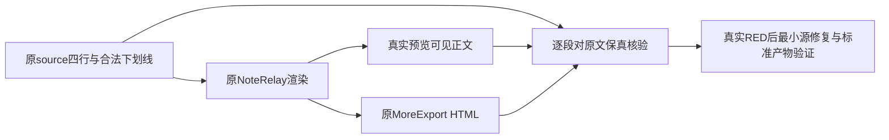

# T-1307 公众号原正文连续下划线的渲染保真修复草案

用户原授权覆盖功能恢复及真实验证。Root依据T1302真实公共验收与独立只读核查，将source→render正文损坏判为T1302阻断，要求独立最小修复任务。当前仅登记📋待审与草案；产品尚未编辑、未实施实验RED、不扩大T1302旧写集或重置T1300/1302审核。

## 确定现象与范围

不可变source cfbaf1ee021ef6904440ffd78afe3f82c4381ed6、同65112 owned根。T1302三case自然exit0只证明当时既定断言；creation文章及editor文章真实source第5节为普通四行中文和每行______，无strong/span。真实native Shadow DOM可见文本各新增3个literal `<strong style=...>`，原MoreExport下载HTML解析后同样含字面标签。preview与export同错不等于原文保真，T1302 acceptance不done。

原件：docs/verification/t1302/acceptance/runs/final-t1304-t1305/a/UI_ACCEPTANCE.md（SHA469a87bf52898bb1d9c3d15cef88119f658e70c2f065520d8f2704971a52d174）；119索引36cfe3320917e1eadcf17547866ec5d73ec5ca2b18682a189694149e78a66627；literal-markup-observation.json SHA3bc4686d2ce483493babeaa57e2b68ddfe5bf01fd471e7112227542a921bcd50。原source JSON、native-preview.html、preview-content、原downloads均保原字节。17原PNG未拍第5节局部，不能说已有异常局部图。0新模型/0成稿写，双方完整DTO和脚本metadata/allversions不变。

## 静态线索与待审最小方向

reference-editors/noterelay/src/platforms/wechat/wenote/wechatRenderer.ts:535–560的inlineMarkdown依次正则处理双/单下划线及其它标记，生成HTML又可能参与后续匹配并被leaf转义；projection.ts:66–69将原section.body交markdown、真实NoteRelay/native load/export消费该renderer。此为源代码线索，未独立实验定最终算法或假称已受控RED。

修复必须对原source正文保真，不能修改AI候选/源文、删除合法下划线、清洗最终下载HTML或只让两个同错输出相等；不能大改所有renderer、主题或新增美学hard-fail。正文里的合法下划线、跨行/嵌套强调、代码/链接/转义/变量和HTML安全等最小输入族需按实际消费者锁定；原显式nativeLayout/主题及无安全输出之外的合法任务可用性必须保留。

产品精确W、现存原生组合测试/标准build与确定产物链、必要输入族和同包公共重新验证待Root方向及独立SPEC初审锁定，不先授生产写权。需要原标准构建生成产物时必须绑定原源与生成器、不能手改bundle代修源；不安装/发布、不碰用户库、未知任务不重发。不为此先重包，Root将在收齐当前包其它模块真实问题后决定集中修复/必要复验。

T1302保持阻断，原三case0/正文异常各按范围记录；T1301真人accepted-risk只覆盖其历史前RED，与本缺陷无关。当前未改父DAG/未claim父矩阵，后续跨任务验收依赖须避免循环并由Root明确。

## Root后续最小技术方向与精确候选写集（仍待独审）

复用现有markdown-it仅解析inline tokens，再由公众号inlineMarkdown一次token→现有theme/leaf/safeUrl/escapeAttr输出；保原block parser和rednote。不得只换regex顺序、仅用opaque暂存或清洗输出HTML：这些不能保证原______合法delimiter。++、==、<u>及{{变量}}仅原输入解析，代码/转义内不触发，变量值作为终端原样文本、不打开raw HTML；默认markdown-it不自带原++/==/u能力，不得借复用删功能。实现仍需独立方案锁审及真实前置RED。

候选最小源W为reference-editors/noterelay/src/platforms/wechat/wenote/wechatRenderer.ts和markdownParser.ts；原测试W为frontend/src/features/reference-editors/noterelay/native-bundle.test.ts。实际生成入口只用frontend/scripts/build-noterelay.mjs（只读），生成W足迹为frontend/public/reference-editors/noterelay/native/{native.js,native.css,build-meta.json,LICENSE,THIRD_PARTY_NOTICES.md}、frontend/public/reference-editors/sources/noterelay/{source.zip,LICENSE,THIRD_PARTY_NOTICES.md}、reference-editors/manifest.json、脚本原字节复制目标reference-editors/noterelay/web/noterelay-layout.ts。最后layout合同copy/css/LICENSE/notices预期字节不变，须核真实结果；不得手改bundle/归档/合同copy。当前旧清理目标已不存在，不假说删除现存文件。运行证据仅docs/verification/t1307/runtime/**和IMPLEMENTATION_RESULT.md；本草案不授写权、不建立module。

先扩原native-bundle.test原host真实mount/load(两份冻结source.document经projectArticle的markdown，graphite-minimal)→DOM及原export Blob，creation/editor各独立用例以原第5节四行文字和______逐字保留、无新增literal标签为目标，前置真实bundle自然RED必须先于改源/生成。其它strong/em嵌套、代码/转义、link/image含符号与危险URL、变量终端文本、u/++/==/~~混合按实测标RED或已过基线，不造红。原native5项/显式layout/署名/rednote分页图片及dispose保持。具体源和生成产物SHA须在正式初审锁定真实当时基线，不以草案假称已核闭包。
