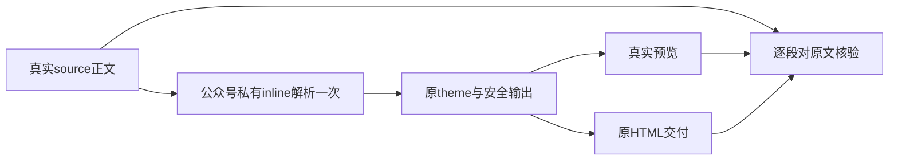

# T-1307 修复公众号原正文连续下划线渲染出字面HTML标签

## 授权、现象与用户结果

用户已授权恢复Codex各功能和分模块真实验证。Root依据T1302两份真实文章的source→render损坏，批准独立最小NoteRelay公众号渲染修复先锁SPEC独审。原T1302保持阻断，旧review和原3case exit0/实际FAIL原文不改；不是重置其round3。用户希望原四行中文和合法______仍是真实正文，预览和HTML交付不额外出现标签。当前产品/测试/生成产物均未编辑，未发生本任务受控前RED，不能签已有TDD。

source cfbaf1ee021ef6904440ffd78afe3f82c4381ed6的creation及editor文章第5节原文仅四行中文和______，无strong/span；真实native Shadow DOM可见文本各新增3个literal strong/span，原MoreExport HTML下载同样错误。两个同错输出相等不证明对原文正确。异常由完整DOM和原下载证明，原17张PNG未拍第5节局部，不冒已有局部图。

原证据：docs/verification/t1302/acceptance/runs/final-t1304-t1305/a/UI_ACCEPTANCE.md（SHA469a87bf52898bb1d9c3d15cef88119f658e70c2f065520d8f2704971a52d174）；119索引36cfe3320917e1eadcf17547866ec5d73ec5ca2b18682a189694149e78a66627；literal-markup-observation.json SHA3bc4686d2ce483493babeaa57e2b68ddfe5bf01fd471e7112227542a921bcd50。R正式ACCEPTANCE_REVIEW记录T1302-ACC-001 major blocking，原case和异常分别保真。

## 原消费者、范围与实现约束

真实链为source.document→frontend/src/features/reference-editors/noterelay/projection.ts的projectArticle→原NoteRelayEditor→应用public/native/native.js的mount/load→公众号wechatRenderer→原export Blob→MoreExport下载。原inlineMarkdown顺序regex可能再次处理已生成标签再leaf转义，是静态线索；根因实验与行为RED必须实际发生。禁止修候选正文、删合法横线、清洗输出HTML或仅换regex顺序；opaque暂存本身也不能保证______的合法delimiter语义。

复用仓库现有markdown-it依赖/配置，只为公众号创建私有inline parser（可在允许新wechatInlineParser.ts中实现），实例只创建一次，每次变量env独立；一次原输入inline tokens→现有theme/leaf/safeUrl/escapeAttr输出。不修改共享markdownParser的md实例、parseMarkdown/block转换、rednote或其它平台。私有解析不能污染共享token规则或改变段落/分页。renderer与private helper之间内部接口只传本轮纯文本/token上下文，不新增公开SDK/HTTP/存储合同。

原++、==、受限<u>、~~、强调与{{变量}}按原能力在原输入解析阶段处理；代码/转义内不触发，变量替换值为终端原样文本，不再解释Markdown/HTML；每次独立env不串值。不开raw HTML执行。沿现有safeUrl/escapeAttr和图片原资产路径，不降低危险URL/转义边界；不引入远程依赖。语义仍来自原稿，机械格式解析不做创作选择。

显式nativeLayout/theme/作者参数原样优先，保空layout原graphite-minimal、原DOM结构/样式角色及主题色语义、rednote分页图片/原实例dispose；不增美学hard-fail、不用改变字号掩盖正文。预览/导出都用同一原渲染入口，但验收必须分别对原source，而不只互比。

## 精确写集与标准生成足迹

唯一手写生产源W：

- reference-editors/noterelay/src/platforms/wechat/wenote/wechatRenderer.ts（现存）
- reference-editors/noterelay/src/platforms/wechat/wenote/wechatInlineParser.ts（允许新增；当前不存在，仅公众号私有inline）

测试W仅现存frontend/src/features/reference-editors/noterelay/native-bundle.test.ts。证据W仅docs/verification/t1307/runtime/**、IMPLEMENTATION_RESULT.md；后续公共验收仅docs/verification/t1307/acceptance/**及REPORT/GATES_REVIEW，C串行控制，独立R只报告。

实际生成唯一入口是frontend/scripts/build-noterelay.mjs（R）：生成W为frontend/public/reference-editors/noterelay/native/native.js、native.css、build-meta.json、LICENSE、THIRD_PARTY_NOTICES.md；frontend/public/reference-editors/sources/noterelay/source.zip、LICENSE、THIRD_PARTY_NOTICES.md；reference-editors/manifest.json；以及原合同复制目标reference-editors/noterelay/web/noterelay-layout.ts。生成器会写后几项但合同copy/css/LICENSE/notices预期不变，必须比SHA核实际结果。真实生成足迹为W不等于允许手改这些文件；不得手改bundle、归档、manifest或合同copy。原脚本legacy清理目标现均不存在，不假说删除现存文件。禁止仅跑web/build.mjs冒应用public/源码归档已更新。

只读输入含markdownParser/types/theme、web/native及obsidian适配、styles/css、projectArticle/NoteRelay/MoreExport消费者、共享contract原layout、生成脚本、原native测试及两份真实source/DOM/下载；完整输入SHA见本任务INPUT_LOCK.json。两个修复与T1308独立源无并写，同checkout严格串行；此锁不引用未来T1308产品字节。版本3.29.0及当前架构沿用，原索引基线/源码直接读取不假称刷新新符号。

## 产品编辑之前必须真实发生的RED

先扩原native-bundle.test的真实host()，直接读取当前public/native/native.js，原mount/load两份冻结实际source.document经projectArticle得到的markdown、graphite-minimal→真实DOM及原export Blob解析。creation与editor两独立用例按第5节四行正文/______逐字保留、无新增literal strong/span断言，完整前置bundle/源/测试快照与自然exit1保存后，才可改源或运行生成。helper-only、仅mock simplified、单独regex试验不代该组合前RED；夹具/导入错误分开，不算产品RED。测试读真实原source文件R，不造source-ID或改原件。

其余输入族按原真实行为记RED或已过基线，不要求造红：strong/em及嵌套、合法连续下划线/标点/换行、inline code/反斜杠转义、link/image含符号及危险URL、变量值含Markdown/HTML只作原文、++/==/u/~~混合。原5项native组合保持，显式layout/署名/rednote原分页图片/两个实例隔离和dispose回归。旧像素夹具仍只算受控管线，不冒新真实PNG像素。

修后标准生成→build-noterelay --verify→同原组合对source逐段/全文与有序块核验、无新增标签、原安全和布局语义；前置源/产物hash及最终源/产物hash全部可追溯。定向vitest test/hook180000ms、retry0、maxWorkers1；frontend tsc无incremental、boundary/semantic/timeout受影响门，必要LED047复用同冻结字节适用结果或按新变更实测，不重复无关suite。外层预算覆盖生成/串行/清理，至少原更长值；无缩短任务deadline/未知重发。

## 新包公共验收与依赖

Root在收齐本轮其它独立缺陷后，可合并T1308一次固定SKIP_INSTALL不可变生产候选，fresh owned根；不用现有65112修改后的开发产物冒候选。对两份原候选文稿可经新owned公共入口建立同文合法fixture或授权只读新包载入原冻结文档，不重发旧模型/UNKNOWN；具体公共driver按受支持lease/packet明确。真实原组件滚到第5节看图、原MoreExport HTML下载，分别核原source四行/合法横线与整篇其它段落无损、真实主题/布局保留。0不必要新模型、不为验收预保存改base或清洗输出。T1302重验引用此新source/run真实原件，不以本任务局部绿代父矩阵或App/native激活。

本模块implementation先独审/真实RED→修复→适用门→独立实施复核；acceptance可依implementation后提供T1302阻断闭合证据。不得T1307 acceptance依赖T1302 acceptance而形成循环；父T1300仍按原T1302依赖待实际闭合。原T1301真人accepted-risk仅历史完整组合前RED，与本缺陷无关。统一pmem/reconcile/taskctl据实收尾，保29既有全局身份与本轮所有失败，不承诺全局绿、不推送/安装/发布/用户库/Keychain。

