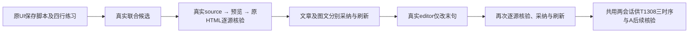

# T1307 新候选公共验收结果

本轮两份真实模型 source 的全文、章节顺序和四行 `______` 均在实际公众号预览、原 MoreExport HTML 下载、采纳后当前稿及刷新读回中保留；未新增字面 strong/span。联合 article/graphic 与 article editor 共两次真实 UI turn、三次 owner 采纳，业务最终实际 exit 0。待独立验收复核；不是 T1302/T1300 全量完成或原生壳/真实激活验收。

## 环境与原始失败

- 控制 HEAD `354786143377c58a12876731d00b075c4008a858`，immutable 包 source `dc46cfa700ec9c9cbada47fb76237d0b50d10a67`；binding SHA256 `d82fcbe6bbccae7f99197a0ce20deb3bd2520c459dded17e6f322f13dcf859e5`。
- 唯一服务 `http://127.0.0.1:65353`，fresh owned `/private/tmp/t1300-candidate-MhP4pW`；controller 归 C。session 仅路径记录，凭据不输出。正式 App、用户库、Keychain、旧 owned 根未操作。
- artifact `/private/tmp/t1300-artifact-bcz9nlt5`；binary SHA256 `9a614c2889d98cbe1c4b3118c6ad62f212c06b8877e8d9b4f41372c97b158634`，sidecar tar `cfc7f148faf8e3f9b618975b7944545b21b0a92ba137febe80af8d68aac9560c`，DMG `16bb553a1d526f393febfab8b4a96e2b9a0cddbf7fb5410cd55461169a9550b7`。仅由已有 production sidecar + build_smoke 测试授权执行，未启动原生壳。
- attempt01 实际 exit 1：Chromium 在业务前因 macOS bootstrap 沙箱权限退出；原日志/reporter/artifacts 原件保存在 `bootstrap-attempt01/` 与 `business-attempt01.*`，随后同命令正常申请沙箱外运行，没有改浏览器安全参数。
- attempt02 实际 exit 1、0 模型：脚本 native UI 真实保存后合并了空白行，测试对原输入双空行的严格期望失败。原件保存在 `setup-attempt02/` 和 `business-attempt02.*`。按前置 SHA 核验保留该版本 runner；只校准夹具，以刚真实保存且完整读回的原 script 版本继续，四行文字、换行及每处六个下划线仍在，语义未改。未重建组/项目或重保存脚本。
- attempt03 沿同一组 `grp-bcda7005-6`、项目 `project-bcda7005-22`、script `artifact-bcda7005-35`，业务实际 exit 0。没有借新任务或模型重试掩盖前置失败。

## 两轮真实业务与逐源结果

| 原UI操作 | 实际身份与结果 |
| --- | --- |
| 脚本“一键生成文章和图文” | joint source `ai-msg-bcda7005-108`；原任务 succeeded，actualEngine=codex，attempt 1 |
| article/graphic 分别预览采纳 | article `output-bcda7005-84`；graphic `output-bcda7005-96`；dirty 双稿自然承接，不预保存换 base |
| article 原UI新对话、只改末句 | editor source `ai-msg-bcda7005-362`；原任务 succeeded，actualEngine=codex，attempt 1 |
| editor 预览采纳并刷新 | article 最终版本 `artifactversion-bcda7005-433`；与原 source sections 深相等，仅原最后一句发生指定替换 |

两份 `*-article-source-family.json` 都由真实 `ai.workCandidates.source` 返回，四行是实际模型 source 内容；未直接注入候选正文、改 source 或 receipt。`*-actual-source.json` / `*-source-document.json`、真实 native preview HTML/DOM、`*-original-download.html` 原字节与 SHA 一并保留。每份 source 的标题、全文段落、所有章节按顺序核对，四行逐字保留；分析副本仅去空白并以独立 Markdown parser 解释合法源格式，原文、下载和渲染结果都未清洗。

预览与下载分别对原 source 核验，通过后才额外比较二者；没有拿“两个同错输出相等”当通过。默认 nativeLayout 为原默认路径，实际 theme=graphite-minimal。`joint1-article-four-lines.png` 与 `editor-article-four-lines.png` 已实际查看，四行清晰且无字面标签；这不扩大为全响应式或跨平台视觉验收。

每个 source 读取、打开/关闭预览、导出、选择、采纳和自然 reload 前后均保完整 article/graphic DTO 与 script metadata + 按真实 total 遍历的全部 versions。只允许当前被采纳的 owner 改变；script 与另一平台逐次 deepEqual。最终 script 有 3 版本，current `artifactversion-bcda7005-70`；graphic 最终 `artifactversion-bcda7005-299`。完整原请求的 body/base/source/key 在各 `*-result.json` 留存；本次未重复旧丢回包恢复实验。

## 时序事实与限制

`safe-timing.json` 在浏览器 request 事件发生时记录真实 POST，而非事后把响应时刻叫 POST。每轮保原 task/call/attempt、响应身份与 RPC 首次观察到终态的时刻。`HANDOFF.json` 的 timingJoin 给出真实 turnCallId、proposalCallId、toolCallId 和 executionTaskId/attempt，可与后台原 `tool_settled/tool_projection_appended/turn_finished` 关联。

250ms `browser-first-visible-text-family` 只是“候选/读取/完成/已保存”的宽文本观察：可命中用户原话或旧历史，editor 新 POST 前已存在这些词，phase 内去重还会吞掉后续事件。**不算本 turn 精确 tool/card 可见时间，不签 FEEDBACK PASS**。C 后来定位到真正 sink 是当前候选 `sidecar.log`：controller stdout 无新增不代表没有后端记录。按 Root 授权只白名单提取两 execution 的18条安全行于 `SAFE_BACKEND_PHASES.json`，有原日志路径、行锚/行 SHA、提取时点及文件当时 SHA；未复制整个 raw 日志。已记录 none 的 tool_settled→首次 tool_projection_appended（before_finish）、proposal 的 deferred_proposal 终态 append、turn_finished。终态同stamp再次输出 before_finish 是对账，不是新早流。内部 prepare/provider 与首token时刻仍缺测；UI gesture/公开保存 POST 是可见边界，不冒内部 prepare。终态是轮询首次观察，非后台精确完成时间。无新探针、无额外模型，不把字节当 token、总提速或 TTI。

## 门禁与交接

`node tools/timeout-policy/verify.mjs` 本次实际 exit 0；原 command/start/end/日志见 `TIMEOUT_EXECUTION.json` 与 `timeout.*`。同一冻结源码适用于 T1308；没有改产品、合同、原门禁或控制面。业务/历史分别保原长预算，retry 0、worker 1；UNKNOWN/失败不自动重发。

T1308 三组真实响应时序已另落其 run，全部 PASS、0 新模型/保存，原服务和这两份候选继续供 A 在 Root 下一窗口使用。A 必须先按 HANDOFF 的真实 source IDs 注册拦截再导航/挂载；已 confirmed 或历史已有后续版本的字段合法 locked，不强行解锁。独立结果尚未签；父40功能矩阵、现用安装版、原生壳均不代签。
