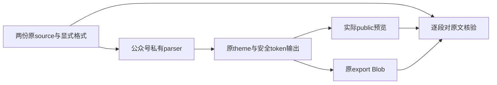

# T-1307 独立实施复核

**受控功能实现结论：PASS，未发现未解决的实质产品问题。** 两份原稿的全部正文、章节、标题和四行下划线在实际 public bundle 预览及原 export Blob 中分别对 source 通过。两处历史留存限制仍明确缺失；本结论不代签新包公共链、父验收或历史证据完全齐全。

## 冻结与证据完整性

本轮为 homogeneous 独立实施复核。按 BACKLOG、T1307 SPEC、锁与 packet 读取后，独立审查最终差异、原日志/exit、DOM、代码、zip 和摘要，没有运行测试、模型、浏览器或服务。

| 输入 | SHA / HEAD |
| --- | --- |
| 基线 HEAD | `7dac8b0550d648d01e1f13348b5aa8787e8b5d38` |
| 受审 HEAD | `0631b00a8ad31c05d2fce68f44ce8cab2190b7db`（评审开始 clean） |
| SPEC | `b3d705957ee4779ceb4ea3bb4f5d7139789c9dd5e0590dda34d199a7bad48c16` |
| 宪法 | `eb1826d4c09054df622d9718c38ca372bd19833e72bd1a752757631a5747c1df` |
| packet | `aa442f3b0944137c825f1d37bd78e5f648c03b82a4dc37d329702aba3c08d5c9` |
| renderer | `e07c90114690c888e98f8cb84b64ed0261334b631a32e560ff10253569347ca0` |
| 私有 parser | `bf710b35f1251285a3b0860af3ce5c9bc2dad168e0a554665f0b56d7a7823f71` |
| 原 native 测试 | `a592a212f17689a2360336e45748d8d8c10e99bcae87cdf19e2fee998a865851` |
| 实际 public bundle | `42cd3ff64406520d85d041f91eab504291c339d901fd70c3e15683a78cdbc23e` |
| source.zip | `9189ca79751e17945f87441e70b91d57514be75443db5e367b289b6941f85eff` |
| manifest | `713ad64b99c320bfaade368d860aebce8fae5c1528345e6987a768eba27e5f1a` |
| 作者结果 | `93317aedf61247bf23ad1b71b9c6aecccd7dd0047e2a99cb02dd58f6532ffeb6` |
| 证据索引 | `2453b40db54546766b467a0f24d3921981bdfd79c8cf0c89012b10a1be01618f` |

176 项原索引逐文件 SHA 全部匹配。48 项开工锁逐项与基线 commit 相符；最终输入及新增 helper 摘要也与当前字节相符。本轮两个新评审报告另给摘要，不修改原索引。

## 实现判断

私有 markdown-it 实例仅创建一次，每次传独立 env；变量值成为终端文本 token，不重新解释 Markdown/HTML。code/escape 在扩展前处理，受限 u 仅精确无属性标记，++/== 与强调在原输入 delimiter 上处理。renderer 逐 token 使用原 theme、leaf、safeUrl、escapeAttr，不再让后续正则处理已生成 HTML。未见新注入或危险 URL 边界退化。

自动关键词装饰原本可在 `file_name_value` 中插入 `++file++`，改变 `_` 边界并跨行配对。既有格式早退条件仅补 `_`，符合本次原输入保真约束；最终纯正文的原 border-bottom 装饰、短语和其余正文有独立对照，未为通过测试再改生产装饰。

原两 source 测试各自经过 projectArticle、原 host/mount/load 和 export Blob，分别对原 source 核验全文段落、标题、章节顺序、四行下划线及无新增字面标签。独立重读原 source 与最终 JSON，creation 的 16 段、editor 的 15 段及各四行在预览和导出中逐字相等，结论不依赖“两坏输出相等”。

手写生产只改 renderer 和新增私有 helper，测试只扩原 native-bundle.test。共享 markdownParser/block、主题源、rednote、native 宿主、合同与 T1308 未变。标准生成只更新 native.js、build-meta、source.zip 和 manifest 的 noterelay 子树。独立比较确认非 NoteRelay 子树和 198 项许可库存不变；另四项 NoteRelay 许可哈希也不变，CSS/两处 LICENSE/notices/合同 copy 六项字节不变。独立读 zip 确认旧条目仅 renderer 变化、新增 helper、无删除；五项关键源与归档逐字一致。

## 原 RED 与留存限制

SPEC 原文是：“**完整前置bundle/源/测试快照与自然exit1保存后，才可改源或运行生成。**”以下分开记录实际事实与本轮判断，不把更严格的首次运行整文件审计要求冒充这句话的原文。

- **已有证据**：原 bundle/renderer/manifest、原五例测试、48 项锁、两原 source、原 RED 命令/日志/自然 exit1、两原 DOM/HTML 均在。03:34:53–03:34:56 原运行明确为 7 总例、2 目标失败、5 过滤；错误是 source 四行被新增 strong/span 文字破坏，不是夹具或导入失败。
- **生产前完整快照**：03:37:09 的记录与完整 16 例快照 SHA `7e3b395b…` 存在，早于 03:37:24 首次标准生成；其中两核心用例正文与最终受测文件对应区域逐字相同。原 RED 日志的 Expected/Received、栈和保留 DOM/export 可交叉验证这两条核心行为。
- **RET-001：仍缺失**：首次 7 例运行的整测试文件没有当场独立留存及 SHA。不能将后来可恢复的前缀说成当场快照，也不能签“首次运行整文件审计完整”。这项缺失没有抹去原核心 RED 或生产前 16 例完整快照；本报告不声明用户已接受风险。
- **RET-002：仍缺失**：第二次修后失败的同名 final DOM/JSON 被后续运行覆盖，只有该轮原失败日志/exit 保留。首次修后 green 失败 DOM、两核心原 RED 原件、最终按 run 独存的 PASS 原件仍在。不能声称第二轮完整 DOM 已冻结，也不应把该缺失扩展到全部 RED/PASS。

受控功能 PASS 不把 RET-001/002 改成已补齐。若后续严格 Gate 单独要求首次 7 例整文件的当场 SHA，该窄项仍只能登记缺失；本评审不为它补签完整 PASS 或 accepted-risk。

| 运行 | 原始结果与性质 |
| --- | --- |
| `pre-red` | 原 bundle 两目标自然 exit1；两 source 原 RED 已证 |
| `format-baseline` | 原生产 7 PASS / 7 FAIL / 2过滤；安全用例 null-href 断言错误不计产品 RED |
| `safety-baseline` | 修 null 处理后原生产安全单例 exit0 |
| `native-green` / `native-final` | 修后各15 PASS / 1 FAIL；补充下划线族的两次失败保留日志，首轮夹具还含可合法配对的语法，未泛称全部为产品缺陷 |
| `native-final-correction` | `_` 早退修正后16 PASS / 1 FAIL；新增纯正文测试误查 background/短语预期，仅修夹具 |
| `native-final-verified` | 最终17 PASS / 0 FAIL / 0 skipped，独立 run 原件完整 |

## 最终适用门

直接读原命令、exit JSON 与日志，以下均真实 exit0；未由复核者重跑。

| 门 | 结果 |
| --- | --- |
| 实际 public native 组合 | 17 PASS：原5项 + 两原source + 10组行内行为 |
| 原标准生成 / --verify | 静态包、归档及共享合同摘要通过 |
| frontend 类型 | `--noEmit --incremental false` 通过 |
| boundary | 无新增，既有5条基线保留 |
| semantic | 通过 |
| 完整 timeout verify | 静态扫描及后续原子检查通过 |
| LED-047 | 合理复用 T1308 同冻结相关字节的10文件216 PASS；本任务未重跑 |

原生组合使用 retry0/maxWorkers1/test及hook180000ms。扩展覆盖强调与嵌套、++/==/u/~~、代码转义、终端变量与重载 env、含符号链接/图片、危险协议与 raw HTML、下划线及实体。原布局、署名、图片、rednote 分页、双实例/dispose 保留。原 PNG/ZIP 仍明确是像素夹具，不能算真实 PNG 画面验收。

新不可变候选的脚本/UI→真实候选→MoreExport 公共链、实际视觉、App 与父 T1302/T1300 全矩阵仍待验；原公共失败不变。本轮没有改任务状态、ledger 或运行全局 reconcile；旧许可名称误扫只能由 C 后续按已核不变字节处理。

未解决实质产品 issues：0；留存限制：RET-001、RET-002，状态保留。两报告核验后 **RELEASE 全部写权与资源**，不提交，由 C 整合。
