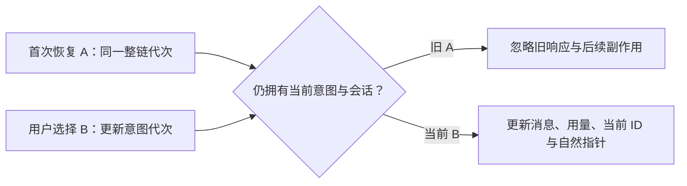

# T1308 实施结果

历史会话读取现按最新明确意图提交。被动恢复 A 已在途时选择 B，即使 A 先返回，旧恢复整链也不能吞掉 B、清掉 B 的指针或继续发起旧 fallback。此次仅完成受控组件实施验证；独立实施复核及新 production 候选公共复验仍待后续执行。

## 输入与改动

- 开始 HEAD：`0c69c8efec42e643c2bc69f37a344b1ec1e2181c`；初审 `PASS[REV:22663e1ffe92]`。
- SPEC SHA256：`5c89eddffeb10a29a1974598633c0b9a78bbdc2141a9ddf7f73cd9e1163bda3f`；原 packet SHA256：`b16c0395869eccb84e54f53b4d467bc82ad05a834c6513960445b2c631ad7859`，保留原字节于 `runtime/TASK_PACKET.md`。
- 生产仅改 `frontend/src/features/copilot/ai-copilot-content.tsx`。测试仅改原 `ai-copilot-content.test.tsx`；原 `ai-copilot-interactions.test.tsx` 未改。
- stored 读取、失败清指针、fallback 列表、fallback 读取、用量与空恢复收尾共享一个读取代次；每次 await 后及提交前核对意图、owner、scope、liveSession/key、epoch、挂载身份。
- 明确选择、新对话、提交准备开始、SDK submitted/streaming 推进会使旧读失效。保留 messages 引用与 SDK status 保护，防 A→B→A 和卸载后迟到回写；历史列表缓存只可回到原归属。StrictMode 第二 setup 仍能恢复。
- 提交准备中的读取在创建与提交两端均被挡住，覆盖首次 autoSend 先 prepare、被动恢复后启动的同次挂载顺序。没有改 wire、body/key、存储协议、prepared ticket、UNKNOWN、附件或原请求恢复语义。

## 前置 RED 与真实失败

原生产 SHA256 为 `c3e19d9332541f94a6579bb37156dcfa2cf9bc17fa835faf3d24ead8b095817e`。`runtime/baseline/` 保留原生产和两份测试，`runtime/PRE_IMPLEMENTATION_RED.json` 记录两轮测试期间生产字节未变；三核心失败均发生在第一次产品编辑前。

| 原生产核心场景 | 实际旧结果 | 证据 |
| --- | --- | --- |
| 默认 A 先回、显式 B 后回，最终应 B | 仍 A：实际 SDK messages/引用、DOM、菜单 active、自然指针 | `pre-red-02/dom/core1-*` |
| stored A 失败后，不得清 B 指针或借 fallback 覆盖 B | 旧 fallback 覆盖为 A，并发生旧列表读取 | `pre-red-02/dom/core2-*` |
| 后选 C，B 先回后 C，最终应 C | 仍 B | `pre-red-02/dom/core3-*` |

完整 scaffold 使用真实 `Chat` / `useChat` 和真实组件树，控制外部契约读取的返回顺序；核心断言不是仅 spy `setMessages`。相应日志、JSON reporter、DOM/状态、测试快照与 exit 均保留。

- `pre-red-01`：实际 exit 1，6 PASS / 9 FAIL。其“新对话”用例把动作前空数组当作保护引用是假设错误，原件保留，未算产品 RED。
- 修正该夹具、补齐负族后，`pre-red-02`：实际 exit 1，10 PASS / 12 FAIL，另 69 原测试因定向过滤未运行。三核心均为目标失败。原生产本来 PASS 的 B 先回、A 完成后选 B、正常 stored/fallback、新对话、StrictMode、SDK 消息推进、当前 submitted、空恢复保输入、明确读取失败等均按 PASS 登记。
- 初轮修复 `green-01`：实际 exit 0，22 项新场景 PASS。
- 随后新增首次 autoSend 的同次挂载顺序检查，`auto-prepare-red` 在初轮修复 SHA `e72a1eefa8b1bbc1cc87ae5eb157bb68f05e38efff099452608a9ef6056dc89e` 上实际 exit 1：prepare 已开始，后来启动的被动恢复取得新读权并写入 A。这是**初轮修后补充 RED**，不能追称原生产前 RED。补充 preparationPending 保护后的 `focused-final` 实际 exit 0、153 PASS。
- 首次类型检查 `gates/frontend-typecheck.*` 实际 exit 2，原因仅新增测试给 `getByRole` 传了类型不支持的 `exact` 参数；保留失败，移除冗余参数后重新验证最终字节。

## 最终验证

最终命令、时间、实际 exit 与受测三文件 SHA 以 `runtime/final-verification/SUMMARY.json` 为准；使用 retry 0 / worker 1 / test 与 hook 180000ms，独立外层单命令 14400 秒，不改产品任务期限。

| 检查 | 实际结果 | 原件 |
| --- | --- | --- |
| 两份原组件完整回归 | exit 0，153 PASS / 0 FAIL / 0 skipped | `final-verification/focused-*` |
| 前端类型检查 | exit 0 | `final-verification/frontend-typecheck.*` |
| 物理边界 | exit 0，无新增违规；保留既有 5 条基线 | `final-verification/boundary.*` |
| 语义边界 | exit 0 | `final-verification/semantic.*` |
| LED-047 与持久化/scope 回归 | exit 0，实际匹配 10 文件、216 PASS | `final-verification/led047-and-restore-*` |
| 超时政策 verify | exit 0，既有完整 verify 各批次均通过 | `final-verification/timeout.*` |

LED-047 批次额外给出的 `live-chat-session.test.ts` 路径当前不存在，未匹配任何用例；没有把它计成通过。实际 10 文件以 JSON reporter 为准，实际 Chat/cache 生命周期由新增真实 SDK 组合测试覆盖。

新增 23 场景与原有 130 场景一并运行，无跳过。既有合法首次 autoSend、prepared 首挂 StrictMode、prepare 失败后“继续本轮”原话恢复、UNKNOWN 仅核对不重发、SDK 普通断流、附件等保留测试均在完整两文件回归中通过。新增真实 SDK 手动/auto prepare 场景还核对实际公开 submit 消息原话及完成后的 ready；外部 fetch 使用受控 SSE 响应，不调用真实模型。

## 边界与交接

本轮没有启动候选、旧 owned 根、服务、浏览器或模型，没有业务保存请求或控制面写入。已有 T1306 公共诊断的 1 FAIL / 2 PASS 保持原字节；原 T1305 首轮缺完成时序仍不作根因追认。此次 DOM 是受控组件证据，不作为新 production 公共或实际视觉验收。

未新增模块、服务或架构依赖；未运行父任务全矩阵、全局 reconcile 或签完成。后续应先独立复核此冻结结果，再与另一独立修复按授权合并一次新候选，执行真实公共链路复验。最终 source/test/evidence hash 索引见 `runtime/EVIDENCE_SHA256.json`；资源释放见 `runtime/RELEASE.json`。控制面仍由 C 负责。
