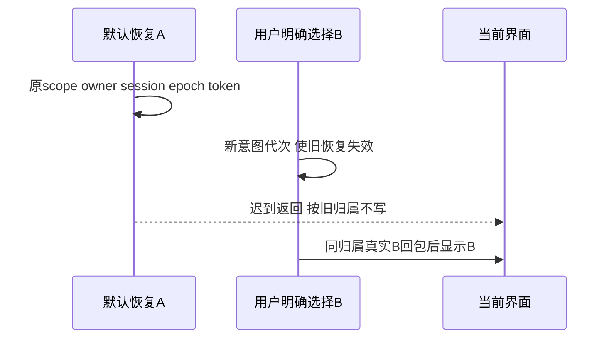

# T-1308 修复历史选择被首次被动恢复竞争吞掉

## 授权、真实问题与目标

用户已授权正常Codex功能恢复和完整分模块验证；Root依据独立T1306只读真实三对照，批准仅历史意图归属最小修复先SPEC独审。T1306仍是只读诊断，不改名或写成其原失败已修；原T1305 firstattempt没有完成顺序，不能追认它就是同一行导致。当前产品/测试未改，本任务组合前RED尚未发生。

T1306报告docs/verification/t1306/runs/first-restore/b/DIAGNOSIS_RESULT.md SHA c7f932e39be8eb091263c1e897c56a565df5ad3d7508ca864a1a35c22358f294，94索引d4ca646eadf5aedf5223263c0de777f09342d7959cc2e3d4df7e21cf8464d723；source cfbaf1ee021ef6904440ffd78afe3f82c4381ed6、control e5d18d2c7d2fc8126319268a9633b2921f25d5a6。1FAIL2PASS、exit1、146.266秒，0模型/0成稿脚本save/双方DTO与scriptmetadata全versions不变。

在原UI自然选A并刷新后，默认A与用户明确选B两读取都真实200，B已请求且完整原响应暂持后才释放A；页面A先显示，再释放B，120秒后仍A（会话region/精确原用户文本/菜单active/自然conv指针一致）。反序先B后A、初始hydrate完成后选B均显示B。原服务器body、释放body和浏览器body SHA相同，不是假回包。代码线索ai-copilot-content.tsx的loadConversation按messages引用变化返回true，且hydrate/pickHistory共用loader；外部证据确认竞争行为，不冒内部行埋点。

用户结果：明确选B应最终显示B，较晚明确选C优先于旧B；整段被动恢复不能吞掉明确选择、清它指针/输入或启动迟到fallback。网络失败保原界面/输入与原具体恢复行为，不新增按钮或阻断合法普通聊天。

## 最小修复与机械边界

唯一生产W为frontend/src/features/copilot/ai-copilot-content.tsx。仅在现有组件内建立历史读取意图代次/所有者检验，冻结当前scope、真实conversationStorageOwner、liveSession对象/键、其epoch及挂载生命周期；不新建全局状态库/协议/持久字段，不改live-chat-session或conversation-persistence生产源。

被动恢复的一个token必须在整段stored读取开始前创建，并贯穿读失败清原指针、fallback list返回后才开始load、最后空会话/usage/prefill清理。不能在失效链的后半重新生成新token让旧任务复活。显式pick先增加代次并使旧被动链失效，再发本次load；更晚明确选择使更早选择失效。每个await后且每个状态/指针/usage/prefill回写前都核原token所有权；旧回包成功、失败或空结果均不能清/覆新会话或输入。未真正被新的用户意图替代的正常stored恢复/fallback原来可用的仍可用，不通过永远关闭hydrate提速。

保原messages引用守卫和stream/status保护，不能全局移除引用比较或让显式历史覆盖submitted/streaming的新消息。新对话、提交开始（含准备await之前）、streaming状态/消息推进、卸载、owner/scope切换及A→B→A返回均使相应旧读失效；不能只按scope字符串相等认旧请求有效。现有epoch/reset/取消、捕获conversationId及真实新任务恢复不改含义。晚到history列表只可对原挂载/owner/scope写缓存，不将旧组结果写新组；原列表仍按scope只读且本地开关，不改服务查询/授权。

只读历史不能清prepared-turn、原UNKNOWN、pending/confirmed、source/message候选身份、body/key、附件或持久原请求来换会话；原new action自身已有合法清理保留，本修复仅阻旧history反写。按机械用户意图和真实ID选归属，不用语义关键词或猜模型内容。无backend/contract/transport/engine配置/模型版本/权限/期限修改。

## 精确写集、受控前RED与门

测试W仅两个现存frontend/src/features/copilot/ai-copilot-content.test.tsx及ai-copilot-interactions.test.tsx；不能改旧行为期望来把新失败吞成PASS。必须在现有content.test.tsx的protocol.actualSdk与vi.importActual(useChat/Chat)基础挂真实AICopilotContent、原菜单/点击/自然恢复effect、可控契约读取promise及真实SDK liveSession.messages引用变化，证明整组件行为而不只helper。interactions原不更新messages的假store或仅spy setMessages不能证明此竞态；可用作其它原交互回归，不代核心RED。外部RPC/流可受控但scope/intent/组件状态路径不旁路。必要原fixture修正单列，不算目标红测。

产品前独立真实组合RED至少包括：默认A与明确B均已读且A先返回后B应显示B；stored失败后迟到fallback不得盖已选B或清其指针；更晚C胜较早B。必须保存原源码/测试SHA、自然RED日志/DOM，再改产品。其它负例按真实基线标已PASS或RED，不造红：反序B先A后与初始完成后选B、fallback list在选择后才返回不启动旧load、旧失败不清新指针、最后prefill清空不覆盖用户输入、history列表迟到scope/owner归属、new/submit/stream/卸载/同scope重挂/作用域A→B→A、原UNKNOWN/preparedturn/附件/body-key及消息流不被旧history清写。提交期间使用真实SDK或明确受控status路径，不能只调用孤立代次helper。

证据W仅docs/verification/t1308/runtime/**及IMPLEMENTATION_RESULT.md，后续公共W docs/verification/t1308/acceptance/**和REPORT/GATES_REVIEW。定向两个tests test/hook180000ms、retry0/maxWorkers1，frontend无emit无incremental类型、boundary/semantic/timeout、受影响LED047及同scope恢复回归；保原更长预算，外层完整覆盖串行/清理。旧大suite同冻结字节可按适用性引用，不以此替新行为。原5边界旧项保留，不声明全局绿。

## 同新候选公共验证与DAG

独审→真实组合前RED→唯一writer单源修复→原受控门→独立实施复核，才可与独立T1307串行后集中一次固定SKIP_INSTALL不可变包。两任务生产/tests不交叉，共享checkout仍不并写；新包fresh owned根，不重开/写旧DB、不重发UNKNOWN。可复用原三模型冻结历史正文建立合法新fixture，明确新公共操作与导入来源；不为三对照重复付费生成。新candidate原UI三对照以真实200时序/最终选择为准：显式B已发生后旧A可被抑制，不强制旧A仍显示来维持错误断言；B最终可见、反序不覆、初始完成后可选，0模型/0成稿写和完整DTO/scriptmetadata/allversions不变。必要真实窄窗/键盘/作用域图与独立oil沿既有界面，不新风格/评分。

本acceptance只依本implementation，可在同一新run与T1302/T1307提供适用证据，不反依T1302 acceptance产生循环。T1302 source→render阻断仍由T1307独立闭合，父T1300全矩阵未通过。T1301真人accepted-risk仅其完整组合前RED历史缺证，不覆盖本功能失败。统一pmem/reconcile/taskctl仅真实收尾，原1FAIL2PASS和原现场缺完成顺序均保留，不推送/安装/发布/用户库/Keychain。

