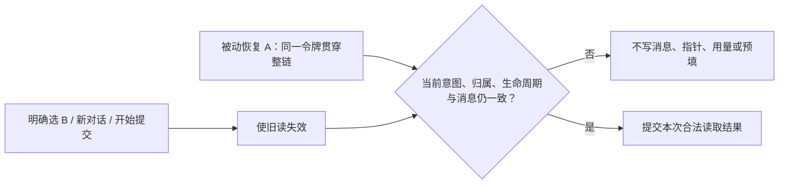

# T-1308 独立实施复核

**结论：PASS，仅限受控实施与适用回归。未发现未解决的实质问题。** 用户选择 B 后，旧恢复 A 的成功、失败和 fallback 都失去回写权；后选 C 仍优先。新 production 候选公共复验与父任务全矩阵待执行。

## 冻结与独立性

本轮为 homogeneous 独立实施复核。复核者读取了最终差异、调用与 SDK 源码、原始 reporter/日志/exit/DOM，并核对完整索引；没有自行执行产品测试、控制命令、浏览器、模型或服务，也没有修改产品、测试或控制面。

| 输入 | 冻结值 |
| --- | --- |
| 起点 HEAD | `0c69c8efec42e643c2bc69f37a344b1ec1e2181c` |
| 受审 HEAD | `ece479755066b784996258241be4a8bba174a07a`（评审开始 clean） |
| SPEC SHA256 | `5c89eddffeb10a29a1974598633c0b9a78bbdc2141a9ddf7f73cd9e1163bda3f` |
| 宪法 SHA256 | `eb1826d4c09054df622d9718c38ca372bd19833e72bd1a752757631a5747c1df` |
| 生产文件 SHA256 | `e576b7b69a8737deb0cc22e71e7bfd066f793d55943b609745fc27e12f79ae82` |
| content 测试 SHA256 | `3547704b32cdc22e7c2befe8a16545dfe74edcb5180912b6d30c2bade3441040` |
| interactions 测试 SHA256 | `7f805e910da696bbd35a593e132ca22263ceef2048f5a4f553121df6967d83f7`（未改） |
| 作者实施报告 SHA256 | `be920efbfca0507d882e4a49820752b874a15aa2d50ff715c120a1598d1df25c` |
| FINAL_SUMMARY SHA256 | `b8fa14bbc34b797a894b2e51a5b783146e8966ec7378bb58dffa63d3b3fa1d20` |
| 256 项索引 SHA256 | `525699a38a0021a9930d95787902a7974f96d1cabf1de2ab2bc13dba7c0cbe97` |

`EVIDENCE_SHA256.json` 的 256 个唯一文件逐项读取后，字节数与 SHA256 均相符，0 项不匹配。此索引冻结的是作者交付证据；本轮两份新增评审报告不在原索引内，由交接另给摘要。

## 代码结论

- 生产仅改 `frontend/src/features/copilot/ai-copilot-content.tsx`；测试仅扩原 content 测试及必要 harness。既有断言未被改低，interactions、live-chat-session、conversation-persistence、contract/backend/transport 未改。
- stored 读取前创建令牌，失败清指针、fallback list、fallback load、usage/prefill 与空恢复收尾贯穿同一令牌；所有异步返回后均检查原归属。显式选择先推进 intent，再读取。因此旧 A 不会靠后续 fallback 重新取得权力。
- context 对象身份、mounted/revision、真实 storage owner、scope、session 与 epoch 联合阻止卸载、同 scope 重挂及 A→B→A 复活。StrictMode cleanup 后的第二 setup 会发新的有效恢复；正常 stored/fallback 保持可用。
- 列表读取捕获原 context，晚到成功或失败仅可写回原归属缓存；没有将较新历史选择误当作列表缓存失效理由。
- `sendPreparedRef` 和重试在准备 await 前失效旧读。最终 `beginHistoryRead` 捕获准备/status 阻塞，`ownsHistoryRead` 再核 `preparationPending`、messages 引用和 status，覆盖 autoSend 比 hydrate effect 更早开始准备的次序。
- 当前 SDK 的 `setMessages` 同步替换 messages 数组。修复只在本次合法写入后接纳该引用；原消息推进及 submitted/streaming 保护仍在。新增历史代码未清写 UNKNOWN、prepared receipt/ticket、附件、body/key 或原请求身份，原新对话合法清理保持原义。

对应最终 DOM/状态证据中：三核心最终分别为 B、B、C；旧 stored 失败后 B 指针保留且不启动旧 fallback；manual 准备期旧 A 不写回，auto 准备期无历史读取；解除 prepare 后实际组件提交本轮原话并回到 ready。

## RED 与失败证据保真

原生产 SHA 为 `c3e19d9332541f94a6579bb37156dcfa2cf9bc17fa835faf3d24ead8b095817e`，与 baseline 快照及两轮 EXECUTION 对应。三核心在产品编辑前已真实失败：A 先回后 B 仍 A；stored A 失败清 B 指针并由 fallback 覆为 A；后选 C 但 B 先回时最终仍 B。原始 reporter 与 DOM 支持这些结果，测试快照 SHA 与每轮执行记录一致。

| 运行 | 实际结果 | 复核处理 |
| --- | --- | --- |
| `pre-red-01` | exit1，6 PASS / 9 FAIL | 新对话合法替换空数组引用导致的夹具误判单列，未计产品 RED |
| `pre-red-02` | exit1，10 PASS / 12 FAIL；69 原测试因过滤未运行 | 三核心及其余目标失败保真；没有把未运行计 PASS |
| `green-01` | exit0，22 新场景 PASS | 仅初次修复结果 |
| `auto-prepare-red` | 首次修复 `e72a1eef…` 上 exit1 | 同挂载 autoSend 准备后 hydrate 重新取权；属于修后补充反例，未冒称原产品前 RED |
| `gates/frontend-typecheck` | exit2 | 新测试给 `getByRole` 的冗余 `exact` 参数不被类型接受；原错误原件保留 |

最终双重准备守卫及 manual/auto 测试已闭合 autoSend 反例；最终类型修正仅去掉不支持的选项，完整冻结字节重新通过类型检查。上述历史失败全部仍在原路径。

## 最终适用门

直接核对 `final-verification/*-execution.json`、原始 reporter、日志及 `.exit`，其受测三文件 SHA 与最终冻结值一致。

| 检查 | 真实结果 |
| --- | --- |
| 两份原组件完整回归 | 2 个实际文件，153 PASS / 0 FAIL / 0 skipped；23 新增 + 130 既有 |
| 前端类型 | `tsc --noEmit --incremental false`，exit0 |
| 物理边界 | exit0；既有 5 条基线保留，无新增 |
| 语义边界 | exit0 |
| LED-047 与恢复 | 10 个实际文件，216 PASS / 0 FAIL / 0 skipped，exit0 |
| 超时政策 verify | 原完整 verify 日志保留，exit0 |

测试保持 retry0、maxWorkers1、test/hook180000ms，执行记录保留实际时段。LED-047 命令带入的 `live-chat-session.test.ts` 当前不存在，未计 PASS。完整两文件回归确实包含既有 prepared 首挂 StrictMode、autoSend、UNKNOWN 仅核对不重发、原话/原附件恢复及普通 SDK 断流等用例。

## 限制与交接

新增用例使用真实 Chat/useChat、组件、原菜单/点击和恢复 effect；RPC/SSE 与会话注册表是受控测试适配，不能据此声称真实数据库、模型、生产公共 UI、实际视觉或完整 cache 淘汰策略已验收。

本 PASS 不替代新不可变候选公共三对照、T1302/T1307 原文渲染闭合或父 T1300 全矩阵。原 T1306 公共 1FAIL/2PASS、T1305 原缺时序记录均保持原件；既有 5 条边界与全局 reconcile 状态未被改成全绿。

未解决 issues：0。两份报告落盘并核验后，复核者 **RELEASE 全部写权与资源**，交由 C 后续集成与控制面处理。
