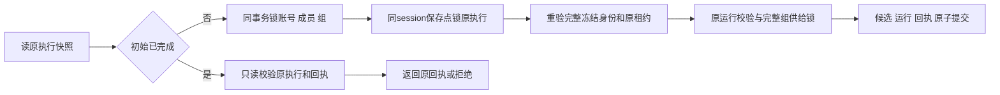

# T1309 实现与受控验证

本轮实现及授权受控检查已执行完成，交 Root/C 独立审核与后续新 immutable 包公共验收。不代签 T1300 全功能，不执行 taskctl complete。

## 改动

每日选题完成现在先在同一事务中验证并锁定真实工作区，再锁原 execution 完成结算。纯组不再被平台账号必填锁拒绝；组加账号仍通过原 membership 准入，额度和供给互斥按整个组计算。旧无 group 路径保留真实平台账号供给锁。初始已成功的执行只允许校验并读取原回执，归档后仍能读回，不能退回活动写入。

生产写集仅为两处：`backend/src/modules/ai/daily-topic-completion.service.ts` 与 `frontend/src/server/persistence-client.ts` 的 dailyTopicPorts 薄接线。没有更改通用账号锁、lease、membership、Worker、DTO/schema、调度策略、模型策略、continuous/maxAttempts 或恢复权限，也未加入 currentGroup.version 必须等于旧冻结版本的规则。

| 生产文件 | 当前 SHA256 | 字节 |
|---|---|---:|
| backend/src/modules/ai/daily-topic-completion.service.ts | 75ebbd93e2bc7ecc853fa1592ebb6d03bcd30ca114849a5b9233c6ecab0ce8cb | 12566 |
| frontend/src/server/persistence-client.ts | ae54433150e2bc86151d2742481e9c8d4b46a9ce164e54917b80171a93c2b40f | 478496 |

起点 HEAD `3d03b129b137f9eb6c9db8106200a0a6a441bd1f`，tracked clean；有效 lease 绑定 `/root/sol_daily_implementation_current`，since `2026-10-16T06:51:18.578Z`。最终 packet SHA `987cb795cfec2f0923569ab60fac938d8ba4088b4258b2268ff86f248bb4bd86`；ROUND2 输入锁 44 文件逐项匹配。沿用 PASS[REV:7af1b2b80c15]，没有重置评审。

## 三层证据边界

| 层次 | 实际执行 | 证明与限制 |
|---|---|---|
| 公开生产组合 | compositeTransport 公开创建真实组、定位/配置/候选、每日 job、runNow；真实 AI/execution 映射、claim、ledger 与实际 dailyTopicPorts | 三族有效 RED→GREEN；模型回执是完整受控 fixture，经真实 ledger.settle 结算。本层不 fork、不发模型 HTTP，不冒真实用户 HTTP E2E。 |
| 兼容与故障注入 | owned PGlite 内的原 job/run 库存、真实 ai.createTask 独立 attempt、authority/bind、claim、ledger 和生产端口；以及明确的字段漂移/触发器故障注入 | 核 legacy、带账号冻结成员、组配额、回滚等安全边界；不称这些库存由公开 runNow 正常生成。 |
| immutable Worker 等价回归 | 原两 it 机械副本，真实 fork 已锁 worker；第二例使用本轮 owned loopback 模型 HTTP fixture | 两 it 全部原业务/16 个 expect 保留，实际 PASS。0 真实模型；不冒当前 App 或新包验收。 |

数据库实际为 PGlite 0.2.17 / Drizzle 0.36.4。单完成路径真实 SQL 观察证明 workspace 锁先于 execution 锁，实际嵌套 savepoint 提交、触发器失败回滚及并发 claim/archive 均已运行；这是 PGlite 单 session 串行事务范围。`afterSnapshotDb` 在同一真实 tx 的 snapshot 读取后注入漂移，覆盖重验与整体回滚，**不是 PostgreSQL 双连接竞争**。未进行真实 PostgreSQL 多连接死锁压测，不据此宣称该项已验。

后端原聚焦测试继续使用原有 validateRun/finishRun 等领域替身；新增锁序/漂移用例沿该组合，证明实际 admission、lease 与事务核心。实际生产 validateRun/lockAccount/finishRun 接线、job/run 写回与 trigger 整体回滚，另由前端 compositeTransport 组合及兼容库存测试证明，不能混称后端聚焦用例也捕获了生产端口。

## 有效 RED 与历史失败

产品首字节修改前，`runtime/red-frontend-three-v4.log` 三族均实际抛 `OwnershipError: 账号不存在`，栈为 `lockAccountForSupply:250 → persistence-client:6434 → daily-topic-completion.service:75`。该轮完整 provider receipt 的 usage/warnings 通过真实 ledger.settle 提交。完整测试、配置与两生产源在运行前冻结于 `runtime/red-three-v4-snapshots/INDEX.json`；exit1，34.475 秒。原生产源 SHA 为 completion `8ce3e54bb5ebd828a0ac2a6aa5971c9745cafc3373ce4b71ad5eb986845ea528`、persistence `2b9d6ec76ddecec372e8203707f408af9beaddf790ba434fe9c8b99741a03860`。

前几轮实际结果均保留，不能补签为产品 RED：

- `red-frontend-three`：3 个夹具前置失败（缺 profile、DTO 省略 accountId），exit1。
- `red-frontend-three-v2`：3 个原账号锁错误，但模型 receipt 当时被直接补写 providerResult，故不采用为最终真实账本 RED；完整测试/源在该轮后真实保存，未冒称事前冻结。
- `red-frontend-three-v3`：skip 两族账号锁错误，模型族 receipt 缺 usage/warnings 而在 ledger schema 前置失败，exit1；有运行前快照。
- `green-frontend-comprehensive-v1`：6 PASS/3 夹具 FAIL（错误的 accountB 预期、schema 非顶层导出）。公开共享 job 实际复用 accountA 冻结身份；未改产品使其迎合测试。
- `green-backend-v1`：18 PASS/1 观察器 FAIL；默认 NoopLogger 未传入事务新 session，未捕获锁 SQL。修观察器后 `green-backend-v2` 19 PASS。
- `green-frontend-comprehensive-v3`：10 PASS/2 兼容夹具 FAIL，真实 job 唯一索引拒绝重复构造。
- `green-frontend-comprehensive-v4`：10 PASS/2 兼容夹具 FAIL，原 AI 整行克隆复用了 attempt 身份。现改用实际 ai.createTask，未改任何唯一索引或生产创建规则。

首轮误扫描单列 `runtime/MISSCAN_INCIDENT.json`：mergeConfig 合并 include，误执行了 W 外测试；明确可见 workbench-file-recovery 57 项、workbench-browser-host 21 项，完整 case 库存不能从原日志还原。精确 SIGINT 只停止本轮 Vitest PID14382，原 wrapper 记录 exit130/109.939 秒；之后核其父子已退出。不计任何 T1309 PASS/FAIL。原配置未事前快照，首轮 fixture 仅在改 v2 前真实保存，缺证如实保留。可确定的 tracked W 外变化为 0，mtime 清单及扫描范围局限见原件；不宣称未知临时文件全部清零。

## 当前验证

| 检查 | 结果 | 原件 |
|---|---|---|
| 三族首轮 GREEN | 3/3 PASS | runtime/green-frontend-three.log/json |
| 前端九族公共组合与安全边界 | 9/9 PASS | runtime/green-frontend-comprehensive-v2.log/json |
| 最终前端十二族含兼容库存 | 12/12 PASS，86.20 秒（Vitest） | runtime/green-frontend-comprehensive-v5.log/json |
| 后端完成、真实计数、原运行回归 | 19/19 PASS，4 文件，61.698 秒 | runtime/green-backend-v2.log/json |
| 后端 tsc | exit0，81.868 秒 | runtime/backend-types-final.log/json |
| 前端 tsc（最终 helper 后） | exit0，74.241 秒 | runtime/frontend-types-latest.log/json |
| boundary | exit0，5 条既有基线，无新增 | runtime/boundary.log/json |
| semantic | exit0 | runtime/semantic.log/json |
| orphan | exit0 | runtime/orphan.log/json |
| 原 timeout-policy Gate | exit0，76.359 秒；静态检查及174项测试全部通过 | runtime/timeout-policy.log/json |
| runtime 两 it 等价回归 | 2/2 PASS，20.136 秒 | runtime/automation-equivalent-v2.log/json |

后端 19 项含原 quota 跨 UTC 日与幂等、真实 >1000 计数/UTC/账号隔离、原失败协调及 retry 冻结预算；新增 snapshot 组/版本/owner/attempt/fence 漂移、终态不能升级活动提交、实际 claim/archive 竞争。前端最终十二族含三族公开路径、两平台筛选共用真实 job 和组额度/另一组隔离/重命名、实际 receipt trigger 回滚 run/候选/账本/任务、归档后只读 replay 与删除候选不重建、跨用户/组、取消/fence/unknown、篡改 run/call、实际冻结 member 迁移拒绝；兼容库存两个真实账号冻结任务并发共组额度、无 group 真实 legacy 完成/缺账号及迁组拒绝，以及实际 1001 条完整计数全部 PASS。

## 旧 suite 与机械副本

**旧 `daily-topic-automation.test.ts` suite 未运行。** 原 `daily-topic-worker.fork.test.ts` 亦未运行，二者均没有本轮 PASS。未 build 或改 ai-worker/dist，未全局 mock exec。

`runtime/generate-automation-equivalent.py` 保存完整 before/after/diff/normalized 与 `automation-equivalence.json`。原 SHA `4dc147ea912c0cdd654686b38f38bdcac17e79e053e27a22f6f25df87f497edd`；除唯一 build 删除、两 immutable worker 路径、两 30000→900000ms、同目标 import 重定位外，反向归一逐字节等于原件。原任务 deadlineMs120000/maxCalls/maxTokens 不变；新 test/hook 900000/180000ms，retry0、单 worker，外层86400秒。

实际 PASS 覆盖原 driver 创建窗口恢复→父 blocked→原 worker 零模型 skip→下 tick 父成功；三个冻结 web 源预结算后本地模型 HTTP 实际抽取3次/最终1次，原 maxCalls13/账本8条，后加来源不改冻结预算全部断言。

Worker：`/private/tmp/t1300-artifact-bcz9nlt5/sidecar/frontend/runtime/execution-worker.cjs`，5618216 字节，SHA `3851b4fb132035f1b03528d68b0fa1c5ab86bda8134d8b98795252295c5a6454`。机械生成与每次 Vitest config 均只读重新核 hash/bytes。

`automation-equivalent-v1` 在普通沙盒第一 it PASS，第二 it 未完成；独立 owned loopback probe 真实报 listen EPERM，结合无 listener/worker 的观测定位为环境准入限制（不将未捕获的第二 it 首抛伪称实证）。精确停止 owned processGroup19912，记录 exitCode -2/178.845 秒。经 require_escalated 原样完整重跑 v2 两 it 全绿，未更改 HTTP server、业务或断言；这不是原任务重发。

## 收尾边界

本执行者没有读取/打开当前 candidate 业务 DB/session，没有重启或停止当前 candidate/controller，没有重发原 U05 失败任务或 U04 原任务，没有触用户库、正式 App、真实模型认证、安装/发布/推送。新包公共每日作业及真实模型验收留给本任务 acceptance；原1246/1250/1249/6923失败保持，父全功能仍 pending。

当前生产 SHA 的三类既有 complexity marker 未新增机制；精确新 SHA 需由 C 独立核 diff 后绑定，旧 baseline 授权不被扩成通配。pmem/reconcile、控制面与最终任务状态归 Root/C 串行收尾，本执行者不越权改控制面。

原 timeout-policy 命令与其内部预算/断言保持原样，实读当前 Vitest `coverage.DM_a_rWm.js:380` 的 `VITEST_MAX_WORKERS` 消费后设为1。其原命令固有派生仅可确定五个包 `node_modules/.vite/vitest/da39a3ee5e6b4b0d3255bfef95601890afd80709/results.json` 更新，实际路径、bytes、SHA、before/after 与 tracked 状态保存在 `runtime/GATE_FOOTPRINT_BEFORE.json` / `GATE_FOOTPRINT_AFTER.json`；未修改 guard 或改包装抹除副作用。本任务新增 Vitest 配置全部将 cacheDir 指向 runtime。

`runtime/RESOURCE_CLEANUP.json` 最后只读检查：本轮实际记录的独立测试/探针/类型进程组（精确列表见原件）无残留进程，误扫已知 PID 无残留；系统 tmpdir 与 `/private/tmp` 下 `t1309-owned-composition-*` 均无残留。正常测试均实际 await dispose/dispatcher.stop/client.close/server.close 和 owned rm；测试 fixture HTTP server/Worker 随其独立进程组退出。此证明限定本轮已知资源，不冒未知历史临时文件全清。没有停止候选活服务。

最终生产 diff 保存 `runtime/final-production.diff`；完整来源绑定与输出索引见 `runtime/FINAL_SOURCE_BINDING.json`、`runtime/OUTPUT_INDEX.json`。运行前完整快照见 `final-focused-v2-snapshots`、`automation-run-v1-snapshots`、`final-frontend-v5-snapshots`；原有效 RED 仍以 `red-three-v4-snapshots` 为准。`git diff --check` exit0。本轮为后台事务与组合根接线，无页面/弹层/导航/轮询改动，LED-047 界面路径未触及；不把无适用改动伪写成运行过该 UI 回归。
